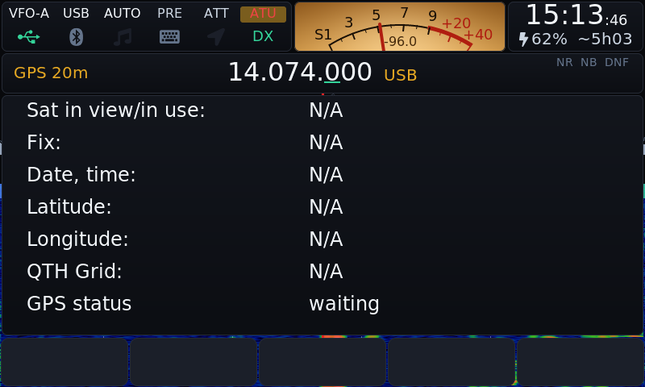
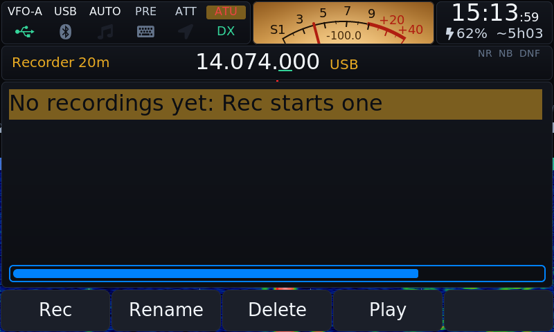
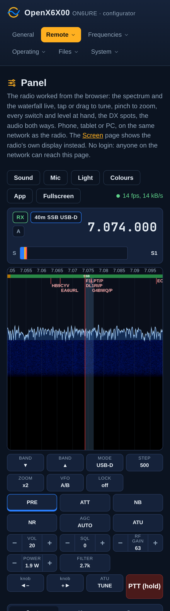
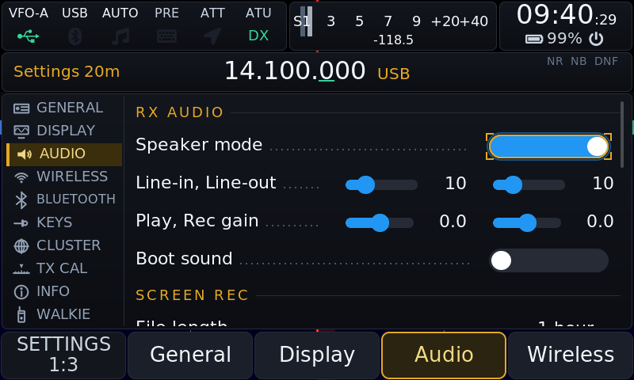
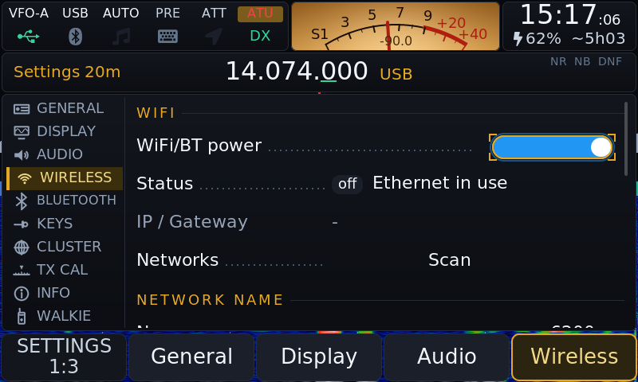
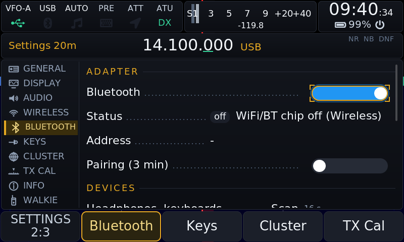
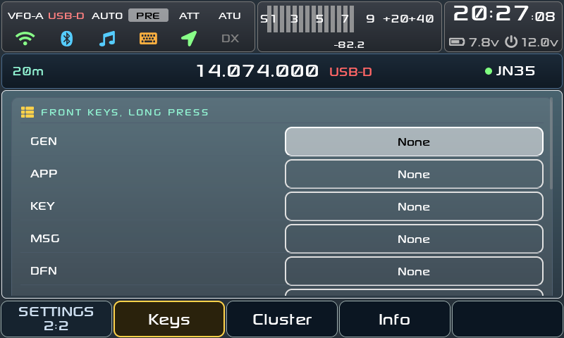
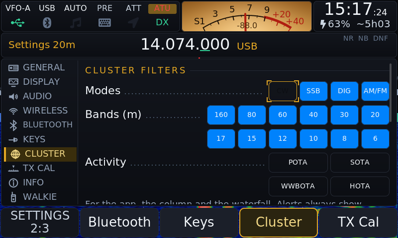
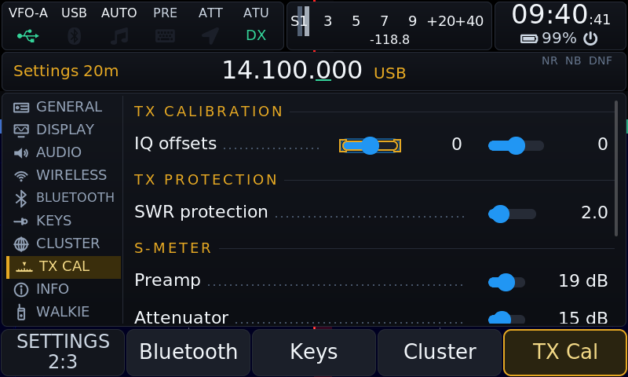
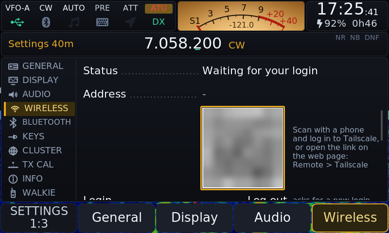

# OpenX6X00 by RF.Guru

**Website: [openx6x00.org](https://openx6x00.org/)**

Open firmware for the **Xiegu X6100** and **X6200**: a complete microSD image
with every digital mode decoded on the radio itself, and sent where the mode
transmits; the DX cluster on the waterfall; portable activations (SOTA, POTA,
WWBOTA, HOTA, WWFF, TOTA, WCA, MOTA, lighthouses, Tiles) with big outdoor tiles;
themes; Bluetooth headphones and CAT; the radio worked from a browser, as a
panel of its own or with its own screen live; a web configurator; an update
from inside the radio; and a **TCI server** so the
[VFO-Knob](https://github.com/Guru-RF/VFO-Knob) and other TCI clients tune,
hear and key the radio over the network. In the RF.Guru identity: near-black
surfaces, gold for what is on, electric blue as the second accent.


*An X6200 on 20 m during the CQ WW SSB weekend: the spectrum, the band plan
strip and the cluster's calls at the top of the waterfall, FT8 at the marker,
the needle S-meter.*

[Install](#install) · [Updating](#updating) · [Screenshots](#screenshots) ·
[Manual](docs/MANUAL.md) · [Releases](https://github.com/Guru-RF/OpenX6X00/releases) ·
[openx6x00.org](https://openx6x00.org/)

## Reporting a problem

Open a [bug report](https://github.com/Guru-RF/OpenX6X00/issues/new?template=bug.yml),
one problem per issue, after a look at the
[open issues](https://github.com/Guru-RF/OpenX6X00/issues). Its form asks for
these; please give:

1. **The radio**: X6100 or X6200.
2. **The versions**, from Settings > Info: the OpenX6X00 version and the
   **Baseband** version (see [The baseband](#the-baseband) below). Say
   whether the card was written from an image or updated in the radio, and
   from which version.
3. **What happened**: what you did, what you expected and what you got. Give
   the mode, the band or frequency, the power setting and the menu you were
   in. A photo of the screen helps, above all of a message or of the TX
   panel.
4. **Power and antenna**: an external supply or the battery; an antenna, a
   tuner or a dummy load. For a transmit problem, give what the TX panel shows
   (PWR, SWR, ALC), and what an external wattmeter shows if you have one.
5. **The logs**, from the card's DATA partition: attach the newest files of
   the `app_logs` folder, from the card in a PC or from the web configurator's
   Files page. Each run of the radio software leaves one `x6100_log_*.txt`.
   From v0.3.4 a power-off with the POWER key saves the running one too, so
   switch off right after the problem.
6. **WiFi**: from v0.3.4 a failed join writes `app_logs/wifi.txt`, with no
   password in it. Add the exact message on the screen, the router's security
   (WPA2, WPA2/WPA3, WPA3 only), its 2.4 GHz channel, and whether a phone
   hotspot works.
7. **Audio and Bluetooth**: what you heard (the received audio or your own
   transmission), and the volume, mute and headphone settings.

## Requesting a feature

Open a [feature request](https://github.com/Guru-RF/OpenX6X00/issues/new?template=feature.yml)
whose title starts with **Feature:** and names it in a few words
(`Feature: Winlink over HF`), one feature per issue. Look at the open ones
first: if the feature is there, add what you would use it for to that issue.
Please give:

1. **The radio**: X6100, X6200 or both, and the OpenX6X00 version you run
   (Settings > Info).
2. **What you want to do**: the operating it is for (an activation, a
   contest, a remote station, a digital mode), not only the feature: "log a
   Tiles activation from the GPS" says more than "add Tiles".
3. **How you do it today**: on the radio, with a program on a PC, a phone app
   or another firmware, and what is missing or awkward about it.
4. **Where it would live**: an app under APP, a Settings tab, Field Ops, the
   web configurator, the Panel or Screen page, TCI; what you would press and
   what you would see. A sketch, or a screenshot of another program that does
   it, helps.
5. **What it depends on**: a programme, a service, a protocol or a device,
   with a link to its rules, its API or its specification, and whether it
   needs an account or a key.
6. **How you can help**: testing it on your radio, a pull request, the
   documentation.

The form asks for each of these, and labels the issue **enhancement**. One
feature per issue lets each be answered, built and closed on its own.

## The baseband

Each radio runs two firmwares. OpenX6X00 is the Linux side, on the card. The
**baseband** is the firmware of the radio board (DSP, RF, power, keyer), from
Xiegu. OpenX6X00 talks to it and never changes it. Settings > Info > Baseband
shows its version.

**X6100**

| Baseband | What it is | With OpenX6X00 |
|---|---|---|
| V1.1.8 (240915003) | Xiegu's base on most radios since late 2024 | Works. The bench X6100 runs it. |
| V1.1.9 (251127001) | Xiegu's newer base. Some radios carry it, not yet flashed, on their internal memory. | Should work: OpenX6X00 uses its zoom and IF shift, as the upstream GUI did. Not yet run on the bench. |
| [x6100_base_patch](https://github.com/gdyuldin/x6100_base_patch) r13 | gdyuldin's patched base, built on V1.1.6 | Works. It adds the TX audio and calibration options (compressor shape, band output gain, TX filter, CESSB, FM emphasis) and a battery percentage from a measured discharge curve. On a radio that shipped with V1.1.8 we saw its power about 10 % high at 5 W and 20 % high at 10 W before calibration, next to no power on the first transmission after a band change (on 6 m nearly always, on other bands now and then), and the external voltage read as 0 V ([TODO.md](TODO.md)). |

The settings that need a newer base are hidden when the base is too old.

**X6200**

| Baseband | What it is | With OpenX6X00 |
|---|---|---|
| 1.0.7 | Xiegu's base | Works. |
| 1.0.8 (August 2026) | Fixes the CW keyer speed and an S-meter stuck at -255 dBm, adds CW macros | Works. The bench X6200 runs it. |

The X6200's settings show only what its base can do. OpenX6X00 v0.3.1 to
v0.3.3 lose the transmit power about a second into a transmission on the
X6200, on both bases (issues #1 and #8). v0.3.4 fixes it: tested into a dummy
load on 1.0.7 and 1.0.8.

**Updating the baseband**: with Xiegu's own system, which stays on the radio's
internal memory when OpenX6X00 runs from the card.

1. Run the radio from a 13.8 V supply (3 A or more) with the battery out, for
   the whole update.
2. Write Xiegu's update image for your radio (from
   [xiegu.eu](https://xiegu.eu/downloads/), for example
   `x6200udimg-260820001.zip` for the X6200's 1.0.8) to a spare microSD card,
   not the OpenX6X00 one. Boot the radio from it: it writes Xiegu's system to
   the internal memory in about a minute, then switches off.
3. Take the card out and switch on: Xiegu's system starts. System Setting >
   Firmware Upgrade, choose the new file (`x6200_mcu_20260820141208.xgf` for
   the X6200's 1.0.8), UPGRADE, wait for 100 %, QUIT. Then Factory Reset, which
   clears Xiegu's settings only.
4. Switch off, put the OpenX6X00 card back and switch on. OpenX6X00 keeps its
   settings on its card.

Xiegu's tutorial:
[X6200 firmware upgrade](https://xiegu.eu/wp-content/uploads/sites/4/2024/07/X6200FirmwareUpgradeTutorialWS-JSZL-2407-01ENRevised.pdf).
The patched X6100 base comes with its own instructions.

## What it does

| | |
|---|---|
| **Digital modes** | FT8, FT4 and FT2 (CQ, reply, auto sequence, Hound, POTA tag, ADIF log), JS8 (JS8Call compatible, all four speeds at once, inbox, relays, heartbeats, APRS), WSPR (decode and beacon, WSPRnet upload), PSK31, PSK63, Olivia, JTTY, RTTY, SSTV (receive with VIS, transmit with templates, denoise), WeFax, and NavTex with DSC (receive only). FT8, FT4, FT2, JS8, PSK, Olivia and JTTY decodes go to PSK Reporter (on by default), and the FT8 app sends WSJT-X UDP for GridTracker and loggers. No PC, no sound card cable: APP > Modes. |
| **CW** | A decoder that copies down to about 0 dB SNR with Parse splitting run-together words, CW as you type (a line on the main screen from a USB or Bluetooth keyboard, and the [CW Keyboard](docs/MANUAL.md#cw-keyboard) app, APP > CW Keyboard, with one or with the on-screen keyboard) with a send queue and Live mode that keys each letter as it is typed, messages with `{CALL}` and `{HIS}`, USB and Bluetooth paddles, a CW trainer. |
| **DX Cluster** | Spots on the waterfall, in a column beside it and in a full app that follows the VFO; filters by mode, band, activity (POTA, SOTA, WWBOTA, HOTA) and the spotter's country (only the spots heard in PA and ON, say), alerts on calls and prefixes, spot snap when turning slowly; fifteen public servers built in, DXFUN by default. One login, a Link switch, and a login of its own if you set one (your call with `-2`, on the web Cluster page) so a logger can use the call at the same time. |
| **Field Ops** | A second interface for SOTA, POTA, WWBOTA, HOTA, WWFF, TOTA, WCA, MOTA and lighthouse (LH, ARLHS) activations with big tiles for gloves: the summit or park found from the GPS or the locator, the references of the whole world offline after one Update list with internet, CQ, a log straight to ADIF with the references, self-spots to pota.app, wwbota.org, cqhota.app and the WWFF Spotline (the last two with your own key) and to the DX cluster (the only spot for SOTA, TOTA, WCA, MOTA and LH), QRZ Logbook upload. Tiles on the Air: the 6-character locator square you are in, from the GPS, with the eight around it. |
| **Wavelog** | Every QSO the radio logs, in every mode, goes to your own [Wavelog](https://github.com/wavelog/wavelog) a few seconds later: a queue on the SD card while there is no network, the station profile chosen by the radio's callsign (DF8MH, DF8MH/P), the result on the display. |
| **Winlink** | In the next release: Winlink email over HF from the radio alone, no computer and no internet: [Pat](https://getpat.io) is the mail program, its mailbox a web page on a phone or a laptop, and ARDOP the modem, through the radio's own audio. When Pat calls a gateway the radio tunes there in USB-D and keys itself. Turned on in the web configurator, Operating > Winlink, with your callsign, locator and Winlink password ([manual](docs/MANUAL.md#winlink)). |
| **Bands** | A live picture of 160 to 6 m from the cluster and the Reverse Beacon Network, and a test beacon that shows who hears you from your own antenna. |
| **Radio** | IARU Region 1 band plan strip (60 m too, and a strip for each band you add), 60 m on the band keys, which step over a band the radio cannot tune (4 m), a TX shift per band for FM repeaters and a QO-100 IF (split kept by itself, REV on the VFO key), Birdie Cal (the radio's own carriers found, marked, notched), S-meter in bars or a needle, long-press actions on every key, editable bands, memories and channels, the broadcast bands in AM, transverters, RX recorder, screen recording and screenshots, voice messages, SWR scan, Walkie Talkie portrait mode, PRE and ATT on the VOL 2:2 page, local time on screen with UTC in the logs. |
| **X6200** | SAM and WFM on the AM key, zoom 1 to 4 over the base's 384 kHz, the two-ring MFK, FM broadcast (87.5-108 MHz) and the airband (118-137 MHz) to receive after 6 m on the band keys, a WR12 switch for Xiegu's 54 MHz-1 GHz receiver on the HOST port (2 m and 70 cm to receive; not yet tried with a WR12, [manual](docs/MANUAL.md#wr12-receiver-x6200)), transverters off by default (they put 2 m on 10 m), PRE and ATT on the VOL 2:2 page since it has no PRE key, the volume over the base's whole range (0 to 100). |
| **Screen** | DRM/KMS output with the GUI on a transparent layer over a waterfall drawn one line at a time, about half the CPU of the old path; a main knob with every detent timed in its own thread and acceleration that grows with the speed. |
| **Themes** | Every colour, corner, font and waterfall palette comes from the theme. RF.Guru, Classic, Outdoor, Outdoor-Negative, VISION, Black Metal and Total Black come with the image; Holo and Material 3 are in [themes/](themes) to copy to the card; your own go on the card too ([docs/THEMES.md](docs/THEMES.md)). |
| **Wireless** | WiFi (a failed join says why on the screen), a USB Ethernet adapter with DHCP or a fixed address, USB tethering, a network name of your own; Bluetooth CAT for three clients, headphones and keyboards with pairings that survive a new image. |
| **Browser panel** | `http://x6100.local/panel` (`x6200.local` on an X6200): the radio worked natively from a phone, a tablet or a PC, portrait or landscape: the spectrum and the waterfall live (tap or drag to tune, pinch to zoom), the frequency, band, mode, step and zoom, every switch and level, the S-meter, the DX spots (tap to tune), the FT8 app (decodes, tap to answer, CQ, auto, hold), the CW decoder's text, a log entry, RX audio and the browser's microphone for TX, a light theme for the sun. What the closed phone app does, as a web page. |
| **Browser remote** | `http://x6100.local/remote` (Remote > Screen in the web menu): the radio's screen live in any browser (up to three browsers at a time, the Panel and Screen pages together), every key and knob, RX audio and the browser's microphone for TX, a Picture choice (Sharp, Balanced, Fast) for a slow link, for the radio's own menus and apps. |
| **Remote station** | A browser watches until it is paired with a six-digit code from the radio; one holds the control at a time (a browser, a TCI client or the radio itself). Sound and Mic go over the TCI server; the microphone needs the https page. A key pressed without the control offers Take control, and Speaker always off (Settings > Audio) keeps the speaker silent. |
| **Tailscale** | The radio on your own tailnet, so a laptop or a phone with Tailscale reaches it from anywhere (the configurator, the Panel and Screen pages, TCI) with nothing opened on the router. Turned on in Settings > Wireless or Remote > Tailscale; the login is a code on the radio's screen or a link on the web page. Tailscale's own build is downloaded once (37 MB) and checked against a pinned checksum ([manual](docs/MANUAL.md#tailscale)). |
| **Web configurator** | `http://x6100.local/` (mDNS, `x6200.local` on an X6200, or the radio's IP): bands, digital frequencies, memories, cluster, Field Ops, Wavelog, CW messages, macros, logs, files, a gallery, backup and restore, display, time, network name, Ethernet, TCI, the SSH keys (SSH takes keys only, no password), the update. No login; pages from other sites are refused. |
| **TCI server** | The VFO-Knob and any TCI client on the network: tune, mode, filter, AGC, PTT, the meters and the audio both ways; the clients may be set to Listen only, all of them together. |

## Screenshots

Taken on 25 October 2026 on an X6200 (base 1.0.8) on an antenna, during the
CQ WW SSB weekend: the signals, decodes and spots are real. The X6100 runs
the same GUI. How they are taken: [docs/screenshots](docs/screenshots/README.md).

### On the air

| | |
|---|---|
|  **APP**: the apps and tools, each with a line on what it does |  **[DX Cluster](docs/MANUAL.md#dx-cluster)** on 20 m: 85 spots, the list following the VFO |
|  **[Bands](docs/MANUAL.md#bands)**: 160 to 6 m from the cluster and the RBN, the best band framed |  **[Channels](docs/MANUAL.md#channels)**: NavTex, VOLMET and the DWD weather stations |

### Digital modes

| | |
|---|---|
|  **[APP > Modes](docs/MANUAL.md#digital-modes)**: thirteen modes, from RTTY to NavTex |  **FT8** on 20 m: decodes with country, flag and SNR, CQ calls marked |
|  **JS8** on 40 m: two QSOs in the receive log |  **RTTY**: the DWD marine forecast on 10.1008 MHz, with the XY tuning scope |

### Portable

| | |
|---|---|
|  **[Field Ops](docs/MANUAL.md#field-ops-sota--pota)**: one big tile per programme |  **Field Ops logbook**, ready for an activation |
| <br>**[Walkie Talkie](docs/MANUAL.md#walkie-talkie-mode)**: the radio held upright |  **GPS**, with no receiver plugged in here: a USB GPS gives Field Ops the position and the locator |

### Radio tools

| | |
|---|---|
|  **[CW Trainer](docs/MANUAL.md#cw-trainer)**: Koch's method, keyed back with the paddle |  **[Birdie Cal](docs/MANUAL.md#birdie-cal)**: finds the radio's own carriers to mark and notch them |
|  **SWR Scan** around the VFO, 50 to 500 kHz wide (it transmits, so not run here) |  **RX Recorder**: record, rename and play back |

### In the browser

| | |
|---|---|
|  |  |
| **[Browser panel](docs/MANUAL.md#browser-panel)** on a desktop, with the spots | The same panel on a phone |


**[Browser remote](docs/MANUAL.md#browser-remote)**: the radio's own screen
live, its keys and knobs, Sound, Mic and the Picture choice.

### Settings

| | |
|---|---|
|  **[Settings](docs/MANUAL.md#settings) > General**: the station, the ten tabs down the left |  **General**: the TCI server and the browser remote |
|  **Display**: backlight and screen off |  **Audio**: Speaker always off |

<details>
<summary>More Settings tabs</summary>

| | |
|---|---|
|  **Wireless**: WiFi, with Ethernet in use |  **Wireless**: the network name |
|  **Bluetooth**: the adapter, pairing and devices |  **Keys**: the long-press actions |
|  **Cluster**: the spot filters |  **TX Cal**: SWR protection and the S-meter |

</details>

## Install

1. Download the image for your radio from the
   [latest release](https://github.com/Guru-RF/OpenX6X00/releases/latest):
   `OpenX6X00-x6100-v<version>-sdcard.img.zip` for the X6100,
   `OpenX6X00-x6200-v<version>-sdcard.img.zip` for the X6200.
2. Write the image to a microSD card (a branded one, 8-32 GB) with
   [balenaEtcher](https://etcher.balena.io/): select the `.img.zip` as it is and
   let it verify what it wrote. Rufus works too, but does not verify. If
   Windows then offers to format the card, choose Cancel.
3. Put the card in the radio and switch on, the first time on external power:
   press POWER briefly and give it a minute (the screen stays dark for the
   first seconds). Settings and logs live on the card's DATA partition (`/mnt`).

## Updating


After the first install the radio updates itself: Settings > Info > Update
(or System > Update on the web page) fetches the latest release's bundle for
its model from GitHub, checks its signature, installs it and restarts the
radio software, keeping the previous version for an automatic rollback if the
new one does not come up.

A new card image is needed only when the kernel, a driver, U-Boot or a system
package changes. From v0.3.4 the radio says so: Check shows when a release
also has a new card image for that radio and what it brings, and Settings >
Info > Update keeps saying it until the new image is on the card. The update
installs everything else meanwhile.

A new image normally keeps DATA: the image is smaller than the card, so the
DATA filesystem stays where it was and the first start adopts it again, and
takes back the WiFi networks and the SSH keys that v0.3.4 and later save there
at every clean power-off. Download the Backup from the web configurator first
all the same (the [manual](docs/MANUAL.md#web-configurator) says what it
holds); a card-wiping tool or a smaller card would lose it. For the
baseband versions and how to update them, see [The baseband](#the-baseband).

<br clear="right">

## Tailscale



Reach the radio from anywhere, with nothing opened on your router: Tailscale
puts it on your own private network, your tailnet. With Tailscale on a laptop
or a phone, the web configurator, the Panel and Screen pages and TCI work as
they do at home, also behind a mobile or satellite connection.

1. On the radio: Settings > Wireless > TAILSCALE, or Remote > Tailscale on the
   web configurator. The radio needs the internet.
2. The first time, it downloads Tailscale from Tailscale's own site (37 MB) and
   checks it against the checksum that comes with OpenX6X00.
3. Log in: scan the code on the radio's screen with a phone, or press Log in to
   Tailscale on the web page. A free Personal account will do.
4. From the laptop or the phone, with Tailscale on: `http://<the radio's name>/`,
   with `/panel` and `/remote` after it, and TCI on port 50001.

Everyone on your tailnet reaches the radio as if they were at home, and the web
configurator has no login: share the radio only with people you would let in.
Tailscale runs in userspace mode, its log upload is off, and the login stays on
the radio. More in the [manual](docs/MANUAL.md#tailscale).

## Where it comes from

OpenX6X00 is a fork of the last fully open-source release of the X6100
firmware by Giovanni Ricciardi IU1WXY, v0.127 of 17 October 2026, which was
published under the LGPL-2.1-or-later. That firmware stands on the R1CBU GUI by
Oleg Belousov R1CBU and Georgy Dyuldin R2RFE
([gdyuldin/x6100_gui](https://github.com/gdyuldin/x6100_gui)) and on the
decoders of 1KO125 by Hany El Imam. From v0.128 the IU1WXY firmware went closed;
this project continues the open line. The X6200 runs the same GUI on Aether
Radio's X6200 control library by gdyuldin. The GUI stays LGPL-2.1-or-later,
the JS8, WSPR, JTTY and PSK Reporter parts are GPL-3, so the image as a whole is GPLv3,
exactly as before. The copyright notices of every author stay in the files.

### What changed from the fork

Removed, so that nothing on the radio talks to a server of its own:

- the X6100 Link phone app and its remote API: the `/link/v2` routes, the
  Link's Remote page, the GUI's remote socket with its spectrum, audio and
  event streams, and the phone voice PTT on UDP 50010;
- the wfview (Icom LAN) server;
- the x6100-link.it update channel: its update without the microSD, signed
  packages, update alert, remote updates and Settings Update tab;
- the diagnostics upload, the site ping and every other telemetry;
- the private tests and tools.

Added:

- the **X6200**, the same GUI behind a backend of its own
  (`src/hw/x6200/hw_x6200.c`);
- a **TCI v2.0 server** (Expert Electronics' protocol, as AetherSDR serves
  it) over a WebSocket on port 50001, on by default on whatever network the
  radio is on, WiFi or Ethernet: Settings > General > TCI SERVER on the radio,
  System > TCI on the web page. It carries `vfo`, `modulation`,
  `rx_filter_band`, `agc_mode`, RIT, `drive`, `trx` (PTT, with `,tci` for the
  client's audio as the microphone), the S-meter and the TX meters, the RX
  audio stream (int16 mono, 24 kHz) and the TX audio frames. No login: set
  Clients to Listen only, or turn it off, on a network you don't trust (the
  browser pages' Sound and Mic go over it). Config in `/mnt/tci.conf`
  (`enabled=0|1`, `port=50001`, `trust=operate|view`);
- the **browser panel and remote**, local only, on the radio's own WebSocket
  (port 50002, no outside server), with pairing and one control holder, in
  place of the Link's;
- a **signed update from GitHub Releases**, with rollback and the card-image
  notice, in place of the x6100-link.it channel;
- the TOTA, WCA, MOTA, lighthouse and Tiles programmes in Field Ops, and the
  network name (mDNS);
- the RF.Guru default theme and the OpenX6X00 boot logo;
- a local configurator socket (`/tmp/x6100_cfg.sock`) for the web pages that
  set the display and the Ethernet port, in place of the remote socket;
- **SSH with keys only**: every radio had the same root password, so password
  logins are off. Add your computer's public key on the web configurator,
  System > SSH (`ssh-keygen -t ed25519` makes one; paste the line of
  `~/.ssh/id_ed25519.pub`), then `ssh root@x6100.local`
  ([manual](docs/MANUAL.md#ssh)).

## Build

The images are built by
[AetherX6100Buildroot](https://github.com/gdyuldin/AetherX6100Buildroot) and
[AetherX6200Buildroot](https://github.com/gdyuldin/AetherX6200Buildroot), with
this repository as their GUI package. `buildroot/local-build.sh` patches the
buildroot tree (local GUI and web server, `boost` and `fftw-single` for JS8,
no RHVoice, the boot logo), builds it and makes the update bundle. The GitHub
Actions workflow (`.github/workflows/main.yml`, *Build image*, run by hand,
about two hours, both radios side by side) runs that script and uploads
`OpenX6X00-x6100-<ref>-sdcard.img.zip` and `OpenX6X00-x6200-<ref>-sdcard.img.zip`
with their bundles as workflow artifacts; run on a tag, it also attaches them
to that release (the releases since v0.2.2 were built locally and their files
attached by hand). Locally, the same build runs in a container: clone the
buildroot tree with its submodule (`git clone --recurse-submodules
https://github.com/gdyuldin/AetherX6100Buildroot`) next to this repository
(itself cloned with `--recurse-submodules`), then, from this repository's
folder,

```
docker build -t openx6x00-build buildroot
docker run --rm -u $(id -u):$(id -g) -e HOME=/work/.brhome -v $(dirname $PWD):/work \
    openx6x00-build bash /work/OpenX6X00/buildroot/local-build.sh
```

leaves `../AetherX6100Buildroot/build/images/OpenX6X00-x6100-local-sdcard.img` (about
an hour the first time, 20 cores; `buildroot/local-build.sh` has the patch
steps, `buildroot/Dockerfile` the Ubuntu 22.04 host with CMake 3.28 and
sqlite3). The X6200 is the same GUI on its own buildroot tree,
[AetherX6200Buildroot](https://github.com/gdyuldin/AetherX6200Buildroot)
cloned next to this repository: the same command with `-e MODEL=x6200` leaves
`../AetherX6200Buildroot/build/images/OpenX6X00-x6200-local-sdcard.img` and the
`OpenX6X00-x6200-v<version>-update.tar.gz` bundle (the updater on a radio takes
only its own model's bundle). The radio's backend is `src/hw/x6200/hw_x6200.c`
behind `src/hw/hw.h`, chosen with `cmake -DHW_BACKEND=x6200`.

With the X6100 buildroot tree already built, `buildroot/build.sh` rebuilds the
GUI alone with its toolchain (for the X6200, point `buildroot/conf.sh` at its
tree and add `-DHW_BACKEND=x6200` to the options in `buildroot/build.sh`)
([docs/UPSTREAM_README.md](docs/UPSTREAM_README.md), [manual, Build](docs/MANUAL.md#build)).
On a PC, `host/build.sh` builds the GUI in an SDL window on a stub radio
([host/README.md](host/README.md)).

## Layout

```
src/                     the GUI (x6100_gui): main screen, apps, settings, decoders, TCI server
  hw/                    the radio behind hw.h: x6100, x6200 and a stub for the PC
  cfg/ params/           the settings (SQLite params.db) and their C/C++ API
  ft8/ js8/ wspr/ sstv/ wefax/ navtex/ cw_decoder/ cluster/ field/ qth/
  fonts/ widgets/        LVGL fonts and custom widgets
third-party/             js8core (JS8Call's modem, GPL-3), wsprd (WSJT-X, GPL-3), cty.dat
lvgl/ lv_drivers/        LVGL 8.3 (gdyuldin's NEON fork, a submodule) and its drivers
webserver/               the web configurator (Python, bottle)
rootfs/                  init scripts, helper scripts (x6100-update, x6100-field, x6100-pota-spots,
                         x6100-broadcast-update, x6100-hostname, x6100-tailscale, x6100-wifilog,
                         btcat-ctl, btaudio-ctl), data files
btcat/ bootanim/         Bluetooth CAT bridge, boot animation
boot/ u-boot/            boot logo, the U-Boot binary written over buildroot's (X6100 image)
sql/                     the default params.db
themes/                  the Holo and Material 3 JSON themes to copy by hand; make_rs.py, an
                         RS-BA1 look cut from a screenshot (personal use, not installed)
buildroot/               local-build.sh and Dockerfile (the image), br2_external/ and x6200/
                         (what it adds to and patches in the buildroot trees),
                         build.sh (the GUI alone with the buildroot toolchain)
host/                    the GUI on a PC (SDL, stub radio)
tools/                   screenshots/ (drive.py, grab.py, pull.py), update/ (the bundle),
                         tci/ (the TCI server's host test), icons/ and logo/
assets/                  the logo's fonts and marks
docs/                    MANUAL.md, THEMES.md, MENUS.md, UPSTREAM_README.md, audit/,
                         screenshots/ (taken by script on an X6200)
```

## Documentation

- [Manual](docs/MANUAL.md): every app and setting, the web pages, the TCI
  server, CAT commands, files, building.
- [Themes](docs/THEMES.md): make your own.
- [Menus](docs/MENUS.md): the icon grids, and how to get the text menus back.
- [Screenshots](docs/screenshots/README.md): how they are taken.
- [The TCI server's host test](tools/tci/README.md) and the [PC build](host/README.md).

## Licences

The GUI is LGPL-2.1-or-later ([LICENSE](LICENSE)); js8core and wsprd
(vendored), the JS8 and WSPR code (`src/js8`, `src/js8_window.c`, `src/wspr`,
`src/dialog_wspr.c`), JTTY (ported from WSJT-X by K1JT and the WSJT-X team,
`src/jtty*`, `src/dialog_jtty.c`) and the PSK Reporter upload
(`src/pskreporter.c`) are GPLv3, so the firmware image is GPLv3. The web
server is LGPL-2.1 ([webserver/LICENSE](webserver/LICENSE)). Every file keeps
the copyright notice of its authors.

## Credits

Oleg Belousov R1CBU and Georgy Dyuldin R2RFE wrote the R1CBU GUI this firmware
stands on (CW receiver, CW tune indicator, DRM/KMS output, direct spectrum
rendering, the main knob handling); Rui Oliveira CT7ALW and R1CBU Aether
Radio's X6100 control library, which Georgy Dyuldin (gdyuldin) carries on and
made the X6200's from, with the X6200 GUI our X6200 port follows; Giovanni Ricciardi IU1WXY the rewrite of the GUI, the theme system,
Field Ops, Bands, the DX cluster, WSPR, SSTV TX, RTTY, WeFax TX, the CW
keyboard, the Bluetooth work and the layer system; Hany El Imam (1KO125) the
WeFax, NavTex and SSTV decoders; Jordan Sherer KN4CRD and the JS8Call
contributors the JS8 engine; K1JT and K9AN wsprd (made a library by VA2GKA);
K1JT and the WSJT-X team JTTY; SP2KMO the Bluetooth tab, PSK31, PSK63 and
Olivia, the WSJT-X UDP output, the FT8 country and distance, and FT2
(IU8LMC's mode); randal007 the PSK and Olivia merge, the Bluetooth scan and
recovery, the JS8 map, the high-SWR guard and the digital-mode drive level;
2E0JFS the Black Metal and Total Black themes. Libraries: LVGL, cJSON, FFTW,
liquid-dsp, ft8_lib, libpng, Boost, Eigen, CRCpp, bottle, jQuery, mp4-muxer,
PulseAudio, BlueZ. The country list is AD1C's cty.dat. Fonts:
Roboto, DejaVu, Arial, Sony Sketch, Inter (the boot logo). The skimmer spots
come from the Reverse Beacon Network and the broadcast schedule from the EiBi
list by Eike Bierwirth. The Field Ops reference lists come from POTA, SOTA,
WWBOTA, cqhota.app, WWFF, TOTA (OK2IH, wwtota.com), the WCA castle list as
ON4VT keeps it, and GMA (gma.rocks) for the mills and the lighthouses.
OpenX6X00 is maintained by RF.Guru (Joeri Van Dooren ON6URE).
