# OpenX6X00 by RF.Guru

Open firmware for the **Xiegu X6100** and **X6200**: a complete microSD image with every
digital mode decoded and sent on the radio itself, the DX cluster on the
waterfall, portable activations (SOTA, POTA, WWBOTA, HOTA, WWFF, TOTA, WCA,
MOTA, lighthouses) with big outdoor tiles, themes, Bluetooth
headphones and CAT, a web configurator, and a **TCI server** so the
[VFO-Knob](https://github.com/Guru-RF/VFO-Knob) and other TCI clients tune,
hear and key the radio over the network. In the RF.Guru identity: near-black
surfaces, gold for what is on, electric blue as the second accent.

## Reporting a problem

Open an [issue](https://github.com/Guru-RF/OpenX6X00/issues), one problem per
issue, after a look at the open ones. Please give:

1. **The radio**: X6100 or X6200.
2. **The versions**, from Settings > Info: the OpenX6X00 version and the
   **Baseband** version (see [The baseband](#the-baseband) below). Say
   whether the card was written from an image or updated in the radio, and
   from which version.
3. **What happened**: what you did, what you expected and what you got. Give
   the mode, the band or frequency, the power setting and the menu you were
   in. A photo of the screen helps, above all of a message or of the TX
   panel.
4. **Power and antenna**: an external supply or the battery; an antenna, a
   tuner or a dummy load. For a transmit problem, give what the TX panel shows
   (PWR, SWR, ALC), and what an external wattmeter shows if you have one.
5. **The logs**, from the card's DATA partition: put the card in a PC and
   attach the newest files of the `app_logs` folder. Each run of the radio
   software leaves one `x6100_log_*.txt`. From v0.3.4 a power-off with the
   POWER key saves the running one too, so switch off right after the problem.
6. **WiFi**: from v0.3.4 a failed join writes `app_logs/wifi.txt`, with no
   password in it. Add the exact message on the screen, the router's security
   (WPA2, WPA2/WPA3, WPA3 only), its 2.4 GHz channel, and whether a phone
   hotspot works.
7. **Audio and Bluetooth**: what you heard (the received audio or your own
   transmission), and the volume, mute and headphone settings.

## The baseband

Each radio runs two firmwares. OpenX6X00 is the Linux side, on the card. The
**baseband** is the firmware of the radio board (DSP, RF, power, keyer), from
Xiegu. OpenX6X00 talks to it and never changes it. Settings > Info > Baseband
shows its version.

**X6100**

| Baseband | What it is | With OpenX6X00 |
|---|---|---|
| V1.1.8 (240915003) | Xiegu's base on most radios since late 2024 | Works. The bench X6100 runs it. |
| V1.1.9 (251127001) | Xiegu's newer base. Some radios carry it, not yet flashed, on their internal memory. | Works, and OpenX6X00 also uses its zoom and IF shift. |
| [x6100_base_patch](https://github.com/gdyuldin/x6100_base_patch) r13 | gdyuldin's patched base, built on V1.1.6 | Works. It adds the TX audio and calibration options (compressor shape, band output gain, TX filter, CESSB, FM emphasis) and a battery percentage from a measured discharge curve. On a radio that shipped with V1.1.8 we saw its power about 10 % high before calibration, now and then next to no power on the first transmission after a band change, and the external voltage read as 0 V ([TODO.md](TODO.md)). |

The settings that need a newer base are hidden when the base is too old.

**X6200**

| Baseband | What it is | With OpenX6X00 |
|---|---|---|
| 1.0.7 (January 2026) | Xiegu's base | Works. |
| 1.0.8 (August 2026) | Fixes the CW keyer speed and an S-meter stuck at -255 dBm, adds CW macros | Works. |

OpenX6X00 v0.3.0 to v0.3.3 lose the transmit power about a second into a
transmission on the X6200, on both bases (issues #1 and #8). v0.3.4 fixes it:
tested into a dummy load on 1.0.7 and 1.0.8.

**Updating the baseband**: with Xiegu's own system, which stays on the radio's
internal memory when OpenX6X00 runs from the card.

1. Run the radio from a 13.8 V supply (3 A or more) with the battery out, for
   the whole update.
2. Write Xiegu's update image for your radio (from
   [xiegu.eu](https://xiegu.eu/downloads/), for example
   `x6200udimg-260820001.zip` for the X6200's 1.0.8) to a spare microSD card,
   not the OpenX6X00 one. Boot the radio from it: it writes Xiegu's system to
   the internal memory in about a minute, then switches off.
3. Take the card out and switch on: Xiegu's system starts. System Setting >
   Firmware Upgrade, choose the new file (`x6200_mcu_20260820141208.xgf` for
   the X6200's 1.0.8), UPGRADE, wait for 100 %, QUIT. Then Factory Reset, which
   clears Xiegu's settings only.
4. Switch off, put the OpenX6X00 card back and switch on. OpenX6X00 keeps its
   settings on its card.

Xiegu's tutorial:
[X6200 firmware upgrade](http://xiegu.eu/wp-content/uploads/sites/4/2024/07/X6200FirmwareUpgradeTutorialWS-JSZL-2407-01ENRevised.pdf).
The patched X6100 base comes with its own instructions.

## Where it comes from

OpenX6X00 is a fork of the last fully open-source release of the X6100
firmware by Giovanni Ricciardi IU1WXY, v0.127 of 17 October 2026, which was
published under the LGPL-2.1-or-later. That firmware stands on the R1CBU GUI by
Oleg Belousov R1CBU and Georgy Dyuldin R2RFE
([gdyuldin/x6100_gui](https://github.com/gdyuldin/x6100_gui)) and on the
decoders of 1KO125 by Hany El Imam. From v0.128 the IU1WXY firmware went closed;
this project continues the open line. The GUI stays LGPL-2.1-or-later, the JS8,
WSPR and JTTY parts are GPL-3, so the image as a whole is GPLv3, exactly as
before. The copyright notices of every author stay in the files.

## What changed from the fork

Removed, so that nothing on the radio talks to a server of its own:

- the X6100 Link phone app and its remote API: the `/link/v2` routes, the
  web Remote page, the GUI's remote socket with its spectrum, audio and event
  streams, and the phone voice PTT on UDP 50010;
- the wfview (Icom LAN) server;
- the x6100-link.it update channel: the update without the microSD, the
  signed packages, the update alert, the remote updates and the Settings
  Update tab;
- the diagnostics upload, the site ping and every other telemetry;
- the private tests and tools.

Added:

- a **TCI v2.0 server** (Expert Electronics' protocol, as AetherSDR serves
  it) over a WebSocket on port 50001, on by default on whatever network the
  radio is on, WiFi or Ethernet: Settings > General > TCI SERVER on the radio,
  System > TCI on the web page. It carries `vfo`,
  `modulation`, `rx_filter_band`, `agc_mode`, RIT, `drive`, `trx` (PTT, with
  `,tci` for the client's audio as the microphone), the S-meter and the TX
  meters, the RX audio stream (int16 mono, 24 kHz) and the TX audio frames.
  No login: turn it off on a network you don't trust. Config in `/mnt/tci.conf`
  (`enabled=0|1`, `port=50001`);
- the RF.Guru default theme and the OpenX6X00 boot logo;
- a local configurator socket (`/tmp/x6100_cfg.sock`) for the web pages that
  set the display and the Ethernet port, in place of the remote socket.

## What it does

| | |
|---|---|
| **Digital modes** | FT8, FT4 and FT2 (CQ, reply, auto sequence, Hound, POTA tag, ADIF log), JS8 (JS8Call compatible, all four speeds at once, inbox, relays, heartbeats, APRS), WSPR (decode and beacon, WSPRnet upload), PSK31, PSK63, Olivia, JTTY, RTTY, SSTV (receive with VIS, transmit with templates, denoise), WeFax and NavTex. No PC, no sound card cable: APP > Modes. |
| **CW** | A decoder that copies down to about 0 dB SNR with Parse splitting run-together words, a CW keyboard with a send queue and Live mode, messages with `{CALL}` and `{HIS}`, USB and Bluetooth paddles, a CW trainer. |
| **DX Cluster** | Spots on the waterfall, in a column beside it and in a full app that follows the VFO; filters by mode, band and activity (POTA, SOTA, WWBOTA, HOTA), alerts on calls and prefixes, spot snap when turning slowly, ten public servers built in. |
| **Field Ops** | A second interface for SOTA, POTA, WWBOTA, HOTA, WWFF, TOTA, WCA, MOTA and lighthouse (LH, ARLHS) activations with big tiles for gloves: the summit or park found from the GPS or the locator, the references of the whole world offline, CQ, a log straight to ADIF with the references, self-spots to pota.app, wwbota.org, cqhota.app and the WWFF Spotline, QRZ Logbook upload. |
| **Bands** | A live picture of 160 to 6 m from the cluster and the Reverse Beacon Network, and a test beacon that shows who hears you from your own antenna. |
| **Radio** | IARU band plan strip, Birdie Cal (the radio's own carriers found, marked, notched), S-meter in bars or a needle, long-press actions on every key, editable bands, memories and channels, transverters, RX recorder, screen recording and screenshots, voice messages, SWR scan, Walkie Talkie portrait mode, local time on screen with UTC in the logs. |
| **Screen** | DRM/KMS output with the GUI on a transparent layer over a waterfall drawn one line at a time, about half the CPU of the old path; a main knob with every detent timed in its own thread and acceleration that grows with the speed. |
| **Themes** | Every colour, corner, font and waterfall palette comes from the theme; RF.Guru, Classic, Outdoor, Outdoor-Negative, VISION, Black Metal, Total Black, RS, Holo and Material 3 come with the image, your own go on the SD card ([docs/THEMES.md](docs/THEMES.md)). |
| **Wireless** | WiFi, a USB Ethernet adapter with DHCP or a fixed address, USB tethering; Bluetooth CAT for three clients, headphones and keyboards with pairings that survive a new image. |
| **Browser panel** | `http://x6100.local/panel`: the radio worked natively from a phone, a tablet or a PC, portrait or landscape: the spectrum and the waterfall live (tap or drag to tune, pinch to zoom), the frequency, band, mode, step and zoom, every switch and level, the S-meter, the DX spots (tap to tune), the FT8 app (decodes, tap to answer, CQ, auto, hold), the CW decoder's text, a log entry, RX audio and the browser's microphone for TX, a light theme for the sun. What the closed phone app does, as a web page. |
| **Browser remote** | `http://x6100.local/remote`: the radio's screen live in any browser, every key and knob, RX audio and the browser's microphone for TX (https), for the radio's own menus and apps. |
| **Web configurator** | `http://x6100.local/` (mDNS; or the radio's IP): bands, digital frequencies, memories, cluster, Field Ops, CW messages, macros, logs, files, a gallery, backup and restore, display, time, network name, Ethernet, TCI. |
| **TCI server** | The VFO-Knob and any TCI client on the network: tune, mode, filter, AGC, PTT, the meters and the audio both ways. |

## Screenshots

| | | |
|---|---|---|
| 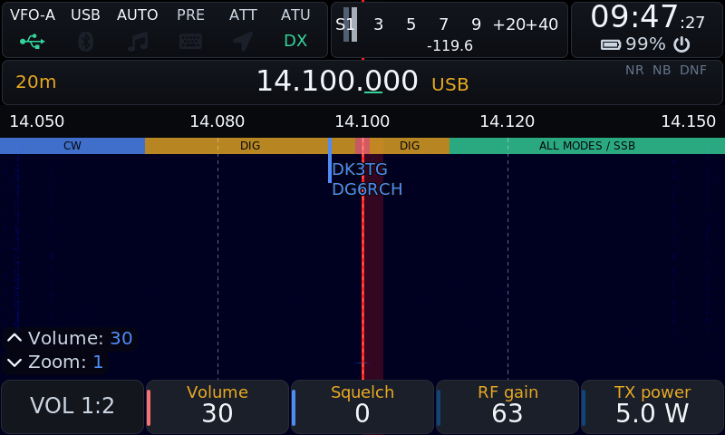 Main screen | 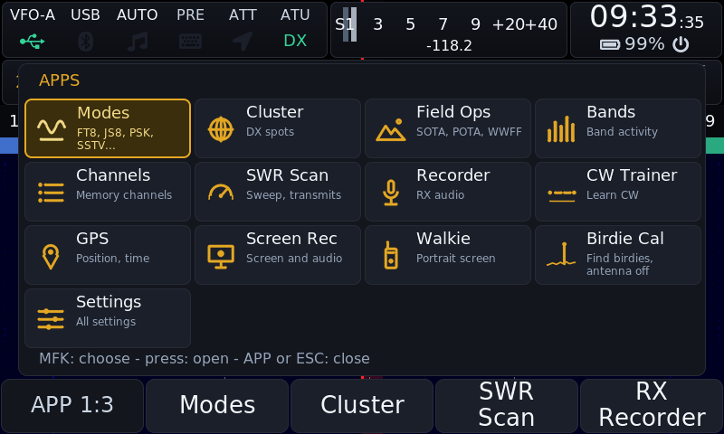 APP grid | 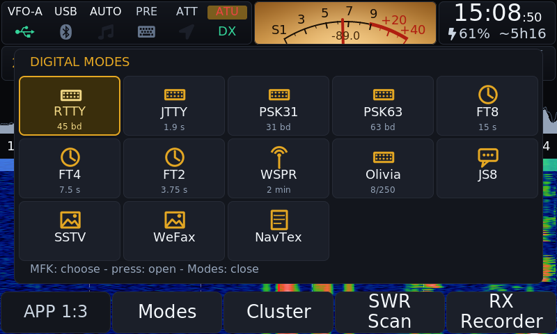 Modes grid |
| 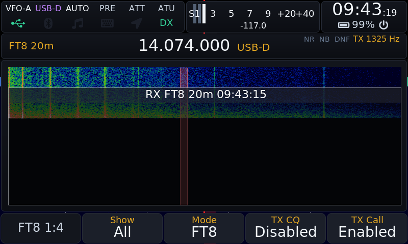 FT8 | 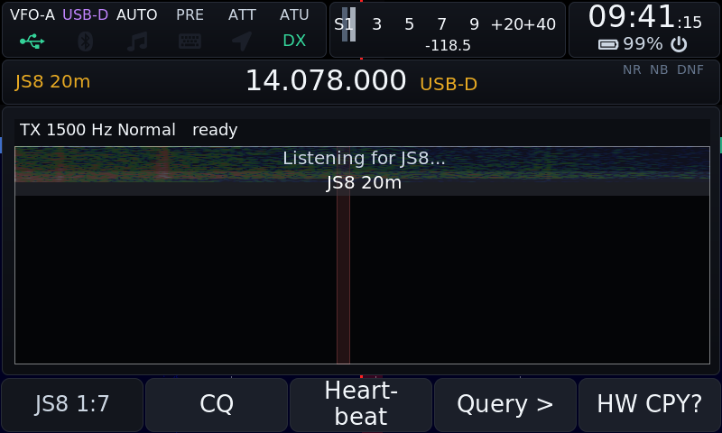 JS8 | 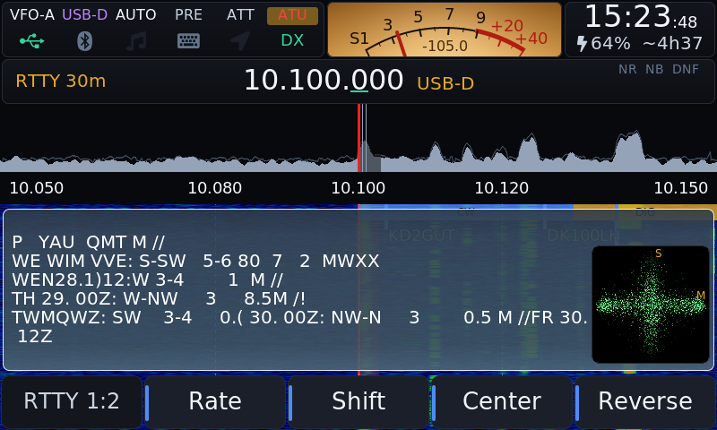 RTTY |
| 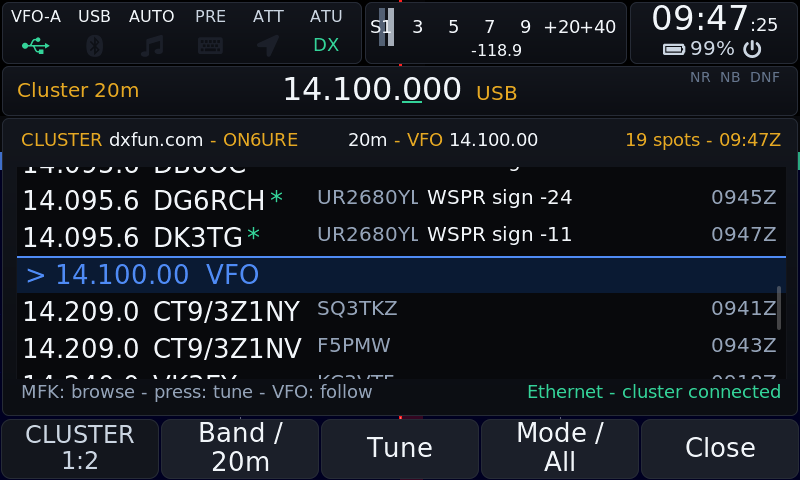 DX cluster | 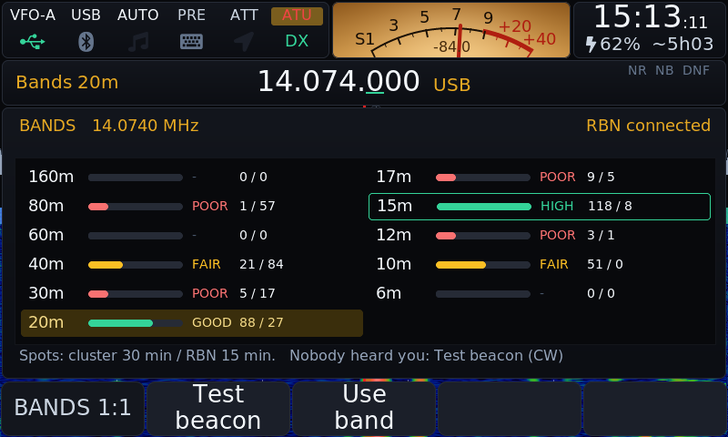 Bands | 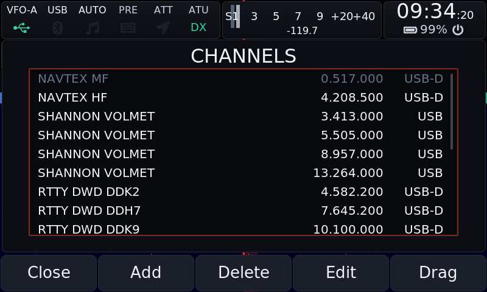 Channels |
|  Field Ops | 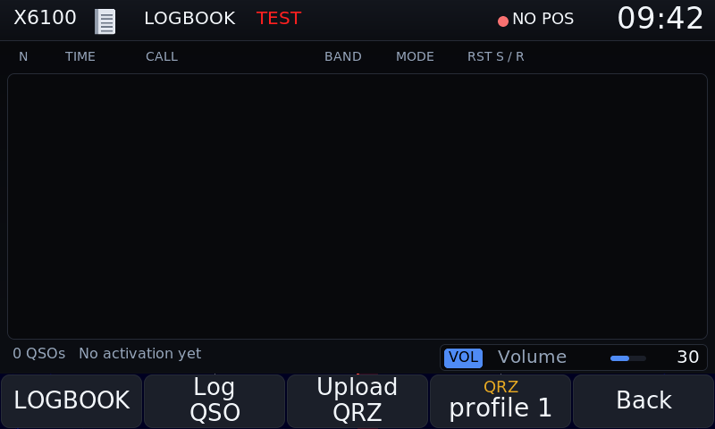 Field Ops logbook | 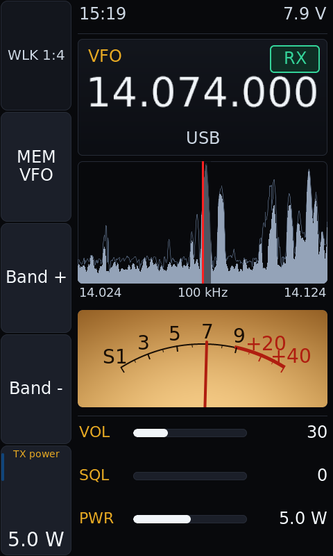 Walkie Talkie |
| 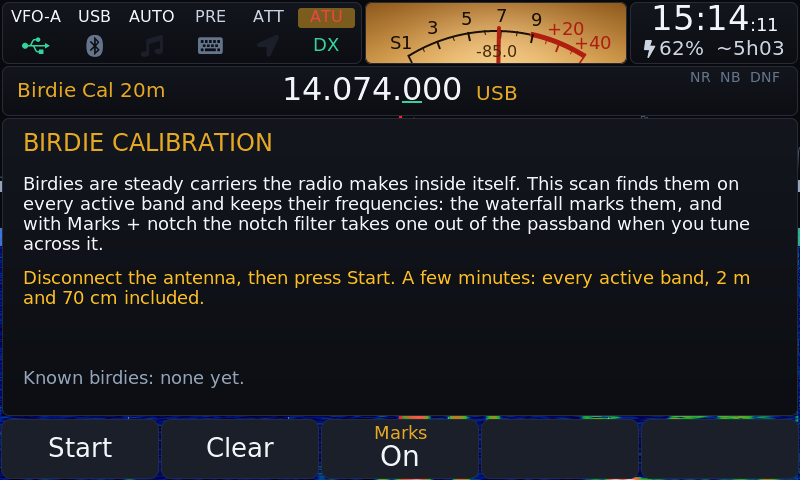 Birdie Cal | 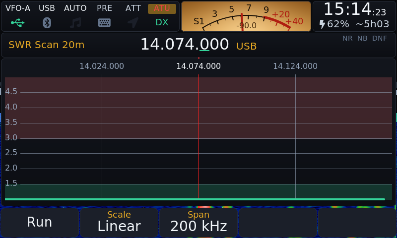 SWR scan | 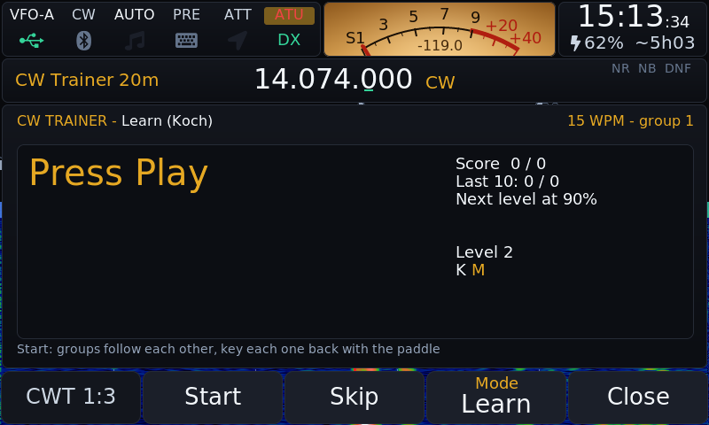 CW trainer |
| 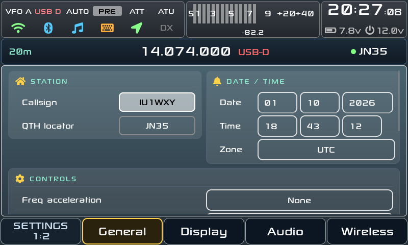 Settings | 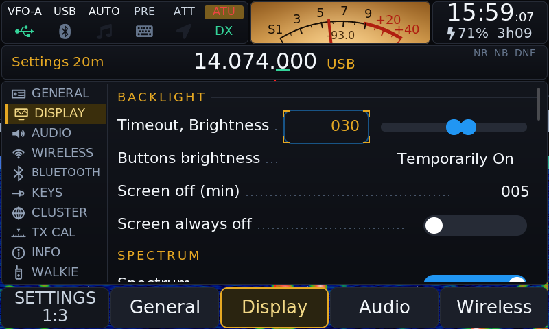 Settings, Display | 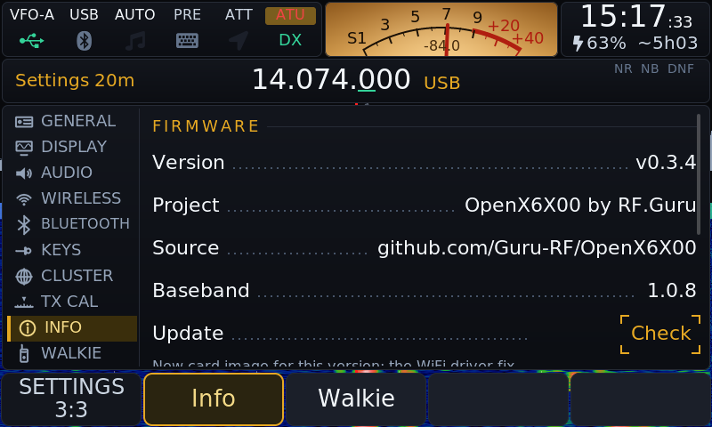 Settings, Info |
| 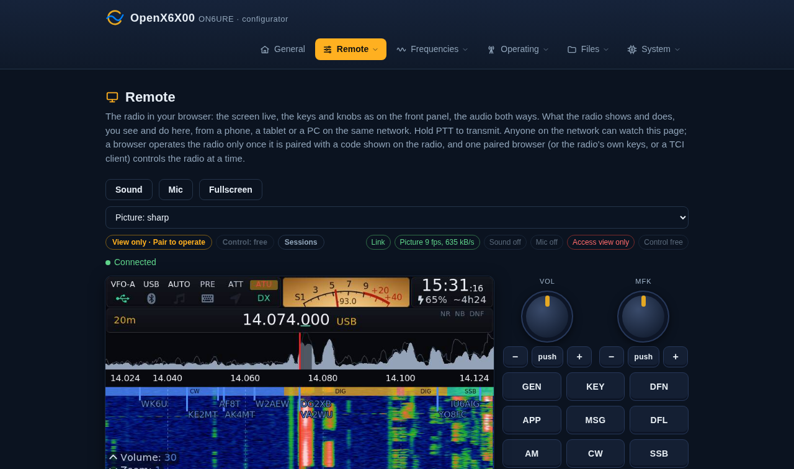 Browser remote, in a browser | 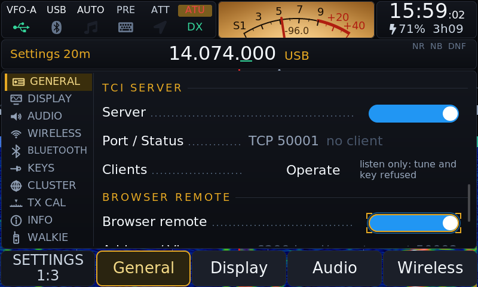 Settings, Browser remote | 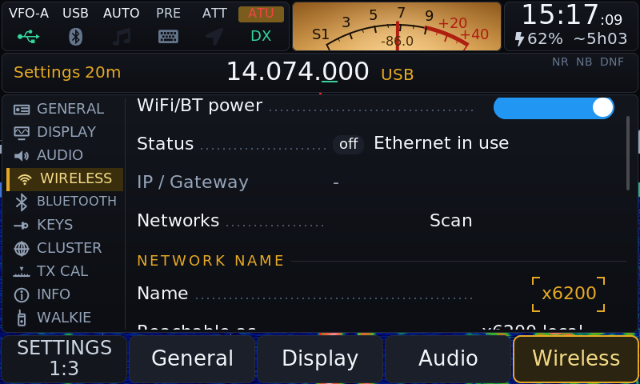 Settings, Network name |

More in [docs/screenshots](docs/screenshots): the Recorder, GPS and every Settings tab. They
are taken from a PC over SSH with `tools/screenshots/drive.py`, which presses the radio's keys
and turns its knobs from a script and dumps the screen; a single shot is
`tools/screenshots/grab.py`. On the radio itself a key with the Screenshot action (Settings >
Keys) writes a PNG to the DATA partition, shown in the web Gallery and copied here with
`tools/screenshots/pull.py`.

## Install

1. Download the image for your radio from the
   [latest release](https://github.com/Guru-RF/OpenX6X00/releases/latest):
   `OpenX6X00-x6100-v<version>-sdcard.img.zip` for the X6100,
   `OpenX6X00-x6200-v<version>-sdcard.img.zip` for the X6200.
2. Write the image to a microSD card with [balenaEtcher](https://etcher.balena.io/)
   or Rufus.
3. Put the card in the radio and switch on. Settings and logs live on the
   card's DATA partition (`/mnt`).

After that the radio updates itself: Settings > Info > Update (or System >
Update on the web page) fetches the latest release's bundle for its model from GitHub,
checks its signature, installs it and restarts the radio software, keeping
the previous version for an automatic rollback if the new one does not come
up. A new card image is only needed when the kernel or a driver changes. From
v0.3.4 the radio says so: Check shows when a release also has a new card image
for that radio and what it brings, and Settings > Info > Update keeps saying
it until the new image is on the card.

A new image normally keeps DATA: the image is smaller than the card, so the
DATA filesystem stays where it was and the first start adopts it again.
Download the Backup from the web configurator first all the same (the
[manual](docs/MANUAL.md) lists the files); a card-wiping tool or a smaller
card would lose it. For the baseband versions and how to update them, see
[The baseband](#the-baseband).

## Build

The images are built by
[AetherX6100Buildroot](https://github.com/gdyuldin/AetherX6100Buildroot) and
[AetherX6200Buildroot](https://github.com/gdyuldin/AetherX6200Buildroot), with
this repository as their GUI package. `buildroot/local-build.sh` patches the
buildroot tree (local GUI and web server, `boost` and `fftw-single` for JS8,
no RHVoice, the boot logo), builds it and makes the update bundle. The GitHub
Actions workflow (`.github/workflows/main.yml`, *Build image*, run by hand,
about an hour per radio) runs that script for both radios and uploads
`OpenX6X00-x6100-<ref>-sdcard.img.zip` and `OpenX6X00-x6200-<ref>-sdcard.img.zip`
with their bundles; on a tag it attaches them to the release. Locally, the
same build runs in a container: clone the buildroot tree next to this
repository, then

```
docker build -t openx6x00-build buildroot
docker run --rm -u $(id -u):$(id -g) -e HOME=/work/.brhome -v $(dirname $PWD):/work \
    openx6x00-build bash /work/OpenX6X00/buildroot/local-build.sh
```

leaves `../AetherX6100Buildroot/build/images/OpenX6X00-x6100-local-sdcard.img` (about
an hour the first time, 20 cores; `buildroot/local-build.sh` has the patch
steps, `buildroot/Dockerfile` the Ubuntu 22.04 host with CMake 3.28 and
sqlite3). The X6200 is the same GUI on its own buildroot tree,
[AetherX6200Buildroot](https://github.com/gdyuldin/AetherX6200Buildroot)
cloned next to this repository: the same command with `-e MODEL=x6200` leaves
`../AetherX6200Buildroot/build/images/OpenX6X00-x6200-local-sdcard.img` and the
`OpenX6X00-x6200-v<version>-update.tar.gz` bundle (the updater on a radio takes
only its own model's bundle). The radio's backend is `src/hw/x6200/hw_x6200.c`
behind `src/hw/hw.h`, chosen with `cmake -DHW_BACKEND=x6200`. With a buildroot tree already built, `buildroot/build.sh` rebuilds
the GUI alone with its toolchain
([docs/UPSTREAM_README.md](docs/UPSTREAM_README.md), [manual, Build](docs/MANUAL.md#build)).

## Layout

```
src/                     the GUI (x6100_gui): main screen, apps, settings, decoders, TCI server
  cfg/ params/           the settings (SQLite params.db) and their C/C++ API
  ft8/ js8/ wspr/ sstv/ wefax/ navtex/ cw_decoder/ cluster/ field/ qth/
  fonts/ widgets/        LVGL fonts and custom widgets
third-party/             js8core (JS8Call's modem, GPL-3), wsprd (WSJT-X, GPL-3), cty.dat
lvgl/ lv_drivers/        LVGL 8.3 (gdyuldin's NEON fork, a submodule) and its drivers
webserver/               the web configurator (Python, bottle)
rootfs/                  init scripts, helper scripts (x6100-field, x6100-pota-spots,
                         x6100-broadcast-update, btcat-ctl, btaudio-ctl), data files
btcat/ bootanim/         Bluetooth CAT bridge, boot animation
boot/ u-boot/            boot logo, the U-Boot binary written over buildroot's
sql/                     the default params.db
themes/                  the RS theme (images) and the JSON themes copied to the SD card
buildroot/               build.sh: the GUI alone with the buildroot toolchain
docs/                    MANUAL.md, THEMES.md, MENUS.md, screenshots pulled from a radio
```

## Documentation

- [Manual](docs/MANUAL.md): every app and setting, the web pages, the TCI
  server, CAT commands, files, building.
- [Themes](docs/THEMES.md): make your own.

## Licences

The GUI is LGPL-2.1-or-later ([LICENSE](LICENSE)); the vendored js8core and
wsprd, and JTTY (ported from WSJT-X by K1JT and the WSJT-X team, `src/jtty*`),
are GPLv3, so the firmware image is GPLv3. The web server is LGPL-2.1
([webserver/LICENSE](webserver/LICENSE)). Every file keeps the copyright
notice of its authors.

## Credits

Oleg Belousov R1CBU and Georgy Dyuldin R2RFE wrote the R1CBU GUI this firmware
stands on (CW receiver, CW tune indicator, DRM/KMS output, direct spectrum
rendering, the main knob handling); Giovanni Ricciardi IU1WXY the rewrite of
the GUI, the theme system, Field Ops, Bands, the DX cluster, WSPR, SSTV TX,
RTTY, WeFax TX, the CW keyboard, the Bluetooth work and the layer system;
Hany El Imam (1KO125) the WeFax, NavTex and SSTV decoders; Jordan Sherer
KN4CRD and the JS8Call contributors the JS8 engine; K1JT and K9AN wsprd; K1JT
and the WSJT-X team JTTY; SP2KMO the Bluetooth tab; 2E0JFS the Black Metal and
Total Black themes. Libraries: LVGL, cJSON, FFTW, liquid-dsp, ft8_lib, libpng,
bottle, PulseAudio, BlueZ. Fonts: Roboto, DejaVu, Arial, Sony Sketch. The
skimmer spots come from the Reverse Beacon Network and the broadcast schedule
from the EiBi list by Eike Bierwirth. The Field Ops reference lists come from
POTA, SOTA, WWBOTA, cqhota.app, WWFF, TOTA (OK2IH, wwtota.com), the WCA castle
list as ON4VT keeps it, and GMA (gma.rocks) for the mills and the lighthouses. OpenX6X00 is maintained by RF.Guru
(Joeri Van Dooren ON6URE).
