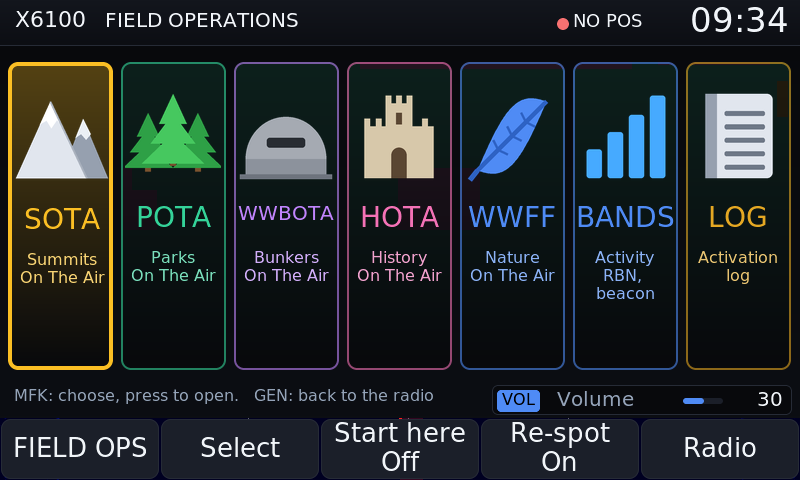
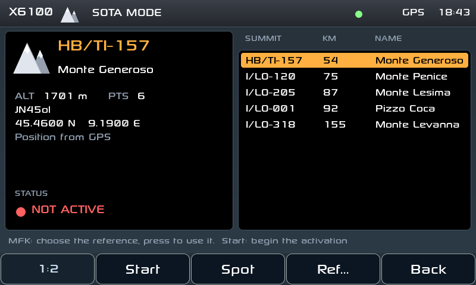
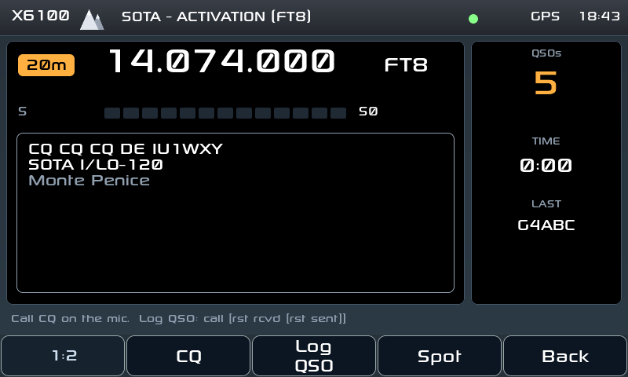
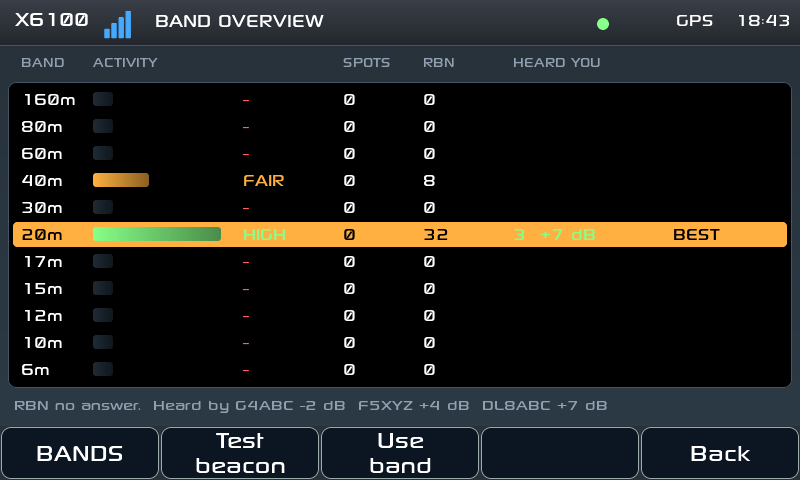
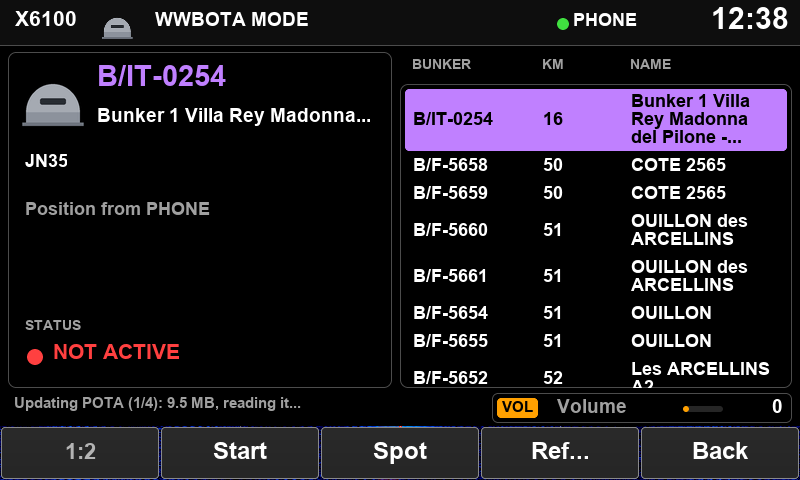
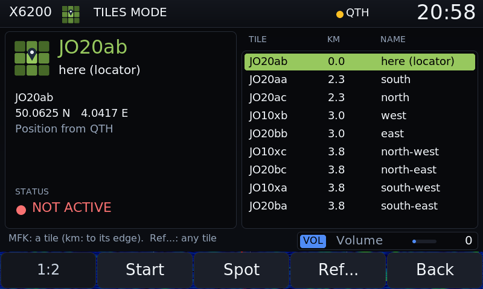
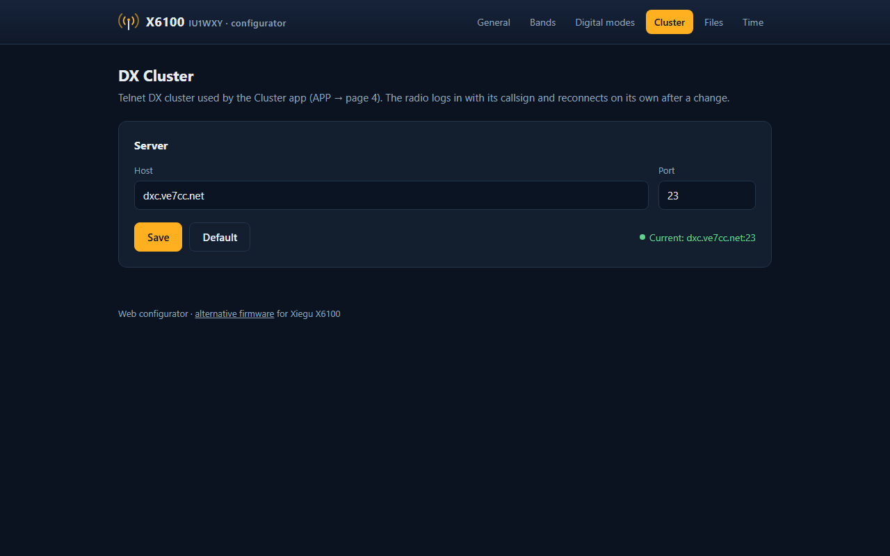
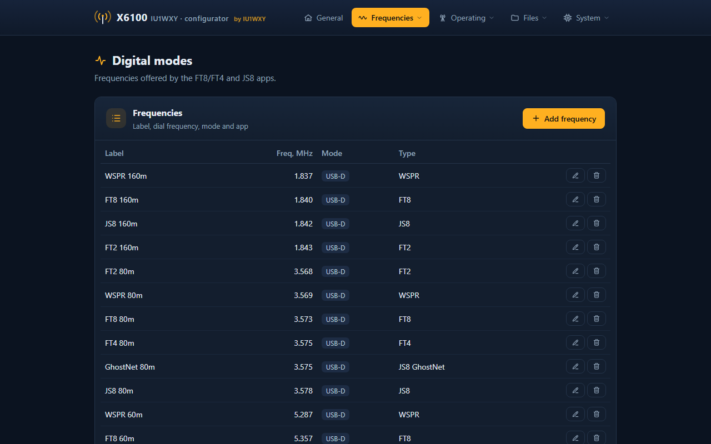
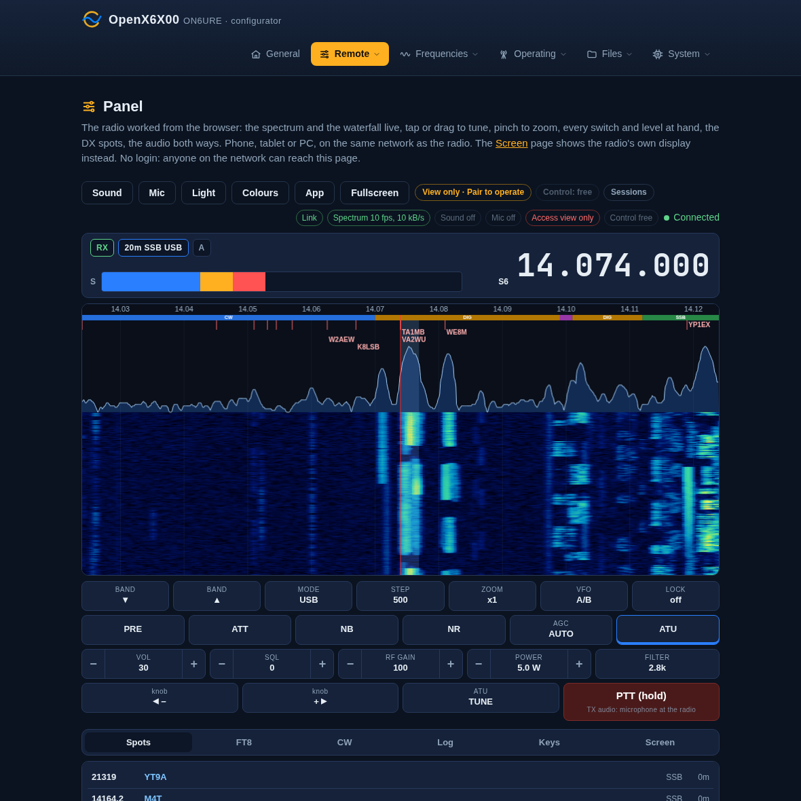

# OpenX6X00: manual

How to use every part of the firmware, and the reference tables. The short
overview is the [README](../README.md).

Each option has a "Where:" line with its place on the radio, for example
"Where: Settings > Display > MAIN SCREEN". Settings opens from APP (page 2) >
Settings. Button and option names are written as the radio shows them.

## Contents

- [Getting started](#getting-started): [first steps](#first-steps), [buttons and knobs](#buttons-and-knobs), [hand mic](#hand-mic), [keyboard](#keyboard) ([quick QSO log](#quick-qso-log))
- [Updating the firmware](#updating-the-firmware)
- [Main screen](#main-screen): [band keys](#band-keys), [receiving outside the ham bands](#receiving-outside-the-ham-bands), [WR12 receiver](#wr12-receiver-x6200), [low battery](#low-battery), [battery time](#battery-time), [status bar](#status-bar), [S-meter](#s-meter), [waterfall](#waterfall), [band plan](#band-plan), [screen recording](#screen-recording), [Walkie Talkie](#walkie-talkie-mode)
- [Settings](#settings): [General](#general-tab), [Display](#display-tab), [Audio](#audio-tab), [Wireless](#wireless-tab), [Bluetooth](#bluetooth-tab), [Keys](#keys-tab), [Cluster](#cluster-tab), [TX Cal](#tx-cal-tab), [Info](#info-tab), [Walkie](#walkie-tab)
- [Transmitting](#transmitting): [amateur bands only](#amateur-bands-only), [no TX without data from the base](#no-tx-without-data-from-the-base), [TX shift](#tx-shift), [transverter TX power limit](#transverter-tx-power-limit), [SWR scan and the tuner](#swr-scan-and-the-tuner), [TUNE for an external tuner](#tune-for-an-external-tuner), [digital-mode TX level](#digital-mode-tx-level), [recording voice messages](#recording-voice-messages), [ALC in CW](#alc-in-cw), [PA bias](#pa-bias-x6200)
- [Digital modes](#digital-modes): [opening a mode](#opening-a-mode), [FT8 and FT4](#ft8-and-ft4), [JS8](#js8), [WSPR](#wspr), [SSTV, WeFax and NavTex](#sstv-wefax-and-navtex), [PSK31, PSK63 and Olivia](#psk31-psk63-and-olivia), [JTTY](#jtty), [text log of the keyboard modes](#text-log-of-the-keyboard-modes), [RTTY and WeFax TX](#rtty-and-wefax-tx)
- [CW](#cw): [CW decoder](#cw-decoder), [CW from the keyboard](#cw-from-the-keyboard), [CW Keyboard](#cw-keyboard), [USB paddle](#usb-paddle), [CW messages](#cw-messages) ([beacon](#cw-beacon), [QRSS3](#qrss3)), [CW Trainer](#cw-trainer)
- [Apps](#apps): [DX Cluster](#dx-cluster), [Field Ops (SOTA / POTA)](#field-ops-sota--pota), [Bands](#bands), [Channels](#channels)
- [Bluetooth](#bluetooth): [headphones](#bluetooth-headphones), [CAT](#bluetooth-cat), [a PC on Bluetooth](#a-pc-on-bluetooth)
- [Themes](#themes)
- [Web configurator](#web-configurator)
- [Wavelog](#wavelog)
- [Winlink](#winlink): [Mercury](#mercury-experimental), [XARA](#xara-experimental)
- [Browser panel](#browser-panel)
- [Browser remote](#browser-remote)
- [TCI server](#tci-server)
- [Network name](#network-name): [the radio's own names](#the-radios-own-names)
- [SSH](#ssh): [a key on Windows](#a-key-on-windows), [on a Mac or on Linux](#a-key-on-a-mac-or-on-linux), [in PuTTY](#a-key-in-putty), [adding the key on the radio](#adding-the-key-on-the-radio), [the first login](#the-first-login), [after a new card image](#after-a-new-card-image), [when SSH does not let you in](#when-ssh-does-not-let-you-in)
- [Tailscale](#tailscale): [Tailscale Funnel](#tailscale-funnel)
- [Ethernet](#ethernet): [USB tethering](#usb-tethering)
- [Troubleshooting and FAQ](#troubleshooting-and-faq)
- [Reference](#reference): [Bluetooth CAT connection](#bluetooth-cat-connection), [CI-V commands](#supported-ci-v-commands), [btcat-ctl](#btcat-ctl), [btaudio-ctl](#btaudio-ctl), [files on /mnt](#files-on-mnt)
- [Build](#build)

## Getting started

### First steps

1. Set your callsign and QTH locator.
   Where: Settings > General > STATION.
   JS8, FT8, WSPR (TX and upload) and the DX Cluster need the callsign.
2. Connect to a WiFi network, for example your phone's hotspot.
   Where: Settings > Wireless > WIFI.
   WiFi sets the clock, and the DX Cluster, the uploads, the web configurator
   and the TCI server need it.
3. Check the clock. FT8, JS8 and WSPR need it right to a second or two.
   Where: Settings > General > DATE / TIME.
4. Open the web configurator from a browser on the same network:
   `http://x6100.local/`, or `http://<radio IP>/` where mDNS names do not
   resolve (see [Web configurator](#web-configurator)).

### Buttons and knobs

The APP button opens three pages of apps and tools:

| Page | Buttons |
|---|---|
| APP 1:3 | Modes, Cluster, SWR Scan, RX Recorder |
| APP 2:3 | Settings, CW Trainer, Field Ops, Channels |
| APP 3:3 | Bands, GPS, Screen rec, CW Keyboard |

With Icon menus on (Settings > Display > INTERFACE, on by default) APP also
opens the same apps as a grid of tiles over these pages, with Walkie and
Birdie Cal besides: the MFK chooses a tile, a press opens it, APP or ESC
closes the grid. "APP > CW Keyboard" in this manual is the tile, or the
button on APP 3:3.

- Each app has its own button pages, named like `(JS8 1:7)`. The first
  button goes to the next page.
- The MFK walks the items of an app or a list; a press chooses.
- ESC closes popups and apps.
- A press of VOL does not close menus or apps, and in a text field it types
  nothing; on the main screen it still works as ESC. Held, it is still one
  press.

Knobs. On the main screen the main knob tunes, and VOL and the MFK each turn
one control of their own list. The two lines over the buttons say which
control and its value (Settings > Display > INTERFACE > Knob info; with it
off, or while Hide buttons has hidden them, the value shows on the message
line).
- A press of the knob switches it between changing the value and choosing
  the control: while it chooses, a turn goes to the next control on its list
  (the name lit), and the next press changes that one again.
- X6200: the MFK has an inner ring. The inner ring chooses the MFK's control,
  the next one or the one before on its list, and the outer ring changes its
  value, with no press. The X6100's MFK has no inner ring: it uses the press.
- A keyboard (USB or Bluetooth) on the main screen: the left and right
  arrows turn the MFK and Enter is its press (while the CW line is open,
  Enter sends it); { and } choose VOL's control, [ and ] turn it (in CW
  they are the paddle).
- What is on each list is yours to choose. Hold a value button (TX power, RF
  gain, Squelch, the filter edges, RIT, XIT, Spectrum Zoom, WF ref, AGC,
  Comp, IF shift, VOX, PRE, ATT, ATU, Step, NB, NR, DNF, the KEY and CW
  values...): each hold steps it from no knob to VOL ("Added to VOL
  encoder"), then to the MFK ("Moved to MFK encoder"), then off again
  ("Removed from MFK encoder"). A mark on the left of the button shows which
  knob it is on, in another colour while that knob turns it.
- A press of a value button puts it on a knob at once: VOL for Volume,
  Squelch, RF gain, TX power, Moni level and the filter, the MFK for the
  others. A press of an on/off button (NB, NR, DNF, VOX, PRE, ATT, ATU)
  switches it; a press of AGC takes it to the next of Off, Slow, Fast, Auto.
- AGC is on the MFK 2:3 page, PRE, ATT and ATU on VOL 2:2, Step (the tuning
  step, as FST) on the DFL page. On a knob, a turn steps AGC and Step forward
  or back, stopping at Off and Auto, 10 Hz and 5 kHz (the AGC and FST keys go
  round), and switches PRE, ATT and ATU. Up to v0.3.7 AGC, PRE and ATT could not
  go on a knob, and there was no ATU or Step button.
- At first VOL has Volume, RF gain, the filter edges and TX power, and the MFK
  Spectrum Zoom and DNF. Volume never leaves VOL.

Hide buttons. With Settings > Display > INTERFACE > Hide buttons at After
3 s, After 5 s or After 10 s (Off by default), the five buttons and the two
knob lines over them hide on the main screen once that long has gone by
without a key, and the waterfall shows down to the bottom of the screen.
- Any key brings them back: a front key, a hand mic key, a keyboard key. It
  also does its usual job (GEN goes to its next page, ATU switches the
  tuner), except F1-F5: their press only brings the buttons back, so a
  button you can't see is never pressed. Press it again to use it. F1-F5
  from a browser (the Panel's Keys tab, the Screen page) are the same: the
  first press only brings the radio's buttons back.
- The main knob tunes and the buttons stay hidden. VOL and the MFK, turned
  or pressed, leave them hidden too: their control and value show on the
  message line, as with Knob info off. While the buttons show, a turn or a
  press of VOL or the MFK keeps them a while longer, the main knob does not.
  A keyboard's keys for the knobs (- and =, [ ] { }, the left and right
  arrows, Enter, ESC) count as the knobs.
- Only on the main screen: an app (FT8, RTTY, CW Trainer...), Settings and
  the APP grid keep their buttons, and the walkie screen always shows them.
  After an app closes they hide again once the time has gone by.

Long press. Each button group (GEN, APP, KEY, MSG, DFN, DFL) has a
long-press action, and so has FST, the tuning step key: a press steps up,
held it steps down until you give it another action (Frequency lock on/off,
as on the stock firmware, say).
Where: Settings > Keys > FRONT KEYS, LONG PRESS.

| Kind | Actions |
|---|---|
| Quick | none, screenshot, RX recorder on/off, screen rec on/off, mute, frequency lock on/off, step up, step down, WF mode, ATT on/off, PRE on/off, tuner on/off, tuner tune (transmits a carrier), TUNE ext. tuner on/off (a carrier for a tuner at the antenna, see [TUNE for an external tuner](#tune-for-an-external-tuner)) |
| Digital modes | RTTY, FT8, WSPR, JS8, SSTV, WeFax, NavTex |
| Tools | Cluster, CW Trainer, CW Keyboard, Field Ops, Bands, Channels, RX recorder, SWR Scan, GPS, QTH grid, Settings |

The hand mic F1 and F2 keys (and the H-22's F3 on the X6200), short and long
press, are set in the same tab, from the quick actions (all but the
screenshot), NR and NB.
Where: Settings > Keys > HAND MIC KEYS.
The other hand mic keys: see [Hand mic](#hand-mic).

Two keys at once. Each key counts on its own: a key pressed while PTT is
held does what it always does, its long press too, and the radio goes back
to receive the moment PTT is let go. Up to v0.3.8 a key let go while PTT
was held (the PTT key on the side or the browser's PTT), a tap say, kept
the radio on the air after PTT was let go, until PTT was pressed again,
and a key held while another one was pressed lost its long press.

Frequency lock. The LOCK key (X6100), the X6100 mic's SPCH key, a
keyboard's Scroll Lock or CapsLock+K, the browser panel's LOCK and any key
given "Frequency lock on/off" in Settings > Keys (a long press of GEN, APP,
KEY, MSG, DFN, DFL or FST, a hand mic F key) turn it on and off. The X6200
has no LOCK key: give it to FST's long press, as on the stock firmware, or
to another of those. Each turn says "Dial locked" or "Dial unlocked" on the
screen.
Held, the X6100's LOCK key restarts the radio's base board instead, a way
out when the base stops answering: after the long press the screen counts
down "Keep holding LOCK to restart: 4 s", and the restart comes 5 s after
the press; let go before and nothing happens ("LOCK let go: no restart"). On battery
the restart switches the radio off (switch it on again).
While it is on, LOCK shows in the frequency strip, the main knob and F-INP
do not tune, the step mark under the frequency goes and the frequency scale
greys out, and the browser panel, TCI programs, Pat's QSY (Winlink) and Field
Ops' band tune are refused, and so are channels (the CHANNELS window and
the hand mic's UP/DOWN). The band keys, memories, cluster spots and CAT
still tune.
- LOCK is left of the frequency; in VISION in front of the locator; in Black
  Metal and Total Black on the right, between the other VFO and the A/B
  badge, and left of the frequency while an app window is open. On the
  Walkie Talkie screen it follows the mode ("USB - LOCK").
- FT8, FT4, JS8, PSK, Olivia, JTTY and WSPR hold the frequency the same way
  while they are open. Their own knobs and buttons keep working (in FT8 the
  MFK still picks a station and the main knob moves the TX offset).
- SSTV holds the frequency, the band and the mode while it transmits a
  picture, from "Preparing ... TX" to the end or Halt TX.
- Your lock is apart from the apps' hold: set before an app opened, it is
  still on after the app closes, and an app never turns it on. Up to v0.3.7
  closing the app turned it off.

### Hand mic

The X6100's hand mic and the X6200's H-22 have keys of their own. They work
on the main screen and with an app open, not in walkie mode. A long press is
one second.

| Key | Mic | Press | Long press |
|---|---|---|---|
| 1-9, 0 | both | the band printed on the key (not while an app holds the band). The X6100 mic, on either radio: 1 = 160 m, 2 = 80 m, 3 = 40 m, 4 = 30 m, 5 = 20 m, 6 = 17 m, 7 = 15 m, 8 = 12 m, 9 = 10 m, 0 = 6 m. H-22: 1 = 160 m, 2 = 80 m, 3 = 60 m, 4 = 40 m, 5 = 30 m, 6 = 20 m, 7 = 17 m, 8 = 15 m, 9 = 12 m, 0 = 6 m | memory 1-9 |
| the dot | H-22 | 10 m (printed 28) | |
| F-INP (H-22: the red F-INP/ENT) | both | the frequency box, see below | |
| F1, F2 | both | the action set in Settings > Keys > HAND MIC KEYS: F1 steps up, F2 does nothing until it has one | F1 steps down, F2 as set |
| F3 | H-22 | as F2, with its own action (X6200: Settings > Keys > HAND MIC KEYS) | as set |
| UP, DOWN (H-22: the arrow keys) | both | the [channel](#channels) before or after the last one tuned, its name shown (not while LOCK is on or an app holds the frequency or the mode) | band up or down |
| MODE | both | the next mode: LSB, USB, CW, CW-R, AM, NFM (and SAM, WFM on the X6200) | DIG on or off in SSB, like a long press of the front SSB key |
| V/M | both | the [CHANNELS](#channels) window (not over an app that has the screen) | |
| VOL+, VOL- | H-22 | the RX volume one step up or down, shown like the VOL knob's | held: on by itself from 0.4 s, before the long press, about ten steps a second until let go |
| A/B | H-22 | VFO A/B, like the front A/B key (not while an app holds the VFOs) | this VFO copied to the other one |
| FIL | X6100 | the filter pages, like the front DFL key | the DFL long press action |
| XFC | X6100 | VFO A/B (not while an app holds the VFOs) | |
| SPCH | X6100 | frequency lock on or off | |
| TUNER | X6100 | the tuner on or off | a tuning cycle (it transmits) |
| GENE | X6100 | the SWL panel; again: the next station | |
| NW | X6100 | the station shown in the SWL panel saved as a channel | |

- The frequency box: F-INP (the H-22's red F-INP/ENT) opens it, not while the frequency
  is locked. Type the frequency in MHz with the digits and the dot (the
  H-22's dot key), 7.074 for 7074 kHz; CE (the H-22's HOME) deletes the last
  character. F-INP again tunes to it and closes the box; with nothing typed
  it only closes it.
- In a list or a text box (the WiFi password) the digits, the dot and CE type
  instead.
- The H-22's UP and DOWN keys on its side change band like the BAND keys.
- The X6100's hand mic works on the X6200 too, its keys as in this table: the
  digits go to the bands printed on them (3 = 40 m) and its dot to none. The
  radio tells it from the H-22 by the codes the keys send.
- Each key pressed goes into the log as `hand mic: key 0x18 (3)`: its code
  and the key the radio took it for, or "unknown". Not while a text box is
  open, where the digits can be a WiFi password. A key of another mic that
  does nothing: send the log lines of its keys in an issue.

### Keyboard

A USB keyboard, or a Bluetooth one paired in Settings > Bluetooth > DEVICES,
types in the text boxes and the apps. On the main screen it has the keys for
the knobs (see [Buttons and knobs](#buttons-and-knobs)), `f` for the
frequency box and, in CW, the [CW line](#cw-from-the-keyboard). Scroll Lock
turns the [frequency lock](#buttons-and-knobs) on and off and Print Screen
takes a screenshot, both on the main screen only.

CapsLock is the keyboard's shortcut key: held, the key pressed with it does
something on the radio instead of typing. Every keyboard has it, small and
Bluetooth ones too, which often have no F keys, or only with Fn.

| CapsLock + | Does | Where |
|---|---|---|
| L | Log a QSO: in CW the line typed in the [CW line](#cw-from-the-keyboard), not sent; else the [quick QSO log](#quick-qso-log)'s box opens | main screen |
| K | The [frequency lock](#buttons-and-knobs) on or off, as Scroll Lock | main screen |
| P | A screenshot, as Print Screen | everywhere |
| S | Settings | main screen |
| F | The frequency box, as `f`, also in CW, where `f` goes into the CW line | main screen |
| 1 to 5 | In CW, the MSG > CW messages 1 to 5, keyed from the [CW line](#cw-from-the-keyboard) | main screen |
| 1 to 8 | [JTTY](#jtty)'s macros F1 to F8, as their buttons | JTTY |
| Up, Down | The next band up or down, as the [BAND keys](#band-keys) | main screen |
| Space | PTT on, and at the next press off (below) | on: main screen; off: everywhere |

- Main screen: no app, Settings, list or text box open, not in [Walkie
  Talkie mode](#walkie-talkie-mode). Elsewhere these chords do nothing, and
  type nothing: in walkie mode CapsLock+Space keys nothing (it still lets go).
  RTTY receives on the main screen, with no window of its own: there the
  chords work, and CapsLock+L logs the QSO as RTTY.
- The keys count by their place on a US keyboard, as the radio types. The
  letters are in the same place on AZERTY and QWERTZ keyboards; on an AZERTY
  one CapsLock+1 is the key marked & and 1.
- A chord's key is never typed, in the CW line, the quick log's box or a
  text box neither, and Caps Lock stays as it was, on or off. The
  keyboard's Caps Lock light can come on while CapsLock is held, and goes
  back when the other key goes down.
- A chord acts once a press: held, it does not repeat (one band a press).
- CapsLock tapped alone, nothing pressed with it, is Caps Lock as before:
  it turns when you let it go. Shift, Ctrl and Alt work with it as usual.
- A key with no chord (A, Q, 9, Enter) pressed while CapsLock is still
  down, as the first key, is fast typing: Caps Lock turns and the key
  types. A chord's key typed that fast is the chord: let CapsLock go first.
- The keyboard's keys keep the screen lit, as the radio's own do. On a
  dark screen (Settings > Display > BACKLIGHT > Screen off) the first
  chord only lights it, press it again; a key typed types as usual.

PTT from the keyboard. CapsLock+Space keys the radio as its PTT key does,
with the same refusals where the radio may not transmit, the 0 W hold, the
SWR protection and the stuck TX watch; in CW it keys the carrier, as the
PTT key does. The screen says `PTT on: CapsLock+Space for off` and shows TX
as for any transmission (the TX panel, or the power and SWR in the S-meter
box). CapsLock+Space again lets go, from any screen: a window opened while
on the air does not keep the radio there. While it is on the screen stays
lit.

- It follows the radio. Let go another way (the PTT key, the SWR
  protection, CAT), the next CapsLock+Space keys again: the screen says
  `PTT off: CapsLock+Space for on`, after the SWR protection's or the band
  stop's own message.
- A press where the radio may not transmit keys nothing ("No TX on ...").
  A key that has not got the radio on the air after 2 s, or a radio back on
  receive by itself, is let go: `PTT off: not on the air`.
- The keyboard unplugged, or its Bluetooth link lost, lets go: `PTT off:
  keyboard gone`. A Bluetooth link can take some seconds to count as
  lost. A wireless keyboard whose USB receiver stays plugged in is not
  seen as gone when the keyboard itself goes quiet (a flat battery, out of
  range): the three minutes below end it then.
- No data from the base for 3 s while it is on lets go: `PTT off: no data
  from the base`. Without it the radio has no SWR protection and no power
  reading.
- As the PTT key does, it gives control to the radio's operator: a browser
  or a TCI client neither keys nor takes control while it is on.
- It lets go three minutes after it keyed, as the browser's PTT does:
  `PTT off: three minutes on the air`. CapsLock+Space keys again for three
  more.

Up to v0.3.8 the keyboard's F keys did some of this: F1-F5 keyed the CW
messages in CW, F10 logged the CW line, F9 opened Settings, F1-F8 sent
JTTY's macros, and F4 was Start in the CW Trainer and Edit in MSG > CW
(Enter still does both). They do nothing now, and neither do PgUp and PgDn.
Up to v0.3.8 this Manual had PgUp and PgDn for the band and Scroll Lock for
the lock, and the code Print Screen for a screenshot, but none of the four
did anything on the radio.

Not tried on a radio yet: checked in the host tests (`tools/keyboard`) and
on the PC build. The Caps Lock light, the Bluetooth link lost and the PTT
have not run on hardware.

#### Quick QSO log

A QSO logged from the main screen in any mode, the waterfall and the spots
on it still in view: CapsLock+L, or the Log QSO button (KEY until the page
reads CW 1:2, then F5), opens a one-line box near the top,
`Call [sent [rcvd]]:`.

- Type the call, then the report you sent and the one you received, and
  press Enter: `F4ABC 59 57`. A report left out is 59, 599 in CW. Esc
  closes the box without logging. Field Ops' Log QSO takes the same order.
- In CW with the decoder's text on the screen (and in RTTY) the call it
  confirmed last is in the box already. Not in SSB after CW: the call heard
  in CW stays out.
- The radio says `QSO logged: F4ABC 59 57 SSB`. The QSO goes into the day's
  log, `/mnt/field/logs/YYYYMMDD.adi` (a file a UTC day), with the time, the
  radio's frequency and its mode (SSB in USB and LSB), never into a Field
  Ops activation's log. The web configurator's Logs page lists it, and
  [Wavelog](#wavelog) gets it when it is set up.
- With a keyboard no on-screen keyboard opens. Without one the on-screen
  keyboard does (the Log QSO button).
- In CW, with a line typed in the [CW line](#cw-from-the-keyboard),
  CapsLock+L logs that line the same way instead of sending it, and the box
  does not open. With nothing typed it opens the box. Up to v0.3.8 F10 logged
  the line.

## Updating the firmware

The radio updates itself: Settings > Info > Update, or the Update page of the
web configurator (System > Update).

- Check asks GitHub for the latest release. Install downloads its update
  bundle (the GUI, the web pages, the helpers and their data, about 14 MB),
  checks every file against the project's signature, puts the files in place
  with the previous ones kept, and restarts the radio software: the screen
  goes dark for a few seconds. Settings, logs and everything on the DATA
  partition stay as they are, your own [boot picture](#boot-picture) too.
- The new version is "pending" until it has run a minute; then it is
  confirmed. If it does not stay up for a minute three times in a row, the
  start loop puts the previous version back by itself. A power cut during the
  install is undone the same way at the next start.
- The web page can also take a bundle file (`OpenX6X00-x6100-vX.Y.Z-update.tar.gz` or `OpenX6X00-x6200-vX.Y.Z-update.tar.gz`
  from the releases page) for a radio without internet, and has a button to go
  back to the previous version by hand.
- Going back from v0.3.7 to v0.3.6 (that button, or v0.3.6's bundle): the
  radio first turns [Tailscale Funnel](#tailscale-funnel) off and takes its
  funnel, and any set up by hand, out of tailscaled. v0.3.6 knows nothing of
  Funnel: tailscaled would keep the funnel, and v0.3.6's TCI and browser
  remote would take connections from the internet without a key.
  - When it cannot make sure of that within half a minute (tailscaled not
    answering, or not connected: no internet, or waiting for a login, when
    it keeps the funnel for when it connects), it does not go back, and the
    page says why: turn Funnel off, or Tailscale itself, wait until it says
    Off, and try again.
  - Funnel is then off when you come back to v0.3.7: turn it on again there.
  - The step back the radio takes by itself after three failed starts tries
    the same for a few seconds, and goes back whatever came of it.
  - This was checked against a stand-in of tailscaled, not on a real
    tailnet.
- Every paired browser pairs again on v0.3.6, since v0.3.7 keeps only a hash
  of each browser's key: Forget all (Settings > General > BROWSER REMOTE), on
  either version, before pairing, so that the first browser paired is the
  admin again.
- The bundle is signed; a bundle not made by the project is refused. (For
  building your own: `tools/update/mkbundle.py`, the key in
  `rootfs/usr/share/x6100/update.pub`; a radio with `/mnt/update/allow-unsigned`
  takes unsigned bundles.)
- What the updater cannot change comes with a card image: the kernel, its
  modules (the WiFi driver), U-Boot, the partition layout. The radio says when
  a release has a new card image for it:
  - Check: "vX is available, with a new card image", and a message saying what
    the image brings. Install still updates the radio software; the image is
    written when convenient.
  - After the update, Settings > Info > Update and the web Update page say
    "New card image for this version: ..." until the new image is on the card,
    and the radio says it once at the first start of each version.
  - Writing a new image keeps the settings and logs on the DATA partition (see
    [Install](#getting-started)), and leaves alone one that went bad when it
    finds what is left of it (see
    [no DATA drive](#on-a-pc-the-card-has-no-data-drive-only-an-unknown-partition));
    download the Backup first all the same.
  - How it knows: every card image carries its level for its radio in
    `/etc/openx6x00-image`, which no update touches, and each version lists the
    level it wants in `/usr/share/x6100/image-required`. Images up to v0.3.3
    have no stamp and count as level 1.

## Main screen

### Band keys

The BAND keys (and the hand mic's long UP/DOWN, a keyboard's CapsLock+Up and
Down, the Walkie Talkie's Band buttons, the browser panel) step through the
active bands of the band list, from the frequency up or down.

- They skip a band the radio cannot tune: 4 m (70 MHz), 2 m and 70 cm,
  unless a transverter that is on (Settings > General > TRANSVERTERS) or, on
  the X6200, the WR12 covers it (see [WR12 receiver](#wr12-receiver-x6200)).
  The band plan strip, Birdie Cal and the browser panel's band list leave them
  out the same way.
- Both transverters are off by default, on the X6100 too: up to v0.3.8 the
  X6100's two were on, and 2 m and 70 cm were on its band keys (see
  [Amateur bands only](#amateur-bands-only)). An X6100 left on 2 m or 70 cm
  whose transverter is now off starts on the band below that it can tune (6 m
  with the default band list).
- 60 m (5351.5-5366.5 kHz, WRC-15) is on the band keys, between 80 m and
  40 m. It opens at 5.360 MHz in USB, the sideband used there. A radio
  updated from an older version gets it too, unless a band of its own already
  covers part of it (a "60m CW" added on the web page). Whether the base lets
  you transmit there is the base's own band plan: both bases list a 60 m band
  around it. Not tried on the air yet.
- A band with no mode saved opens in LSB under 10 MHz and USB above, USB on
  60 m; on the X6200 wide FM on FM broadcast, AM on the airband and NFM in
  what only the WR12 receives.
- A band opens on the frequency last used there. One saved there that lies
  outside the band (VFO A tuned by CAT while VFO B was in use, or the band's
  edges moved by another band plan region) opens at the band's start. Up to
  v0.3.8 the radio went to that frequency: 40m chosen put the dial on 20m,
  and the next key went on from there, so the BAND keys and the browser's
  BAND buttons could step between 20m and 30m only, until the other bands
  were tuned by hand (#168). With Independent VFOs, VFO B on a band it had
  not been on yet did the same (see below).
- Tuned into another band (the knob from 7.040 in 40m SSB to 7.039 in 40m
  CW, or a frequency from CAT, TCI, a spot or an app), the radio is on that
  band: the VFO you tune keeps its frequency and takes the mode, ATT, PRE and
  AGC last used there; the other VFO stays as it was. Where that band has
  split on, the other VFO, the one the radio transmits on, comes from the
  band, as with the band keys. Up to v0.3.6 the other VFO always came from
  the new band: tuning A across 7.040 moved B.
- With Independent VFOs on (Settings > General > STATION) a band key moves
  the VFO you are on only: the other one stays on its own band, frequency
  and mode, where the VFO key takes it back, after a restart too. Into a
  band left in split the other VFO, the one the radio transmits on, comes
  from that band. Split turned on while the other VFO is on another band
  transmits on that band; the strip shows where. Up to v0.3.7 a band key
  brought both VFOs of the new band (B on 40m showed 15m's B after A went
  to 15m), and the VFO key back to B then lost A's frequency.
  VFO B on a band it has no frequency of its own on yet (a band key, the VFO
  key or a restart) starts where VFO A has that band, or at the band's start,
  in A's mode there, and keeps that as its own. Up to v0.3.8 it kept A's
  frequency from another band: B on 30m for the first time stayed on 14.326
  with "20m" on the screen, and the VFO key from A on 6m brought it up on
  50.000.

### Receiving outside the ham bands

- The broadcast bands of the band list (Broadcast 75m to 11m) open in AM and
  keep their own mode and settings, as a ham band does; the band keys still
  skip them. (They opened in LSB under 10 MHz and USB above, which made AM
  stations sound garbled.)
- The X6200 also receives FM broadcast (87.5-108 MHz, wide FM) and the airband
  (118-137 MHz, AM), as its specification has it: two bands, FM broadcast and
  Airband, after 6 m on the band keys. They are receive only: PTT, the digital
  apps, CW from the keyboard, the tuner and the SWR scan are refused there:
  "No TX on 100.000 MHz", then "Receive only there".
- The same refusal holds anywhere the radio does not transmit: above 55 MHz
  without a transverter, and what the WR12 receives unless a transverter with
  a shift covers it (the transverter wins, see
  [WR12 receiver](#wr12-receiver-x6200)). In split it is the other VFO's
  frequency, the one the radio would transmit on, that counts. While the
  X6200 receives through its WR12, nothing transmits at all, in split on HF
  neither.
- On HF outside the amateur bands (CB, the broadcast bands, marine) the radio
  does not transmit either, by default: "No TX on 27.185 MHz", then "Out of
  band: Settings > TX Cal". See [Amateur bands only](#amateur-bands-only).
- PRE and ATT are on the VOL 2:2 button page (F1 from the main screen), per
  band, and can go on a knob (see [Buttons and knobs](#buttons-and-knobs)).
  The X6200 has no PRE key, and its receiver is specified with the
  preamplifier on: turn PRE on when the band sounds quiet.

### WR12 receiver (X6200)

Xiegu's WR12 is a receiver for the X6200's HOST port: 54 MHz to 1 GHz,
receive only. It sits between the antenna and the radio. In its bypass the
antenna goes straight through to the radio; out of it the WR12 receives, and
the radio listens to it on the WR12's IF. A switch says that a WR12 is
there: Settings > General > WR12 RECEIVER > WR12 on HOST (also on the web
Display page, Receiver card). Off by default.

- On: the bands of the band list between 54 MHz and 1 GHz come onto the band
  keys and the band plan (4 m, 2 m, 70 cm with the default list), and the
  knob and the keypad go up to 1 GHz. They open in NFM. Everything there is
  receive only (PTT, the apps, CW, the tuner and the SWR scan are refused with
  a message), unless a transverter with a shift covers it: the transverter
  wins and transmits on its IF, and the WR12 stays in its bypass there. Set
  its shift to 0 to leave that range to the WR12.
- Off again while on one of those bands: the radio goes to the band below
  (the airband from 2 m).
- On, the radio looks for the WR12 on USB by its id (0483:5740), sets it up
  (AT+INIT, its gains and AGCs) and puts it in its bypass, as the WR12
  starts up. The screen says "WR12 found on HOST", and "WR12 unplugged",
  "WR12 not answering" or "WR12: ERROR to AT+..." when that happens, each
  once, not at every try. A WR12 that takes the set-up but stops answering,
  again and again, is said once until it is unplugged or the switch turned,
  and set up again 2 s after, then twice as long each time, up to 30 s;
  after 10 minutes of working, a new trouble is said again. Off, the radio
  puts it back in its bypass and lets it go.
- Receiving through it: with the dial from 54 MHz up, the radio tunes the
  WR12 to the dial (AT+FREQ), takes it out of its bypass (AT+BYPASS=0) and
  puts its own receiver on the WR12's IF, 5.06 MHz, with I and Q swapped.
  FM broadcast and the airband go through the WR12 too, as does 54-55 MHz,
  which the radio otherwise receives itself. The screen, the S-meter's band
  settings, CAT and TCI keep the dial's frequency; only the radio's receiver
  is on the IF. Below 54 MHz or with the switch off, the WR12 goes back to
  its bypass and the radio back to the dial; with the WR12 unplugged or not
  answering, the radio goes back to the dial at once. The VFO not in use
  keeps its own frequency: the WR12 follows the VFO in use. Birdie Cal runs
  on the radio's own receiver, the WR12 in its bypass meanwhile.
- While the WR12 is out of its bypass, or may be, nothing transmits, on any
  frequency, in split on HF too: PTT, the apps, CW (the CW Trainer's key
  too), TUNE, the tuner and the SWR scan are refused ("No TX on 98.000 MHz",
  then "WR12 receiving: no TX", or after a move below 54 MHz "WR12 not in
  bypass: no TX"). What the base keys by itself (the hand mic's PTT, VOX,
  the KEY jack) is held at 0 W with VOX off and KEY Train on, as outside the
  amateur bands, and the WR12 does not leave its bypass while the radio is
  in TX. That holds until the WR12 answers that it is back in its bypass
  (and 50 ms more, for its relay), or has been unplugged for 3 s (back
  sooner, after a reset on USB, it is set up again first); a WR12 that
  stops answering keeps it held. A GUI that is stopped (a restart, an
  update or its Rollback, a shutdown) puts the WR12 back in its bypass on
  its way out, without waiting for the answer; after a GUI that ended
  another way (a crash), the radio's start loop does, and says so at the
  end of that run's log ("x6100-wr12-bypass: ttyACM0: AT+BYPASS=1 sent"). A
  GUI started while a WR12 is out of its bypass, or may be (after an
  update, or a crash), holds the same way until it has set the WR12 up
  again. Versions before this one know nothing of the WR12: to go back to
  one (Rollback, or an older bundle), first turn the dial below 54 MHz or
  WR12 on HOST off.
- Unplug the WR12 with the dial below 54 MHz or the switch off: unplugged
  while it receives, the radio cannot put it back in its bypass, and whether
  a WR12 without power passes the antenna through is not known yet.
- The S-meter reads what the radio gets from the WR12, its gain included;
  Per band S-meter cal (Settings > General > CONTROLS) sets it for each band.
- Not tried with a WR12 yet: nothing has been received through a WR12 with
  OpenX6X00 so far, so the IF, the I/Q swap and the gains are still to be
  checked on a radio. What was tried, on a PC against a stand-in WR12: the
  set-up, the commands for each move, the answers (ERROR, none, late),
  unplugging it in the middle of a command, one that keeps stopping to
  answer or never stops sending, the GUI stopped while it receives and the
  start loop after a crash, and when TX is held and when it goes free
  again. And the radio's side against stand-ins for the settings,
  the base and the WR12's driver: the hold at 0 W before the radio's
  receiver goes onto the IF and until the WR12 is back in its bypass, the
  I/Q swap with it, the knob, a band key, the VFOs swapped, the switch off
  and the WR12 unplugged while it receives, Birdie Cal, 54.5 MHz with TX
  outside the bands on, a transverter over 2 m. Reports are welcome, with
  the log of the run (`/mnt/app_logs/`): at every start the radio writes
  there what is on the HOST port ("USB on HOST: ..."), and each answer of
  the WR12 when it changes ("wr12: AT+BYPASS=0: OK").
- gpsd leaves the WR12 alone. The WR12 is a USB serial port (USB id
  0483:5740, `/dev/ttyACM0` when it is the only one), and plugged in at boot
  it was handed to gpsd as a GPS, which then read what it said. A USB GPS
  works as before, at boot and plugged in later, but for one with STM's
  stock USB id 0483:5740, the WR12's: an X6200 leaves that one alone at
  boot too, whatever WR12 on HOST says (plugged in later, gpsd never took
  that id).
- The X6200's two transverters (2 m and 70 cm, 28 MHz IF) are off by default,
  as the X6100's, so that 2 m and 70 cm are the WR12's. Older versions had
  them always on: "145.500" was tuned and transmitted on 29.500 MHz, on 10 m.
  A transverter set up in Settings before the update keeps its shift. The
  three that gdyuldin's X6200 firmware saves (4 m, 2 m and 70 cm through a
  28 MHz IF) are not taken for yours when they are exactly its values and
  nothing else is set: they are removed, and the transverters are off. To
  use one, set its shift in Settings > General > TRANSVERTERS (0 is off).

### Low battery

On battery, at 10% or less the radio shows a message every minute: "Battery
8%: about 15 min left" (the minutes when it knows them), and from 5% "Battery
5%: connect power". At 6.0 V (the X6200: 6.8 V) it shows "Low battery! Turning
off in 30s", and 30 seconds later it sets the charger back On (see
[Charger](#general-tab)), saves and switches itself off to protect the
battery. As a guide, on my radio receiving with WiFi and Bluetooth on, 10%
left about 22 minutes and 5% about 12.

The X6200's base (1.0.8) cuts the power by itself at about 6.4 to 6.6 V, at
once and without a word: nothing is saved, this run's log does not reach
app_logs, and with Charger Off or Shadow the charger is not set back On, so
the flat radio does not charge on the supply while it is off. Up to v0.3.8 the
radio's own power-off came at 6.0 V on the X6200 too, so the base always came
first (issue #160). In that issue, on receive with WiFi and Bluetooth on, the
first 6.8 V came 4 to 5 minutes before the base's cut and 6.7 V about 2.5
minutes before, so the warning, the 30 s, the charger and the save are done
minutes before the cut, also when a transmission at the end brings it nearer.
6.8 V is also where the % from the voltage (below) reaches 0. The X6100 keeps
6.0 V. The battery sags under the TX current, so with a few % left a long
transmission can bring the warning; back at 7.0 V (the X6100: 6.2 V) before
the 30 s are over, or on a supply (on the X6200 one the radio reads at 12.0 V
or more, see below), the power-off is called off.

On the X6200 a supply the radio reads under 12.0 V does not stop the
power-off: External in the POWER box of the [Info tab](#info-tab), or the
supply's voltage at the top right with Power display at Volts (see [battery
time](#battery-time)). Xiegu's 12 V 1 A charger reads 11.7 to 11.8 V there, so
it counts as under. In issue #160 a charger at 11.6 to 11.8 V did not
hold a flat battery up: with the radio on it fell from 6.9 to 6.4 V in 2
minutes and the base cut the power again, while the radio took the charger for
external power. With the battery at 7.7 to 7.8 V the stock charger did run the
radio (issue #33, see [Charger](#general-tab)); it is a flat battery it does
not hold. So there the radio says "Low battery, DC IN under 12 V! Turning off
in 30s." and switches off as on battery. With a flat battery, charge it with
the radio off for a while first, or use a supply that reads 12.0 V or more on
the radio (the X6200's manual asks for 12 to 13.8 V on DC IN for charging).
When the base reports no battery (the red cross at the top right) there is
none to protect, and the power-off never starts, on any supply. On the X6100
any supply stops it, as before.

The supply's voltage comes in 0.1 V steps, so on the X6200 one close to 12.0 V
reads on both sides of it. The radio takes it for 12.0 V or more once it has
read so for 5 seconds in a row (at once from 12.2 V), and for under once it
reads under 12.0 V three times in a row on receive (about a second), or at once
when it is gone. So such a supply starts the power-off once and the radio
switches off, or it does not start it. A supply that dips under 12.0 V only
while transmitting (as with "DCIN TOO LOW!", below) still counts as 12.0 V or
more.

Right after power-on the base may not have measured the battery yet: one
X6100 reported nothing for about 3 seconds, then a charge that climbed to the
real one over about 7 more. The radio does not take those first readings: the
box at the top right stays empty, and the battery's readings count from about
15 seconds after the base's first reading with a voltage, some 15 to 20 seconds
after the screen comes up. The warnings and the power-off work from then on.
The GUI log (app_logs) lists what the base sent until then, as
"battery: start-up reading" lines.

The X6200's base also warns of a battery too hot or too cold, a PA too hot
and a DC input too low. The radio shows these in the words of Xiegu's own
firmware: "BATTERY HIGH TEMP!", "BATTERY LOW TEMP!", "PA HIGH TEMP!", "DCIN
TOO LOW!", several in one message, when one comes on and again every 30
seconds while any lasts. One that comes and goes (the DC input dipping under
the TX current) is shown again only after those 30 seconds. Like the battery
warnings they work once the readings count. The X6100's base does not report
them.


### Battery time

> **Experimental.** The time left is an estimate, not a measurement. The radio
> learns it by itself from how you use it, and it gets more precise over time.
> A "~" in front of the time means it is still learning.

At the top right the radio shows the charge and the time left (with Power
display at % + time, the default; the other choices are below):
- On battery: "45%  2h07", that is 45% of charge and about 2 hours and 7
  minutes before the battery is empty, if you keep using the radio the way you
  are using it now. While the radio is still learning, the time has a "~" in
  front: "~4h28".
- Charging: the lightning sign with "66%  ~3h05", the time still needed to
  reach a full charge.
- On the external supply and not charging: the plug sign with the charge,
  "100%" once charged, or with [Charger](#general-tab) set to Off or Shadow on
  the X6200. (Up to v0.3.6 a charged battery showed the power sign after the
  %, and the X6200 showed the lightning sign and a time to full whatever the
  Charger setting, issue #33. Up to v0.3.7 an X6100 with Charger Off showed
  them for its first minute on the supply, issue #108.)
- External supply only, no battery fitted: the plug sign and the external
  voltage, "12.1v". When the X6200's base reports no battery, a red cross in
  place of the battery.
- Just after power-on: nothing, for 15 to 20 seconds, while the base's first
  readings settle (see [low battery](#low-battery)).

Power display. Where: Settings > Display > MAIN SCREEN (also on the web
configurator's Display page). What the box shows (issues #108 and #119):
- % + time (the default): the charge and the time, as above.
- Volts: the battery's level sign and its voltage, "7.9v"; on the external
  supply also the lightning sign (charging) or the plug, and the supply's
  voltage: "7.9v  13.8v".
- Alternate: the two in turn, 5 seconds each.
- % + V: on the external supply the battery's level sign and the charge,
  then the lightning sign (charging) or the plug and the supply's voltage:
  "85%  13.6v". The time to full is not shown in this choice. On battery
  alone the same as % + time: "45%  2h07".

On battery when low the voltage turns red, as the % does. With no battery
fitted the box shows the supply's voltage whatever the choice.

The "~" stays until the radio has seen at least 2 hours of discharge or 2 full
charges. Until then take the time as a rough guess.

The % is the base's own count, and a base can lose it: one that never saw the
charge (a pack charged with the radio off) said 3 % at 8.2 V, in Xiegu's own
firmware too (issue #49). So on battery, while receiving, the radio checks it
against what the voltage says (measured on an X6100: 8.2 V 98 %, 7.8 V 80 %,
7.5 V 56 %, 7.4 V 42 %, 7.3 V 24 %, 7.2 V 9 %, 7.1 V 3 %, 6.9 V 1 %, 6.8 V
0 %). When the two are
more than 25 points apart it shows the voltage's, until they agree within 10
again, but not from 7.3 V down: on its way to 0 there the voltage's agrees with
a base stuck at 0 % too. A base at 0 % with the pack at 7.2 V or more has lost
count as well: the radio shows the voltage's then too, also when it is switched
on that low. (In v0.3.7 the radio went back to such a base's 0 % at 7.2 V, or
showed it from the start when switched on at 7.3 or 7.2 V, and said "connect
power" every minute while the pack still had half an hour or more.) The
voltage comes in 0.1 V steps and goes back and forth on a step, so the % from
the voltage goes down at once and back up a step only after about a minute
there, or at once for 0.2 V more (up to v0.3.8 it went 24 % and 9 % in turn at
7.3 and 7.2 V, issue #160). The time left and the 10 % warning follow the %
shown; the battery log keeps the base's.

<!-- IMG battery_estimate_main.png: top right, "45%  2h07" -->

How the radio works it out: there is no fixed table, it learns from how you
really use it. It weighs what draws current:
- receiving;
- transmitting, by watts and by seconds on the air;
- WiFi and Bluetooth;
- headphones;
- screen brightness.

The time shown follows what you did in the last 20 minutes. It counts down
minute by minute and rises slowly, but it never shows more than the model gives
for the % now: near empty the % can fall 30 points in a few minutes, and the
time falls with it. At 0% on receive it shows 0h00. While you transmit the %
sags under the TX current, so a single 0% reading is not taken as empty: the
time reaches 0h00 after a few minutes at 0%. (Up to v0.3.5 it also followed
slowly on the way down, and could still show hours at 0%, issue #31.) Every 20
minutes the radio works its model out again and saves it on the microSD, so it
is not lost when you switch off. The more you use the radio, the closer the time
gets to the real one.

Limits:
- If you start transmitting much more than usual, the time drops fast. That is
  correct: the battery really is going down faster.
- While charging the time is less precise, because the base reports the charge
  in uneven steps while it charges.
- A battery that is getting old loses capacity. The radio follows the change
  after a few discharges, not at once.

The voltages are also in the POWER box of the [Info tab](#info-tab). The
battery log stays on the radio's microSD and is not sent anywhere.

### Status bar

The box at the top left of the main screen: the radio state on the first row,
the connections on the second.

| Item | Meaning |
|---|---|
| VFO-A / VFO-B | the VFO in use; SPL-A / SPL-B when split is on; with a [TX shift](#tx-shift) the shift ("-600k") or REV; red in split when the radio cannot or may not transmit on the other VFO (receive only, or outside the [amateur bands](#amateur-bands-only); not for the X6200's dial) |
| USB-D, LSB, CW... | the mode |
| AUTO, FAST, SLOW, OFF | the AGC |
| PRE, ATT, ATU | highlighted when the preamp, the attenuator or the tuner is on |

Each icon of the second row is dark when off, grey when on but not connected
yet, in colour when working:

| Icon | Colour means |
|---|---|
| WiFi | green connected; grey on, no network; dark off |
| Bluetooth | blue a device connected; grey on, nothing connected; dark off |
| Note | blue Bluetooth headphones connected (A2DP) |
| Keyboard | amber a Bluetooth CAT client connected; grey CAT bridge ready |
| Arrow | green GPS position (fix in the last 10 s); grey GPS on, no fix |
| DX | green DX cluster connected; grey connecting or retrying; dark stopped |

In the middle is the [S-meter](#s-meter). On the right: the local time and the
charge with the time left, the voltages, or the charge with the supply's
voltage (see [battery time](#battery-time)).

### S-meter

The S-meter shows the signal and its level in dB. Three options set its look.

Where: Settings > Display > MAIN SCREEN (also on the web configurator's
Display page).

| Option | Values | What it does |
|---|---|---|
| S-meter type | Bars, Needle | Needle (the default): a wide, low dial with a needle, in the theme's colours; the dB value is under the dial. Bars: thin bars along the scale. |
| S-meter colours | Theme, Scale, Level | Theme: as the theme draws it. Scale: green, yellow and red along the scale. Level: the lit bars (on the needle, the arc up to the signal) in the colour of the signal level. |
| Needle lamp | on, off | An amber dial lit from behind, with dark marks and a red zone over S9 (the default). Needle only; it replaces the colours. |

The VISION theme always uses bars.

While transmitting. The receiver gives no reading while the radio transmits,
on both radios, and the S-meter box is framed red. With the TX panel on
(Settings > Display > INTERFACE > Popups Freq/Info/TX, the TX switch, on by
default; see the [Display tab](#display-tab)) the panel shows the power, SWR
and ALC big, and the S-meter stays at rest with "TX" in red in place of its
value (Black Metal and Total Black: their scales at rest). It does the same
under a digital app's TX strip, which shows the power and the SWR, and during
a [TUNE for an external tuner](#tune-for-an-external-tuner), which always
brings up the panel. With the TX panel off, the S-meter box shows the
transmitter instead: PWR (0-10 W), SWR (1-5, yellow from 2, red from 3) and
ALC (0-10, grey in CW, see [ALC in CW](#alc-in-cw)), each with its bar and
its value. VISION shows the three values side by side, big, without bars.
Black Metal and Total Black light their own scales: the S row becomes PO, 0
to 10 W, and the SWR and ALC rows get their bars. Back on receive the
S-meter starts again from the next reading. Up to v0.3.8 the TX panel came
up whatever that switch, and the box never showed the readings (issue
#166).

Each transmission's power, SWR and ALC start from 0, on the radio, on the
browser panel, over TCI and over CAT, until the radio's first reading of it.
TCI sends that SWR as 1.0, the least an SWR can be. Up to v0.3.8 a
transmission could start with the last one's readings: a
1 W transmission right after an 8 W one read 7.9 W over TCI as it keyed,
before any of its audio went out (issue #53).

Per band S-meter calibration. Each band has its own correction, -40 to
+40 dB in 1 dB steps (the CW and SSB parts of 40 m and 20 m share one,
below); the value shown is the one of the band the radio is on.
Where: Settings > General > CONTROLS > Per band S-meter cal.

- When you start editing it, a panel "S-METER CALIBRATION" says for 5 s:
  "For this band only. Feed -73 dBm and set the reading to S9 on each band you
  use." On 40 m and 20 m it names both parts (below): "For 40m CW and 40m SSB
  only. ..."
- Change it only while reading a known signal: -73 dBm (S9) from a generator,
  or the same signal on a calibrated radio.
- A band never calibrated starts at -22 dB on the X6100 and +11 dB on the
  X6200, or at the single S-meter cal value set before. On the X6100, -22 dB
  matched another calibrated transceiver on our bench. The X6200 shows the
  level its base sends, on another scale: +11 dB is the mean of two X6200s
  calibrated band by band with a generator, 14 figures from +7 to +14 dB on
  ten bands from 160 m to 10 m.
- Up to v0.3.8 the X6200 started at -22 dB too, so a band never calibrated
  read 30 to 35 dB low there, S3 for an S9 carrier. On the bands you never
  calibrated, an X6200 now reads about 33 dB higher than before. A band you
  calibrated keeps its own value.
- On the X6200, calibrate a band before you press Measure on it (Settings >
  TX Cal > S-METER): Measure wants the meter to read about S9 to S9+20.
- 40m CW and 40m SSB are two bands of the band list, and so are 20m CW and
  20m SSB, but each pair shares one calibration, and on the X6200 one
  attenuator figure too (Settings > TX Cal > S-METER): the receiver is the
  same in both parts. Set on one part, the calibration with its slider or
  the attenuator with its slider or Measure, it is set on the other part
  too, and a part never set takes the other part's value before the start
  above. Nothing else is shared: each part
  keeps its own VFOs, mode, PRE and ATT, and the frequency picks the part,
  not the mode (CW on 7.100 MHz is 40m SSB).
- Which bands share goes by frequency, not by name: the bands whose middle
  lies from 7.000 to 7.300 MHz share one value, and those from 14.000 to
  14.350 MHz another. A part renamed, or moved on the web page within those
  ranges, still shares (40m SSB to 7.300 MHz in Region 2 does), one moved
  out of them keeps its own, and a band you add within them shares too.
  Broadcast 41m (7.200 to 7.500 MHz) keeps its own.
- Where the two parts already hold different values, set on an earlier
  version, each keeps its own until you set one of them: then both take
  that one.

### Waterfall

Where: Settings > Display > WATERFALL.

| Option | What it does |
|---|---|
| Mode | Centered keeps the VFO in the middle; Fixed keeps the span (below) |
| Jump at, Jump to | shown with Fixed: when the view moves on, and where the VFO line goes then (below) |
| Auto level, offset | the levels follow the noise floor; the offset makes it darker or brighter |
| Min / max | the manual levels, used when auto level is off |
| Line, zoom | a line on the VFO; zoom with the waterfall instead of the span |
| Smooth scroll | scrolls by pixels instead of lines |
| Speed | 3 = 15 lines/s (default), 4 = 20, 5 = 30; 2 = 7.5 and 1 = 5 average the frames into a line: less noise and less CPU |

In Fixed mode the span stays still and the VFO line moves across it. The
spectrum comes in only for the span around where the radio listens (the
screen's span, on both radios), so the side you tune away from gets nothing
new: there the waterfall goes on with the last picture received at those
frequencies, and the spectrum shows its last line there, dimmed: the last one
received after the dial had been still for half a second. With the line at an
edge, about half the screen is that last picture.

Jump at: when the view moves on.

- 40% (the default): when the VFO, or what is received, is 40% of the
  spectrum's span from the centre (40 kHz at zoom 1, 20 kHz at zoom 2). The
  line goes most of the way to the edge first; v0.3.7 jumped at a quarter.
- Passband: when the edge of the receive filter's passband (or the line
  itself, beside a USB or LSB passband) comes within 100 Hz of the screen's
  edge: the whole passband stays on the screen. A passband wider than the
  screen counts as Line.
- Line: when the VFO line comes within 100 Hz of the screen's edge.

Jump to: where the line goes then.

- Center (the default): the view centres on what is received, the VFO less
  any IF shift.
- Other edge: the line goes to the edge it came from (tuning up, the left
  one), as far in as Jump at allows, and you tune on across the whole screen.
  Right after the jump the part more than half a span ahead of the line has
  nothing received yet: noise in the waterfall, no line in the spectrum, until
  the line comes nearer.
- Scroll: no jump. The line stays at the edge it reached and the view scrolls
  along with each step, as in Centered mode; tuned back, the line moves across
  the screen again.

A move of more than a screen past the edge (a frequency typed in, another
band), or a new zoom or filter that leaves the line out, centres the view,
whatever Jump to is. With Smooth scroll on, the
picture slides to its new place; the line still moves a step at a time (#10).

Over the waterfall. Where: Settings > Display > MAIN SCREEN.

| Option | What it does |
|---|---|
| Band plan | the band plan's segments in a strip at the top (which plan: see [Band plan](#band-plan)) |
| Cluster spots | the DX cluster calls at their frequencies (see [DX Cluster](#dx-cluster)) |
| Cluster column | the spot list in a box on the right |

Zoom and step per mode. Where: Settings > Display > MAIN SCREEN (also on the
web configurator's Display page).

- On (the default): each mode keeps its own waterfall zoom and tuning step
  (FST), and a mode change brings that mode's back. SSB (LSB, USB), DIG
  (LSB-D, USB-D), CW (CW, CW-R), AM (AM, SAM), NFM and wide FM each have
  their own.
- Off: one zoom and one step for every mode. A change in any mode (FST, the
  span buttons, the MFK, the browser panel, CAT) changes them in all, and a
  mode change keeps them, whatever makes it: the mode keys, Mode from band
  plan, or the knob turned into the next band of the band list, which brings
  the mode last used in that band (14.069 in 20m CW to 14.0701 in 20m SSB).
- Turned off, the zoom and step of the mode the radio is in become every
  mode's. They stay over a restart.
- Turned on again, each mode has its own zoom and step back, as they were
  when the option went off.

Spectrum. Where: Settings > Display > SPECTRUM (off by default; the screen
restarts to lay it out). The band plan and the cluster spots stay at the top
of the waterfall. With Spectrum on, the card has:

| Option | What it does |
|---|---|
| Fill | the area under the trace filled |
| Peaks | the peaks held for a moment |
| Fill gradient | the fill fades from its colour at the trace to the background at the bottom |
| Filter colour | the filter passband on the spectrum and the waterfall: Theme (default), Blue, Cyan, Green, Yellow, Orange, Red, Violet, White |
| Height | the height of the spectrum, 60-160 px |


Colours, on the web configurator's Display page:

| Option | Values |
|---|---|
| Waterfall colours | Theme (default), Classic, Gauss, Grey, Fire, Ice, Rainbow |
| Trace colour | Theme, or your own |
| Fill colour | As trace, or your own (the trace is then drawn over it) |

### Band plan

The strip at the top of the waterfall (Settings > Display > MAIN SCREEN >
Band plan shows or hides it) has the segments of one plan, 160 m to 10 m,
60 m and 6 m: CW, DIG (narrow band and digital modes, no phone), ALL MODES /
SSB (phone allowed) and BCN (beacons). Which plan: Settings > General >
STATION > Band plan (also on the web configurator's Display page, Plan).

| Band plan | What the strip shows |
|---|---|
| Auto (the default) | IARU Region 1, 2 or 3, from where the radio is (below) |
| Region 1 | the IARU Region 1 HF plan (effective 16 October 2020, 60 m as WRC-15), 6 m from its VHF plan |
| Region 2 | the IARU Region 2 plan (September 2020): 75 m phone up to 4.0 MHz, 40 m up to 7.3 MHz |
| Region 3 | the IARU Region 3 plan (R3-004 Rev. 2, November 2024): 80 m up to 3.9 MHz, 40 m up to 7.2 MHz, 500 Hz either side of the beacons |
| US Extra, US Advanced, US General, US Technician | the US sub-bands of 47 CFR Part 97 for that licence class (Technician stands for Novice too), as of October 2026 |

Auto takes the region from the first of these that it has: a GPS fix less
than 10 s old, the QTH locator, the country of the callsign (from cty.dat,
looked up once, a moment after the start). With none of them (the GPS fix
lost, or not there yet after a start) it keeps the region the radio had
last, from one of them or from a plan chosen by hand: the one the band list
is on (below), so the strip and the band list agree. Region 1 only when it
never had another. The dropdown's first entry says what Auto takes, "Auto
(Region 2)", and the web page from what: "Auto: Region 2 from the locator
FN31", or "Region 2, the last one it had". Auto looks again when the locator
or the callsign is saved, at each band change, and every 10 s for the GPS.
The regions are the ITU's (Radio Regulations, Article 5), with the countries
it puts whole in one region (Russia, Kazakhstan, Mongolia, Turkey, the
Caucasus and Central Asia in Region 1, all of Iran in Region 3). A
4-character locator is a square of 2 by 1 degrees: where a border runs
through one (the Bering Strait, the Amur, around Iran, Turkmenistan and
Oman's Musandam) its centre can be on the other side. A 6-character locator,
the GPS or a plan chosen by hand settles it. Auto never takes a US plan: it
cannot know your licence class.

The US plans: what your class may use shows as in the IARU plans, the parts
without phone split into CW, DIG and BCN as the ARRL band plan uses them;
what it may not use is a grey NOT YOUR CLASS (OUT where that does not fit).
A Technician's segments on 80, 40 and 15 m are CW, as the rules have it.
60 m is the 5351.5-5366.5 kHz band and the four channels around 5332, 5348,
5373 and 5405 kHz (since January 2026). 40 m phone at 7.075-7.100 MHz shows
only where it is allowed: west of 130 W or south of 20 N (Alaska, Hawaii, Puerto
Rico, the Virgin Islands), known from the GPS, the locator or the callsign
(KH6, KL7, KP4). In the US choose US and your class, not Region 2: the IARU
Region 2 plan shows phone where the FCC allows none (7.050-7.125 MHz on the
mainland, 14.112-14.150 and 21.151-21.200 MHz), and 75 m phone from 3.6 MHz,
which is Extra and Advanced only.

The plan is guidance only: the key, the paddle and the microphone work
wherever the radio transmits, and your licence and your country's rules are
what count. What follows it:

- the strip, and the browser panel's strip (sent again when the plan
  changes);
- Mode from band plan (Settings > General > STATION): CW in a CW segment,
  the band's sideband in an ALL MODES segment; DIG, BCN and NOT YOUR CLASS
  change nothing. Region 3 has few CW-only parts (80 m 3500-3535 and 40 m
  7000-7030 kHz): tuning up past them in CW turns the radio to LSB, though
  the plan allows CW there too. Turn Mode from band plan off if that is in
  the way;
- the main screen's [CW line](#cw-from-the-keyboard), which keys only in a
  CW segment: not in NOT YOUR CLASS, and in Region 3 not above 3535 and
  7030 kHz on 80 and 40 m (the [CW Keyboard](#cw-keyboard) app keys in
  any segment);
- the band list: its 160m, 80m, 40m SSB and 6m take the region's edges (80m
  to 4.0 MHz and 40m SSB to 7.3 MHz in Region 2 and the US, 80m to 3.9 MHz
  in Region 3, 160m from 1.8 MHz and 6m to 54 MHz outside Region 1), unless
  they were changed on the web configurator's Bands page or a band of your
  own lies where they would go (75m at 3.8-3.9 MHz keeps 80m at 3.8);
  another region later moves them on. Before, a radio in Region 2 tuned to
  7.2-7.3 or 3.9-4.0 MHz was on "Broadcast 41m" or "Broadcast 75m", in AM.
  A radio updated from an older version is on Auto: in Region 2 or 3 its
  list moves by itself at the first start, as soon as Auto knows the
  region. Auto with nothing to go by takes the band list's region, so it
  leaves the list as it is;
- the typical frequencies of Field Ops and the Bands app: in Region 2 and
  the US phone on 80 m at 3.860 and on 40 m at 7.200 MHz, and outside
  Region 1 CW on 6 m at 50.090 MHz (50.060 is among the beacons there).

A band of the band list the plan does not cover (one added on the web
configurator's Bands page, the top of 6 m in Region 1, 4 m, 2 m) gets a strip
too, typed from its name: CW in the name makes a CW segment, DIG, FT8, FT4 or
DATA a digital one, BCN a beacon one, anything else all modes. "60m CW" at
5.2585 MHz is a CW segment, so the main screen's
[CW line](#cw-from-the-keyboard) works there. Broadcast and CB get none. A
band changed on the web page shows at the next band change.

The plans are our own reduction of the documents to the segment edges and a
type each: the IARU Region 1, 2 and 3 band plans (iaru-r1.org, iaru-r2.org,
iaru-r3.org), 47 CFR Part 97 of the FCC (ecfr.gov) and the ARRL band plan
(arrl.org/band-plan). Thanks to the IARU and the ARRL for them.

### Screen recording

Records the screen and the audio to an AVI file (MJPEG video, 800x480,
8 frames/s, mono audio).

- Start and stop: APP 3:3 > Screen rec (the button reads Stop rec while
  recording), or a long-press action (screen rec on/off).
- Files: `/mnt/screenrec/screen-YYYYMMDD-HHMMSS.avi`. The web configurator's
  Gallery lists them and can convert them to MP4.
- While recording, the monitor level is raised (to at least 30) so your
  transmitted voice is recorded too. Your monitor setting comes back when the
  recording stops. Not on the X6200: there the recording takes your
  transmission at your own Moni level (0 by default, so it is not recorded).
  The X6200's speaker shares the case with the built-in microphone, and a
  monitor at 30 went round through the microphone into the transmission, a
  loud ringing on the air (issue #15). On the X6100 the raised monitor can do
  the same while you transmit in SSB with the built-in microphone (issue #72):
  use a headset or the hand mic away from the speaker while recording.
- File length: Settings > Audio > SCREEN REC > File length, 1 hour (default),
  45, 30, 15 or 5 minutes. When a file reaches that length it is closed and
  the recording goes on in a new file, named with the time it starts. Stop
  says how many files were saved. An hour takes about 2.5 GB.
- It needs the SD card and 50 MB free ("Screen rec: no SD card", "SD card
  full"). With less than 10 minutes of space left the radio shows "SD card:
  about N min left", again every minute; at 50 MB it stops by itself and closes the
  file properly ("SD card full, recording saved").


### Walkie Talkie mode

The radio held upright, the knobs on top, with a plain screen: VFO or memory,
RX/TX, frequency, mode, a bandscope, the S-meter, and the VOL, SQL and PWR
bars. It follows the theme.

- Bandscope: the band around the frequency, the same trace as the main
  spectrum (fill, peaks, colours, filter and VFO line), with the band edges
  in MHz and the span under it. The zoom is the main screen's. It runs also
  when the main spectrum is turned off.

Where: Settings > Walkie > WALKIE TALKIE > Walkie Talkie (or Settings >
General > CONTROLS > Walkie Talkie). The screen turns to portrait at once, no
restart.

> **How to leave Walkie Talkie mode**
> 1. Press **APP**: the walkie buttons appear on the left edge, the first one reads "(WLK 1:4)".
> 2. **Hold** that first button "(WLK 1:4)" (or press it three times): it goes to "(WLK 4:4)".
> 3. **Hold** the button **"Exit hold"** for a second. The radio goes back to the normal landscape screen.

- PTT: the PTT key on the side of the radio. It transmits with the built-in
  microphone (Settings > Walkie > Microphone); the border turns red and the
  S-meter shows the power and SWR. The microphone of Settings > Audio is back
  when you leave walkie mode.
- VOL knob: always the volume. The buttons that set a value use the MFK. When
  you leave walkie mode the VOL knob goes back to what it was on before.
- F1-F5 run down the left edge, with the buttons next to them. APP opens the
  walkie pages:

| Page | Buttons |
|---|---|
| WLK 1 | MEM/VFO, Band +, Band -, TX power |
| WLK 2 | AM/FM, SSB (held: DIG), ATU (held: tune, it transmits), PRE (held: ATT) |
| WLK 3 | AGC (held: split), A/B (held: copy), Step (held: as FST held, the step back down unless Settings > Keys gives it another action), Lock (the [frequency lock](#buttons-and-knobs)) |
| WLK 4 | Store, Clear (held), Vol Sql RF Pwr (the levels page), Exit (held) |

- GEN, KEY, DFN, DFL and VM open their pages as on the main screen.
- Walkie channels: 32 channels of their own, apart from Channel Memory. Each
  keeps frequency, mode, AGC, PRE and ATT, like a memory.
  - MEM: the main knob steps through channels 1-32, the empty ones too. The
    panel shows "CH 05 - name", "CH 05" or "CH 05 - empty". A stored channel
    tunes the radio; an empty one leaves it where it is.
  - Store (WLK 4): the current frequency and mode go into the channel shown,
    and the knob switches to MEM.
  - Clear (WLK 4, held): empties the channel shown.
  - They are kept in /mnt/walkie_channels.json, the same format as
    channels.json with the channel number in "ch". A name can be written
    there; the radio shows it.
- Exit: APP, then WLK 4, hold "Exit hold" (steps in the box above). The screen
  goes back to landscape, no restart.
- Not in walkie mode: the apps, Settings and the hand mic keys. Leave walkie
  mode to use them.

## Settings

APP (page 2) > Settings. The tabs are on three button pages: General, Display,
Audio, Wireless (page 1); Bluetooth, Keys, Cluster, TX Cal (page 2); Info,
Walkie (page 3). The page button, or the APP key pressed again, turns the
page and opens its first tab.

The MFK walks the controls and stops at the first and last one. There the
page shows its top or its end, so status rows below the last control are
always in view. Some cards depend on the base firmware revision (TX AUDIO,
band output gain, TX filter, CESSB, FM emphasis): they are hidden when the
base is too old.

### General tab

| Card | Options |
|---|---|
| STATION | callsign (an empty field clears it), QTH locator, Band plan (Auto, Region 1, 2 or 3, US Extra, Advanced, General or Technician: see [Band plan](#band-plan)), Mode from band plan (the knob turned into another band plan segment sets its mode: CW in a CW segment, the band's sideband in a phone segment; SSB and CW only), Independent VFOs (VFO A and VFO B each keep their own band, frequency and mode: a band key moves the VFO you are on only, the VFO key brings the other one's band back, A=B copies everything to the other VFO; off, a band key brings both VFOs of that band, and a VFO tuned into another band leaves the other as it was, see [Band keys](#band-keys)) |
| DATE / TIME | date, time, time zone |
| CONTROLS | Freq acceleration, Accel. onset, Charger (Off, On, Shadow), Per band S-meter cal, TX shift of the band the radio is on (see [TX shift](#tx-shift)), Walkie Talkie (see [Walkie Talkie mode](#walkie-talkie-mode)) |
| TRANSVERTERS | two transverters: from, to, shift in MHz; a shift of 0 is off, the default on both radios (see [Amateur bands only](#amateur-bands-only) and [WR12 receiver](#wr12-receiver-x6200)); TX power limit, W: Off, or 0.1 W up to the radio's top (see [Transverter TX power limit](#transverter-tx-power-limit)) |
| WR12 RECEIVER | the X6200 only: WR12 on HOST (see [WR12 receiver](#wr12-receiver-x6200)) |
| TCI SERVER | on/off, port and status, connected client, Clients (Operate or Listen only, see [TCI server](#tci-server)) |
| TEXT LOG | Keyboard modes (on by default), Size limit (1-100 MB, 10 MB by default): what PSK, Olivia, Contestia and JTTY receive and send, and what RTTY receives, on the card (see [Text log of the keyboard modes](#text-log-of-the-keyboard-modes)) |

Main knob acceleration. Where: Settings > General > CONTROLS > Freq
acceleration.

- The radio times every detent of the main knob, and the step grows smoothly
  with the speed.
- Turning slowly the step is the tuning step. Turning faster it grows up to
  6 times (Lite) or 15 times (Strong, which also starts sooner). None keeps
  the step.
- Accel. onset (1-5, default 3) sets how soon it starts: 1 only when turned
  fast, 5 already when turned gently.

Charger. Where: Settings > General > CONTROLS > Charger (default On). What the
radio asks the base for with an external supply connected:

- Off: no charging, with the radio on or switched off.
- On: charging, with the radio on or switched off.
- Shadow: no charging while the radio is on; at Power off the base is asked to
  charge, so the battery charges while the radio is off.

The radio sends it at the start, with each change, and again with the rest of
the base's settings (every 3 s in receive on the X6100, every second on the
X6200). A power-off for a low battery asks for charging whatever the setting.
Whether the base charges: External on the [Info tab](#info-tab), for example
"12.1 V  charging".

The X6200 with base 1.0.8 goes on reporting "charging" while the radio is on
and a supply is connected, whatever the setting (#33). The setting works all
the same: measured by a user with the stock charger and the radio on, with Off
the battery stayed at 7.8 V and 65 % for 42 minutes, with On it went from 57 to
64 % in 45 minutes. So on the X6200 the radio takes the base's "charging" only
with Charger On, as Xiegu's own firmware does: with Off or Shadow, External
says "12.1 V" and the top right shows the plug sign with no time to full (up
to v0.3.6 they said "charging" and showed the lightning sign). The X6100 shows
what its base reports: with Charger Off the plug sign from the moment the
supply is in. (Up to v0.3.7 an X6100 with Charger Off showed the lightning
sign and a time to full for its first minute on the supply, then the plug,
issue #108.)

Zone. Where: Settings > General > DATE / TIME > Zone. The change applies at
once; summer time follows by itself where the zone has it. 24 zones, UTC then
west to east: UTC, Pacific/Honolulu (HST), America/Anchorage (AKST/AKDT),
America/Los_Angeles (PST/PDT), America/Denver (MST/MDT), America/Chicago
(CST/CDT), America/New_York (EST/EDT), America/Sao_Paulo (BRT),
America/Buenos_Aires (ART), Europe/London (GMT/BST), Europe/Lisbon, Canary
(WET/WEST), Europe/Rome (CET/CEST), Europe/Athens (EET/EEST),
Africa/Johannesburg (SAST), Europe/Moscow (MSK), Asia/Kolkata (IST),
Asia/Singapore (SGT), Asia/Shanghai (CST), Australia/Perth (AWST), Asia/Seoul
(KST), Asia/Tokyo (JST), Australia/Brisbane (AEST), Australia/Sydney
(AEST/AEDT), Pacific/Auckland (NZST/NZDT).

Per band S-meter cal: see [S-meter](#s-meter). TCI SERVER: see
[TCI server](#tci-server).

### Display tab

| Card | Options |
|---|---|
| BACKLIGHT | timeout and brightness, buttons brightness (Always Off, Always On, Temporarily On), Screen off (min) (minutes without a key or knob, 0 never; the key that wakes it does nothing else), Screen always off (the screen stays dark for a radio run from the VFO-Knob or a browser; POWER shows it for the blank time, a minute at least) |
| SPECTRUM | Spectrum; with it on Fill, Peaks, Fill gradient, Filter colour, Height (see [Waterfall](#waterfall)) |
| WATERFALL | see [Waterfall](#waterfall) |
| MAIN SCREEN | Band plan, Cluster spots, Cluster column, Broadcast names, S-meter type, S-meter colours, Needle lamp, Birdies (see [Birdie Cal](#birdie-cal)), Zoom and step per mode (see [Waterfall](#waterfall)), Power display (% + time, Volts, Alternate, % + V; see [battery time](#battery-time)) |
| INTERFACE | Popups Freq/Info/TX, Icon menus, Knob info, Hide buttons (Off, After 3 s, After 5 s, After 10 s), Theme, Font, Decoder text, FT8/FT4 info |

- Popups Freq/Info/TX (Popups Freq/Info/ALC up to v0.3.8), three switches:
  - Freq (off by default): the new frequency, big in the middle of the
    screen, while tuning.
  - Info (off by default): a short note in the middle of the screen when a
    key switches the VFO, split, the AGC, PRE, ATT or the ATU.
  - TX (on by default): the TX panel while transmitting, under the
    frequency strip: the power, SWR and ALC big with their bars, the mode,
    the TX frequency and the time on the air; the S-meter rests with "TX"
    (Black Metal and Total Black: their scales at rest). Off, the panel
    does not come up and the S-meter box shows the power, SWR and ALC
    instead (see [S-meter](#s-meter)), except for a
    [TUNE for an external tuner](#tune-for-an-external-tuner): it always
    brings up the panel, for its seconds against the limit. The digital apps
    keep their TX strip (power and SWR) either way, the S-meter at rest.
- Icon menus (on by default): the APP grid (see
  [Buttons and knobs](#buttons-and-knobs)), APP > Modes as tiles and icons on
  the Settings tabs; off, APP shows its button pages only, Modes a list and
  the tabs their numbers. It shows the next time they open.
- Knob info: the value shown while a knob turns.
- Hide buttons (Off by default): on the main screen the buttons and the knob
  lines hide after 3, 5 or 10 s without a key, and the next key brings them
  back (see [Buttons and knobs](#buttons-and-knobs)).
- Theme: see [Themes](#themes). A new theme applies at once, without a restart.
- Font: Sony Sketch, Roboto or DejaVu (default). A new font applies at once.
  Themes with their own font (Black Metal, Total Black, 1bit, a theme file that
  sets one) keep it.
- Broadcast names (from v0.127): tuned to a broadcast station on the air,
  the frequency strip shows "BC <station name>" in a light blue box instead
  of the band name. The names come from the broadcast list (see the
  [Info tab](#info-tab)).

All these options are also on the web configurator's Display page.

### Audio tab

| Card | Options |
|---|---|
| RX AUDIO | Speaker mode, Line-in / Line-out, Play / Rec gain, Boot sound (CQ CQ in CW with the boot logo, quiet; at volume 28 when your VOL is lower; off by default), Speaker always off |
| TX AUDIO | compressor (threshold, makeup), TX filter, FM pre/de-emphasis |
| MICROPHONE | Input (Built-in, Hand, Auto), Hand mic gain, Built-in gain |
| VOX | On, Gain, Anti-VOX, Delay |
| AGC | Hang, Knee, Slope |

Speaker always off, for a radio run from a browser or a TCI client: the
speaker and the TX monitor stay silent whatever the volume, and there is no
boot sound. The sound to the browser, TCI and Bluetooth headphones goes on as
before. Turning VOL says so on the screen. The CW sidetone keeps its own level
(Key volume). Also on the web configurator's Display page, Remote station card.

Line-in and Play / Rec gain are separate settings:

- Line-in / Line-out (0-36, default 10) are the base's own levels. Line-in is
  the input level for the audio the digital apps transmit.
- Play / Rec gain (dB) are the radio's own playback and recording volumes.
- Up to v0.3.5, moving Play or Rec gain also set Line-in to that dB value,
  as a whole number: 0 at 0 dB and below. With Line-in at 0 the digital apps
  on the X6200 could transmit at 0 W (issue #16). Play and Rec gain no longer
  change Line-in. After the update, a Line-in left that way goes back to 10.
  A Line-in you set on its own slider afterwards stays as it is.

Compressor on the X6200: its base has three levels, so the ratio chosen (Comp
on the MFK 2:3 page) goes to the nearest of them: 2:1 and 3:1 as 2:1, 4:1 to
7:1 as 4:1, 8:1 as 8:1; 1:1 (Off) is off. It is off by default on the X6200.

TX monitor: Moni level (VOL 2:2 page, F2) plays your own transmission on the
speaker. It is 0 by default on both radios. At 30, the default in earlier
releases, the microphone picked the monitor up and fed it back into the
transmission: on the X6200, whose speaker and built-in microphone share the
case, a loud ringing from the moment PTT was pressed in SSB (issue #15); on
the X6100 a feedback loop on PTT and while an app sent its tones (issue #72).
A radio whose Moni level was never changed gets the new default with the
update; a level you set stays. To hear yourself again, turn it up there. On
the X6200 a screen recording does not raise it (see
[Screen recording](#screen-recording)).

### Wireless tab

| Card | Options |
|---|---|
| WIFI | power, status, IP, networks |
| NETWORK NAME | the radio's name on the LAN, `x6100` by default (`x6200` on an X6200): reachable as `<name>.local` (see [Network name](#network-name)) |
| TAILSCALE | on/off, status, the radio's name and address on your tailnet, Funnel on/off with Public (the Panel's address on the internet, or what Funnel waits for), the login or the link that allows Funnel as a code to scan, Log out (see [Tailscale](#tailscale) and [Tailscale Funnel](#tailscale-funnel)) |
| ETHERNET | a USB Ethernet adapter: DHCP or a static address (see [Ethernet](#ethernet)) |

WiFi/BT power switches the WiFi and Bluetooth chip (one chip for both): with
it off, Bluetooth is off too. Bluetooth has its own tab.

Joining a network:

- Press a network, then Connect. A network with a lock asks for its password
  (8 to 63 characters); an open one joins at once. The digits, the dot and CE
  of the hand mic type into the password box.
- The radio joins open and WPA2 networks, and WPA2/WPA3 ones in WPA2. It says
  so instead of asking for a password on a WEP, WPA Enterprise, Enhanced Open
  (OWE), WPA3-only or hidden network.
- A join that does not complete is tried four times. Then the screen says why:
  "handshake failed: password, signal or router security", "no answer: signal,
  channel or router security", "not in range", "joined, but no address from
  DHCP", and so on. A wrong password and a weak signal look the same to the
  radio, so the first message names both.
- After a failed join the radio writes what its WiFi module, NetworkManager and
  the supplicant said to `app_logs/wifi.txt` on the card's DATA partition (no
  password is in it). Attach that file to a report.
- The saved networks, the SSH host keys and root's SSH keys are copied to
  `backups/backup.tgz` on the DATA partition at every clean shutdown, and when
  a key is added or removed on the web configurator ([SSH](#ssh)). At the first
  start of a rewritten card they are taken back from it, so the card keeps its
  WiFi (a network named `Cafe [5G]` too); files already there are left alone.
  Only regular files of those three folders come back, each written by the
  radio itself: a link, a device, or a name the archive holds twice is left
  out.

An access point that does not answer the X6100 (#29, #32):

- Some access points never let the X6100 join, with the right password and a
  good signal: MediaTek ones (GL.iNet GL-MT3000, GL-MT3600BE) and the UniFi
  U6+ among them. The radio authenticates, then the access point never
  answers its association request. Connect makes its four tries and then
  says, on a network with a password, "handshake failed: password, signal or
  router security", as a wrong password does. In `app_logs/wifi.txt` the
  supplicant's `AssocStatusCode` is 1; `dmesg` shows
  `RTL871X: auth success, start assoc` with no association after it. (The
  "join refused, assoc status 1" quoted in #29 is another firmware's log.)
- The X6100's WiFi driver, 8723bu, sent its HT capabilities one octet short,
  and these access points do not answer that. The fixed driver comes with the
  card image of the release that carries it: write that image (see
  [Install](#getting-started)). An update alone does not change the driver;
  the radio says when a release has a new card image for it (see
  [Updating the firmware](#updating-the-firmware)).
- Until then the kernel's own driver for the chip, rtl8xxxu, joins them. The
  X6200 has another chip and driver, and none of this applies to it.

rtl8xxxu over [SSH](#ssh) (through a phone hotspot, which the radio joins, or
[Ethernet](#ethernet)), until the next start:

```
/etc/init.d/S45network-manager stop
rmmod 8723bu
modprobe rtl8xxxu
/etc/init.d/S45network-manager start
```

rtl8xxxu at every start (the radio restarts):

```
mv /etc/modprobe.d/x6100-wifi.conf /etc/modprobe.d/x6100-wifi.conf.disabled
echo 'blacklist 8723bu' > /etc/modprobe.d/disable-8723bu.conf
reboot
```

Back to 8723bu without a new card image:

```
rm /etc/modprobe.d/disable-8723bu.conf
mv /etc/modprobe.d/x6100-wifi.conf.disabled /etc/modprobe.d/x6100-wifi.conf
reboot
```

Writing a new card image, such as the one with the fix, goes back to 8723bu
by itself. The 20 MHz and channel 12 and 13 settings in `x6100-wifi.conf` are
8723bu's and do not apply to rtl8xxxu.

### Bluetooth tab

| Card | Options |
|---|---|
| ADAPTER | Bluetooth (power), Status, Address, Pairing (3 min) |
| DEVICES | Scan (headphones and keyboards, 16 s), Activity, the device list |
| HEADPHONES | RX to headphones, Volume, Mute speaker |
| BLUETOOTH CAT | Clients connected, Port |

- Status: *on* and hidden (paired devices connect, nobody else can pair),
  *pairing* while the pairing window is open, *off*. With the WiFi/BT chip
  switched off in Wireless it says so; if the Bluetooth service on the radio
  stops it says that too, and the page picks it up again when it is back.
- Pairing (3 min): the radio is visible and pairable for 3 minutes, the label
  counts down. Outside the window every pairing request is refused.
- The list: paired devices first, then what Scan found. Tags: *headphones*,
  *keyboard*, *phone*, *CAT* (a PC or other CAT client), *new* (not paired
  yet), *connected*. When a scan moves the devices around, the MFK stays on
  the device it was on.
- MFK press on a *new* device: pair and connect (headphones in pairing mode;
  for a keyboard press its pairing key). A keyboard that never sends its
  name shows as *Keyboard* and its address. Activity says what is going on:
  the code to type on a keyboard (then Enter), or "not found - is it in
  pairing mode?".
- MFK press on a paired device: a menu with Connect or Disconnect, Connect at
  startup (headphones) and Forget. Forget asks again (Cancel is first); after
  it the device has to be paired again.
- One pair of headphones at a time: connecting one disconnects the others. A
  keyboard and a CAT phone stay connected.
- Details: [Bluetooth headphones](#bluetooth-headphones), [Bluetooth CAT](#bluetooth-cat), [a PC on Bluetooth](#a-pc-on-bluetooth).

### Keys tab

| Card | Options |
|---|---|
| FRONT KEYS, LONG PRESS | the long-press action of GEN, APP, KEY, MSG, DFN, DFL and FST (see [Buttons and knobs](#buttons-and-knobs)) |
| HAND MIC KEYS | F1, F2, F1 long, F2 long; on the X6200 F3 and F3 long too, for the H-22's F3 (see [Hand mic](#hand-mic)) |
| PADDLE | USB paddles: Connected, the dit/dah of each kind, Learn dit and dah, Swap dit and dah, Serial port (see [USB paddle](#usb-paddle)) |

### Cluster tab

| Card | Options |
|---|---|
| CLUSTER FILTERS | Modes (CW, SSB, DIG, AM/FM), Bands (160 m to 6 m, 4 m, 2 m, 70 cm), Activity (POTA, SOTA, WWBOTA, HOTA; none lit = all spots) |
| CLUSTER VIEW | Newest first, All bands, Spot snap hold, Spot snap speed |
| PSK REPORTER | Report decodes (on by default) |

What they do: see [DX Cluster](#dx-cluster).

### TX Cal tab

| Card | Options |
|---|---|
| TX CALIBRATION | IQ offsets, band output gain, codec gain |
| CESSB | on, level |
| TX PROTECTION | SWR protection, TX outside ham bands (see [Amateur bands only](#amateur-bands-only)) |
| EXTERNAL TUNER | TUNE power, W; TUNE time limit, s (see [TUNE for an external tuner](#tune-for-an-external-tuner)) |
| S-METER | Preamp, Attenuator, RF gain a step, Measure |

S-meter front end. Where: Settings > TX Cal > S-METER.

The S-meter reading stays put when PRE, ATT or the RF gain change: the
preamp's gain is taken off the reading, the attenuator's depth added, and
for every RF gain step under 100 a fraction of a dB added. The three values
are settings, with the figures measured on one radio as defaults.

| Setting | Range | Default |
|---|---|---|
| Preamp | 0 to 40 dB | 19 dB (X6200: 16 dB) |
| Attenuator | 0 to 40 dB (X6200: 0 to 70 dB, one for each band) | 15 dB (X6200: by band, below) |
| RF gain, a step | 0.00 to 2.00 dB | 0.60 dB |

On the X6200 the attenuator takes much more off, and how much depends on the
band and on the radio: one radio showed 59 dB on 160 m, 39 to 51 dB on 80 m
and 24 to 30 dB from 60 m to 10 m, another 40 to about 62 dB on 80 m and
about 40 dB on 40, 20 and 10 m. So there the row is "Attenuator on this
band": each band keeps its own value, and the slider and Measure set the
band the radio is on. Those are the bands of the band list, but for the CW
and SSB parts of 40 m and 20 m, which share one figure as they share their
calibration (see [S-meter](#s-meter)). A broadcast band is one of its own,
so Measure on a broadcast carrier at 7.3 MHz sets Broadcast 41m, not 40 m.
When it is done, Measure names the band it set, or both parts, and then
leaves the RF gain to its slider for the line to fit: "Done on 40m CW and
40m SSB: PRE 16 dB, ATT 34 dB." A band never set starts from these figures:
on 160 m one radio's, on 80 m one in the middle of the four seen there, and
from 5 MHz up one between the two radios:

| X6200 bands | Attenuator |
|---|---|
| 160 m (under 2.5 MHz) | 59 dB |
| 80 m, the 75 m and 60 m broadcast bands (2.5 to 5 MHz) | 51 dB |
| 60 m and up, the 49 m broadcast band and up (over 5 MHz) | 34 dB |

Outside the bands (medium wave, the 120 m and 90 m broadcast bands, the gaps
between the bands) all frequencies share one value, which starts at 34 dB, as
on 40 m.

On the X6200 the one attenuator value of v0.3.8 and before (15 dB, or what
the slider or Measure set) is not used any more: it fit one band at most.
Every band starts from the table above until you set it or press Measure on
it. From then on it keeps its own value, also when a later version changes
the table, and also when Measure came out at the table's figure. That old
value stays stored as it was, so an older version finds it again if you go
back. The X6100 keeps its one value. The preamp is one value for every band,
on both radios, and a preamp value set before stays.

The meter on the screen, the browser Panel and TCI's `rx_smeter` show the
same reading, with these corrections in.

With ATT on, a weak signal, or none, sinks into the radio's own noise, and
the meter shows that noise as it would be at the antenna: on the X6200,
with 24 to 60 dB of attenuator, that can be higher than with ATT off. Those
bars stay grey, as noise.

Measure sets them for your radio, since preamps differ a little. Feed a
steady carrier, from a signal generator (around -73 dBm, S9) or a strong
broadcast station, so the meter reads between S5 and S9+20 (on the X6200
from about S9 to S9+20: feed about -55 dBm, S9+18, from a generator. With
its 24 to 60 dB of attenuator on, a weaker carrier comes close to the
radio's own noise and the reading can wander: "Not steady"), and press
Measure.
For about 12 s the radio reads its meter with everything off, then with PRE
on, with ATT on, and with the RF gain at 40, a second and a half each, and
moves the three settings by what was left over. PRE, ATT and the RF gain go
back as they were, also when you press Stop, leave the tab, transmit or
switch the radio off. A
reading that wanders more than 3 dB during a step, a carrier outside that
range, or ATT taking the reading down to S1 (the attenuator value far too
low: raise it, or feed a stronger carrier) stops the measurement and
changes nothing. A band change stops it too ("Stopped: band changed"): PRE
and ATT belong to the band, so check them on the band you left.

The attenuator value stops at its top, 70 dB on the X6200 and 40 dB on the
X6100. When Measure comes out there it says so, and leaves the RF gain to
its slider for the line to fit:
"Done on 80m: PRE 16 dB, ATT 70, the top, so 70 or more." The attenuator
then takes that much off or more, and with ATT on the meter reads low by
whatever it takes off over the top.

The per band S-meter calibration (Settings > General > CONTROLS) is a
separate correction, for the band's level with everything off.

SWR protection. Where: Settings > TX Cal > TX PROTECTION > SWR protection.

- Off, or the highest SWR allowed, 1.5 to 5.0 in steps of 0.5. Default 2.0.
- When the SWR stays over it for 0.3 s, the transmission stops and the radio
  says "TX stopped: SWR 3.4". Short spikes at key-up don't count.
- Not while the ATU tunes: the tune carrier sees a high SWR on purpose.
- Nor during a [TUNE for an external tuner](#tune-for-an-external-tuner),
  for the readings of the tune's own power and within its time limit: its
  tuner shows a high SWR on purpose too while it matches. Up to v0.3.7 such a
  tuner was stopped by it ("TX stopped: SWR 3.4", #84).
- Nothing stays locked: the next PTT or transmission goes out again. Only
  Winlink waits, 5 minutes on that band (see [Winlink](#winlink)).
- It stops what the radio keys itself: CAT PTT, the PTT button, CW messages
  and the CW keyboard, voice messages, the digital apps and the keyboard
  paddle (it keys again after both paddles are let go). A PTT held on the
  hand mic, VOX and the radio's own CW keyer may key again at once: let go
  and check the antenna.

Stuck TX. Now and then a command from the radio to its base (the board that
transmits) does not get through, and a lost PTT off could leave the radio
keyed. The radio watches for it; there is nothing to set.

- If the base is still in TX 2 s after PTT off, and a command to it failed in
  the 10 s before, the radio sets the TX power to 0. Your power comes back as
  soon as the base is back in RX.
- A PTT held on the hand mic and VOX are never cut: the base keys them itself.
- Each case goes into the base log:
  - "write to register N failed: N resent OK, N lost; resending all
    registers"
  - "base still in TX 1000 ms after an un-key or write error, nothing keying it
    from the GUI: PTT off resent"
  - "base still in TX 2000 ms after PTT off and a write error: TX power set to
    0 (vext 13.8 V, vbat 8.2 V)"
  - "base back in RX: TX power 5.0 W restored (vext 13.8 V, vbat 8.2 V)"
  - "base silent for N ms, battery 8.2 V, external 13.8 V": the base sent
    nothing for more than 0.3 s. Not in the first 10 s after start, at most
    one line every 10 s.
  - "no data from the base for N ms: said on the screen", or "no data from
    the base for N ms, none since the start: said on the screen" when none
    came at all, then "data from the base again after N ms" once it comes
    back: see
    [The waterfall stays black](#the-waterfall-stays-black-and-the-s-meter-does-not-move).
  - "TX: no data from the base for N ms, back to RX": the data stopped during
    a transmission, PTT, the apps and the CW key have let go, and the
    register block gets through (its last try wrote no "register block not
    sent"). N is 3000 or more for one the radio keyed, 30000 or more for one
    the hand mic's PTT, VOX or the KEY jack keyed.
  - "SWR scan: no data from the base for N ms, stopped".

### Info tab

The FIRMWARE card: the project, where its source is, the firmware version and
the baseband version, on the X6200 the PA bias in use and where it came from
("3326 / 3843, the radio's own", see [PA bias](#pa-bias-x6200)), then the
broadcast list and the factory reset (below).

Broadcast list, Update: the timetable of the broadcast stations (EiBi,
eibispace.de) for the current season: A from the end of March to the end of
October, B for the rest of the year; if the new season is not out yet the
previous one is used. The note below shows the list in use ("In use: season
A26, updated 2026-10-17, 9,593 stations."). Update downloads it over WiFi or
Ethernet ("Downloading 0.3 of 0.5 MB") and says "Broadcast list updated:
9,593 stations, season A26."; with no connection, "No internet connection.
Connect the radio to WiFi or Ethernet."; if the download fails, "The
download failed, the old list is still in use." The old list stays as a
spare copy. The SWL panel (GENE key of the hand mic) and the station name on
the frequency strip use the new list at once, without a restart.

Factory reset (from v0.127). Where: Settings > Info > FIRMWARE > Factory
reset, Reset.... A panel lists what goes and what stays; hold the MFK down for
3 seconds to confirm, ESC cancels ("Released: reset cancelled"). A press or a
turn of the knob does nothing. Then the radio software restarts (a few
seconds of dark screen); the radio does not reboot.

> **There is no undo.** Download the Backup from the web configurator first,
> so you can put your settings back.

- Reset: all the settings in params.db (band memory and CW messages
  included), app frequencies, DX cluster, FT8 UDP, PSK squelch, TCI server, time
  zone, headphone volume, Bluetooth CAT.
- Kept: logs (ADIF, QSO, field), memory channels, PSK/Olivia macros, JS8
  texts, voice messages, pictures, recordings, themes, CW trainer progress,
  Bluetooth pairings and autoconnect list.

POWER, below Factory reset, has three lines:
- Battery: voltage and charge, for example "7.9 V  66%", or "not fitted".
- External: the external supply and whether it is charging, for example
  "12.1 V  charging", or "none".
- Time left: what the [battery time](#battery-time) is based on, "learned from
  N h on battery, M charges", or "starting values, learning" while it has
  nothing of its own yet.

<!-- IMG settings_power.png: Settings > Info, POWER box -->

### Walkie tab

| Card | Options |
|---|---|
| WALKIE TALKIE | Walkie Talkie, Main knob steps channels, Microphone |

- Walkie Talkie: turns the portrait screen on. Settings closes and the walkie
  screen comes up (see [Walkie Talkie mode](#walkie-talkie-mode)).
- Main knob steps channels: the main knob goes through the walkie channels
  instead of tuning. The same as the MEM/VFO button on WLK 1.
- Microphone: the input used while the walkie screen is up (Built-in, Hand,
  Auto; default Built-in). The Audio tab's input is not changed.

## Transmitting

TX power (PWR) goes from 0.1 W to 10 W on the X6100, and to 8 W on the X6200:
its rating on an external supply. The Power knob control, TX power on WLK 1,
the browser panel's PWR, TCI's `drive` (100 % is the radio's top: 10 W, or 8 W on the X6200) and CAT stop there.
Up to v0.3.6 the X6200 also went up to 10 W and asked its base for that
(issue #53). A setting saved above 8 W comes back as 8 W. The TX meter keeps
its 0-10 W scale on both radios, so it shows what the radio measures.

On battery the X6200 stops at 5 W, as Xiegu's own firmware (1.0.8) does. The
radio follows the supply once it has been steady for 5 seconds (and once the
battery readings count after power-on, see [low battery](#low-battery)). With
PWR above 5 W when the supply goes, PWR comes down to 5 W and the radio says
"TX power 5 W on battery". When the supply comes back PWR stays at 5 W: the
top goes back to 8 W, turn it up yourself. On battery every way of setting
PWR stops at 5 W: TCI's `drive` from 62 % up gives 5 W, and the browser panel's
PWR goes back to 5 W. The X6100 has no battery limit.

### Amateur bands only

By default the radio transmits only inside the amateur bands and on the range
of a transverter you turned on, and never on the X6200's receive-only ranges
(#121). Up to v0.3.8 it transmitted anywhere from 0.1 to 55 MHz.

| Band | From | To |
|---|---|---|
| 2200 m | 135.7 kHz | 137.8 kHz |
| 630 m | 472 kHz | 479 kHz |
| 160 m | 1.800 MHz | 2.000 MHz |
| 80 m | 3.500 MHz | 4.000 MHz |
| Alaska emergency channel | 5.167 MHz | 5.168 MHz (its carrier, 5167.5 kHz USB) |
| 60 m | 5.250 MHz | 5.450 MHz |
| 40 m | 7.000 MHz | 7.300 MHz |
| 30 m | 10.100 MHz | 10.150 MHz |
| 20 m | 14.000 MHz | 14.350 MHz |
| 17 m | 18.068 MHz | 18.168 MHz |
| 15 m | 21.000 MHz | 21.450 MHz |
| 12 m | 24.890 MHz | 24.990 MHz |
| 10 m | 28.000 MHz | 29.700 MHz |
| 8 m | 40.000 MHz | 45.000 MHz |
| 6 m | 50.000 MHz | 54.000 MHz |

- One table for every country: the amateur bands of ITU Regions 1, 2 and 3
  together, and the national bands wider than those (60 m as some countries
  have it, 8 m as Ireland's band plan; the other countries' 8 m slots,
  40.66-40.70 MHz, are inside). Your licence decides inside it: 1.85-2.0,
  3.8-4.0 and 7.2-7.3 MHz, 52-54 MHz and 60 m outside your country's
  channels are amateur bands somewhere, maybe not where you are. The radio
  stops only clear out-of-band TX: CB, marine, broadcast, MARS and other
  channels outside the bands, cordless phones.
- Not in the table, the switch below covers them: Ireland's blocks at 30-40,
  45-49 and 54-55 MHz (Irish operators turn it on for those), Somalia's
  5.060-5.250 MHz, Japan's 4.630 MHz emergency channel.

TX outside ham bands. Where: Settings > TX Cal > TX PROTECTION > TX outside
ham bands (also on the web Display page, Transmitter card). Off by default,
and off on every radio after the update to this version, whatever it was
before; a backup restored afterwards brings its own. Turn it on only if you
are licensed to transmit outside the amateur bands (MARS, CAP and the like):
the radio then transmits wherever it can, 0.1 to 55 MHz. The receive-only
ranges stay receive only.

What is checked: the frequency the radio transmits on, the dial, in split
the other VFO, with a [TX shift](#tx-shift) the shifted one. On the X6200
in split the dial too, for PTT, CW and what the base keys by itself: its
base keys the VFO you listen on whatever split says. The apps, TUNE and the
SWR scan move that VFO to the TX frequency first and are checked there. On
either radio the dial turned while they transmit in split is checked too:
that VFO then sends them there. Not the signal's width, nor XIT, nor
where an app's tone lands: LSB keyed at 7.000 MHz, a dial at 14.3495 MHz
with +1.5 kHz of XIT, or an FT8 tone near the edge go outside the band.
Keep the signal inside the band yourself.

Refused there. The screen says "No TX on 27.185 MHz" and then, in a line
of its own, "Out of band: Settings > TX Cal" ("Receive only there" where
the radio cannot transmit at all). The browser Panel and Winlink's page
give the frequency and the reason in one line, "... outside the amateur
bands (Settings > TX Cal)". What is refused:

- PTT: the PTT key, the walkie screen, CAT (it answers NG, see
  [CI-V commands](#supported-ci-v-commands)), TCI, the browser Panel and
  remote sessions (the page shows the reason, see
  [Transmitting from the browser](#transmitting-from-the-browser)).
- The digital apps (FT8, FT4, FT2, JS8, WSPR, PSK, Olivia, JTTY, RTTY, SSTV,
  WeFax), the voice messages, Winlink with ARDOP, Mercury or XARA (its page
  says why, see [Winlink](#winlink)).
- CW: the CW messages and beacons (not started there; one moved out stops),
  QRSS3, the CW keyboard, the USB paddle, the PTT key in CW, Field Ops' test
  beacon.
- The radio's tuner (in split checked on both VFOs, at its start and while
  it tunes: which one its carrier goes out on cannot be told), TUNE for an
  external tuner, the SWR scan (its sweep stays inside the band, see
  [SWR scan](#swr-scan-and-the-tuner)).
- In split the VFO on the status bar turns red when the other VFO is
  outside the bands. The X6200's dial outside them does not turn it red:
  only the words name it.
- A transmission under way that comes onto such a frequency (a band key, a
  QSY from CAT, TCI or the Panel while PTT is held, an app's slot, a CW
  message, the switch turned off) is stopped: "TX stopped on 27.185 MHz",
  then why. The power is at 0 W until it stops; the tuner gives up
  ("Tuner stopped"), the SWR scan stops as its Stop does.
- The [CW Trainer](#cw-trainer) keeps working on any frequency the radio can
  transmit on: its key sounds the sidetone at 0 W, its PTT does nothing
  there. KEY Train outside the trainer (the key, the paddle, a message) is
  refused as any CW is.

What the radio's base keys by itself, the hand mic's PTT, VOX and the KEY
jack, the radio cannot refuse. Outside the amateur bands it holds the base
instead:

- The TX power at 0 W, whatever asks for more.
- VOX off. Your VOX setting stays as it is and comes back in the bands;
  nothing on the screen says it is off meanwhile.
- KEY Train on. On the X6100 a paddle in the KEY jack in Auto-L or Auto-R
  should then only sound the sidetone (not checked on the bench yet); the
  X6200's base goes into TX at 0 W with Train (#127).
- The first time the base keys while held the radio says "0 W on 27.185
  MHz", then "Out of band: Settings > TX Cal".
- The hold comes before the base moves: a band key or a QSY from CAT with the
  hand mic's PTT held does not send PWR outside the bands meanwhile. It goes
  once the radio is back in a band.
- Birdie Cal holds the base the same way for its whole run (it tunes the CB
  bands of the band list too), until both VFOs are back where you tuned
  them.

Left uncovered:

- The hand mic's PTT and a straight key in the KEY jack in Manual still put
  the base into TX, at 0 W. What either radio puts out at 0 W has not been
  measured yet.
- The radio's tuner carrier is the base's own, at a power the radio does not
  set: a tune is refused at its start, and one whose dial is moved out is
  given up, but what goes out in between is the base's.
- What the base itself permits or refuses there is not known.

Transverters: a transverter's range transmits as you set it up. Both are off
by default (a shift of 0), on the X6100 too. Up to v0.3.8 the X6100's two
were on from the start (2 m and 70 cm through a 28 MHz IF): with nothing
connected, transmitting on 2 m or 70 cm (PTT, an app, CW) sent that IF, 28
to 34 MHz, into the antenna, 29.7 to 34 MHz of it outside 10 m. An X6100
updated from then keeps a transverter you set up (from, to, shift or TX
power limit changed) with its shift; one never changed is off. The two that
gdyuldin's X6100 firmware saves (144-150 MHz with a shift of 116 MHz,
432-438 MHz with 404 MHz) are not taken for yours when they are exactly its
values and nothing else is set: both are off. If you used one as it came,
set its shift again in Settings > General > TRANSVERTERS: 116 MHz for 2 m,
404 MHz for 70 cm (a 28 MHz IF).

Not tried on the air yet: checked on the PC build and in the host tests.

### No TX without data from the base

The radio does not transmit what it keys itself while its base, the board
that receives and transmits, sends it no data: none for 3 s, or none yet
since the start (issue #152). The SWR protection, the power and SWR
readings and TX on the screen all come from that data; without it a
transmission would go out unwatched. While the data comes nothing changes:
it comes many times a second (on the X6200 every 35 ms), and the 3 s count
from the last of it.

When it refuses, the screen says "No TX: no data from the base" and then,
in a line of its own, "Baseband: Settings > Info". What is refused is what
the [amateur bands](#amateur-bands-only) refuse outside them:

- PTT: the PTT key, the walkie screen, CAT (it answers NG, see
  [CI-V commands](#supported-ci-v-commands)), TCI, the browser Panel and
  remote sessions (the page shows the reason, "no data from the base", see
  [Transmitting from the browser](#transmitting-from-the-browser)).
- The digital apps (FT8, FT4, FT2, JS8, WSPR, PSK, Olivia, JTTY, RTTY, SSTV,
  WeFax), the voice messages, Winlink with ARDOP, Mercury or XARA.
- CW: the CW messages and beacons, QRSS3, the CW keyboard, the USB paddle,
  the PTT key in CW, Field Ops' test beacon. A message, a beacon and QRSS3
  are not started. The test beacon says "Test beacon on 20m: no data from
  the base" at the first press, and "Test beacon stopped: no data from the
  base" if the data stops before the second press sends. Each element is a
  key of its own: one under way stops at its next element once the data has
  been gone for 3 s.
- The radio's tuner, the SWR scan, TUNE for an external tuner ("No tune: no
  data from the base"; the Panel's TUNE gives the same reason).
- The [CW Trainer](#cw-trainer) keeps sounding its sidetone at 0 W; its PTT
  does nothing, as outside the bands.

At a start the first data can take a while: an X6200 on base 1.0.8 sent its
first 16 s after the start (issue #47). A transmission asked before it is
refused with the same words; once the waterfall moves, ask again.

Not cut by this: a transmission on the air when the data stops (PTT held, an
app's slot, a voice message). The radio goes back to receive once it is let
go and the data has been gone for 3 s, and a tune or an SWR scan is given up
3 s after the last data (see
[The waterfall stays black](#the-waterfall-stays-black-and-the-s-meter-does-not-move)).

What the base keys by itself, the hand mic's PTT, VOX and the KEY jack, the
radio cannot refuse: those still go out without data, with no SWR
protection and no power reading. Don't transmit that way into an antenna
you don't know.

Not tried on the radio yet: checked on the PC build and in the host test
(`tools/base_guard`).

### TX shift

A band can transmit at a fixed distance from where it listens: an FM
repeater's input, or a QO-100 station whose receive and transmit converters
put the satellite at two different frequencies. Where: Settings > General >
CONTROLS > TX shift <band>, kHz (the band the radio is on; not shown on a band
the radio cannot transmit on), or the web configurator's Bands page, TX shift
column. 0 is off; up to 10 MHz up or down (9999 kHz in Settings).

- With a shift, split comes on and VFO B stays at VFO A + the shift, in A's
  mode: tune A anywhere (the knob, a memory, the band keys, CAT, TCI, the
  apps) or change its mode, and B follows. The radio listens on A and
  transmits on B.
- The status bar shows the shift in place of SPL-A ("-600k", "+1.6M"); the
  Black Metal and Total Black themes show it after the other VFO.
- The VFO key gives the reverse: on VFO B the radio listens on the
  repeater's input (A = B - the shift) and transmits on its output; the
  status bar reads REV. The VFO key again goes back.
- Split off (AGC held) pauses the shift: simplex on A, the shift kept for when
  split comes on again. A shift of 0 turns split off too.
- The shift belongs to the band: another band has its own, or none. For
  repeaters in part of a band only, give them a band of their own on the web
  Bands page (for example 10m ending at 29.520 MHz and a "10m FM" from 29.520
  to 29.700 MHz) and the shift to that one: tuning into it brings the shift,
  tuning out of it takes it away.
- While the shift is on, VFO B is the shift's: a frequency or a mode written
  to B (CAT, A=B) goes back to A + the shift in A's mode (on REV the other
  way round).
- The radio transmits only where it can and may (the
  [amateur bands](#amateur-bands-only), a transverter that is on). Where
  the shift takes B off them (below 0 Hz too, where B itself stops at 100
  kHz), the VFO on the status bar turns red (in Black Metal and Total Black
  the other VFO's frequency), and PTT, the apps, CW, the tuner and the SWR
  scan are refused with "No TX on ... MHz" and the reason. The web Bands
  page checks a shift against what the hardware can do, not the amateur
  bands: it saves one only where the whole band, shifted, can transmit (6 m
  with +5000 kHz, 55-58.9 MHz, is refused), so a shift it saves can still
  take B outside the amateur bands, red and refused there as above. The
  Settings row takes any shift.
- The digital apps (FT8, FT4, JS8, WSPR, RTTY, SSTV...), the SWR scan, the
  voice messages and TCI's audio go out on the TX frequency, so they work in
  split and with a shift: for each transmission the VFO you listen on moves
  there with the radio's split off, and both come back after. v0.3.5 moved
  the VFO you listen on and left split on: an X6100 sent FT8 1325 Hz above B
  whatever its offset, and the X6200's base sends these from VFO A in split
  (an FT8 CQ at 1200 Hz with a +700 Hz shift was heard at VFO A + 1325 Hz,
  575 Hz below where it belonged).
- Winlink is simplex: it keys only on the frequency the radio listens on.
  With a shift on it does not key and says "Winlink: no TX, a TX shift is set
  on this band"; in plain split with VFO B on another frequency it says
  "Winlink: no TX, split would send on 14.200.000, not 14.105.000". Up to
  v0.3.6 plain split was let through, and Winlink called the gateway from B.
  XIT and RIT are refused the same way ([Winlink](#winlink)).

Two examples:

- A 10 m FM repeater that sends on 29.620 MHz and listens on 29.520 MHz: a
  shift of -100 kHz on the band it is in. Tune to 29.620; the radio transmits
  on 29.520.
- QO-100 through converters to and from 28 MHz, the receive one putting the
  narrowband transponder's lower beacon (10489.500 MHz) at 28.500 MHz, the
  transmit one taking 2400.000 MHz (which comes down at 10489.500) from
  28.000 MHz: a shift of -500 kHz on 10 m. Tune the downlink and the uplink
  follows.

Not tried on the air yet. The hand mic's PTT and the paddle go to the base
directly, without the GUI's check: what the base does with a VFO B it cannot
transmit on is its own TX permit. Outside the amateur bands the radio holds
the base at 0 W for them (see [Amateur bands only](#amateur-bands-only)).

### Transverter TX power limit

A transverter that takes 0.1 to 1 W of drive can have a TX power limit of its
own, so that it never gets the radio's full PWR by mistake (#104). Where:
Settings > General > TRANSVERTERS > 1: TX power limit, W (and 2: for the
second), under the transverter's from, to and shift: Off, the default, or
0.1 W up to the radio's top (10 W on the X6100, 8 W on the X6200) in steps of
0.1 W. Transverters set up before this version have no limit.

- While the radio is tuned through that transverter (the dial in its range,
  or the frequency it transmits on: split's other VFO, a TX shift), nothing
  goes out above the limit. PWR stops there whichever way it is set (the
  Power knob control, TX power on WLK 1, the digital apps' Power button, the
  browser panel's PWR, TCI's `drive`, CAT), and the base is held to it
  whatever asks for more: the digital apps, WSPR's own power, TUNE for an
  external tuner, TCI's audio, Winlink, CW, the voice messages, the SWR scan.
  The hand mic's PTT and the paddle key the base directly, at the power the
  radio has set it to: the limit. A band key, a memory or a frequency from
  CAT while the radio transmits: the limit reaches the base before the
  transverter's frequency does, and PWR goes back up only once the base is
  off it.
- With PWR above the limit as the radio comes onto that band, PWR comes down
  to it and the radio says "TX power 0.5 W: transverter 2m" (the band list's
  name for the band, or the transverter's number). Off it again (a band key,
  the knob, a memory, CAT, the transverter's shift to 0), PWR goes back to
  what it was and the radio says "TX power back to 10.0 W", also after a
  restart on the transverter. A PWR already under the limit is left as it
  is, and so is one turned down on the transverter: the PWR from before
  comes back all the same when you leave it.
- The limit set to Off while the radio is on its band (Off is the step
  below 0.1 W), or a move onto a transverter without a limit, leaves PWR
  where it is: the PWR from before comes back once the radio is off the
  transverters.
- PWR held at the limit follows a new one: another transverter's (2 m at
  0.5 W, then 70 cm at 1 W: PWR 1.0 W there), or the limit stepped up in
  Settings while on its band, up to the PWR from before.
- With both VFOs on transverters with a limit (split from 2 m to 70 cm), the
  lower limit holds.
- WSPR's beacon goes out at the limit when its own Power is higher, and
  reports its own Power all the same. Through a transverter the power to
  report is what the transverter puts out: set WSPR's Power to that (its
  steps go up to 5 W), and the radio still drives the transverter at the
  limit at most.
- The radio's own tuner does not tune there (the ATU key held, the "tuner
  tune" action): its carrier is the base's own, at a power the radio does
  not set. It says "No tuner: 0.5 W transverter". TUNE for an external
  tuner tunes, at its TUNE power or the limit, whichever is lower.
- On the X6200 on battery the 5 W top stays: off the transverter PWR comes
  back to 5 W at most.
- The Winlink page's Power row says when the limit is what holds Winlink.

Not tried on a radio with a transverter yet: checked on the PC build.

### SWR scan and the tuner

SWR scan: APP 1:3 > SWR Scan. It transmits a carrier (AM on the X6100, FM on
the X6200; 1 W, or less when PWR is set lower) and sweeps it across the span
around the frequency the radio transmits on (the other VFO in split), drawing
the SWR as it goes.

- Run starts the sweep and the button turns into Stop. Stop, or closing the
  window, ends it and puts the VFO and the mode back.
- The carrier stays at 1 W while the scan runs, also when PWR is changed
  meanwhile (by a TCI program, the browser Panel, or the X6200 going onto its
  battery).
- On the X6200 each reading waits until the power is up. Its base (1.0.8)
  reports no SWR in its own sweep mode, so the radio keys a plain FM carrier,
  the way the digital apps key (the microphones stay out), and after each step
  the base brings the power up from 0 in about a second. A sweep of 50 points
  takes about a minute, one of 100 points (1000 kHz and up) about two; on the
  X6100 a sweep takes a few seconds. Up to v0.3.8 the X6200's curve stayed at
  1.0 whatever the antenna.
- Span: 50, 100, 200, 500, 1000, 1500, 2000 or 2500 kHz (not while scanning).
  Scale: Log or Linear. A sweep takes 50 readings across the span, 100 from
  1000 kHz up (one every 25 kHz at 2500 kHz), so a wide one takes twice as
  long.
- The sweep stays inside the amateur band (see
  [Amateur bands only](#amateur-bands-only)): 2500 kHz on 40 m sweeps 7.000
  to 7.300 MHz, 30 m 50 kHz at most. The frequencies on the plot show the
  sweep, the Span button the span asked; the readings follow the sweep's
  width (100 from 1000 kHz of it). Up to v0.3.8 a wide span sent the carrier
  outside the band, as the stock firmware's sweep does; with TX outside ham
  bands on it still does.
- The sweep stays where the radio transmits. Near the edge of HF (0.1 and
  55 MHz), of a transverter's range or of the amateur band the span moves
  inside it, with the VFO's line off the middle, and a range narrower than
  the span is swept whole. Up to v0.3.7 the radio refused the points
  outside, and the curve showed there the SWR of the last frequency it could
  take.
- The dial moved outside the bands during a scan (a band key, the knob, CAT)
  stops it as Stop does, the VFO and the mode back as before the scan: "Scan
  stopped on 26.055 MHz", then "Out of band: Settings > TX Cal".
- It starts only from receive. While the radio transmits or the tuner is
  tuning, Run says "SWR scan: not while transmitting or tuning" and nothing
  moves. On a frequency the radio may not transmit on, it says "No TX on ...
  MHz" and why; while the base sends no data, "No TX: no data from the base"
  (see [No TX without data from the base](#no-tx-without-data-from-the-base)).
- The sweep steps on the base's readings. If the data stops during a scan,
  the scan stops as Stop does 3 s after the last data and the radio says
  "SWR scan: no data from the base" (see
  [The waterfall stays black](#the-waterfall-stays-black-and-the-s-meter-does-not-move)).
  Up to v0.3.8 its carrier stayed on until Stop, the sweep standing still.

The tuner (the ATU key held, or the "tuner tune" action) transmits a carrier
until it has found a match. The radio now gives up a tune that does not end
normally:

- The base has 3 s to start transmitting for the tuner. If it doesn't, the
  radio says "Tuner did not start".
- If the base goes back to receive without reporting a match, the radio
  waits 1 s and then says "Tuner: no match".
- A tune asked while the base sends no data (none for 3 s, or none yet
  since the start) is refused: "No TX: no data from the base" (see
  [No TX without data from the base](#no-tx-without-data-from-the-base)).
  If the data stops during a tune, or less than 3 s before it was asked,
  the radio switches it off 3 s after the last data and says "Tuner: no
  data from the base" (the waterfall and the S-meter stand still, see
  [The waterfall stays black](#the-waterfall-stays-black-and-the-s-meter-does-not-move)).
  On the X6100 the short key at 0.1 W (50 ms) that ends every tune, which
  brings back the base's sound inputs from the GUI and the USB sound card,
  then waits for the data to come back; none if the base is transmitting
  by itself then.
  Up to v0.3.8 the radio stayed in its tuning state, without a word, and
  refused every transmission of the digital apps until a restart (found
  while looking into issue #152).
- In all these cases the tune is switched off and the radio is back in
  receive. Before, it stayed in its tuning state: a new tune and the SWR scan
  did nothing, and CAT and TCI reported TX until a restart. That is the likely
  cause of issue #25, no SWR scan after a tune on 10 m and 15 m.
- Each case goes into the base log (`/mnt/base_i2c.log`) with what the base
  reported, for example "ATU: Tuner: no match (tx 0, atu_status 0,
  atu_params 00000000)". Without data it says for how long instead: "ATU:
  Tuner: no data from the base for 3120 ms".

Not tried on the radio yet: what the X6200's base reports at the end of a
tune with no match.

### TUNE for an external tuner

TUNE sends a steady low-power carrier for a tuner of its own at the antenna
(an LDG, an SGC, a MAT) to match on, from any mode and from inside the
digital apps, without leaving the app or changing the frequency or the mode
(#85). It is not the radio's own ATU, which tunes itself (the ATU key held,
see [SWR scan and the tuner](#swr-scan-and-the-tuner)): TUNE works with the
ATU off, and above 1 W switches it off itself (below).

Starting and stopping it:

- A key: give "TUNE ext. tuner on/off" to a front key's long press or to a
  hand mic F key (Settings > Keys). It works with an app open.
- The Ext tune button of the digital apps: FT8/FT4/FT2 page 5, JS8 page 7,
  WSPR page 2, SSTV page 3, PSK31/PSK63 and Olivia page 6, JTTY page 5. It
  shows the TUNE power, and Stop while it tunes.
- The browser Panel's TUNE button (see
  [Transmitting from the browser](#transmitting-from-the-browser)).
- The same key or button again stops it at once, faded out ("TUNE
  stopped"). So does a change of frequency, band or TX shift ("TUNE stopped:
  tuned away"), of mode ("TUNE stopped: mode changed"), of VFO or split
  ("TUNE stopped: VFO changed"), the ATU switched on during a tune above
  1 W ("TUNE stopped: ATU on", below), and the time limit ("TUNE over: 15 s
  limit").

What goes on the air:

- Outside the apps a carrier on the frequency the radio transmits on: the
  dial, in split the other VFO, with a [TX shift](#tx-shift) the shifted one;
  in SSB, CW, AM and FM alike. The base sends it in USB-D for the tune and
  goes back to the mode after.
- In a digital app a single tone at the app's TX offset, so it lands where
  the app transmits: FT8 on 14.074 MHz with its TX at 1500 Hz tunes on
  14.075.500. JS8, WSPR, PSK, Olivia and JTTY at their TX frequency, SSTV at
  1900 Hz, the middle of its picture. An app used in LSB (SSTV on 40 m)
  sends below the dial, and so does the tune: 7.169.100 for SSTV on 7.171
  LSB.
- At the TUNE power, 1.0 W by default, whatever PWR is set to, higher or
  lower; while it tunes the power never goes above it, PWR turned up
  meanwhile included. Where: Settings > TX Cal > EXTERNAL TUNER > TUNE power,
  W: 0.1 W up to the radio's PWR top, 10 W on the X6100 and 8 W on the X6200,
  for a tuner that needs about 9 W to match (#87). In a digital app too:
  the apps' 7 W cap is for their own transmissions, not for the tune. The
  X6200 on battery stops at its 5 W as always, a tune under way too once the
  radio has gone onto its battery (unplugged, after the 5 s it waits for the
  supply to settle), and on a transverter's band at its
  [TX power limit](#transverter-tx-power-limit).
- Above 1 W the radio's own ATU goes off first, on both radios, so the tuner
  at the antenna matches alone. The screen says so ("TUNE 5.0 W, 15 s, ATU
  off"), and the ATU stays off after the tune: a press of the ATU key (or the
  "tuner on/off" action) puts it back on. Pressed during the tune, it stops
  the tune: one above 1 W does not go on through the ATU. At 1 W and less, or
  held to 1 W or less by a transverter's limit, the ATU is left as it is, and
  may be switched on while it tunes.
- For at most the TUNE time limit, 15 s by default. Where: Settings > TX Cal >
  EXTERNAL TUNER > TUNE time limit, s: 5 to 30 s.
- The TX panel (in an app the TX strip) shows TUNE, EXTERNAL TUNE and the
  frequency, the power, the SWR and the seconds against the limit ("4 / 15
  s"), also with the TX panel switched off (Popups Freq/Info/TX, see the
  [Display tab](#display-tab)). Stop it when the tuner's lights say it has
  matched: nothing tells the radio that it has, so a low SWR does not stop
  it.

After it everything is as it was: the frequency, the mode, the VFOs and
split, PWR, the app and its TX offset, the band memories. It writes no
setting but the ATU's off above 1 W, and the TX level the digital apps share
is left alone.

The SWR protection stands aside during the tune, as it does while the ATU
tunes, but only within the tune's own limits:

- For the readings of the tune's power: up to twice it and 0.2 W (the base
  overshoots for a moment as it keys, the reading is in 0.1 W steps). A
  reading over that is protected as any transmission ("TX stopped: SWR 3.4").
  From a TUNE power of about 5 W that is more than the radio gives, so the
  protection then stands aside for the whole tune, up to its time limit.
- Until its time limit, and a second after while it unkeys.
- Everything else keeps the protection as set: PTT, the apps, CW, TCI.
- The base keeps its own protection: the X6100's base cuts its power back
  from about SWR 2.5 whatever the radio's setting (#87), so a tuner that
  needs several watts to match may not get them there.

Not where the radio may not transmit; the screen (and the Panel) says why:

- "No tune on 27.185 MHz", then "Out of band: Settings > TX Cal" or
  "Receive only there" (the Panel: "no TX on 27.185 MHz: outside the
  amateur bands (Settings > TX Cal)", or "...: receive only"): a frequency
  the radio may not transmit on (outside the
  [amateur bands](#amateur-bands-only), a band it only receives, split's
  other VFO or a TX shift there).
- "No tune: no data from the base", then "Baseband: Settings > Info" (the
  Panel: "no data from the base"): the base sends no data (see
  [No TX without data from the base](#no-tx-without-data-from-the-base)).
  The radio's ATU is left as it is.
- "No tune: on the air": something else transmits (PTT, an app's slot, TCI,
  Winlink, the ATU, the SWR scan). An app's slot that comes during a tune is
  not sent.
- "No tune: Winlink in session": a Winlink connection is under way (Pat's
  last QSY or the modem's last key less than a minute ago).
- From the Panel also: a browser that only watches, a session without TX,
  control held elsewhere.
- LOCK does not refuse it: TUNE does not change the frequency that LOCK
  holds (the digital apps that hold the frequency while open have the button
  too).

With an amplifier after the radio, put it in bypass (standby) while the
tuner matches, and set the TUNE power for the tuner, not for the
amplifier's drive.

On the bench X6100 into a dummy load: about 0.9 W at the default 1 W from USB, FT8 and CW, and about 10.9 W at
10 W with the radio's ATU switched off first. Not tried yet on the X6200, or with a real tuner on an antenna.

### Digital-mode TX level

The apps that transmit from the radio (FT8/FT4, JS8, WSPR, SSTV, RTTY,
WeFax) set their audio level by themselves.

- The level settles with the ALC working a little (about 1), with the power
  at the setting.
- In the first second or so of a transmission nothing changes. Then, while
  the ALC reads under 1, the level goes up slowly and stops there; when the
  ALC goes over 3 or the power is well over the setting, it comes down.
- Silence in a transmission changes nothing either: no power then is not a
  level too low. [XARA](#xara-experimental) keeps the radio keyed and silent
  for about 3 s while it waits out the other station's CW ID. The readings
  count again about 0.75 s after the audio is back.
- The level found is kept for the next transmission. Not from a WSPR beacon,
  which has its own power (0.2 W by default): its level would pull the one
  FT8 starts from down.
- On the X6200 the ALC reading does not follow the audio level, so the level
  goes up until the power reaches the setting and stays there. The ALC it
  reads changes nothing. After the key the X6200's power comes up from 0 by
  itself; while it is still coming up the level waits. Steps up that bring
  no more power go back, judged a few together: the power reading moves in
  0.1 W steps and wobbles, and taken one by one it let the level creep up a
  little each transmission where the power reads around or under the
  setting.
- The level never goes so high that the audio would be clipped. Up to
  v0.3.8 the X6200's could climb there over many transmissions (seen:
  33.4 dB, the audio a square wave 14 dB over the default); since then every
  X6200 starts once from the default level (0 dB) and learns it again.
- A transmission that reads 0 W from its first second to its end says so:
  "TX 0 W: level -38 dB, Line-in 10". Not at a 0.1 W setting, where the
  power reading (in whole tenths of a watt) can show 0.0 all along. The log
  gets a line with the level, the Line-in, the ALC and the power set; send it
  with a report. On the X6200 the level then goes back to its default (0 dB)
  for the next transmission, instead of climbing back 8 dB a transmission. A
  Line-in of 0 is the other known cause: see [Audio tab](#audio-tab).
- At start the log has a line with the base's version, Line-in, Line-out,
  Play and Rec gain and the level kept.
- Each transmission that moved the level kept adds a line to the log: the
  level before and after, the windows (half a second each) that decided it,
  and the blocks of silence in it ("tx_player: level -6.50 -> -5.75 dB,
  3 windows decided in 122 blocks, 64 of them silent").

While the AF volume is 0, or the speaker is muted (the mute action, Bluetooth
headphones with Mute speaker, a TCI client transmitting), the TX monitor is
quiet too: the speaker does not play the tones of a digital transmission. On
the X6100 a screen recording still takes them.

TX power while a digital app is open:

- The power is capped at 7 W. With a higher setting the app says so
  ("Power is limited to 7W"), and the setting comes back when you close it.
  A TUNE in the app (its Ext tune button, the key) is not held to it: it
  goes at its own TUNE power, up to the radio's PWR top (see
  [TUNE for an external tuner](#tune-for-an-external-tuner)).
- The Power button in the apps sets the power: 0.1, 0.2, 0.5, 1, 2, 3, 5,
  7 W. WSPR's Power button is its own and leaves the radio's power alone (see
  [WSPR](#wspr)).
- Digital apps reopen on their last frequency and mode.

### ALC in CW

In CW and CW-R the ALC bar of the TX panel and of the S-meter box is grey.
In CW the base makes the carrier itself and its own ALC brings it down to
the power set, so the bar only shows how much it turned it down. Readings
around 5 on a dummy load are normal; there is nothing to adjust.


### Recording voice messages

**Voice messages can be recorded only from the hand mic.** The built-in
microphone cannot record them. This is a limit of the radio's baseband, not
of this firmware: the baseband keeps the built-in microphone off while
receiving and turns it on only when transmitting.

- It applies to MSG > Voice (Rec) and to the Field Ops voice CQ (Rec CQ).
- With no hand mic, after 3 seconds the radio says "No audio: recording uses
  the hand mic".
- Transmitting with the built-in microphone works as usual (Settings > Audio
  > MICROPHONE), also in Walkie Talkie mode.
- The recording keeps 250-3000 Hz, what SSB sends, without the radio's own
  hum and whistles.

### PA bias (X6200)

Each X6200's base has its own PA bias from the factory, one value for the
driver and one for the final, in its calibration block. Xiegu's firmware
reads them at the start and sends them to the base. The X6200 now does the
same: at each start it reads the block before it sends anything to the base,
and sends those values. Versions 0.3.4 to 0.3.8 sent 3360 / 3820 to every
X6200, the values of another radio (issue #173). The X6100 sends its 450 /
650 as before. There is no setting for it.

Where to see it: Settings > Info > FIRMWARE > PA bias, and one line in the
base log (`/mnt/base_i2c.log`) at each start:

- "3326 / 3843, the radio's own" (log: "PA bias 3326/3843 (drive/final):
  this radio's own, from the base's calibration block"). The numbers are
  your radio's.
- "3360 / 3820, own or an old version's" (log: "PA bias 3360/3820: either
  this radio's own or left by an older version until the base loses
  power"). The base keeps in the block the bias last sent to it, until it
  loses power. After an older version ran, or Aether Radio's X6200 GUI, or
  a start of this one on the fixed 3360 / 3820 (the two "fixed" lines
  below), the block shows 3360 / 3820 until then, and a radio whose own
  values are those reads the same. To be sure, take the battery and the
  supply out for a minute: at the next start the radio reads its own.
  Whether a normal power-off with the battery in is enough is not known
  yet.
- "3360 / 3820, fixed (base: N / M)" (log: "PA bias N/M in the base's
  calibration block is out of range (drive 3024-3696, final 3438-4095): the
  fixed 3360/3820 instead"). A value is taken from the block only within
  10 % of 3360 (driver) and 3820 (final), and under 4096; the two X6200s
  known are 1 % apart. If either is out, both go back to 3360 / 3820. The
  X6100's 450 / 650, which versions before 0.3.4 sent to the X6200, land
  here at the first start after such a version.
- "3360 / 3820, fixed (not read)" (log: "PA bias: the base's calibration
  block could not be read: the fixed 3360/3820 instead"). The radio tries
  the read three times before it gives up.

After a start on either "fixed" line the base keeps the 3360 / 3820 it was
sent, so every later start shows "own or an old version's" until the base
loses power.

The bias goes to the base once at the start. The radio sends its whole
register block to the base every second and after a write error, the bias
in it, so it stays until the radio software stops.

## Digital modes

### Opening a mode

APP (page 1) > Modes opens a menu: RTTY, PSK31, PSK63, FT8, FT4, FT2, WSPR, Olivia
(Contestia too, from the Olivia window's Mode), JTTY, JS8, SSTV, WeFax, NavTex. Turn the MFK to choose, press to open; the last used mode is marked.
Pressing Modes again closes the menu.

- Callsign and QTH: Settings > General > STATION.
- The apps reopen on their last frequency and mode.
- Power is capped at 7 W while an app is open (see
  [Digital-mode TX level](#digital-mode-tx-level)).

### FT8 and FT4

APP > Modes > FT8 (or FT4, FT2). The radio tunes an FT8/FT4/FT2 frequency; the band
keys step through the others. 80 px of waterfall (about two slots) sit above
the list. The main knob moves your TX audio offset.

Buttons:

| Page | Buttons |
|---|---|
| 1 | Show: All / CQ, Mode: FT8 / FT4 / FT2, TX CQ, TX Call |
| 2 | Hold Freq, Auto, Force QSO save, Power |
| 3 | CQ Modifier, Time Sync, Log Map, Live Map |
| 4 | Freq: Preset / 14.091, Hound: Off / On, Retries, For you |
| 5 | Ext tune (see [TUNE for an external tuner](#tune-for-an-external-tuner)) |

- Show: CQ shows the CQs and the messages to you; All shows all traffic.
- TX CQ calls CQ. A band key, Freq or Mode ends the CQ: TX CQ goes to
  Disabled (after a band key or Freq the radio also says "CQ off: press TX
  CQ to call on this frequency"), and one press calls again there. A reply,
  yours or Auto's, takes the CQ's place and turns it off too. TX Call allows
  or stops transmitting; stopping cuts a transmission in progress.
- An FT8 or FT4 transmission starts 0.5 s into its slot, as WSJT-X sends.
  One that can only start later (a press up to 1.5 s into the slot, 1.0 s
  in FT4; an answer after a long last decode) leaves out the part already
  past, so the rest of the message is where it belongs. One so late that
  more than a fifth of it would be left out (2.5 s of FT8, 1.0 s of FT4; the
  clock set while FT8 is open) is not sent: the radio says "TX not sent: too
  late into the slot", and the message goes in your next slot, its retry not
  used up. FT2 starts as soon as it can (see FT2 below).
- Your grid in a CQ, an answer or a Hound call is the QTH's square in
  capitals: jo21cv goes as JO21. A QTH of 2 characters (JO) sends none.
- Hold Freq: your TX offset does not move to the station you answer.
- Auto: the next message of the QSO is sent by itself, and a station that
  calls you gets an answer, also while you call CQ (what other programs call
  "Res"). It never calls a CQ on its own. If several stations call you in the
  same slot and one is a POTA activator, that one is answered first. Once
  your RR73 or 73 has gone out, the next station that calls you is answered
  at once; if the other station sends again in that slot (it missed your
  RR73 or 73), it gets that message again first.
- Retries: how many times a message goes out with no answer before the QSO is
  dropped (its late RR73 still logs it, see Log). Each press steps 3, 4, 5, 6,
  8, 10, 12, 15 and back to 3; 6 by default.
- Time Sync: for a clock off by a few seconds with no WiFi or GPS to set
  it. Press it as a slot starts (the signals start, or a clock you trust
  shows :00, :15, :30, :45): the clock moves to the nearest slot start (15 s
  FT8, 7.5 s FT4, 3.75 s FT2) and is kept in the clock chip. A clock that
  NTP (WiFi) or the GPS keeps is left alone ("Clock in sync", "The GPS keeps
  the clock"): moved to a press it could only get worse.
- CQ Modifier: for example `CQ POTA` or `CQ DX`.

The list. Each row has the slot time, the message, and on the right the
country with its flag, the distance (when the sender sent a grid and your
QTH is set) and the SNR. The country comes from AD1C's cty.dat (SP2KMO's
upstream PR #282). Settings > Display > INTERFACE > FT8/FT4 info picks what
goes next to the SNR: km, mi, Country, Country + km (the default) or
Country + mi.

| Row | Colour |
|---|---|
| CQ, not worked | green |
| CQ, worked on another band or mode | dark green |
| CQ, worked on this band and mode | darker green, struck through |
| a message to you | red |
| your TX | blue |

A POTA tag after the message marks a station spotted on POTA right now, and
any `CQ POTA`. The spots are the ones the cluster already fetches from
pota.app; with no spots there is no tag.

Replying. Turn the MFK onto a row and press it. The radio
answers that station, moves your TX offset there (unless Hold Freq is on) and
turns TX Call on. A press while transmitting stops TX. Touching a row answers
it too; the MFK stays on its row, and on the last row the list keeps
following new messages. Dragging the list leaves the MFK on the row you let
go on.

The "For you" strip. Stations that call you stay pinned in a strip under the
list, so they do not scroll away.

- Up to 3 stations, one row each, newest at the bottom.
- A row stays 2 minutes after the station's last message. It leaves earlier
  when you send that station RR73 or 73. A band or mode change clears it.
- An MFK press on a row replies, as in the list.
- With the MFK: down past the last row of the list enters the strip; up from
  its first row goes back to the list.
- For you (page 4) turns the strip off: no pinned rows, the calls to you stay
  in the list only, in red as before. On by default.
- The strip has no title: a line in the "to you" colour sits on top of it.
  It is hidden when empty.

Log. A QSO is logged by itself once both reports are known, when the other
station sends R+report (you called CQ), RR73, RRR or 73. It is logged once:
the same messages again, or a new call from that station soon after, make no
second entry.

- Moving on before the last message comes does not lose the QSO. Answer
  another station (a row, the For you strip, the browser's reply), press TX
  CQ, turn Hound on or off, or let the retries run out, and a QSO whose
  report has gone out, or that is logged already, is kept aside for 4 slots
  (a minute in FT8), counted again at each message of its station. Its late
  RR73, RRR or 73, or its R+report when you called CQ, still logs it, with
  its report and the last of yours that went out (not one made since that
  never went). Up to 4 QSOs wait like this.
- While another QSO is in progress, a late message gets no answer: the QSO
  you went on to carries on. With none in progress (you pressed TX CQ, the
  retries ran out, or the QSO you went on to has ended: logged, and your RR73
  or 73 gone out), a late R+report makes its QSO the one in progress
  again, and with Auto it gets your RR73, so that the other station can log
  the QSO too; that ends the CQ, as any answer of Auto's does. In Hound mode
  no late message is answered, and the Fox's QSO is logged by Hound alone.
- A call from that station, or a press on its row, takes the same QSO up
  again, and it goes on as any QSO does.
- A band key, Freq or Mode change drops them, as the station is no longer
  heard there. A QSO that the last decodes from before the change complete
  is still logged with the old dial frequency and mode.
- "Force QSO save" logs the QSO in progress by hand, once both reports are
  known. The TX message and the sequence go on as they were: with Auto the
  station's RR73 gets your 73, and a station that calls you is answered once
  the other one has been quiet for a slot of yours.

The log is `/mnt/ft_log.adi`; the radio says "Saved QSO de ...". The QSO
also goes into the day's log, which the web configurator's Logs page lists
and exports, as the same ADIF record: the time to the second, the band as
ADIF writes it (`40m`), the frequency in MHz to the Hz, no empty fields.
While an activation runs it goes into the activation's log instead, with
the same call, date, time to the second, band, frequency and mode, and the
activation's fields besides: its reference (MY_SOTA_REF, MY_POTA_REF or
MY_SIG and MY_SIG_INFO) and, in Tiles, the tile as MY_GRIDSQUARE. For LoTW,
upload one of the two (see [Where are my logs?](#where-are-my-logs)).

A compound or long callsign. FT8 packs a base call, with /P or /R at most
(ON6URE, ON6URE/P), together with a grid or a report. Any other call of
yours (PA/ON6URE, ON6URE/MM, KF0QGT/6Y, OT4ABCD, up to 11 characters; the
callsign setting says "Callsign is long, QTH will be omitted") goes the way
WSJT-X sends it: in full in the messages without a report, `<W1ABC>
PA/ON6URE` to a CQ and `<W1ABC> PA/ON6URE RR73` or `73` at the end, the
other station's call as a hash; in the reports as a hash (`W1ABC
<PA/ON6URE> R-10` on the air), which the other station knows from your
first message. So a station that has not heard you before can answer you,
and a call to you (`<PA/ON6URE> W1ABC -05`) decodes from the first slot
on, also after a long pause. These QSOs carry no grid. Your CQ is
`CQ PA/ON6URE`, with no room for the QTH or a CQ Modifier: TX CQ says
"Next TX: CQ PA/ON6URE (no QTH or modifier with this call)". A CQ that does
not encode at all (a callsign too long for FT8) is refused at TX CQ, "No
CQ: callsign ... does not fit FT8", and CQ stays off. The other way round,
a station with such a call answers your CQ with `<ON6URE> PA/W1ABC`, no
grid: that is a call to you, answered (by Auto, or pressed) with your
report `PA/W1ABC ON6URE -07`, its call as a hash on the air.

Log Map. Page 3 > Log Map shows the logged stations on a world map centred on you:
great-circle paths, a dot and the callsign for each station. Calls and dots
are larger since v0.119. ESC or Log Map closes it.

Live Map. Page 3 > Live Map puts on the same map every station decoded in
the last 15 minutes that sent a grid (a CQ or a reply with its 4-character
square). The dot's colour is the distance from your QTH square: green under
1000 km, blue under 3000, orange under 8000, pink beyond. Stations heard in the
last minute have a bigger, ringed dot and their call first; a call is left out
where it would cover another. A band change empties it. Your own position is
the centre of your 4-character square, the red dot. ESC or Live Map closes it;
the map is a snapshot, open it again to refresh.

PSK Reporter. Settings > Cluster > PSK REPORTER > Report decodes (on by default)
sends what you decode in FT8, FT4, FT2 and JS8 to pskreporter.info, the way
WSJT-X does: UDP to report.pskreporter.info:4739, batched about every 5 minutes
(up to 30 s earlier or later, at random), each call once per band in 5 minutes.
Your callsign goes with your QTH square cut to 4 characters (JN35, never the
6-character locator) and "OpenX6X00 v0.x.y" as the software; each spot
carries the call, its grid when the message had one, dial + audio frequency,
SNR and mode. Your own transmissions are never reported. With no network the
batch is dropped quietly; nothing waits on it, the decoding goes on. Search
your call on pskreporter.info to see the spots after a few minutes.
In PSK31, PSK63, Olivia and Contestia the text is free, so a station is reported when the
decoder reads "DE <call>" (as in "CQ CQ DE IK1ABC"), with no grid and 0 dB SNR,
because these modes give no S/N figure.

FT2. FT2 (IU8LMC, 2026) is FT4 at twice the speed: 41.67 Bd, 103 symbols in
2.47 s, 167 Hz wide, 3.75 s slots. Mode cycles FT8 > FT4 > FT2; the band keys
step through the FT2 frequencies (1.843, 3.568, 5.360, 7.062, 10.144, 14.084,
18.108, 21.144, 24.923, 28.184, 50.316 MHz). A transmission starts only in the
first 0.8 s of its slot, so that it ends inside it; the "RX" line comes every
4th slot (15 s). QSOs are logged as ADIF MFSK / FT2. From SP2KMO's upstream
port. The knob moves the TX offset 5 or 10 Hz a click when turned fast again
(4 or more clicks in 30 ms), from randal007's upstream fix.

WSJT-X UDP output. While the app is open the radio sends WSJT-X compatible
UDP messages (heartbeat, status, decodes, logged QSOs), so GridTracker or
JTAlert can follow it. From SP2KMO's upstream PR #275. It is set in
`/mnt/ft8_udp.conf` (`enabled=`, `host=`, `port=`, `id=`); the defaults are
port 2237 and the network gateway (your phone on a hotspot) plus the WSJT-X
multicast group.

Custom frequency. DXpeditions often work away from 14.074, e.g. H49A on
14.091. Page 4 > Freq lists the mode's preset frequencies, one per band: pick
one with the knob and press. Hold Freq for the keyboard: type the dial frequency in kHz
(14091) or MHz (14.091) and press Enter. The radio goes there in USB-D, the
rows say "RX FT8 Custom 14.091" and the button shows 14.091. It is kept for
the next time. An empty entry, a band key or a Mode change goes back to the
preset list. Range 1800 - 54000 kHz. The web remote's "base" reports it.

Hound mode. For an FT8 DXpedition in Fox and Hound mode (FT8 only). Page 4 >
Hound: On, then select the Fox's CQ and press. The rules are WSJT-X's (K1JT
and the WSJT-X team, GPL v3):

- You call "FOX YOURCALL GRID" in the second period (:15 and :45). Below
  1000 Hz is the Fox's: if your offset is lower it jumps to 1000-3000 Hz at
  random. Calling stops after 2 minutes; press the CQ again to go on.
- The Fox answers alone or inside a multi-stream message, e.g.
  "K1ABC RR73; YOURCALL <H49A> -12". You send "FOX YOURCALL R-xx" with the
  Fox's SNR, first on the Fox's own offset, then 300 Hz away from it.
  It stops after 11 periods (165 s) without RR73.
- The Fox's RR73 ("YOURCALL RR73; ..." or "YOURCALL FOX RR73") logs the QSO
  and TX stops. Decodes from the second period (other Hounds) are ignored.
- TX CQ and Hold Freq do nothing in Hound mode. The RX rows show the state,
  e.g. "Hound: calling H49A". Hound is off each time the app opens.
- A compound or long callsign of yours (PA/ON6URE; see above) goes to the
  Fox only as a hash, not in full as in the other QSOs: a Fox that has not
  heard it in full reads "H49A <...> JO21" and cannot work you.

The multi-stream messages are now decoded in any FT8 session (ft8_lib left
them out); the Fox's call shows as `<...>` until its CQ has been heard.

SuperFox. Not supported. The SuperFox signal (WSJT-X 2.7) is a 1500 Hz wide
polar-coded waveform. Its code tables in WSJT-X are licensed for WSJT-X only
("NOT free software ... no derived work" without IV3NWV's written
permission), so they cannot go into this firmware, and the Fox check is a
one-time code verified on an internet server. Old-style Fox and Hound works.

### JS8

A JS8Call-compatible decoder and keyboard in the radio, with all four speeds
(Normal, Fast, Turbo, Slow) decoded at once.

First steps:

1. Set callsign and QTH in Settings > General > STATION. JS8 will not send
   without a callsign.
2. The radio clock must be within about 2 s: WiFi sets it, or use Time Sync
   (page 3) after some stations have decoded. It shifts only JS8's own
   timing (a drift shown on the top line); hold the button to reset it.
3. APP > Modes > JS8. The radio tunes the nearest JS8 frequency; the band
   keys step through JS8Call's (or GhostNet's) frequencies, or type your own
   (Freq, page 6). While JS8 is open the RX filter is 200-3000 Hz, noise
   reduction, noise blanker and notch are off, and power is capped at 7 W;
   all go back when you leave.
4. Turn the MFK onto a station's row, then HW CPY? (page 1), Reply (page 2)
   or Query > (page 1).
5. ESC or the top knob stops sending; the next ESC leaves the app.

Nothing sends by itself: AUTO (automatic replies), HB (heartbeats) and HB ACK
are off every time the app opens.

Buttons (the first one of each row turns the page, hold to go back):

| Page | Buttons |
|---|---|
| 1 | CQ (hold: auto CQ), Heartbeat, Query >, HW CPY? |
| 2 | Show: No HB / Directed / All, Reply, Send..., Clear |
| 3 | Time Sync, Hold: Off / On, Show Stations / Messages, Inbox |
| 4 | AUTO, HB, HB ACK, Settings... (INFO, STATUS, Relay, Groups) |
| 5 | APRS >, Log QSO, Activ.: Off / POTA / SOTA, Log prompt |
| 6 | Alerts >, Speed, Decode: All speeds / My speed, Freq: JS8 / GhostNet / kHz |
| 7 | Power, Map, Ext tune |

What it does:

- One-press messages (SNR?, GRID?, INFO?, STATUS?, HEARING?, AGN?, RR, 73),
  an Inbox for `MSG` messages, relays and store-and-forward like desktop
  JS8Call.
- Log: the Log popup (page 5, or when a QSO ends with 73/SK) saves to
  `js8call_log.adi` in desktop JS8Call's ADIF format, with POTA/SOTA
  activation fields. FT8 keeps its own `ft_log.adi`.
- Map (page 7): the stations of the JS8 log on the same map as FT8.
- Alerts: beeps for messages, CQs and new stations, and purple alert words.
- APRS through JS8 gateways: grid and GPS position beacons (optionally with a
  message), POTA and SOTA spots, SMS, email and Winlink.
- Rows in the list: blue sent by you, red to you, green a CQ, dark blue to a
  group, purple an alert word.

The @X6100 group, for stations running this firmware. It is in Groups by
default, and everyone is free to take it out:

- Messages to @X6100 show in red like those to you, also under Show: No HB
  and Directed. In Show Stations, a station heard sending to @X6100 gets a
  small X6100 tag at the end of its row. While you are in the group, a MSG
  to @X6100 goes in the Inbox.
- The radio never transmits to the group by itself: no automatic answers,
  heartbeat acks, ACKs or relays for @X6100 traffic, with AUTO on or off,
  in the group or not. Only what you send yourself goes out.
- To leave it: page 4, Settings..., Groups: @X6100. Delete @X6100 from the
  text and confirm; the radio shows "No groups" (or your other groups). It
  stays out after that, also after a restart or an update. To join again,
  type @X6100 there.

Known limits: relays, store and forward, and most APRS items are not yet
proven on the air (only the grid spot and SMS are). The main screen's
waterfall stands still while JS8 is open.


### WSPR

APP > Modes > WSPR. The radio tunes the nearest WSPR dial frequency (USB-D,
WSJT-X's list); the band keys step through the others. Cycles are two minutes
from the even UTC minute, so the clock must be right to about a second (GPS
or NTP).

- RX: every cycle not used for TX is decoded at 1:54. The spots go to the
  top of the table (UTC, SNR, DT, audio Hz, drift, call, grid, dBm, km from
  your QTH).
- TX % (0, 10, 20, 33, 50): the chance that a cycle is a beacon, chosen at
  random as in WSJT-X. TX next sends one beacon in the next cycle; press
  again before that cycle to cancel it. Turning TX % to 0 cancels a beacon
  it had already chosen for the next cycle.
- Stop TX: while a beacon is on the air, and in the second before it starts,
  the TX next button reads Stop TX. A press takes the beacon off the air at
  once and turns TX % to 0 and TX next off. The rest of that cycle is idle;
  the next cycles receive until you press TX % or TX next again. Closing WSPR
  (ESC) also stops a beacon and turns TX % to 0.
- WSPR always opens with TX % at 0, also after a power-off with WSPR open:
  no beacon goes out until you press TX % or TX next.
- Power (page 2) is WSPR's own: 0.1, 0.2, 0.5, 1, 2 or 5 W, 0.2 W by
  default. The radio's power setting is not changed: the radio goes to
  WSPR's power for each beacon and back to its own after it. These steps
  are the WSPR levels (20, 23, 27, 30, 33, 37 dBm) that the radio's 0.1 W
  steps reach exactly, so the power the beacon reports is the power it
  sends. 0.25 W is not one of them: the X6200 would send 0.2 W.
- After the update WSPR beacons go out at 0.2 W until you choose another
  power. Before, WSPR used the radio's power, and its Power button changed
  it for SSB and the other apps too.
- The message is the callsign, the first 4 characters of the locator and
  that power. Compound calls with a `/` can't be sent. Without a callsign or
  a locator (Settings > General > STATION, or a GPS fix when WSPR opens) TX
  next and TX % say which one is missing and stay off.
- The main knob moves the TX audio offset (1410-1590 Hz).
- Upload: the spots of each cycle go to WSPRnet (plain HTTP over WiFi). The
  status line counts what was sent and what failed.
- Page 2: Power and TX %, the same 0, 10, 20, 33, 50 steps as on page 1,
  and Ext tune: a carrier at the TX offset for an external tuner, at the
  TUNE power, not WSPR's (see [TUNE for an external tuner](#tune-for-an-external-tuner)).

### SSTV, WeFax and NavTex

These apps work on known frequencies, so they don't need the waterfall. They
fill the screen in the same look as WSPR, and Freq. opens the list to tune
from (the MFK chooses, a press tunes). The header shows the station or
frequency and the receiver state. Leaving the app gives the VFO back.

- NavTex: NAVTEX 518 and 490 kHz, NAVTEX HF 4209.5 kHz and the HF MSI
  frequencies. The MFK scrolls the text.
- DSC (in NavTex, Mode: NAVTEX / DSC): receive only, MF/HF distress and
  safety calls on 2187.5, 4207.5, 6312, 8414.5, 12577 and 16804.5 kHz (Freq.
  lists them). One row per call, the newest on top: UTC time, category
  (DISTRESS, URGENCY, SAFETY, ROUTINE, ACK), the caller's MMSI with its
  country, then the nature of distress, ALL SHIPS or the called MMSI and the
  proposed mode and frequency. Distress rows are red, with the position and
  the time it was valid. A `?` marks a call whose error check failed. Save
  (page 2) writes the calls to the Files page.
- WeFax: the DWD (Germany), Northwood (UK) and Athens (Greece) stations and
  NOAA's Boston, New Orleans, Pt. Reyes, Kodiak and Honolulu (US). Your own
  stations come after them, under Channels: every [channel](#channels) whose
  name starts with WEFAX (upper or lower case). The list and the header show
  the rest of its name. A channel holds the dial, and the app listens 1.5 kHz
  above it: for a station on 7795.0 kHz, tune 7793.5 kHz USB on the main
  screen (not in the app: it gives the VFO back when it closes), APP >
  Channels > Add, then Edit for the name (WEFAX JMH); or on the web
  configurator's Memories page, frequency 7.7935. A channel on one of the
  stations above (the WEFAX channels a new radio starts with) is not listed
  twice. View (page 2) chooses Big (default), Full (the whole fax) or Small,
  the old low panel that keeps the main waterfall visible above it.
- SSTV: calling frequencies, LSB on 80 and 40 m (3.735, 3.845, 7.165,
  7.171 MHz) and USB above (14.230, 14.233, 18.160, 21.340, 24.975, 28.680,
  50.510 MHz). The picture is on the left, the decoder state on the right,
  the decoding progress in the thin bar under the header. The decoder is
  TheMurusTeam's 1KO125 beta8 one, with a tolerant VIS detection.

WeFax buttons. WeFax opens in RX Auto: it waits for the start tone of a fax.

| Page | Buttons |
|---|---|
| 1 | Freq., RX Auto / Cont, Clear, Close |
| 2 | Align, Tilt, View, Save |
| 3 | Fax Browser, Fix Align, Fix Tilt, Done |
| 4 | Power |

SSTV buttons:

| Page | Buttons |
|---|---|
| 1 | Start Auto RX, Start Manual RX, RX Mode (Manual RX), TX |
| 2 | Freq., RX Pics Browser, Delete picture, Auto RX Restart (on: a new VIS during a picture starts a new one) |
| 3 | Ext tune, Power, Denoise (ON/OFF), Close (ESC also closes) |

Denoise. SSTV 3:3 > Denoise, on by default. When a picture is complete the
radio saves it as it came off the air (`sstv-20261016-143205.png`), cleans
it and saves the clean copy next to it (`sstv-20261016-143205_dn.png`); the
screen shows the clean one. The clean-up removes the coloured dashes that
QRM and fading leave along a line and the single wrong dots, then evens out
the grain a little without softening edges. A picture without noise comes out
the same. Two limits: a line drawn only 1 pixel high goes with the noise, and
in Robot 36/72 a colour dash covers two lines, so it stays. It takes about
0.1 s per picture after the decoding; the live picture while receiving is
the raw one. With Denoise OFF only the original is saved. In the RX Pics
Browser and the web Gallery both files are listed, the
`_dn` one first with the original right below it; delete either one on its own.

SSTV TX. TX opens the TX menu (turn the MFK, press to choose):

- CALL CQ: a picture with CQ CQ SSTV and your callsign on it.
- REPLY TO / REPLAY TO the target callsign: the reply text on a picture;
  Replay adds a miniature of the last received picture.
- TX IMAGE ONLY: the picture without text. REPEAT LAST TX sends the last
  transmission again.
- SET TARGET CALLSIGN: type the other station's call (Reply and Replay need
  it).

Then choose the picture, the text (templates like `R575QSB`, `PSEQSL`, `73`)
and its colours; the next press transmits.

- TX Mode chooses Martin, Scottie or Robot. Cancel TX goes back. Halt TX
  stops on the air.
- While a picture goes out the main knob, the band and mode keys and A/B
  leave the frequency, band and mode as they are, as in FT8. Freq. (page 2)
  is off from TX setup to the end of TX: choose the calling frequency
  before TX.
- TX goes through the same player as FT8 and WSPR: power at most 7 W, level
  set from the ALC and the power.
- Pictures are in `/mnt/sstv/tx_pics`, text templates in
  `/mnt/sstv/tx_text`; the default ones are copied there at the first start.
  Received pictures are saved in `/mnt/sstv`.
- Pictures can be uploaded from the web configurator's Gallery.

### PSK31, PSK63 and Olivia

Keyboard-to-keyboard modes, ported from SP2KMO's OpenX6100 PSK31 and Olivia
work (randal007's merge). APP > Modes > PSK31, PSK63 or Olivia; Contestia is
in the Olivia window, from its Mode button. The radio
goes to the nearest standard dial frequency in USB-D (PSK 14.070, 7.040,
3.580...; Olivia 14.071, 7.071, 3.5815...); the BAND keys step through the
others. Frequency and mode come back when the app closes.

- The waterfall covers the receive filter; the coloured band is where the
  decoder listens. The main knob moves it (5 Hz a click in PSK, 10 Hz in
  Olivia); in PSK it snaps
  onto the signal underneath when the knob stops. The MFK gives 1 Hz (PSK)
  or 5 Hz (Olivia) steps.
- Received text in the panel under the waterfall, sent text in the TX
  colour; the size follows Settings > Display > Decoder text, as RTTY and CW.
- Mode (page 1): PSK31 (31.25 Bd) or PSK63 (62.5 Bd), same Varicode; Olivia
  8/250 (default), 16/500 or 32/1000, then Contestia (CT on the button) 4/250,
  8/250, 4/500, 8/500, 16/500, 8/1000, 16/1000 or 32/1000. Contestia is Olivia
  with a block half as long: about twice the speed, for about 2 dB of
  sensitivity at the same tones and bandwidth (in the host test, 75% copy at
  -13 dB SNR in 2500 Hz in Contestia 8/250, -15 dB in Olivia 8/250), capitals
  only, and what it has no character for goes out as `?`. It is made
  to fldigi's Contestia (the same block, scrambling sequence and alphabet) but
  has not yet been tried against fldigi on the air. The status button shows the
  audio frequency and the lock quality; press resyncs, hold clears the text.
- PSK squelch (page 2, SQL): text is shown only while the decoder's quality
  (how tightly the symbols sit on 0 and 180 degrees, the Q on the button)
  is at the threshold or above, and for 1.5 s after it drops. Noise alone
  reads about 50 (never above 64 in the tests), a readable PSK31 signal 70 and
  more. On at 68 by default, so noise prints nothing. Press, then the MFK sets
  it (0 = off); hold toggles off/on.
  Olivia needs no squelch: it prints only once it has locked (a few blocks,
  about 8 s at 8/250).
- Dial (page 2): the MFK moves the VFO in 1 kHz steps, up to 50 kHz either
  side; hold goes back to the standard frequency.
- DX call and RST (page 2): the DX call is taken from "DE <call>" in the
  received text, or typed in; hold clears it.
- TX: Free Text, or the macros (pages 3-5: press sends, hold edits; an empty
  text deletes). Page 6: Ext tune, a carrier at the TX frequency for an
  external tuner. Tokens `<MYCALL>`, `<CALL>`, `<RST>`, `<RSTR>`. Stop TX ends
  with a short carrier tail (PSK) or after the current block (Olivia, Contestia). Nothing is sent on
  opening. TX goes through the same path as FT8: power capped at 7 W, ALC
  levelling, SWR protection, the TX strip.
- Files: `/mnt/psk_macros.txt`, `/mnt/olivia_macros.txt`, `/mnt/psk.conf`
  (squelch).
- The macros can also be edited on the web configurator's Macros page.
- What is received and sent is kept on the card, a file a day (see
  [Text log of the keyboard modes](#text-log-of-the-keyboard-modes)).
- The apps don't log QSOs themselves yet. A QSO logged from the browser
  panel's Log tab while one is open goes into the log in its mode: PSK31 or
  PSK63 (ADIF mode PSK with that submode), OLIVIA or CONTESTI (see
  [Browser panel](#browser-panel)).

### JTTY

The keyboard mode added in WSJT-X 3.2 by K1JT and the WSJT-X team (ported
from WSJT-X, GPLv3). APP > Modes > JTTY. The radio goes to the JTTY dial
frequency of the band in USB-D (14.090 on 20 m). The layout is the same as
RTTY and PSK: received text in the panel under the waterfall, sent text in
the TX colour. F1-F8 (pages 2 and 3) are macros: press sends, hold edits
the name and then the text (an empty text deletes, the ones after move up).
With a keyboard CapsLock+1 to CapsLock+8 send them too (up to v0.3.8 its F1
to F8 did).
By default they are the WSJT-X contest keys. In the text, `%M` is your call,
`%H` the DX call, `%E` "599" and the serial number, sent as one frame. Up to
80 characters, kept in `/mnt/jtty_macros.txt`, also on the web configurator's
Macros page. Page 5: Ext tune, a carrier at the TX frequency for an external
tuner. Decoded stations go to PSK Reporter when it is on. TX goes through the same path as FT8 (7 W cap, ALC, SWR
protection). I haven't made a QSO with it yet, so reports are welcome. A
QSO logged from the browser panel's Log tab while JTTY is open goes into the
log as JTTY (ADIF 3.1.8: mode MFSK, submode JTTY).

### Text log of the keyboard modes

What PSK31, PSK63, Olivia, Contestia and JTTY receive and send, and what RTTY
receives, is kept on the card: a line for each line, in `/mnt/digi_text/`, one file a
UTC day (`2026-10-31.txt`). Leave the radio listening and read later what
came through; the reports you exchange are in the text.

```
2026-10-31 14:05:12Z 14.071000 PSK31 RX Q87% CQ CQ DE PA3XYZ PA3XYZ K
2026-10-31 14:05:40Z 14.071000 PSK31 TX - PA3XYZ DE ON6URE ON6URE KN
2026-10-31 14:07:02Z 14.090850 JTTY RX -12dB CQ PA3XYZ JO21
2026-10-31 14:09:30Z 14.072500 OLIVIA-8/250 RX Q64% RYRYRY
2026-10-31 14:11:05Z 14.072500 CONTESTIA-16/1000 RX Q71% CQ CQ DE PA3XYZ
```

- Each line: the UTC time the line began, the frequency in MHz where the
  signal is (the dial plus the decoder's audio frequency in PSK, the centre
  in Olivia and Contestia, the lowest tone in JTTY, the RTTY centre), the mode, RX or TX,
  the app's own figure for the signal averaged over the line, and the text.
  The figure: Q, the decoder's quality as on the PSK and Olivia status
  button (0-100 %); dB, JTTY's signal-to-noise in 2500 Hz; `-` none (RTTY
  has no such figure yet, and what is sent).
- The files are plain ASCII: a character past it (a macro's `é`) is written
  as `?` for each of its bytes, as PSK and Olivia send it.
- A received line ends at the decoder's line break, after 10 s without new
  text, when the frequency moves more than 30 Hz (another station), at 200
  characters, and when the app closes. A JTTY message is written once,
  whole, when its last frame is in, or 10 s after its last frame. JTTY
  keeps every message it decodes in the passband, the dim ones in the panel
  too, each at its own frequency.
- PSK keeps what the panel shows: with the squelch on, what the decoder
  makes of noise is not kept either.
- Settings > General > TEXT LOG: Keyboard modes (on by default) and Size
  limit (1-100 MB, 10 MB by default). Past the limit the oldest day's file
  goes. The newest day's file is never deleted: when it alone reaches the
  limit, nothing more is kept until the next UTC day (or a higher limit).
- The lines go to the card as they end, and the radio has the card write
  them out at most every 15 s: a power cut loses the last quarter minute
  or so, and a day of listening costs the card little. Nothing is written
  while the card's DATA partition is not mounted.
- The web configurator's Logs page lists the days under the QSOs: read one
  in the browser, download it, or delete it.
- These lines are not QSOs: to log a QSO in these modes, use the Log tab of
  the [browser panel](#browser-panel).

### RTTY and WeFax TX

The RTTY and WeFax transmitters are in the firmware (the TX player), but no
screen on the radio starts them yet: a control for them is still to come.

- RTTY TX: ITA2 AFSK with the RTTY app's rate, shift, centre and reverse,
  through the same TX player.
- WeFax TX: a picture in grey, 1809 px wide (IOC 576), 120 LPM, with APT
  start and stop tones and phasing, at most 800 lines. Pictures go to
  `/mnt/wefax/tx_pics` (uploaded from the Gallery).
- NavTex is receive only.

## CW

The keyer's settings are on the KEY button's pages: KEY 1:2 has Speed,
Volume, Train and Tone, KEY 2:2 Mode, Iambic, QSK time and Ratio. Volume is
the sidetone's level, 0 to 32 on the X6100 and 0 to 63 on the X6200.

Train is for practice: the key, the paddle, the CW messages and the
[CW Trainer](#cw-trainer) sound only the sidetone, and nothing goes out.

- While Train is on and the radio is in CW or CW-R (in split, also when
  the other VFO, the one that transmits, is), the radio holds its TX power
  at 0 W, in every key mode. In Manual the X6200's base (1.0.8) transmitted
  at PWR with Train on, from a key or paddle in the KEY jack, up to v0.3.8
  (issue #127). With Auto-L and Auto-R its keyer already sent nothing.
- The screen shows ON AIR at 0.0 W while the key is down, and the first
  time the key goes down it says "KEY Train: sidetone only, 0 W" (not in
  the CW Trainer).
- A TUNE for an external tuner keeps its own power, and out of CW and CW-R
  (voice, the apps) the power is not held. To transmit CW, turn Train off.
- Outside the amateur bands only the CW Trainer keeps sounding; Train with
  the key, the paddle or the messages is refused there as any CW is (see
  [Amateur bands only](#amateur-bands-only)).

### CW decoder

In CW mode the decoder buttons are on the CW pages: CW 1:2 has ZAP, CW
peak, CW peak Q and Log QSO (the [quick QSO log](#quick-qso-log)), CW 2:2 Decoder on/off, Tuner (tuning
indicator), Dec SNR and Parse. Text and speed (WPM) appear in the panel
over the waterfall.

- The receiver comes from gdyuldin x6100_gui 1.0.1: a coherent tone tracker
  that follows the station inside the CW filter, a detector with a noise
  floor, and a time classifier that learns the speed, 10 to 50 WPM (in the
  [CW Trainer](#cw-trainer) from 5).
- On test signals it copies 98-100% from 20 dB down to 0 dB SNR (in 2.5 kHz)
  and still 97-100% at -3 dB; the old decoder stopped at about +5 dB. The WPM
  reading is within about 0.5 WPM.
- Dec SNR (5-30 dB, default 8) is how far over the noise floor a mark must
  be. Lower copies weaker signals but can print noise.
- No characters from noise: lone blips, clicks and steady carriers (birdies)
  on the tone are not decoded and do not change the speed estimate.
- A letter shows when the next one starts; the last one after a short pause.
  For 1 s after the decoder is reset (first use, CW peak or key tone change)
  nothing is decoded. A key-down longer than 8 dots (tune-up) is ignored.
- Upstream bugs fixed here: a strong station slightly off tune was never
  decoded, and a dash cut by a retune came out as a dot.

In CW and CW-R a station on the dial sounds at the key tone (KEY > Tone),
on the X6100 and the X6200 alike, and the waterfall, the spectrum and the
browser Panel draw it on the VFO line, in the middle of the passband. Up to
v0.3.8 the X6200 drew it a key tone off the line, below it in CW and above
it in CW-R, and in CW its ZAP and Tuner went the wrong way (#115).

- ZAP tunes to the station the decoder follows, to 10 Hz: it then sounds at
  the key tone. The decoder follows keyed signals, not a steady carrier.
- Tuner: a row of bars under the frequency while the decoder follows a
  station, the middle one when it sounds at the key tone, one bar further
  for each 10 Hz off, in green, yellow or red. In CW the lit bar is on the
  station's side of the dial: turn the dial towards it. In CW-R it is the
  other way round.

Parse. Where: CW 2:2 > Parse (on by default). The decoder often runs words
together when the spacing is tight: "CQCQDEON6UREK". With Parse on, each
finished word is split on the usual CW words and on callsigns: "CQ CQ DE
ON6URE K", "UR 5NN 5NN", "TU 73 <SK>", "NAME JOE". It only adds spaces,
never changes a letter, and leaves a word alone when it does not read
cleanly (ANTENNA stays ANTENNA). Callsigns show in the theme's accent colour
once confirmed: after or before DE, or sent twice. A call-shaped word heard
once (often noise) stays plain. Abbreviations
and prosigns are dimmer, RST (599, 5NN) in the heading colour. A call
already on the panel decides a doubtful split: with W1AW sent before,
"DEW1AWK" reads DE W1AW K. Parse Off gives the text exactly as decoded.

### CW from the keyboard

With a USB or Bluetooth keyboard you key CW straight from the main screen.
Pair a Bluetooth keyboard in Settings > Bluetooth > DEVICES; it is found
again when it reconnects.

- It works in CW or CW-R, with the VFO inside a CW segment of the band plan
  (the CW part of the strip over the waterfall) and no app open.
- A letter or digit opens a thin line over the bottom of the waterfall with
  what you type. Backspace corrects, Esc clears it (and stops sending).
- Enter keys the line. Lines typed while sending wait in a queue. The line
  on the air is bright up to the key and highlighted after it, the queue is
  grey.
- On the left of the line, the yellow MFK tag with the key speed and an
  arrow to the corner: while the line is open the MFK turns the speed (the
  same as KEY > Speed), and goes back to its control when the line closes.
- When everything is sent the line goes away. Out of CW mode or out of the
  CW segment nothing new is sent and the line is cleared.
- CapsLock+1 to CapsLock+5 key the MSG > CW messages 1 to 5 (in list order)
  as if typed and sent with Enter; Esc stops them. A number with no message
  does nothing. CapsLock+L logs the line typed instead of sending it (see
  [Quick QSO log](#quick-qso-log)), and CapsLock+F opens the frequency box,
  as `f` does outside CW. Like any window (Settings, an app) it drops what
  waits to be sent and empties the line; a message on the air finishes. Up
  to v0.3.8 F1 to F5 keyed the messages.
- In a CW message `{CALL}` is your callsign (Settings > General > STATION),
  also with TX in MSG > CW; with no callsign set it stays as written.
- Until the line is open, the other keys (- = and so on) work as usual; in
  CW [ and ] are the paddle (below).
- With Live on ([CW Keyboard](#cw-keyboard), last page) each letter is keyed
  as you type it.

### CW Keyboard

The CW Keyboard app is CW as you type, with a keyboard or without one, the
same on the X6100 and the X6200. Where: APP > CW Keyboard; a long press can
open it too (Settings > Keys > FRONT KEYS, LONG PRESS: APP CW Keyboard).

- It keys in CW or CW-R. In another mode the box on the right reads NOT CW
  and nothing is taken ("Set CW mode to transmit"). Unlike the main screen's
  line it does not need the CW segment; where the radio may not transmit, or
  while the base sends no data, it says "No TX on ..." or "No TX: no data
  from the base" and why, and keys nothing.
- With a USB or Bluetooth keyboard: type the line under the log, Enter keys
  it, lines typed while sending wait in a queue. Backspace corrects; Esc
  stops what is on the air and queued, and with nothing to stop closes the
  app.
- Without a keyboard: a press of the MFK, or Send, with the line empty opens
  the on-screen keyboard. Turn the MFK to a key and press to type it; OK (the
  tick) keys the line, the keyboard key at the bottom left closes it without
  sending. With a line typed on a keyboard, the MFK press or Send keys it.
- Turning the MFK (or the arrow keys) sets the speed, 5 to 60 WPM, the same
  as KEY > Speed; the head of the window shows it.
- The log: what was sent dim, the line on the air bright up to the key and
  highlighted after it, the queue grey. On the right READY, ON AIR or NOT CW.
- Buttons: Send, Stop, Clear (the log and the line), Close. The next pages
  key the MSG > CW messages (up to eight, four to a page), each as a typed
  line; the last page has Live.

Live. Where: CW Keyboard, last page, "Live: On" / "Live: Off", off by
default. The same setting drives the CW line of the main screen (above).

- Live on: each letter is keyed as you type it, no Enter needed; a space is
  the word gap. The empty field reads "Live: keyed as typed".
- On the on-screen keyboard too: it reads "Live:" in front of the line and
  each letter goes out as you press it. The line only shows what you typed;
  full (64 letters) it starts again empty. OK or the keyboard key closes it
  and keys nothing more. Live switched while it is open counts from the next
  time it opens. Letters and Backspace go to the end of the line, wherever
  the arrow keys put the cursor. An MFK press held on a letter keys it once;
  held on Backspace it goes on rubbing out.
- Backspace removes the last letter not keyed yet; a letter already on the
  air stays.
- Limits: there can be up to about 0.1 s of extra space between letters, and
  with a short QSK time the relay may click between them. Not yet tried on
  the air.


### TinyMIDI / Bluetooth paddle

The N6ARA TinyMIDI paddle works as a Bluetooth keyboard.

- Put its mode switch on the left (Keyboard Mode) and pair it in Settings >
  Bluetooth > DEVICES like any keyboard: it is a Low Energy one, the scan
  finds it as *keyboard*.
- In CW or CW-R the dit contact (the `[` key) and the dah contact (`]`) key
  the radio. Out of CW they are the volume keys again.
- It follows the KEY settings: Speed, Iambic A or B, the dit:dah ratio and
  the key mode: Manual makes the dit contact a straight key, Auto-R swaps
  the contacts. Train keys only the sidetone, as with a wired paddle.
- A touch of the paddle stops a CW message or line on the air, as a break.
- The touch paddle goes up to 30 WPM, a paddle on its 3.5 mm jack up to 40.
  Any USB keyboard's [ and ] keys do the same.

### USB paddle

USB paddle interfaces plug into the radio's USB port. The radio reads four
kinds:

- Keyboard type: the adapter sends keys. Default Left Ctrl = dit, Right
  Ctrl = dah (the Vail adapter); [ and ] always work too.
- Mouse type: the paddle shows up as a mouse, default left button = dit,
  right button = dah. An ordinary mouse is not taken for a paddle.
- USB MIDI (highly experimental): notes, default 1 = dit, 2 = dah.
- USB serial (CH340, FTDI, CP210x, PL2303, CDC ACM): the paddle on the
  modem lines, default CTS = dit, DSR = dah. Off by default: turn on Serial
  port. The first ttyUSB or ttyACM port is read; the radio's own ports are
  never touched, nor on an X6200 the WR12's while WR12 on HOST is on (see
  [WR12 receiver](#wr12-receiver-x6200)).

In CW or CW-R the contacts key the radio; out of CW they do nothing. The
keyer follows the KEY buttons in CW (mode, iambic A/B, speed, ratio).

- Iambic A: letting go of a squeeze (both contacts) ends with the element
  being sent. Iambic B sends one more of the other contact.
- A contact pressed during an element and still held when the other one is
  let go is a press of its own, sent in both modes. K keyed dah, dit, dah
  with the dit down just before the dah is let go stays a K (Iambic A sent M).

SET > KEYS > PADDLE shows what is connected and the dit/dah of each kind.
Learn dit and dah > Start, then press the dit contact and the dah contact:
whatever comes in (a key, a mouse button, a MIDI note, a serial line) is
saved for that kind. Each press has 10 seconds. Swap dit and dah exchanges
them for all the USB paddles.


A keyboard-type paddle press stops a CW message on the air; the other kinds
do not.

### CW messages

The MSG > CW messages are sent with TX or as a beacon. Page 1: TX, New,
Edit; page 2: Beacon, Delete, QRSS3; page 3: Start, Until, Freq.

- Edit them on the radio (MSG > CW) or on the web configurator's CW messages
  page (Operating menu): add, edit, delete, 1-64 characters each. The radio
  shows the changes the next time MSG > CW opens.
- While a message or beacon is sent, the break-in delay is raised (one word
  space plus 150 ms, at most 1 s), so the transmitter stays keyed through
  the gaps instead of clicking the relay. It goes back to your setting between
  beacons and when the message ends. Not in [QRSS3](#qrss3).
- `{CALL}` is your callsign and `{HIS}` the other station's: the last call
  the decoder confirmed (the one Log QSO offers), e.g. `{HIS} UR 599 599 BK`.
- The side panel shows how long the message takes as sent (`{CALL}` filled
  in), whether the beacon is on, and its start and end.

#### CW beacon

- Page 2, Beacon: Off, or the pause after each send: 10, 30, 60 or 120 s.
  TX then sends the message again after every pause until you stop it. The
  radio receives in the pauses, with the CW decoder if it is on. It sends at
  the radio's power (PWR).
- Not started where the radio may not transmit ("No TX on ...", see
  [Amateur bands only](#amateur-bands-only)); one moved there stops at its
  next element. Nor while the base sends no data ("No TX: no data from the
  base", see [No TX without data from the base](#no-tx-without-data-from-the-base));
  one the data stops in stops at its next element once it has been gone for
  3 s.
- TX (Stop), the front PTT key, ESC or closing MSG > CW (Close, another menu
  key, an app) stop it. So does a transmission during a pause or before
  its start: the mic's PTT, CAT, TCI, the Panel. A beacon only runs while
  MSG > CW is open.
- Its start and end, page 3, for scheduled CW lessons, bulletins, or a
  beacon of a set length:
  - Start: Now, or a time. Press Start, turn the MFK or VOL (5-minute
    steps), press the MFK when done.
  - Until: Stopped (until you stop it), a number of sends (1-99) or a time.
    Each press of Until goes to the next of the three; the MFK or VOL then
    sets the number or the time; press the MFK when done.
  - The times are the screen clock's: the radio's local time in the time
    zone of Settings > General > DATE / TIME, UTC unless you chose one. The
    panel says which: "From 20:00 UTC, 10 sends". The radio's clock must be
    right (NTP over WiFi, GPS, or set by hand).
- With Beacon on, TX arms it. Before its start the panel says "AT 20:00"
  and the hint counts down; the radio receives meanwhile. A start time gone
  by today is tomorrow's; one whose minute the clock shows now starts at
  once. If the clock is set forward past the start while it waits (NTP when
  WiFi connects, GPS, by hand), it starts then; past the end time too, it is
  over without a send.
- It ends after its sends, or when the next send would start at or after
  the end time: the send on the air at the end time is finished, not cut
  off. The screen says "Beacon over: 10 sends" or "Beacon over: 21:00". An
  end time earlier in the day than the start is the next day's, one at the
  start's minute 24 hours later: with Start Now and Until 21:00, TX at 21:05
  runs until 21:00 tomorrow. The page says so ("Now, until 21:00 tomorrow",
  and in the line at the bottom while it waits and runs), so a day of
  beacon is never a surprise.
- With Beacon off, Start and Until do nothing: TX sends once, at once.
- After a restart Beacon (and QRSS3) are off, so a restart never starts a
  beacon by itself. The pause, Start, Until and the QRSS3 frequencies are
  kept.

#### QRSS3

QRSS3 is very slow CW for receivers that draw a long, narrow waterfall (the
"grabbers" on the web), read by eye: a dot 3 s, a dash 9 s, 3 s between the
elements of a character, 9 s between characters, 21 s between words. A
callsign takes about 3 minutes, `CQ CQ DE {CALL} {CALL} K` about 11; the
hint counts down the send.

- Page 2, QRSS3 On: TX and Beacon send the message in QRSS3 instead of at
  the keyer's speed. The beacon's pause, start and end work as above.
- In CW or CW-R, on 30 m or 80 m. TX moves the radio onto the band's QRSS
  frequency; in CW the carrier goes out on the frequency shown.

  | Band | QRSS window | Default frequency | Grabbers' receivers (USB) |
  |---|---|---|---|
  | 30 m | 10.140000-10.140100 MHz | 10.140050 MHz | 10.138700 MHz |
  | 80 m | 3.569800-3.570000 MHz | 3.569900 MHz | 3.568600 MHz |

- Page 3, Freq: the QRSS frequency of the band the radio is on. Press Freq,
  turn the MFK or VOL (10 Hz steps), press the MFK when done. Kept for each
  band. Look at a grabber first and pick a spot in the window that is free.
- Refused, with a word on the screen: in another mode, on another band,
  with the frequency locked, in split or with a TX shift, with XIT set (it
  would move the carrier out of the window: set it to 0), where the radio
  may not transmit, and while the base sends no data.
- The radio times every element itself (the base's keyer does not go that
  slow) and keeps your break-in delay: it receives in every gap (3 s at
  least), with the CW decoder if it is on.
- It stops on TX (Stop), ESC or closing MSG > CW, the front PTT key, the
  SWR protection, any transmission between the elements (the mic's PTT,
  CAT, TCI, the Panel), and a change of frequency, band, mode, VFO, split,
  TX shift or XIT (the knob, the band keys, CAT, TCI, the Panel). The screen
  says why: "QRSS3 stopped: tuned away".
- Its TX time limit: no key-down may last over 10 s (the longest element is
  a 9 s dash). Past that the radio lets go of the key and QRSS3 stops ("QRSS3
  stopped: key held 10 s").
- Should the radio's program end while the key is down (a crash in the
  middle of a dash), the key is let go as soon as it has ended, before it
  starts again.
- It sends at PWR and keys about half of the time: on a long beacon mind
  the radio's heat. QRSS is usually sent at low power.
- QRSS3 only, for now: not QRSS10 or slower, DFCW or FSK-CW.

### CW Trainer

APP (page 2) > CW Trainer keys with the radio's own keyer, so it follows the
KEY settings. While it is open the radio is in train mode: sidetone only, no TX,
its TX power held at 0 W in every key mode, Manual too (see [CW](#cw)).

- KEY button, page KEY 2:2:
  - Mode: Manual is a straight key: the keyer makes no dits and dahs, the
    contacts key the radio directly. With a paddle in the KEY jack of an
    X6200 (base 1.0.8) either contact keys, so the paddle works as a
    sideswiper (issue #109; not checked on the X6100 yet). A USB or Bluetooth
    paddle keys from its dit contact only. Auto-L and Auto-R are the iambic
    keyer for a paddle; L and R swap which side gives dits and dahs.
  - Iambic: A or B.
  - QSK time and Ratio are on the same page.
- With a paddle, set Mode to Auto-L or Auto-R before opening the trainer, for
  the keyer's dits and dahs. On Manual the paddle is a straight key (on an
  X6200, from the KEY jack, a sideswiper).
- Learn (Koch) plays groups of the characters of your level. The level's
  newest character comes up in about one place of three while it is new,
  less and less over its first 20 tries; after that it comes up as often as
  the others. Weak and little tried characters come up more often (Stats
  shows the last 20 tries of each).
- Learn and Calls check your answer with the CW decoder, which hears the
  radio's group too. The trainer tells the radio's own characters from
  yours by their dits and dahs, at any speed, and the decoder starts at the
  key speed. Let the group end before you answer: a character begun less
  than two dots after the group's last element runs into it and goes with
  it (in a group of one "Your turn" stays: key it again). Up to v0.3.8 the
  end of the radio's last character could be taken for your answer: at
  13 WPM and slower, at other speeds now and then or after a few dozen groups.
  It showed OK while you were still keying, and the next group then ran
  into your answer, which came out as "?" (issue #144). The pause before
  your answer no longer stretches the decoder's spacing either.
- Your answer ends with its last character, at a word space, or when no
  new character comes for 3 s, longer at slow speeds: 30 dots and half a
  second (from 14 WPM down), with KEY Ratio over 3 more (37.5 dots at
  4.5), in dots of the key speed or of the speed the decoder hears,
  whichever is slower (a straight key slower than KEY Speed is waited for
  too). The decoder gives a character out when the next one starts, the
  last one about 8 dots after it ends. Up to v0.3.8 it was 3 s at every
  speed: at 10 WPM, when the group ended in 0 1 9 , or . the answer's last
  character came out later, the answer was a character short and counted
  wrong (slower, more of them).
- The trainer keys at the key speed, 5 to 50 WPM, and the decoder follows
  it, and a straight key, down to 5 WPM while the trainer is open (on the
  band it stops at 10). Up to v0.3.8 it stopped at 10 in the trainer too:
  at 5 WPM it read every group and answer wrong (an M as two Ts). Below
  10 WPM with KEY Ratio over 3 it also took a long dah for a steady
  carrier: dahs and the dits after them were lost (a J heard as W, a Z as
  M).
- A character of your answer the decoder cannot read (dits and dahs that
  make no character, or a prosign such as AR) shows as `<?>`, in Learn and
  Calls, as the CW decoder panel shows it, and is never right; the hint
  line then says "`<?> = not a character`". A `?` heard as one still shows
  as `?`. It counts as one place, so the rest of the answer is still
  checked against the group place by place (the red marks in Calls, Stats
  in Learn); in Calls the characters after it stand a little to the right.
  In Learn, when the Sent or Heard line is too long for the screen
  (several of them in a group of 5, or five long characters such as ?),
  its dits and dahs stop at the last character that fits.
  Up to v0.3.8 it showed as "?", which is itself a character (from level
  32): a garbled answer to a "?" counted right. A prosign took four places,
  and its letters counted for the group's in Stats.


## Apps

### DX Cluster

Needs WiFi (Settings > Wireless) and your callsign (Settings > General >
STATION), used to log in.

- The client connects in the background as soon as both are there. It
  reconnects by itself (with a backoff) after an error or when WiFi comes
  back.
- It logs in to one server, the one chosen. A cluster network takes a call on
  a few nodes at most (DXSpider: three), and a second login with the same call
  on a node ends the first. When the node refuses the call, or another login
  with it takes over (a logger on your PC), the radio waits 30 minutes before
  it tries again. To run the radio and a logger at the same time, give the
  radio its own login, your call with `-2`, on the web configurator's Cluster
  page (Link card).
- Link Off (Cluster page 2, or the web page) ends the login and keeps it off,
  also after a restart. Powering off closes the link at once.
- Spots older than 60 minutes are dropped. After login it asks for the latest
  50 spots (`sh/dx`).

Cluster app (APP > Cluster; pages `(CLUSTER 1:2)` and `(CLUSTER 2:2)`):

- The spots of the current band, sorted by frequency, with a VFO marker row
  among them. The list stays centred on the VFO: tuning scrolls it and
  selects the nearest spot. Spots within 3 kHz of the VFO are highlighted; a
  green `*` marks spots less than 2 minutes old.
- Turning the MFK browses the list (this stops the VFO following). An MFK
  press or the Tune button tunes to the spot. The mode comes
  from the comment (CW, FT8, SSB, ...) or else from the band plan: CW, USB-D
  on the FT8/FT4 frequencies, LSB below 10 MHz, USB above; on 4 m, 2 m and
  70 cm CW at the bottom of the band (below 70.100, 144.100, 432.100), USB-D
  on 70.154 and 144.174, USB up to 70.250, 144.500 and 432.500, FM above
  (and on 70 cm below 432.000).
- 4 m, 2 m and 70 cm (issue #103): their spots are listed like any other,
  above 100 MHz as `144.300` (no 100 Hz digit). The radio tunes them through
  the transverter that covers them (Settings > General > TRANSVERTERS; the
  two cover 144-150 and 432-438 MHz once a shift is set, off by default) or,
  on the X6200, with the WR12 on, to receive ("DG1SMD 144.300.0 - RX only").
  A spot no transverter covers (nor the WR12) is grey, and Tune says so
  ("No transverter: 70.200 MHz", on the X6200 "No transverter/WR12:
  144.300") and leaves the radio where it is. Up to v0.3.7 those spots were
  in no band (the band filter hid them, Band showed them only with All), and
  Tune put the radio on the nearest frequency it could tune instead: 55 MHz
  for a 4 m spot.
- Page 1: Band / All switches between the current band and all bands (always
  all when the VFO is outside the amateur bands); the button shows the view
  (`Band / 20m`, `Band / All`). Tune, Mode (All > CW > SSB > DIG, a quick
  view filter), Close.
- Page 2: Server opens the list of saved servers: MFK to choose, press to use
  it, Server again or ESC to close. The choice is saved in
  `/mnt/cluster.conf`. Order: by frequency around the VFO (`Freq`) or newest
  first (`Time`). Link: the cluster login on or off.
- Order and band view are saved and shared with the cluster column.
- The status line shows the WiFi and cluster state ("Set your callsign",
  "No network: WiFi or Ethernet", "Connecting...", "WiFi - logging in...",
  "Logged in as ON6URE-2", "Cluster link off", or the error and "retrying" or
  "retry in 30 min"). "Logged in" means the call was sent: a node that refuses
  it says so next, and the line shows that. The web configurator's Cluster page
  shows the same line (Link card, On the radio).

Filters and alerts. They are saved in `/mnt/cluster.conf`, shared by the
radio and the web configurator, and apply to the app, the column and the
waterfall.

- On the radio: modes (CW, SSB, DIG, AM/FM), bands (160 m to 6 m, then
  4 m, 2 m and 70 cm; all on = no filter) and activity (POTA, SOTA, WWBOTA,
  HOTA, any mix; none lit = all spots). One mode and one band always stay
  on. A change applies at once. Where: Settings > Cluster > CLUSTER FILTERS.
- A band filter set up to v0.3.7 keeps its bands: 4 m, 2 m and 70 cm stay
  off in it (their spots were hidden by it before too) until you turn them
  on. With no band filter (all bands on) they are shown, as they were.
  The bands are kept in `/mnt/cluster.conf` by their number: 2 for 2 m, 70
  for 70 cm.
- POTA / SOTA come from the spot comment: the word POTA or SOTA, a park
  reference (`US-1234`, `IT-0123`) or a summit reference (`I/LO-123`,
  `W7W/KG-001`). WWFF references (`IFF-0123`), TOTA towers (`OKR-0150`),
  WCA castles (`DL-01156`), lighthouses (`USA-1286`) and LLOTA lakes
  (`LLPL-0001`) are not taken as POTA.
  WWBOTA: the word WWBOTA (or BOTA) or a bunker (`B/G-0070`); HOTA: the word
  HOTA or a HOTA reference (`RO-H0390`).
- Besides the cluster, the radio reads the activator spots of pota.app,
  wwbota.org, cqhota.app and llota.app once a minute (WiFi needed) and puts
  them in the same list. A llota.app spot reads `LLOTA LLPL-0123 SSB`, as the
  radio's own Spot writes it on the DX cluster.
- On the web configurator (Cluster page): the same modes, bands and activity,
  plus maximum age and spotters to skip (`*` wildcard). Up to v0.3.7 the
  page had no 8 m, and a save there took 8 m out of a filter set on the
  radio.
- Heard in (web configurator, Filters card): only the spots whose spotter is
  in one of these countries, typed as prefixes: `PA, ON` for the Netherlands
  and Belgium. Each prefix stands for its whole country by the country list
  (`cty.dat`): PD and PH are the Netherlands too, OT is Belgium, K is the USA,
  R is European Russia (UA9 or R0 for Asiatic Russia); Sicily (IT9) counts as
  Italy. Up to 16; empty = all spots. The spotter's `-2` or `-#` (a skimmer)
  does not count. Spots from other countries are dropped as they come in, so
  they cannot push the wanted ones out of the list or replace them (the list
  keeps one spot per call and frequency, the newest). Spots from spotters the
  country list does not know are dropped too. A changed list takes the latest
  spots from the cluster again. Alerts still come through. The POTA, WWBOTA and
  HOTA spots are filtered the same way. The cluster itself still sends every
  spot: nothing is set on the node, so a logger that uses the same call there
  is not affected.
- Alerts (web configurator): callsigns or prefixes (`3B8M`, `VP8*`, `*/MM`),
  optionally only on some bands or one mode. Matching spots are magenta with
  an `ALERT` tag and are never filtered out. A new one pops up on the main
  screen for 10 s (an MFK press tunes it).

On the main screen. Where: Settings > Display > MAIN SCREEN.

- Cluster spots: a short cyan line at each spot frequency at the top of the
  waterfall (across the band plan strip), with the callsign under it, in two
  staggered rows on a dark see-through background. Alert calls are pink. The
  waterfall does not move.
- Cluster column: a box at the right of the waterfall (80 % opaque) with the
  spots (kHz, callsign, mode, age) around the VFO marker row, coloured by
  age: green under 2 minutes, yellow under 10, amber under 30, grey older.
  The title shows the view (`Cluster 40m - Freq`). In time order the newest
  spot is on top and there is no VFO marker row.
- While the column is shown, the MFK has two more items, Cluster order
  (Freq / Time) and Cluster bands (Band / All), the same settings as in the
  app.

Cluster view. Where: Settings > Cluster > CLUSTER VIEW.

| Option | What it does |
|---|---|
| Newest first | the same as Cluster order |
| All bands | the same as Cluster bands |
| Spot snap hold (0-5, 0 = off) | with the cluster spots shown, turning the main knob slowly stops the VFO on a spot it passes for this many more detents |
| Spot snap speed (1-5) | how slow counts as slow: at most this many detents every 33 ms. Turning faster goes past. |

Without the cluster spots on the waterfall there is no snap.

Servers. If `/mnt/cluster.conf` has no `server=` lines the app lists fifteen
public clusters (DXFUN, VE7CC, W3LPL, K1TTT, NC7J, W1NR, WA9PIE, K4ZR,
DB0SUE, GB7DJK, AE5E, HamQTH, IZ7AUH, ON0DXK, N2WQ). The default is DXFUN, `dxfun.com` port 8000. Add and
remove servers from the [web configurator](#web-configurator) or in the file
([format](#files-on-mnt)).

### Field Ops (SOTA / POTA)

A full-screen interface for portable activations: APP (page 2) > Field Ops,
or a long-press action. GEN or Radio goes back to the normal screen.

- Everything (the reference, the activation running, its log, the screen you
  were on) is kept on the SD card in `/mnt/field`. Coming back, or a restart
  in the middle of an activation, finds it as it was.
- Start here (home screen) opens Field Ops at power on.
- Re-spot (home screen, on by default): the automatic spot after a QSY. Off,
  the radio spots only when the activation starts, when you press Spot and
  the QRT at End.
- The main knob still tunes; the MFK chooses.


| Home | SOTA, before the activation |
|---|---|
|  |  |
| **Activation** | **Bands** |
|  |  |

Home: a row of thirteen tiles, LOG first, then SOTA, POTA, WWBOTA, HOTA, WWFF,
TOTA, WCA, MOTA, LH, Tiles, LLOTA and Bands. Six and a half fit on the screen (five and a half
with VISION): the row scrolls along as the MFK moves, and Bands is one MFK
step left of LOG. A press opens. On the PC a drag scrolls the row and a click
opens a tile.

SOTA / POTA, before the activation:

- On the left the reference: summit or park, name, altitude and points
  (SOTA), locator, coordinates and where the position comes from. On the
  right the nearest references with their distance. The nearest one is
  taken; the MFK and a press choose another; Ref... (page 2) types one.
- The position comes from the radio's GPS, else from the QTH locator. The
  dot in the header is green for a real position (GPS), yellow for the
  locator.
- Update list (page 2) downloads the reference lists of all the programmes; then it
  works offline. Also from the web configurator's Field Ops page. The radio
  says "Downloading the reference lists: up to half an hour on a slow WiFi",
  then each list with its progress, "Updating POTA (1/10): x.x / y.y MB" up
  to LLOTA (10/10),
  and "reading it..." once it is downloaded. A download that stops goes on
  from where it stopped, up to 5 tries ("retry 2 of 5"). At the end:
  "Lists: N POTA, N SOTA, N WWBOTA, N HOTA, N WWFF, N TOTA, N WCA, N MOTA,
  N LH, N LLOTA". A list
  that could not be fetched keeps its previous entries and is named after:
  "Not updated, kept as it was: <list>: <reason>". A run that hangs (a
  connection that never answers) ends after 45 minutes with "timed out".

  
- Start begins the activation and its ADIF log.

SOTA / POTA, during the activation: the band, the frequency and the mode,
the S-meter, the CQ text with the reference, the QSO count, the time since
the start and the last call.

- CQ sends `CQ CQ SOTA DE <call> <call> K` in CW (POTA in a park). In SSB it
  sends your voice CQ: record it once with Rec CQ (page 2, before or during
  the activation): press, speak, Stop rec (60 s at most). It records from the
  hand mic only (see [recording voice messages](#recording-voice-messages)). It is `CQ SOTA` /
  `CQ POTA` in `/mnt/msg`, so MSG > Voice lists it too. CQ again while it is
  on air stops it.
- Log QSO: type `CALL`, or `CALL rst_sent rst_rcvd`, the report you sent
  first, as in the main screen's [quick QSO log](#quick-qso-log) (default 599
  in CW, 59 otherwise): `F4ABC 59 57` is 59 sent, 57 received. Up to v0.3.8
  Field Ops took the report received first. Each QSO goes to the SD card at once, in
  `/mnt/field/logs/<date>-<time>_<ref>.adi` with `MY_SOTA_REF` or
  `MY_SIG POTA` / `MY_POTA_REF`. The logs can be downloaded from the web
  configurator's Field Ops page.
- If a QSO can't be written to the microSD the radio says "QSO not saved: "
  and why: "the microSD has an error and is read-only. Restart the radio; if
  it happens again, back up and rewrite the microSD", "the microSD is full",
  "the microSD gave a write error. Restart the radio; if it happens again,
  back up and rewrite the microSD" or "the microSD could not be written.
  Restart the radio; if it happens again, back up and rewrite the
  microSD". The same goes for the day's log outside Field Ops.
- The mode logged is the radio's (CW, SSB, AM, FM), and FT8 or FT4 when the
  radio is on an FT8/FT4 frequency, also in USB. In USB-D or LSB-D anywhere
  else the radio can't tell the mode: no digital app runs while Field Ops is
  open, and a program on TCI or the USB audio isn't known. The QSO is then
  logged without a mode and the radio says so; the screen and the spots say
  DATA. Set the mode on the web Logs page (PSK31, OLIVIA, RTTY...); until
  then the QSO doesn't go to Wavelog.
- Spot: a POTA self-spot on pota.app with the frequency and mode of the radio
  (WiFi needed). The first press shows what will be posted and the button
  reads Spot?; press again within 4 s to post.
- In POTA the radio also spots by itself: when the activation starts, and
  after a QSY (1 kHz or more away, or another mode) once you have transmitted
  there and stayed a minute. Tuning around and listening doesn't spot. At most one automatic spot in 5 minutes; pota.app keeps
  only your latest spot, so the old frequency goes away. These QSY spots go
  to pota.app only: a DX cluster spot can't be withdrawn.
- SOTAwatch spots are not available yet (they need an API client approved by
  SOTA): post an alert on SOTAwatch and call CQ in CW, RBNHole spots you from
  the Reverse Beacon Network.
- End (page 2), pressed twice, ends the activation. In POTA, if the
  activation was spotted from the radio, End also posts a QRT spot on
  pota.app (WiFi needed).

Bands screen: for each band the cluster spots of the last 30 minutes, the
Reverse Beacon Network skimmer spots of the last 15 and the skimmers that
heard you in the last 10 (with the best SNR); the activity as a bar and
HIGH / GOOD / FAIR / POOR, the best band marked.

- Test beacon sends `TEST DE <call> <call> <call>` once in CW on the band
  chosen (the highlighted row), so you can see who hears you there. The radio must
  be in CW or CW-R. It takes two presses, so that you listen before you
  transmit: a band's CW frequency is a calling frequency, and someone may be
  using it.
- The first press sends nothing. On the band the radio is on, the radio
  stays where you are; on another band it goes to that band's CW frequency
  (the one Use band tunes), in the CW or CW-R it was in. Listen there: the
  message box shows the band, the frequency and the seconds left. In split
  it also shows the frequency the test sends on (the other VFO, or the TX
  shift), where you are not listening.
- Press Test beacon again within 10 seconds to send the test there. The
  message box says the band and the frequency it sends on. After a test on
  another band the radio goes back to where it was before the first press,
  once the send is over and the radio receives again. The band you tested
  keeps that frequency, in CW, as after Use band. Your antenna must suit the
  band: the test transmits at the power set.
- No second press within the 10 seconds, or tuning, a band key or another
  mode in that time: nothing is sent, the radio stays where it is now, and
  the message box says so. Use band in that time sends nothing either, and
  the radio goes where Use band takes it. Choosing another band and pressing
  Test beacon in that time listens on that band instead, and the way back is
  still where the radio was before the first press.
- Press Test beacon while it sends to stop the test and go back. Tuning, a
  band key, another mode or Use band during the send also stops it, and the
  radio stays as you set it.
- The screen says why nothing is sent when: the test is on another band and
  the frequency, band or mode is locked; split or a TX shift would put the
  carrier off that band; the radio does not transmit there; the base sends
  no data ("no data from the base", see
  [No TX without data from the base](#no-tx-without-data-from-the-base)); it
  is already transmitting; or MSG > CW is sending or has a beacon on.
- Use band (or a press) tunes a typical activation frequency of the band,
  for the band plan's region (see [Band plan](#band-plan)). In CW or CW-R
  it is the band's CW frequency, and the radio stays in CW or CW-R; in any
  other mode it is the band's phone frequency, in its sideband (LSB below
  10 MHz, USB above and on 60 m).
- RBN is connected while the screen is open (the first minute fills the
  counts); it needs WiFi and the callsign.
- The skimmer data comes from the Reverse Beacon Network
  (reversebeacon.net), thanks to its skimmer operators.

LOG tile. The page title is "<program> LOGBOOK <reference>" with a red TEST:
the page and its QRZ upload are experimental. It lists the QSOs of the
activation log (N, TIME, CALL, BAND, MODE, RST S / R). Buttons: Log QSO,
Upload QRZ, QRZ: <call>, Back.

- Upload QRZ (experimental) sends the whole activation log to your QRZ.com
  logbook. QSOs already there are counted, not sent again: "QRZ: 5 sent, 2
  already there". A QSO QRZ refuses (a call it does not take) does not stop
  the others: "QRZ: 5 sent, 2 already there, some refused", then "QRZ
  refused 1: <the reason QRZ gave>".
- QRZ: <call> (page LOGBOOK) shows the QRZ profile the upload goes to, and a
  press turns to the next one: "QRZ profile: <call>". The profiles, up to
  three callsigns each with a Logbook API key, are set on the Field Ops page
  of the web configurator, where the active one is chosen too. With one
  profile the key says "Only one QRZ profile"; with none, "No QRZ profile:
  add it on the web page, Field Ops".
- It needs your QRZ Logbook API key, pasted on the Field Ops page of the web
  configurator.
- Uploading to QRZ needs a QRZ.com Logbook API key, which QRZ.com only gives
  with a paid QRZ.com subscription (XML level or higher).
- Other messages: "Uploading the log to QRZ...", "No log to upload", "No QRZ profile:
  add it on the web page, Field Ops", or "QRZ: HTTP <code> after N sent" when the service itself failed.


Spot also posts the spot on the DX cluster (`POTA IT-0123 SSB`, `SOTA
I/LO-123 CW`), and so does Start in POTA, WWBOTA, HOTA and WWFF; the QSY
spots don't.

WWBOTA (World Wide Bunkers On The Air) and HOTA (History On The Air) work
like POTA, with their own tile.

- Update list downloads the bunkers (wwbota.org) and the HOTA references
  (cqhota.app) with the parks and summits. Lists that did not change since
  the last update are not downloaded again.
- The activation screen shows what a valid activation needs: `QSOs / 25` in
  WWBOTA (`/ 10` for the S5 and Z3 bunkers), `CALLS / 5` in HOTA (different
  calls, the same UTC day, within 500 m), `QSOs / 10` in POTA, `QSOs / 4` in
  SOTA.
- The log has `MY_SIG WWBOTA` or `MY_SIG HOTA` and `MY_SIG_INFO` with the
  reference.
- Spots: the same rules as POTA (Start, Spot, after a QSY, QRT at End).
  WWBOTA spots go to wwbota.org, no account needed. HOTA spots go to
  cqhota.app with your own key: on cqhota.app, My account > Integration API
  key, then paste it in the web configurator's Field Ops page. Without the
  key HOTA spots go to the DX cluster only, and the message says so.

WWFF (World Wide Flora and Fauna) has its own tile too, the blue leaf.

- Update list downloads the WWFF directory (wwff.co) with the other lists;
  the list heading says AREA. A reference is `DLFF-0123`, `ONFF-0456` and
  the like.
- A valid activation needs 44 QSOs: the activation screen counts `QSOs / 44`.
- The log has `MY_SIG WWFF` and `MY_SIG_INFO` with the reference; a park
  to park QSO logs the other reference as `SIG WWFF`, `SIG_INFO`.
- Spots go to the WWFF Spotline (spots.wwff.co) with your own API key,
  asked to the Spotline team, pasted in the web configurator's Field Ops
  page. Without the key WWFF spots go to the DX cluster only, and the
  message says so.

TOTA (Towers On The Air), WCA (World Castles Award) and MOTA (Mills On The
Air) have their own tiles: the orange lookout tower, the grey castle and the
teal windmill.

- Update list downloads their lists with the others: the towers from the
  TOTA site (wwtota.com, its tower list), the castles from the WCA list as
  ON4VT keeps it with positions, the mills from GMA (gma.rocks). The list
  headings say TOWER, CASTLE and MILL.
- A tower is `OKR-0150`, `DLR-0163` or `ONR-0323`, a castle `ON-00001`,
  `DL-01156` or `I-14619`, a mill `X42018`.
- Most castles have no position in the list: those of Belgium, Germany,
  England, the Czech Republic and Sweden have one, those of Italy, France
  and Spain don't. A castle with no position is not among the nearest:
  Ref... (page 2) takes any castle by its number, `DL-1156` as `DL-01156`. A
  number the list doesn't have yet (new castles are activated before the
  list has them) is taken as it is: "not in the castle list, taken as it
  is".
- The activation screen counts what a valid activation needs: `QSOs / 13`
  in TOTA (13 on HF; on VHF 3 are enough, which the count doesn't tell
  apart), `QSOs / 50` in WCA, `CALLS / 4` in MOTA (four different stations;
  33 QSOs when the radio runs on mains or car power). Operate within 200 m
  of the tower, within 1 km of the castle, within 1 km of the mill and in
  sight of it.
- The log has `MY_SIG TOTA`, `MY_SIG WCA` or `MY_SIG MOTA` and `MY_SIG_INFO`
  with the reference. A QSO with another tower, castle or mill (its
  reference typed after the call) logs theirs as `SIG` and `SIG_INFO`, and
  the log shows T2T, C2C or M2M. During a WCA activation a castle sent
  without its zeros (`DL-1156`) is logged as `DL-01156` when the list has
  that castle and no such park.
- Spots go to the DX cluster only, as in SOTA: none of the three has a spot
  service open to the radio. Spot posts `TOTA OKR-0150 SSB`, `WCA DL-01156
  CW` or `MOTA X42018 SSB`. Nothing is spotted by itself: not at the start,
  not after a QSY, no QRT at End. The TOTA Cluster on wwtota.com takes spots
  from its own app and site only, and passes them on to the DX cluster in
  the same form.
- The logs go to wwtota.com (Upload, once registered), to the WCA by email
  (wcalog@qth.cz) and to GMA (ADIF upload) for MOTA. Download them from the
  web configurator's Field Ops page.

LH, the lighthouses, has its own tile too, the red and white lighthouse.
"LH" is what lighthouse activators write on the DX cluster ("LH BEL 002").
The references are the lighthouses' ARLHS numbers, the World List of Lights
of the Amateur Radio Lighthouse Society.

- Update list downloads GMA's lighthouse list (gma.rocks) with the others;
  the list heading says LIGHT. A lighthouse is `BEL 002`, with a space, as
  the list writes it (`USA 1286` and `AUS 079H` have four digits or a
  letter). Ref... also takes `BEL-002`, `BEL002`, `bel 2` or `ARLHS BEL 002`.
  Belgium's lighthouses and lightships (the BLHA's 18 among them) are all
  in the list.
- A valid activation for GMA's Lighthouse Award: 4 different stations,
  operating portable (50 QSOs when you work from the lighthouse on its
  power), within 1000 m of the light and in sight of it. The activation
  screen counts `CALLS / 4`.
- The log has `MY_SIG ARLHS` and `MY_SIG_INFO BEL 002`. A QSO with another
  lighthouse logs theirs as `SIG ARLHS` (the log shows L2L): type it after
  the call as `LH BEL 002` or `BEL-002`, which always work, or as `BEL 002`
  when the list has it (during a lighthouse activation also `BEL002`, and
  `BEL 007` for a number that can be no report).
- Spot posts `LH ARLHS BEL 002 SSB` on the DX cluster: LH for the people
  who look for lighthouses, ARLHS just before the number so Spothole picks
  up the reference. There is no lighthouse spot service open to the radio.
- The log goes to GMA (ADIF upload, the reference typed in the upload
  form), where it counts for the Lighthouse Award and, for the Belgian
  lights, the BLHA.

Tiles (Tiles on the Air, tilesontheair.com, worldwide) has its own tile too,
a lime map with a pin. A tile is a 6-character locator square, 2.5' of
latitude by 5' of longitude (about 5 x 7 km): `JO20ab`. Tiles counts one
activation per tile and UTC day.



- There is no list to update: the reference is the tile you are in, from
  the GPS or from a 6-character QTH locator ("here (GPS)", "here
  (locator)"), with the eight around it and how far it is to their nearest
  edge. The tile follows you as you move, until you choose another one or
  start. A 4-character QTH locator tells no tile: Ref... (page 2) types
  yours, and takes any tile (`JO20ab`, `jo20AB`).
- One QSO is a valid activation: the screen counts `QSOs / 1`. Every mode
  counts; Tiles' rules want each QSO made by you, no automated ones. An
  activation that runs past 00:00 UTC is two for Tiles: its upload splits
  the log by day.
- The log has the tile in `MY_GRIDSQUARE`, where Tiles reads it, and in
  `MY_SIG TILES` / `MY_SIG_INFO`. A QSO with another Tiles activator: type
  their tile after the call. It is logged as their `GRIDSQUARE` and `SIG
  TILES`, and the log shows T3, Tiles' tile to tile. In the other
  programmes a locator typed after the call is only their `GRIDSQUARE`.
- Spot posts `TILES JO20ab SSB` on the DX cluster. Tiles' own spots (its
  site and apps) need an account key and are not sent from the radio.
- The log goes to tilesontheair.com (the activation form; the ADIF is
  required from 30 QSOs). Download it from the web configurator's Field Ops
  page.

LLOTA (Lakes and Lagoons On The Air, llota.app; Lagos y Lagunas On The Air)
has its own tile too, a light blue lake with reeds.

- Update list downloads llota.app's list of lakes and lagoons with the
  others (some 9,200, each with its position); the list heading says LAKE.
  A lake is `LLPL-0001`: LL, the country's two letters and the number
  (Ireland's have five digits, `LLIE-10001`).
- A valid activation: 10 QSOs, within 200 m of the water's edge. The
  activation screen counts `QSOs / 10`.
- The log has `MY_SIG LLOTA` and `MY_SIG_INFO LLPL-0001`, where llota.app
  finds the lake when you upload it. A QSO with another lake (its
  reference typed after the call) logs theirs as `SIG LLOTA` and
  `SIG_INFO`, and the log shows LL2LL.
- Spot posts `LLOTA LLPL-0001 SSB` on the DX cluster. Nothing is spotted by
  itself. llota.app takes spots only from an activator logged in on the
  site, so the radio cannot post there: spot yourself on llota.app as well
  if you want its hunters to see you there.
- The other way round, the radio reads llota.app's spots once a minute and
  shows them with the DX cluster's (DX Cluster app, the waterfall), as
  `LLOTA LLPL-0123 SSB`.
- The log goes to llota.app (your profile, ADIF upload, within 30 days of
  the activation). Download it from the web configurator's Field Ops page.

### Bands

The band overview of Field Ops as an app of its own, in the look of the other
apps: APP (page 3) > Bands, or a long-press action.


- Each band shows its activity bar and word, the cluster / RBN spot counts
  and who heard you (skimmers, best SNR); the best band has a thin frame.
  The band chosen is the filled row: the MFK moves it, and Test beacon and
  Use band take it.
- MFK to choose, a press (or Use band) tunes a typical frequency of the band
  (CW in CW or CW-R, which stays, else phone in the band's sideband; for the band plan's region, see
  [Band plan](#band-plan)).
- Test beacon takes two presses, as in [Field Ops](#field-ops-sota--pota): the
  first takes the radio to the band chosen to listen and sends nothing, the
  second within 10 seconds sends `TEST DE <call>` in CW there, and then the
  radio goes back to where it was. ESC closes. A test that is still sending
  carries on and comes back by itself; one waiting for its second press keeps
  its 10 seconds, then sends nothing, and the radio stays where it is.
- The numbers are the same as in Field Ops.

### Birdie Cal

Birdies are steady carriers the radio makes inside itself (clock harmonics, the
receiver's own spurs): thin lines on the waterfall that never move with the band.
APP > Birdie Cal finds them. Disconnect the antenna, press **Start**: the scan
steps the receiver across every active band, a spectrum width at a time, and
keeps every narrow carrier that stays put between two looks: a few minutes,
every band the radio transmits on (a transverter's too; not the receive-only
bands). **Stop** ends it early; what
was found so far is kept. **Clear**
forgets them. The list is `/mnt/birdies.txt`, one frequency a line. It holds
2048; a scan that finds more says so at the end ("List full at 2048: ... more not
kept"), which with the antenna still connected means stations: take it off,
**Clear** and scan again.

What is done with them is Settings > Display > MAIN SCREEN > **Birdies** (also
the **Marks** button here and the web Display page): *Marks* draws a short red
tick at each one at the top of the waterfall; *Marks + notch* also puts the DNF
notch on a birdie that falls inside the passband in USB, LSB and the digital
modes, and takes it off again when you tune away (a notch you set yourself is
left alone). The receiver's own centre spike, which moves with the VFO, is not a
birdie and is not kept.

### Channels

A list of named frequencies: APP (page 2) > Channels, the long-press action
APP Channels, or the V/M key of the hand mic.


- The CHANNELS window has a row for each channel: the name on the left, the
  frequency and the mode on the right. A channel with no name shows as
  "CHANNEL n".
- The MFK moves along the list; a press tunes the channel (frequency, mode,
  AGC, PRE, ATT) and closes the window. Not while LOCK is on or an app holds
  the frequency or the mode (FT8, WSPR, SSTV on the air...): "Channel not
  tuned" says which, and the window stays.
- Close closes it. Add stores the current VFO (frequency, mode, AGC, PRE, ATT)
  as a new channel at the end of the list. Delete removes the channel under
  the cursor. Edit renames it (the keyboard opens, "Channel name").
- Drag picks the channel up and the button becomes Drop: the MFK carries the
  channel up and down, Drop saves the new order.
- Hand mic: V/M opens the window (not over WeFax, NavTex, SSTV, JS8, PSK,
  Olivia or JTTY); UP and DOWN (the H-22's arrow keys) tune the channel
  before or after the last one tuned and show its name for a moment, without
  opening the window. With LOCK on or an app holding the frequency or the
  mode they do not tune either.
- Up to 100 channels. They are the same as on the web configurator's
  Memories page; a change made there shows on the radio within a few
  seconds, unless the window is open. The window has the list it read when
  it opened, and a change made in it (Add, Delete, Edit, Drop) writes that
  list over the file: the page's changes since the window opened are lost. A
  change the radio saves while the page is writing its own is kept: the page
  makes its change again on the radio's list. The page lists them all, on
  any frequency: an entry of `channels.json` that the radio leaves out (a
  field missing or of the wrong kind, an unknown mode or AGC) is left out
  there too, alone. A change made on the page (add, save, delete, up, down)
  leaves every other entry of the file as it was, one the page does not list
  too (the radio drops that one at its next change of the list). A file the
  radio cannot read either is left alone, and so is one with a number too
  big to write back (1e400): the page says so and changes nothing. Up to
  v0.3.8 one channel above 56 MHz (an X6200's on FM broadcast or the
  airband, the WR12's, a transverter's) left the page's list empty, and an
  Add there then replaced all the channels with the new one.
- A Save, Delete, Up or Down on the page names the channel as the page shows
  it. When the list changed meanwhile (a channel deleted or moved on the
  radio or in another tab) it changes nothing: the page says so and shows
  the radio's list, what was typed kept for another Save. Up to v0.3.8 it
  hit the channel that had taken that place: a Save wrote over another
  channel, a Delete took another one.
- The page's own changes go to the radio one at a time. One clicked while
  another is still on its way goes out after its answer, to the channel
  where that answer shows it: Up twice moves a channel two places, a Save
  then an Up or a Delete before the answer moves or deletes the channel as
  saved. One on a channel that is no longer in the list (Delete, then Up on
  it) changes nothing, and the page says so. Up to v0.3.8 a second Up
  before the first answer undid the first.
- A channel saved on the Memories page, and a MEM slot there, takes the
  frequencies the radio tunes: 0.1-55 MHz, and 70-500 MHz for a
  transverter, on the X6100; 0.1-1000 MHz on the X6200 (FM broadcast, the
  airband, the WR12, transverters). Whether the transverter or the WR12 is
  on does not matter: while it is off, the radio tunes such a channel or
  slot to the nearest frequency it can. Up to v0.3.8 both took 0.1-56 MHz
  only, so a MEM slot saved on an X6200's FM broadcast or airband could not
  be saved on the page.
- A Save on the page changes in the channel what was changed there: a name
  or a frequency left as the page shows it stays as the file has it, also
  one the page would not take (a name outside printable ASCII or over 31
  bytes, which the page shows cut to the radio's 31, a frequency outside
  those ranges or with a fraction of a hertz), and so do the entry's other
  keys. A changed name or frequency has to fit. Undo of a delete puts the
  entry back as the file had it, at its place.
- A channel whose name starts with WEFAX also shows in the WeFax app's Freq.
  list ([SSTV, WeFax and NavTex](#sstv-wefax-and-navtex)). Its frequency is
  the dial, 1.5 kHz below the fax station's: 7793.5 kHz for a station on
  7795.0 kHz.
- The first list has NAVTEX MF and HF, SHANNON VOLMET, the DWD RTTY stations
  and the DWD and GYA WeFax stations.

## Bluetooth

### Bluetooth headphones

Radio RX audio to A2DP headphones. Everything is in Settings > Bluetooth:
pairing and connection in DEVICES, the audio switches in HEADPHONES.

1. Switch Bluetooth on, put the headphones in pairing mode and press Scan
   (16 s).
2. An MFK press on a device marked *new* pairs, trusts and connects it; it
   also opens the pairing window (the Pairing switch counts down). What it is
   doing, or why it failed, shows on the Activity row. On a paired device
   the menu offers Connect / Disconnect, Connect at startup and Forget.
3. HEADPHONES, with the headphones connected:

| Option | What it does |
|---|---|
| RX to headphones | a PulseAudio loopback from the radio RX audio (`alsa_input.platform-sound.stereo-fallback`) to the headphones |
| Volume | the headphones sink volume |
| Mute speaker | AF volume and TX monitor 0 while the headphones are connected, back to the previous values when they disconnect. The AF volume does not change the audio sent to the headphones. |

- Only A2DP is used: HFP/HSP (SCO) gives no audio on the X6100 and drops the
  WiFi, so PulseAudio has no headset backend
  (`rootfs/etc/pulse/system.pa.d/btaudio.pa`). The same file stops PulseAudio
  from looping a phone or tablet that connects for CAT (it also appears as an
  A2DP source) into the radio TX audio.
- The headphones get mono audio, like the radio's, with about 0.4 s of delay;
  it can grow to 0.7 s when the link is busy.
- WiFi runs at 20 MHz only, so it leaves more of the band to the headphones.
- Bluetooth keyboards (for [CW from the keyboard](#cw-from-the-keyboard)) are paired the
  same way: Scan also finds keyboards, marked *keyboard* in the list (one
  that never sends its name shows as *Keyboard* and its address). After the
  MFK press, press the keyboard's pairing key when asked; if it asks for a
  code, the code to type (then Enter) shows on the Activity row. A keyboard
  that takes a new address at each pairing is found again by its name.
- Pairings are kept in a backup on `/mnt` (`backups/bluetooth.tgz`) and
  restored at the first start of a new image (`S39btpairings`), so it does not
  forget them. A radio that has pairings of its own keeps them as they are.

> **WiFi and Bluetooth share one chip.** With both on, the headphone audio can
> skip, WiFi slows down and the chip sometimes resets. The built-in WiFi is
> weak anyway: for the web configurator and the TCI server a cable works better, a
> USB Ethernet adapter ([Ethernet](#ethernet)) or a phone on
> [USB tethering](#usb-tethering).

### Bluetooth CAT

`btcat` (`btcat/btcat.c`) opens the real CAT UART (`/dev/ttyS2`) and
bind-mounts a pty over it, so the GUI talks to btcat. USB CAT and up to 3
Bluetooth clients share the CAT port: one request at a time, replies go back
to whoever asked, transceive frames (dst `0x00`) go to everyone.

Where: Settings > Bluetooth (ADAPTER and BLUETOOTH CAT cards).

| Option | What it does |
|---|---|
| Bluetooth | adapter power |
| Pairing (3 min) | visible and pairable for 3 minutes, then off by itself; the label counts down |
| Clients | Bluetooth CAT clients connected now, or "bridge not running" |

CAT accepts paired devices only (RFCOMM security level medium): a device in
range that has not paired cannot open the port. Outside the pairing window
the radio is hidden, not pairable and its pairing agent refuses every
request; paired devices still connect. To pair a phone or PC once: switch Pairing on, then pair from
the phone or PC within 3 minutes (Just Works, no PIN). When the window closes
the new devices are marked trusted and the pairings are saved on `/mnt`.
Pairing a keyboard or headphones from the device list opens the window too.
On Linux: `rfcomm connect /dev/rfcomm0
<BT-MAC> 1`, then use `/dev/rfcomm0`. On Windows and Android the paired
device exposes an outgoing COM/SPP port. Log files: `/tmp/btcat.log`,
`/tmp/btcat-setup.log`. Connection details: [reference](#bluetooth-cat-connection).

### A PC on Bluetooth

When a PC (or a phone) pairs with the radio it gets:

- CAT, over the radio's Bluetooth serial port ([Bluetooth CAT](#bluetooth-cat)).
- An audio output: the radio as a Bluetooth speaker (A2DP). It plays
  nowhere, on purpose: the radio drops what is sent to it, so the sound of a
  PC or a phone can't end up in the TX audio (see
  [Bluetooth headphones](#bluetooth-headphones)). If the PC made the radio
  its speaker, pick the PC's own speaker again.
- No audio input. A PC makes a Bluetooth microphone from the headset profile
  (HFP/HSP), and the radio does not offer it: on the X6100's WiFi/Bluetooth
  chip, SCO (the link the headset audio goes over) gives no audio and drops
  the WiFi.

For a program on the PC, use the USB cable (the radio's USB sound card and
CAT; the CAT settings are in the [reference](#bluetooth-cat-connection)) or
the [TCI server](#tci-server): CAT and audio both ways over the network, on
WiFi or better on [Ethernet](#ethernet).

## Themes

Every colour of the GUI comes from a role (background, button, selected row,
header text, OK, TX, ...). A theme gives each role a colour, plus corners,
borders, gradients, the font and the waterfall palette.

Where: Settings > Display > INTERFACE > Theme (also on the web
configurator's Display page). The new theme applies at once, with no
restart.

| Theme | Look |
|---|---|
| RF.Guru | default: near-black surfaces, gold for what is on, electric blue as the second accent |
| Classic | black, grey keys, the look of a classic transceiver |
| Outdoor | for the sun: light, black text, grey waterfall, S-meter in one grey gradient |
| Outdoor-Negative | Outdoor with the lightness inverted: dark, white text, the hues kept |
| VISION | for weak eyes: big type, white digits on dark grey, orange for what is on, aqua frames; the S-meter on a row of its own, always bars |
| Black Metal | designed by 2E0JFS: two rows of state on top (ATT PRE, NR NB DNF, AGC, SPL ATU, RIT XIT; mode, filter, BW, IF, STEP, scope span), S/SWR/ALC scales beside a big frequency with the 10 Hz digits smaller, the other VFO and an A/B badge, the span edges in the spectrum, the buttons in capitals at the state rows' size; brushed grey panels, cyan for the tuned digit and the encoder's control, Roboto |
| Total Black | designed by 2E0JFS: Black Metal on pure black, the buttons marked by a thin grey line on top |
| 1bit | black on one white, like a monochrome LCD: every pixel ink or paper, a pixel font, inverted boxes for what is on or selected, the frequency in big pixel digits, the S-meter as segments, the spectrum as black bars, the waterfall as dots (the stronger, the denser); its own font and icons |
| your files | `/mnt/themes/<name>.json`, or a folder `/mnt/themes/<name>/theme.json` with PNG images |

- A theme file sets only what it changes; the rest comes from its `base`
  theme.
- A folder theme can draw the background, the buttons (normal, active,
  disabled, page), the top bar, the frequency strip, the app windows and the
  encoder LED with PNG images, 9-sliced to the size of each surface.
- The RS theme (another maker's remote-control look) no longer comes with
  the image: it is cut from a screenshot of that software. `themes/make_rs.py` in the source still
  makes that folder from such a screenshot, for personal use. A card that has
  `/mnt/themes/RS` from an earlier version keeps it.
- Legacy is kept in the code but not offered in the menu.
- File format, images and the list of roles:
  [docs/THEMES.md](THEMES.md).

Button text. Each theme writes the bottom buttons in one text size, on every
page and in the apps: the page button, an action and a name over its value
alike. Black Metal and Total Black write them in capitals at the size of their
state rows, a name and its value on one line where it fits ("VOLUME 30") and
the name over the value where it does not; a unit after a number keeps its
case ("2950 Hz"). A text too wide for its button takes the biggest smaller
size it fits in. VISION and the walkie screen's buttons fit each text to its
button instead. A theme file sets the size and the capitals with
`btn_text_size` and `btn_caps`.

Encoder LED. The bottom buttons show which encoder their control is on. The
control the encoder adjusts now has a red LED, which follows button presses
and encoder changes. A theme can draw the LED with an image.

Fonts. Sony Sketch, Roboto and DejaVu (default) are in Settings > Display >
INTERFACE > Font. Arial is set by a theme's `font`; its LVGL sizes are
generated with `tools/font_gen.py`.

## Web configurator

A small web server (vendored in [webserver/](../webserver/), Python/bottle) runs
on the radio on port 80. Open `http://x6100.local/` (or `http://<radio IP>/`)
from any browser on the same network. The radio picks up changes within a few seconds.

A change is taken only from a page opened by one of the
[radio's own names](#the-radios-own-names): its address, `x6100.local`
(`x6200.local`, or the [network name](#network-name) you gave it), its name
in your network's domain (`x6100.home.lan`), a name you added on the Network
page, or its Tailscale name (the full `*.ts.net` one, or the short one on your
tailnet). The same goes for the Files page and the Backup download, which
hold the keys and passwords kept on the radio, and for the connections of the
Panel and the Remote page (the Panel's sound too). Opened by another name, the
pages show the settings but do not save them, the Panel and the Remote page do
not connect, and they say by which name the page was opened, by which names it
works and where to add that name: a web site can point a name of its own at the
radio (DNS rebinding), and through your browser it could otherwise change
settings, download the keys or key the transmitter. Logs > Export and the
Gallery's ZIP download hold no secret and work by any name; TCI programs, which
are not browsers, connect by any name as before.

The menu has General and five groups:

| Group | Page | Does |
|---|---|---|
| | General | index of the pages |
| Remote | Panel | the radio's own controls in the browser, for a touch screen (see [Browser panel](#browser-panel)) |
| | Screen | the radio's screen live, its keys and knobs, the audio both ways (see [Browser remote](#browser-remote)) |
| | Tailscale | Enabled, status, Log in to Tailscale, the radio on your tailnet, Log out, and Funnel (see [Tailscale](#tailscale) and [Tailscale Funnel](#tailscale-funnel)) |
| Frequencies | Bands | band edges, default modes and TX shifts ([TX shift](#tx-shift)); the band plan the radio uses, whose region 160m, 80m, 40m SSB and 6m follow unless edited ([Band plan](#band-plan)). A band may overlap an inactive broadcast band (80m to 4 MHz over Broadcast 75m): the radio takes the band |
| | Digital modes | add, edit and delete the FT8/FT4, JS8, WSPR and FT2 frequencies |
| | Memories | MEM 1-9 slots and the named channel list ([Channels](#channels)), on the frequencies the radio tunes |
| Operating | Cluster | DX cluster servers, filters and alerts (writes `/mnt/cluster.conf`) |
| | Field Ops | QRZ Logbook profiles (three callsigns with their API keys, the active one), HOTA key, WWFF key, update the reference lists, download the activation logs |
| | Wavelog | every logged QSO to your Wavelog: URL, API key, station profile (one, or Automatic by the radio's callsign), connection test, Send now (writes `/mnt/field/wavelog.conf`, see [Wavelog](#wavelog)) |
| | Winlink | Winlink email over HF with Pat and ARDOP, or Mercury or XARA (both experimental): Enabled, callsign, locator, the Winlink password (write only, and where Pat's is set), the modem, ARDOP's, Mercury's or XARA's bandwidth, the VARA HF licence tick box (XARA's full speed; the radio does not check it), the status and Open the mailbox (Pat's page on port 8080), the radio before a connection, the last connection with what to do next, and the logs as a download (writes `/mnt/winlink.conf`, see [Winlink](#winlink)) |
| | CW messages | the MSG > CW messages: add, edit, delete (1-64 characters) |
| | Macros | the PSK31, Olivia and JTTY macros (add, edit, move up, delete) and the JS8 INFO and STATUS answers (see below) |
| | Logs | every QSO on the radio, day by day: edit, delete, export as ADIF or CSV; the text of the keyboard modes, a file a day: read, download, delete (see [Text log of the keyboard modes](#text-log-of-the-keyboard-modes)) |
| Files | Files | browse and download `/mnt` |
| | Gallery | screen recordings, voice recordings, screenshots, SSTV and WeFax pictures (see below) |
| | Backup | download settings, memories, cluster, TCI server, QSO log, voice messages, your own boot picture (optionally CW trainer and WiFi) as one file, and restore the parts you choose (restored WiFi networks are taken a few seconds after, no restart needed; see below) |
| System | Display | every display option of the radio, a few station options of the other tabs (independent VFOs, the band plan, the WR12, [TX outside ham bands](#amateur-bands-only) in the Transmitter card), and the [boot picture](#boot-picture) (see below) |
| | Time | local and server time; Sync sets the radio clock from the browser's, in the radio's timezone; NTP sync; timezone |
| | Network | the radio's [network name](#network-name), its [other names](#the-radios-own-names), and the USB Ethernet adapter: state, DHCP or static address (see [Ethernet](#ethernet)) |
| | TCI | enable the [TCI server](#tci-server), set its port |
| | SSH | the keys that may log in over SSH: list, add, remove (passwords are not taken, see [SSH](#ssh)) |
| | Update | Check and Install the latest release, install a bundle file, go back to the previous version (see [Updating the firmware](#updating-the-firmware)) |

### Editing, saving, deleting

Every page says what a change is in and when the radio takes it. A card's
title carries "Takes effect: ..." (at once; within a few seconds; at the next
spot, upload, band key or MEM tap; the next time the window opens on the
radio; the screen restarts). Each row of a list (CW messages, memories and
channels, macros, bands, digital modes) says Unsaved as soon as it is edited,
Saving..., Saved, or Failed with the radio's reason, the typed values kept so
they can be corrected or saved again with Save. A row keeps its draft while
another row is saved and while the list is read again from the radio; a bar
in the card counts the unsaved and failed rows and offers Save all and
Discard. A row says Saved only when it holds what the radio confirmed:
while a row is being saved its Save is unavailable, and an edit typed
meanwhile stays, Unsaved, for the next Save. The changes to one list go to
the radio one at a time, each after the answer to the one before, so with
Save all the rows waiting their turn say Saving... On the Bands and Digital
modes pages the row's fields and Close are locked until the answer comes,
and Add is refused, with a message, until the row being edited is saved or
closed. A row the radio changed meanwhile (another browser, the radio
itself) says "Changed on the radio meanwhile": Save keeps yours, Reload
takes the radio's. The browser warns before a page is left with a row
unsaved, failed or still saving.

On the Bands, Digital modes, Memories, Cluster, CW messages, Macros, Display
and TCI pages a save that fails says why: the radio's own reason (an invalid
port, a list that is full), "No reply from the radio in 15 s: reload the page
to see what was saved" (the radio may have saved it), "The radio's web server
could not be reached (WiFi?)" (the browser got no answer at all: the WiFi, a
phone that went to sleep) or "The radio's web server failed (HTTP N)". The
Tailscale, Winlink and Wavelog pages say the same, but wait longer than 15 s:
they run a helper. The other pages (Field Ops, Logs, Network, Time, Update,
Backup) give the radio's reason when it sent one, else only that the save
failed, and wait as long as the browser does.

Display applies each option as it is changed and the row says Applied on the
radio, or Failed with the control back to what the radio has. Forms (TCI,
Network, the cluster filters, the JS8 answers) say Unsaved and enable their
Save once a field differs from the radio's.

Deleting is the same everywhere: the question names what goes (the message,
the channel with its frequency, the band), and for twenty seconds the status
line offers Undo, which puts the entry back where it was. QSO logs and
activation logs cannot be undone and say so, with the advice to export first.

Stored secrets (QRZ Logbook keys, the HOTA and WWFF keys) are only ever
replaced by a key typed in, or taken away by their Remove button; a field
left empty keeps the key.

Gallery: a folder per kind (screen recordings, voice recordings, screenshots,
SSTV and WeFax received and to send) with count and size.

Macros page (Operating > Macros): the macro buttons of the PSK31 and Olivia
windows (up to 12 each, name up to 23 characters, text up to 199, tokens
`<MYCALL>`, `<CALL>`, `<RST>`, `<RSTR>`), the JTTY F1-F8 keys (text up to 80,
tokens `%M`, `%H`, `%E`) and the JS8 answers to INFO? and STATUS? (up to 64
characters each). Plain ASCII only. It writes `/mnt/psk_macros.txt`,
`/mnt/olivia_macros.txt`, `/mnt/jtty_macros.txt` and the INFO and STATUS lines
of `/mnt/js8_texts.txt`. The radio reads them when the window opens, so close
and reopen the window to see the changes.


- Multi-select (tap, checkbox, shift for a range, all/none); delete the
  selection with one confirmation or download it as a ZIP.
- Upload several pictures into the SSTV and WeFax TX folders (other formats
  are converted to PNG in the browser).
- Convert AVI to MP4 in the browser (HTTPS page only) or on the radio.

Backup page (Files > Backup): the WiFi part holds every saved WiFi network
and the [Ethernet](#ethernet) setting (the files in
`/etc/NetworkManager/system-connections`). Restored, they are taken a few
seconds after the page says Restored, with no restart. A restored one that
replaces the network the radio is on with another profile of the same name
(one from another radio, or from before the radio was flashed again and the
network joined anew) makes the radio leave that network and join the
restored one: the link to the browser drops for a few seconds. A restored
Ethernet setting with another radio's static address moves the radio to
that address; open the web configurator there.

Display page (System > Display): the options of Settings > Display and a
few station options of the other tabs, applied on the radio as you change
them.

| Card | Options |
|---|---|
| Theme | Theme (the radio's screen restarts with the new one) |
| S-meter | S-meter type (Bars, Needle), Colours (Theme, Scale, Level), Needle lamp; with a preview |
| Waterfall | Mode (Centered, Fixed), Jump at (40%, Passband, Line) and Jump to (Center, Other edge, Scroll), greyed unless Mode is Fixed (see [Waterfall](#waterfall)), Speed (1-5), Auto level, Auto level offset (-15 to +15 dB), Center line, Zoom, Smooth scroll |
| On the waterfall | Band plan, Plan (Auto or a plan, with what Auto takes and from what; see [Band plan](#band-plan)), Cluster spots, Cluster column |
| Backlight | Brightness, Brightness when idle, Idle after (5-120 s), Button lights (Always off, Always on, Temporarily on), Screen off after (0-120 min), Screen always off |
| Receiver | the X6200 only: WR12 on HOST (see [WR12 receiver](#wr12-receiver-x6200)) |
| Transmitter | TX outside ham bands (Settings > TX Cal; see [Amateur bands only](#amateur-bands-only)) |
| Text and info | Independent VFOs, Birdies (Off, Marks, Marks + notch), Mode from band plan, Zoom and step per mode (see [Waterfall](#waterfall)), Power display (% + time, Volts, Alternate, % + V; see [battery time](#battery-time)), Icon menus, Knob info, Hide buttons (Off, 3 s, 5 s, 10 s; see [Buttons and knobs](#buttons-and-knobs)), Decoder text (Large, Compact), Magnify frequency, Magnify info, TX panel (the radio's Popups TX) |
| Boot picture | the picture the radio starts with, Upload, Default; kept by the web server, not a Settings option, so it works with the radio's screen down too (see [Boot picture](#boot-picture)) |

HTTPS. The server also listens on port 443, with a self-signed certificate
made on first start (valid 10 years, stored in `/mnt/https/`). The browser
warns about it; accept it (Advanced, then Proceed; Accept the Risk and
Continue in an older Firefox). The browser keeps that for the address it was opened by: by
another one (`x6100.local`, the IP address, the Tailscale name) it asks once
more. The https Panel and Screen page open their sockets on the same port
(`wss://<address>/ws/remote` and `/ws/tci`, which the server hands on to the
GUI), so the one certificate covers them too. Up to v0.3.7 they used ports
50003 and 50004, which Firefox wanted accepted on their own: the page said
"Connection lost" and gave no pairing code
([#58](https://github.com/Guru-RF/OpenX6X00/issues/58)). Those two ports
still answer in this release, for a page left open over the update, and go
in the next one. A certificate that is expired or
not valid yet by the radio's clock (one made while the clock was wrong) is
made anew at the next start, and the browser asks once more. While the clock
is not set (a date before 2026: no network or GPS yet, a clock chip that lost
its time) the certificate is left as it is, and checked again once the clock
is set. In-browser MP4 conversion in the
Gallery only works on the HTTPS page (WebCodecs needs a secure context);
"Convert on radio" works on both.

Server options: `--host`, `--port`, `--https-port` (0 = off), `--cert-dir`,
`--db`, `--cluster-conf`, `--tci-conf`, `--channels-file`,
`--filebrowser-path`, `--debug`; see
[webserver/README.md](../webserver/README.md).

| Cluster | Digital modes |
|---|---|
|  |  |

### Boot picture

The picture on the screen while the radio starts, until the main screen
comes: the built-in logo, which draws itself piece by piece, or a picture
of your own. Where: web configurator, System > Display, the Boot picture
card. No SSH needed.

- Your picture: a PNG of 800x480 pixels (the screen's size, landscape), up
  to 2 MB. Choose it and press Upload; it shows from the next start. The
  card shows the picture the radio starts with, with its size and date.
- The page checks the picture before it keeps it and says why when it does
  not take it: another size ("The picture is 1024x600 pixels: the radio
  needs 800x480, the screen's size"), not a PNG (a JPEG renamed), or a file
  cut short or damaged on the way. It also turns down the few kinds of PNG
  the radio's picture reader cannot show safely at the start: an interlaced
  one, a palette one with transparency, or one carrying a lot of embedded
  text or a colour profile. Scale or crop it to 800x480 in any picture
  editor and save it as a plain PNG (interlacing off; for transparency pick
  RGBA, not a palette) and it is taken.
- It fades in as a whole over about 3 seconds, from the colour of its
  top-left pixel; the built-in logo's steps are made for that logo alone.
  With the [boot sound](#audio-tab) on it ends with "CQ CQ", as the logo
  does. What is transparent in it shows black.
- It is kept on the card's DATA partition (`/mnt/bootlogo.png`), so updates,
  which put the built-in logo back with the rest of the system, leave it as
  it is, and so does a new card image that keeps the DATA partition. The
  [Backup](#web-configurator) takes it along (the Boot picture part) and
  Restore puts it back.
- Default removes it: the built-in logo from the next start.
- A picture the radio can't read gives the built-in logo, never a dark
  start. One copied to `/mnt/bootlogo.png` by hand (SFTP) is shown as well;
  if it is of another size or damaged, the card says so, and why. One
  copied over the system's own `/usr/share/x6100/bootlogo.png`, as was done
  before this card, is replaced by every update: upload it on the card.

## Wavelog

Every QSO the radio logs goes to your [Wavelog](https://github.com/wavelog/wavelog) as well, a few seconds after it is logged: FT8, FT4, FT2, JS8, voice, CW and the keyboard modes (the phone's logger, the CW keyboard) and the Field Ops activations, all that the web Logs page lists. The radio's own logs stay as they are. Where: web configurator, Operating > Wavelog.

- Set up: the Wavelog URL (the address you open Wavelog with), a read & write API key (Wavelog: your account menu, API Keys, Create a read & write key; in Wavelog 3.1 and later under Legacy API Keys (API v1)), then Load, choose the station profile and switch Upload to Wavelog on. Test connection asks Wavelog for its version and the key's rights, with what is typed, before Save: a read-only key, with which every QSO would be refused, fails the test. Test connection, Load and Send now wait for Wavelog one at a time, their buttons off meanwhile. A Wavelog that doesn't answer gives "no connection" after 20 s; a name lookup the radio's network never answers holds the radio's side longer, and Test connection or Load then says, at 40 s, "no answer in 40 s: check the URL, and that the radio can reach that address". The API tokens of Wavelog's API v2 (wl2_...) don't work yet: the page says so at Test connection, Load and Save. The saved key goes only to the server it was saved with: with the URL of another server (your Wavelog moved), type the key again for Test connection, Load and Save.
- Station profile Automatic: each QSO goes to the Wavelog profile with the callsign the radio logged it with (Settings > General > STATION). With a profile DF8MH and one DF8MH/P in Wavelog, changing the callsign on the radio is all it takes; when several profiles have the callsign, the one Wavelog marks active. A QSO whose callsign has no profile waits, "Wavelog: no station profile for DF8MH/M, 1 QSO waiting", and the others still go; make the profile in Wavelog, then Send now.
- From the moment it is switched on: the QSOs logged before are not sent. To send an older log, import its ADIF in Wavelog (Files, Logs page, Export).
- The display says what happened: "Wavelog: DL1ABC uploaded", "Wavelog: DL1ABC was already there" (Wavelog found it as a duplicate), "Wavelog: no connection, 2 QSOs waiting". A failure is shown once, on the QSO that met it.
- Each QSO goes once. The radio tells QSOs apart by the other station, the date and time to the second, the band, the mode and your station callsign: two QSOs with DL1ABC in the same minute, or one as ON6URE and one as ON6URE/P, are two, and both go. Wavelog itself takes a second QSO with the same station, band and mode within 15 minutes, under the same callsign of yours, for a duplicate.
- The mode goes as ADIF 3.1.8 has it: PSK31 and PSK63 as mode PSK with that submode, FT4, FT2, JS8 and JTTY as mode MFSK with theirs, FT8, OLIVIA, CONTESTI, RTTY, CW, SSB, AM and FM as they are. A QSO logged without a mode (by hand in USB-D or LSB-D with no app open, away from FT8 and FT4) waits on the radio: it goes once the Logs page gives it one, so Wavelog never gets it without a mode and then again with one.
- Without a network, or behind a WiFi login page, the QSOs wait on the SD card (`/mnt/field/wavelog.queue`) and go at the next QSO, a minute after the next start, every 5 minutes while some wait, or with Send now on the web page.
- A QSO Wavelog refuses (a record it can't take) goes to `/mnt/field/wavelog.failed.adi` and is not sent again unless it is edited on the Logs page. A refused key stops the upload until a new key is saved; the QSOs wait.
- A QSO edited on the Logs page after it was sent goes again with the next upload. Wavelog adds QSOs and changes none it has. When the QSO's call, date, time, band, mode and own callsign are as they were (a report or a name corrected), Wavelog keeps its own copy, and the display says "Wavelog: DL1ABC was already there, edit it in Wavelog too". An edit of any of those reaches Wavelog as another QSO: it is added ("uploaded"), or, within 15 minutes of the old one with the same call, band and mode, found as a duplicate ("was already there"); either way the old one is to be corrected or deleted in Wavelog by hand. A QSO edited while it waits (no network) goes as it stands then, once; deleted while it waits, it does not go. A QSO deleted on the Logs page after it was sent stays in Wavelog.
- HTTPS is checked against the radio's root certificates. Check the certificate off only for a Wavelog at home with a self-signed certificate.
- The key is kept in `/mnt/field/wavelog.conf`. The Wavelog page never shows it again and it is not in the Backup, but like the QRZ, HOTA and WWFF keys it can be downloaded from the Files page by anyone who reaches the web configurator (your LAN, and your tailnet with Tailscale on). The upload uses Wavelog's API v1 (`api/qso`, `api/station_info`, `api/version`, `api/auth`); QSOs sent through it are not uploaded on to other services by Wavelog at once and get no callbook lookup there.
- By hand: `x6100-wavelog sync`, `x6100-wavelog stations`, `x6100-wavelog test` (one line each, as the other helpers).

## Winlink

Since v0.3.6. [Winlink](https://winlink.org) email over HF from the
radio alone, with no computer and no internet: [Pat](https://getpat.io) is the
mail program, and its mailbox is a web page you open on a phone, a tablet or a
laptop on the radio's network; ARDOP is the HF modem
([ardopcf](https://github.com/pflarue/ardop)), working through the radio's own
audio, or [Mercury](#mercury-experimental) or [XARA](#xara-experimental), which
speaks VARA HF (both experimental), in its place. Pat
calls a Winlink RMS gateway, the radio tunes there and transmits, and your
mail goes out while the new mail comes in. Where: web configurator,
Operating > Winlink. Off by default; when it is off, Pat and the modem do not
run.

Setting it up:

1. You need a Winlink account: your callsign and its password.
   [winlink.org](https://winlink.org) explains how to get one.
2. On Operating > Winlink, fill in the Station card and Save:
   - Callsign: your Winlink account. Empty takes the radio's callsign
     (Settings > General) without its portable part: ON6URE for ON6URE/P.
   - Locator: sent to the gateway, and Pat's gateway list is sorted by the
     distance from it. Empty takes the radio's QTH.
   - Winlink password: kept on the radio and never shown again; a field left
     empty keeps it. The row says where the password Pat uses is set: "set
     here (hidden)", "set in Pat's own Settings (hidden)" or "not set". With
     Winlink on and none set anywhere, the page says so in red at the top
     (see the password below); it is a warning only, since a new account's
     first connection over the air needs none.
   - Modem: ARDOP (the default), Mercury (experimental, see
     [Mercury](#mercury-experimental) below) or XARA (experimental,
     VARA-compatible, see [XARA](#xara-experimental) below). One runs at a
     time.
   - ARDOP bandwidth: the widest ARDOP may use, 200, 500 (the default), 1000
     or 2000 Hz. It counts for every connection, also with a gateway that
     Pat's gateway list shows wider: see "The ARDOP bandwidth" below. With
     Mercury chosen, Mercury bandwidth in its place: 500, 2300 (the default)
     or 2750 Hz. With XARA, XARA bandwidth (500, 2300, the default, or 2750
     Hz) and VARA HF licence, off by default: tick it only if you hold a
     VARA HF licence of your own. The radio does not check it; off, XARA runs
     VARA's free speed levels.
3. Switch Enabled on. Status says "Running as ON6URE" once Pat and the modem
   run. From then on they start with the radio, also after a new card image.
   The Before you connect card shows the radio as Winlink will use it, once
   the modem is on the radio's audio; what is red keeps Winlink from
   transmitting, or from being heard well:
   - Frequency: where the radio listens, and whether it transmits there too
     ("No TX: split would send on 14.200.000, not 14.105.000", XIT, RIT, a
     TX shift, outside the amateur bands, "No TX: no data from the base").
   - Mode: Pat's QSY to a gateway sets USB-D (USB is kept).
   - Filter: whether the RX filter (and the TX filter, on a base that has
     one) covers ARDOP's passband at the page's bandwidth: 1250-1750 Hz at
     500 Hz, 500-2500 Hz at 2000 Hz. Mercury's: 450-2550 Hz at 2300 and
     2750 Hz, 1200-1800 Hz at 500 Hz. XARA's, VARA HF's carriers: 350-2650
     Hz at 2300 Hz, 120-2880 Hz at 2750 Hz, 1240-1760 Hz at 500 Hz.
   - Power: the radio's PWR, at most 7 W for Winlink; 5 W with the X6200 on
     its battery, or a transverter's TX power limit, which the row says (see
     [Transmitting](#transmitting)).
   - Apps: a digital app open (red: close it), or LOCK on (Pat's QSY is not
     made).
   - SWR hold: after high SWR stopped a Winlink transmission, the minutes
     left and where ("4 min left on 30m"); red while the radio is in the
     hold, not when it is on another band, where Winlink transmits.
   - Last no TX: the radio's last reason not to key, in the last 10 minutes.
     It also goes into Pat's log ("OpenX6X00: no TX, FT8 is open, close it.
     Close the app on the radio, then connect again"), once, and again after
     a minute; so does a QSY not made.

   The Connections card keeps apart what is often lumped together:
   - Service: Pat and the modem run.
   - Modem: ARDOP is on the radio's audio (ardopcf connected to the GUI), or
     Mercury (x6x00-mercury), or XARA; "Waiting for the radio's audio" until
     it is. With Mercury or XARA, "Ready, but it fell behind the receiver
     lately" in red when it could not keep up (see
     [Mercury](#mercury-experimental)). With XARA, the speed it says it runs
     at: "VARA's free speed levels", or "full speed (VARA HF licence
     ticked)".
   - Session: Idle, Calling a gateway or Connected, as Pat says, and in how
     many browsers the mailbox is open: Pat asks there what it needs during
     a connection (go ahead on a busy channel, the password).
   - Last connection: Calling, Connected (with ARDOP's or XARA's
     bandwidth, and XARA's speed), Delivered ("Done with DM6TS at 500 Hz: 1
     sent, 0 received"), Done (nothing to send or receive) or Failed, with
     what to do next, from Pat's log, ARDOP's or XARA's and Pat's event log
     (`/run/winlink`):

     | What happened | What to do |
     |---|---|
     | No answer from the gateway (Connect timeout) | Check the power, antenna and SWR, and the radio's screen for "Winlink: no TX"; on a weak path choose 500 or 200 Hz; or another gateway or band |
     | The gateway refused the bandwidth (INCOMPATIBLE BW) | Choose 500 Hz, or the bandwidth the gateway list gives |
     | The gateway is busy with another station | Try later, or another gateway |
     | The frequency stayed busy, or Abort was chosen | Try later, another gateway or band |
     | The password prompt timed out (context deadline exceeded) | Set the password on this page, or keep the mailbox open to type it |
     | The gateway refused the password (secure login failed) | Check the password; one set before 31 January 2018 is in capitals |
     | The link dropped during the exchange | What was delivered counts; connect again, narrower on a weak path |
     | Pat could not tune the radio (Unable to QSY) | The radio's screen says why |

     The same line goes into Pat's log, so the mailbox shows it too.
   - Logs, Download: Pat's log, its output, ARDOP's, Mercury's, XARA's (and
     its settings), Pat's event log, the radio's state and the status, as one
     text file to attach to a bug
     report. The passwords in them are masked: the Winlink page's, the ones
     on Pat's Configure page, and the one Pat prints for a new account ("DO
     NOT LOSE YOUR PASSWORD"). The gateways and the subjects of your mail are
     in it; like the Files page, it opens only by the radio's own names.
4. Press Open the mailbox, or open `http://x6100.local:8080/` (`x6200.local`
   on an X6200, or the radio's address): Pat's own page, where you write and
   read your mail. Its Configure page (Action > Configure) has the rest of
   Pat's options. The callsign, the locator and the ARDOP, VARA HF (Mercury,
   XARA) and radio settings are set again by the radio each time Pat starts,
   and so is the password once one is set on the radio's Winlink page: change those
   there, not in Pat. A password typed on Pat's Configure page is kept while
   the Winlink page has none (up to v0.3.6 it was emptied at Pat's next
   start, #80). The radio's rig is x6x00 on that page, under Rig Control >
   Hamlib rigs (TCP, 127.0.0.1:4532, the radio's own rigctld), and it is the
   Rig of the ARDOP and Vara HF sections. Its values are grey there like
   Pat's examples, but they are the radio's: leave them as they are. The
   radio writes them again each time it starts Pat, so an edit saved there
   lasts only until then.

Connecting to a gateway:

- In the mailbox: Connect, ARDOP as the transport, then the gateway list (the
  RMS list): the gateways that run ARDOP, with their callsign, frequency and
  distance. Pick one on a band that suits the time of day and your antenna,
  and Connect.
- Pat gives the radio the gateway's dial frequency: the radio tunes there,
  switches to USB-D (unless it is in USB or USB-D already), and tunes back
  after the session. The power is the radio's setting, at most 7 W, as for
  the radio's other digital modes.
- ARDOP keys the radio the way the radio's own digital modes do, and
  identifies with your callsign in CW. Its call carries your callsign too
  and counts as an ID: no ID frame keys the radio by itself about 9 minutes
  after a call nobody answered. The radio does not key for Winlink
  while it is already transmitting, nor, for 5 minutes after a high SWR
  stopped a Winlink transmission, on the band where that happened: Pat's
  and ARDOP's next tries go out there, into the same antenna, and are held.
  The band is the one the screen names under the frequency (30m, 40m), and
  the hold also covers 100 kHz either side of where it happened (across a
  band's edge, and outside the bands). Another band transmits at once: call
  a gateway on a band where the antenna is fine. The hold is the last trip's:
  a trip on another band moves it there. A high SWR that stops something
  else (a PTT, FT8) holds nothing for Winlink. Up to v0.3.8 the hold was on
  every band, until its 5 minutes were over or the radio's software
  restarted, and such a stop after a Winlink transmission could start it
  too (#147). The screen says so as it happens ("TX stopped: SWR 3.2", then
  "Winlink: no TX on 30m for 5 minutes, check the antenna") and at each
  refused key with the time left ("Winlink: no TX, high SWR on 30m, the hold
  ends in 4 min"; outside the bands "near 5.403.500 MHz"); the Winlink
  page's SWR hold row counts the minutes down and says where, and Pat's log
  says when it ends ("OpenX6X00: high SWR stopped a Winlink transmission on
  30m: no TX there for 5 minutes, until 14:32; another band transmits").
  A tune or an SWR scan does not end the hold: the scan's carrier is 1 W,
  and the SWR protection watches the transmissions themselves, at their
  power.
- Close the radio's digital apps first. While one is open (FT8, FT4, JS8,
  WSPR, PSK, Olivia, JTTY, RTTY, SSTV, WeFax, NavTex) it holds the radio's
  frequency, mode and audio: Winlink does not key ("Winlink: no TX, FT8 is
  open, close it") and Pat's QSY is not made. One opened while Winlink
  transmits stops that transmission ("Winlink: TX stopped, FT8 is open").
  Up to v0.3.6 a connection without a QSY could key on the app's frequency,
  between its slots.
- When Pat's QSY is not made, the screen says why, where Pat's log only has
  "Unable to QSY": "Winlink: no QSY to 7.061.500 MHz, FT8 is open, close
  it", "..., the radio is on the air", "..., the frequency is locked (LOCK)"
  (the [frequency lock](#buttons-and-knobs): the LOCK key, the browser
  panel's LOCK, a key given Frequency lock), "..., not a frequency the
  radio can tune" or "..., the radio was busy, try again".
- The TX level is the one the radio's digital apps share (see
  [Digital-mode TX level](#digital-mode-tx-level)). It is first judged about
  2 s into a frame (1.3 s for the base to settle, then half a second of
  readings), so a shorter frame leaves it as it is. Up to v0.3.6 ARDOP frames
  could pull the level down, frame after frame, until the power fell to a few
  tenths of a watt (#66). One or two FT8 transmissions bring it back.
- Winlink transmits only on the frequency the radio listens on, which is the
  gateway's once Pat has tuned there. This is checked as each transmission
  begins, on the band Pat's QSY brought (split and the [TX shift](#tx-shift)
  belong to a band):
  - Split on with VFO B on another frequency, or a TX shift on: no key,
    "Winlink: no TX, split would send on 14.200.000, not 14.105.000" or
    "Winlink: no TX, a TX shift is set on this band". Turn split off (AGC
    held), or put B on the same frequency.
  - XIT or RIT set (the XIT and RIT buttons): no key, "Winlink: no TX, XIT is
    set (+500 Hz)" or "Winlink: no TX, RIT is set (+500 Hz)". XIT moves the
    transmission off the gateway's frequency, RIT moves what ARDOP hears. Set
    them to 0.
  - A frequency the radio may not transmit on (outside the
    [amateur bands](#amateur-bands-only), receive only): no key, "Winlink:
    no TX, 27.185.000 MHz: outside the amateur bands (Settings > TX Cal)",
    on the page's last connection and its line before a connection too.
    Pat's QSY there is still made.
  - Split turned on, the other VFO chosen, XIT set or the dial turned while
    Winlink transmits: that transmission stops, "Winlink: TX stopped, it left
    14.105.000 MHz".
  - A QSY Pat asks while the radio transmits is made when the transmission
    ends. A frame ARDOP sends right after that transmission goes out after the
    QSY, as a transmission of its own, on Pat's new frequency. If the radio
    cannot go there (an app or LOCK holds the frequency): no key, "Winlink: no
    TX, the radio could not go to Pat's 7.100.000 MHz", until the radio is on
    that frequency or Pat tunes again.
  - A connection keeps its frequency: the one Pat tuned last, or where ARDOP
    last transmitted. Turn the dial or choose the other VFO between two
    transmissions, and Winlink does not key: "Winlink: no TX, the radio left
    14.105.000 MHz". Go back there, or connect again with the gateway's
    frequency. A minute after Pat's last QSY and ARDOP's last try the dial
    counts again: a connect without a frequency then transmits where you
    listen (ARDOP hears that frequency too). Pat's tune-back after a session
    is a QSY too, so retuning right after a session and connecting at once
    without a frequency waits that minute.
- While the base sends no data (see
  [No TX without data from the base](#no-tx-without-data-from-the-base)):
  no key, "Winlink: no TX, no data from the base", on the page's last
  connection and its line before a connection too.
- The ARDOP bandwidth: Pat's gateway list fills in each gateway's widest
  ARDOP bandwidth (2000MAX for a gateway listed as ARDOP 2000), the Connect
  dialog takes it over and the browser remembers it for the next time. The
  radio's Pat keeps to the bandwidth on the Winlink page instead: a gateway
  listed wider is called at that bandwidth, and Pat's log says so ("ARDOP
  bandwidth 500MAX, the widest set on the radio (Operating > Winlink), not the
  2000MAX asked"). A gateway that runs 2000 Hz takes a 500 Hz call and the
  session runs at 500 Hz. Up to v0.3.6 the gateway list's bandwidth won, and
  the page's only counted for a connection without one.
  - 500 Hz (the default) is the one to start with. Reported from the air
    (#18): at the radio's few watts a 200 Hz session connected at once where
    the gateway list's 2000MAX did not. ARDOP's calls are the same narrow
    frames whatever the bandwidth, but a 2000 Hz session starts with four
    carriers and its most robust frame is 500 Hz wide, while a 200 or 500 Hz
    session can fall back to ARDOP's most robust frame (200 Hz, one carrier);
    500 Hz is the faster of the two on a good path.
  - 200 Hz is the most robust, for a weak path, but slower, and a gateway
    fixed at 500 Hz or wider refuses it ("REJECTED ... INCOMPATIBLE BW" in
    `ardopcf.log`). 1000 and 2000 Hz are faster on a good path, with a gateway
    that runs them; a gateway fixed at 1000 or 2000 Hz refuses a narrower call.
  - Pat's Connect dialog still shows the gateway list's bandwidth; what is
    sent is the narrower of the two.
- Pat listens before it calls: on a busy frequency it asks in the mailbox
  whether to go ahead.
- Keep the mailbox open during a connection, on a phone too (a phone that
  goes to sleep closes it): Pat asks there what it needs, whether to go
  ahead on a busy frequency and the password when none is set, and gives up
  when nobody answers (after a minute for the password). The Connections
  card says in how many browsers the mailbox is open.
- Lines in the mailbox's log that start with "OpenX6X00:" are the radio's:
  what Pat cannot see itself. No password set, a transmission or a QSY the
  radio refused and why, the SWR hold, and how each connection ended with
  what to do next.
- The gateway asks for the password once its welcome is in (the line ending
  in `>`). With none set, Pat asks for it in the mailbox and gives up after a
  minute: "Exchange failed: context deadline exceeded", and the connection
  ends. Set the password on the Winlink page (its Password row says whether
  Pat has one, and where it was set), or keep the mailbox open during the
  connection to type it there. A new account's first connection over the air
  goes without one: the gateway then sends the account's password in a
  message, and Pat's log shows it ("DO NOT LOSE YOUR PASSWORD"; the logs
  download masks it).
- The gateway list: the first time, Pat fetches it from winlink.org when the
  radio has internet, and keeps it on the SD card. Without internet it uses
  the list built into Pat (November 2026). Updating it needs the internet.
- With the radio on the internet (WiFi, Ethernet), Pat's Telnet transport
  (Connect, Telnet) sends and fetches the mail with no radio at all: a first
  test of the account and the mailbox.

Good to know:

- The mailbox has no login of its own. Anyone who reaches the radio's
  network, and your tailnet with Tailscale on, can read and send your mail and
  make the radio transmit under your callsign. Turn Winlink off on a network
  you do not trust (a campsite's WiFi, a shared hotspot).
- The mailbox answers only to the radio's address and its
  [own names](#the-radios-own-names) (`x6100.local`, its name in your network's
  domain, the names added on the Network page, the Tailscale name, the short
  name on your tailnet), and refuses requests from the pages of
  other sites, so a web page you happen to visit cannot use it through your
  browser. It never answers a request that came from the internet through
  Tailscale Funnel. The configurator changes Winlink only when opened by those names
  too. ARDOP and the radio's frequency control for Pat listen on 127.0.0.1,
  which Tailscale (userspace mode) also opens to your tailnet.
- Anyone can send you a Winlink message (an email to `yourcall@winlink.org`
  with `//WL2K` in its subject is enough), so the mailbox treats what a
  message holds as text: the sender and the other addresses, the subject, the
  attachments' names and the log's lines are shown as they are and never run
  as part of the page. Up to v0.3.7 that was not so: an attachment named like a
  piece of a web page ran as a script in the mailbox when its message was
  opened, and such a script could send mail, connect and transmit (found by a
  security review on [#105](https://github.com/Guru-RF/OpenX6X00/issues/105)).
  On v0.3.7 or older, update before you open mail from someone you do not
  know, or turn Winlink off.
- An attachment is saved when you click it (under its own name), not opened in
  a page of the radio's: a `.html` or `.svg` file sent to you opens on your
  computer, away from the radio, and only if you open it there. A picture
  (JPEG, PNG, GIF) still opens in a tab of its own. A Winlink form sent to you
  opens in a tab as before (Pat shows it in a box that cannot reach the
  mailbox).
- Reply on a message sent with a Winlink form (an ICS 213, say) opens the
  form's reply page in a window of its own; its Submit closes that window and
  puts the reply in the message you are writing, to check and send. On v0.3.7
  that Submit was refused ("Forbidden: cross-origin request").
- A form or a template picked with the message's Template... button opens the same
  way, in a window of its own (Pat 1.0.1 shows it in the same box as a form
  sent to you), and its Submit puts it in the message you are writing. A
  text-only template picked for a reply has the message replied to in it.
- The mailbox's pages run only Pat's own scripts (a Content-Security-Policy
  that forbids any other), and a page of the mailbox (port 8080) cannot open
  the radio's TCI or Panel sockets: a script that ever got into it could not
  key the radio that way.
- The password is kept on the radio's system partition (`/var/lib/winlink`),
  out of reach of the web pages: never shown again, not in the Backup, not on
  the Files page. A new card image keeps the settings (`/mnt/winlink.conf`)
  but asks for the password again.
- The mail is on the DATA partition (`/mnt/winlink/pat/mailbox`, one file per
  message), so it survives a new card image. Like everything on `/mnt`, anyone
  who reaches the web configurator can download it from the Files page.
- Pat's own calls home are off: the version report, the release check and the
  password-recovery check. When the radio is online, Pat still fetches the
  gateway list from winlink.org, checks the account at a connection (once
  every 100 days) and fetches the forms when you update them.
- Pat runs behind the GUI and the audio (lower priority).
- Over SSH, `x6100-winlink status` prints the state, and
  `/run/winlink/pat.log`, `/run/winlink/ardopcf.log`,
  `/run/winlink/mercury.log` and `/run/winlink/xara.log` have the programs'
  output (in memory).
  `/run/winlink/radio` is the radio's state as the GUI writes it each second
  while the modem is on its audio (the Before you connect card's).

Sessions with gateways work, as reported on
[#18](https://github.com/Guru-RF/OpenX6X00/issues/18): KM4GKD on an X6100,
80 m to W4NWG, a message sent; M7SVA from the UK to DM6TS on 40 m, a message
sent at 200 Hz (2000MAX did not connect); EA5JTT's X6200 reached HB9MM at
2000MAX and stopped at the password, which was not set
([#80](https://github.com/Guru-RF/OpenX6X00/issues/80)). Tested here: the
receive path, Pat's page and its guard, ARDOP's ID frames on the air at 1 W
(X6200) and its frames at 5 W into a dummy load (X6100). More reports are
welcome on #18.

Pat's Configure page has "Listen for inbound P2P traffic": the radio turns it
off again each time Pat starts. Listening would make the radio transmit,
unattended, on whatever frequency it is on.

Pat 1.0.1 (MIT, Martin Hebnes Pedersen LA5NTA) and ardopcf (MIT, Rick Muething,
John Wiseman, Peter LaRue) come with the firmware: Pat with small changes (its
page answers only to the radio's names and never through Tailscale Funnel, no
calls home, the Winlink page's ARDOP bandwidth as the widest, its log open to
the radio's lines, a reply with a Winlink form or a text-only template that
reaches the composer), ardopcf with its audio and PTT through the radio's GUI.

### Mercury (experimental)

[Mercury](https://github.com/Rhizomatica/mercury) is a second HF modem for
Winlink, from Rhizomatica's HERMES project: OFDM modes up to 2.1 kHz wide,
faster than ARDOP on a good path, down to an MFSK mode for the weakest
signals, and a VARA-style connection that Pat drives as its VARA HF transport.
It comes with the firmware, pinned at version 1.9.21: `x6x00-mercury` is
Mercury with the radio's GUI as its sound card and PTT, as ardopcf has.

It is experimental. Two stations connected and exchanged mail through it on a
PC, each with the radio's own Winlink code and Pat, but it has not been on the
air from a radio yet. It needs far more of the radio's processor than ARDOP:
on an X6100, into a dummy load, about one of its four cores, the radio at
39 % of its processor with Mercury listening (18 % with ARDOP) and at most
51 % during calls, its receiver never falling behind. The X6100 has no
temperature sensor to read. Not measured on an X6200 yet.

Choosing it: on Operating > Winlink, the Station card's Modem, Mercury
(experimental), and its bandwidth, then Save. One modem runs at a time, since
the radio's audio takes one: with Winlink on, Pat stops, ARDOP stops, Mercury
starts and Pat starts again; the same way back to ARDOP. Status says "Running
as ON6URE" once Pat and Mercury run, and the Connections card's Modem row
"Mercury on the radio's audio".

Who answers:

- Only Mercury 1.9.20 or later: 1.9.20 and later do not connect to 1.9.19 or
  older, and Mercury does not talk to VARA or ARDOP at all. Ask the other
  station which version it runs.
- Another Mercury station, station to station (P2P). The radio calls; it does
  not answer calls (P2P listening stays off, as with ARDOP), so the other
  station listens.
- The few Winlink RMS gateways that run Mercury behind their VARA driver:
  KO0OOO (its banner gives 7.101.5 MHz) and K7EK-10 were seen in Mercury's
  issues in 2026; K7EK finds 30 m works best and 80 and 40 m poorly. Winlink's
  gateway list has no Mercury: Pat's VARA HF list shows VARA gateways, which do
  not answer it, and ARDOP's gateways do not either.

Dialling: in the mailbox, Connect, VARA HF as the transport, then the other
station's callsign as the target and its dial frequency in kHz by hand, and
Connect. The radio tunes there in USB-D and back afterwards, as with ARDOP.
The bandwidth field may stay empty: Mercury then takes the Winlink page's.

- The bandwidth: 2300 Hz (the default) lets Mercury use all its modes; 500 Hz
  keeps it narrow (DATAC3, 562 Hz, at the most), and its most robust mode, the
  MFSK floor, is then a 500 Hz MFSK at half the speed (about 27 s a frame);
  2750 Hz has 2300's modes for now. The narrower of the two stations' is used.
  The RX filter has to cover Mercury's audio: 450-2550 Hz at 2300 and 2750 Hz,
  1200-1800 Hz at 500 Hz. The Before you connect card checks it.
- Mercury's keys are longer than ARDOP's: a call on its MFSK floor took 27 s
  on the PC, and a round in a session is up to 30 s on the air plus its head
  and tail. The radio stops a Mercury key after 40 s ("Winlink: TX stopped
  after 40 s"), an ARDOP one after 30 s. The power is the same, at most 7 W,
  and everything above holds for Mercury too: simplex, the apps, the SWR hold,
  a QSY asked during a key.
- Mercury sends no CW ID (Pat's CWID ON is not one of its commands): the
  callsigns go in its own call frames.

When it does not work:

- The Connections card's last connection says what happened, as with ARDOP:
  no answer (the other station needs Mercury 1.9.20 or later, a VARA gateway
  from Pat's list does not answer it), a dropped link (500 Hz on a weak
  path), "Pat called through ARDOP, but the radio runs Mercury" (VARA HF in
  Pat's Connect dialog, or ARDOP on the page), "Mercury was not ready", a
  bandwidth Mercury does not have (500, 2300 or 2750).
- The Modem row says "Ready, but it fell behind the receiver lately" in red,
  and Pat's log "OpenX6X00: Mercury could not keep up with the receiver": one
  of Mercury's decoders dropped audio, or it threw away audio it had not
  decoded yet ("decoder ring full" or "RX backlog exceeded" in its log), and
  its connections fail. The radio's processor is short for it: use ARDOP, and send
  the logs download on [#18](https://github.com/Guru-RF/OpenX6X00/issues/18),
  it helps the measurement.
- Mercury's log is `/run/winlink/mercury.log` (in the logs download too), its
  settings `/run/winlink/mercury.ini`, written at each start: its TNC ports
  8300 and 8301 for Pat and its broadcast port 8100, all on 127.0.0.1 (which
  Tailscale's userspace mode also opens to your tailnet, as ARDOP's), no web
  UI, no message store.

Mercury (GPL-3.0-or-later, Rafael Diniz and Rhizomatica's HERMES project; its
FreeDV part LGPL-2.1 with KISS FFT in it BSD-3-Clause, its iniparser, nanorq
and oblas MIT) comes with the firmware as upstream has it, with two small
changes: its TNC and broadcast ports listen on 127.0.0.1 only, and it answers
Pat's VERSION with a VERSION line, so Pat never hangs starting it
(`third-party/mercury/UPSTREAM.md`).

### XARA (experimental)

[XARA](https://github.com/x0rro/xara) is a third HF modem for Winlink: an
independent program by another author (x0rro) that speaks VARA HF on the air
and VARA's interface to Pat. So the VARA HF gateways in Pat's list answer it,
where they do not answer Mercury. It comes with the firmware, pinned at
version 0.1.3 and built from its source with three changes of ours: the
radio's GUI is its sound card and PTT, as for ardopcf and Mercury, it
identifies in CW with any callsign, and a call you cancel ends at once
(below). Every transmission goes through the radio's own TX path, as for the
other digital modes: the amateur bands only, simplex, at most 7 W, the SWR
hold, no TX while a digital app is open.

It is experimental. Two stations exchanged mail through it on a PC, each with
the radio's own Winlink code and Pat, at the free speed and at full speed. It
has not been on the air from a radio yet, nor against VARA itself or a VARA
gateway, and its processor load on the radios and its timing through the
radio's audio are not measured yet. XARA itself is young (its first release
came out on 21 October 2026) and still changes fast.

Choosing it: on Operating > Winlink, the Station card's Modem, XARA
(experimental, VARA-compatible), its bandwidth and the VARA HF licence box
(below), then Save. One modem runs at a time, as with Mercury.

XARA needs your callsign, the Winlink page's or the radio's (Settings >
General): 1 to 7 letters and digits, with an SSID from -1 to -19 if any, not
N0CALL. With none, or one it does not take, the Status says so and XARA does
not start.

The speed:

- VARA HF has free speed levels, and faster ones for those who bought a
  licence. On the air the difference is one bit in the caller's connect
  frame: the station called follows it, and nothing else is checked.
- By default XARA runs VARA's free levels (1 to 4), without compression, as a
  VARA without a licence does. The Connections card's Modem row says "VARA's
  free speed levels".
- The VARA HF licence box: tick it only if you hold a VARA HF licence of your
  own. It is your statement; the radio does not check it. Ticked, XARA calls
  as a registered VARA station does, and the link may use every level ("full
  speed (VARA HF licence ticked)"). The radio always calls (it answers no
  call, below), so its own setting is the one that counts on its links.
- XARA's author ships his own builds without the faster levels, so that
  using them takes a build of one's own. This firmware has them built in, off,
  behind the box: ticking it is your statement that you hold a licence.

Dialling: in the mailbox, Connect, VARA HF as the transport, then a gateway
from the VARA HF gateway list, or another station's callsign and dial
frequency by hand, and Connect. The radio tunes there in USB-D and back
afterwards, as with ARDOP. The bandwidth field may stay empty: XARA then
takes the Winlink page's. Call a gateway at the bandwidth its list entry
gives.

- The bandwidth: VARA HF's 500, 2300 (the default) or 2750 Hz. The RX filter,
  and the TX filter on a base that has one, have to cover XARA's audio:
  350-2650 Hz at 2300 Hz, 120-2880 Hz at 2750 Hz, 1240-1760 Hz at 500 Hz. The
  Before you connect card checks it.
- XARA's keys are a few seconds long (6 s at the most on the PC, with the CW
  ID). The radio stops one after 30 s ("Winlink: TX stopped after 30 s").
- XARA identifies in CW as each session ends, and after a call that got no
  answer or that you cancelled, since Pat asks it to (CWID ON), with any
  callsign: yours without its SSID, at about 28 words a minute, at the end of
  its last transmission. A call you cancel in Pat ends at once, and its ID
  goes out straight away (or in the same transmission, when the call was
  still on the air), on the call's frequency: the radio tunes back for Pat
  only after it. When the other station ended the link and identifies too,
  the radio first waits out its ID, keyed and silent (about 3 s), then sends
  its own. The ID is part of a key like the rest of XARA's audio: the radio's
  checks and power hold for it, and the silent wait leaves the TX level as it
  was. XARA 0.1.3 itself sends one only with a US callsign (such as K1ABC or
  N0AAA), and after a cancelled call only once the call's wait for an answer
  is over, when Pat may have tuned the radio back already; ours with any, a
  European one too, and at once.

The radio calls; it does not answer calls. XARA starts with listening off,
and on the radio Pat never turns it on (P2P listening stays off, as with
ARDOP). So a station that calls your callsign over VARA HF gets no answer,
and the radio does not transmit for it, also with Winlink on and nobody at
the radio.

When it does not work:

- The Connections card's last connection says what happened, as with ARDOP
  and Mercury: no answer (call the gateway at the bandwidth Pat's list gives
  it), a dropped link (500 Hz on a weak path), "Pat called through ARDOP, but
  the radio runs XARA" (VARA HF in Pat's Connect dialog, or ARDOP on the
  page), "XARA was not ready", a bandwidth XARA does not have (500, 2300 or
  2750). A delivered connection says its speed: "Done with YO4CIL at 2300 Hz
  at VARA's free speed: 1 sent, 0 received".
- After a call that got no answer, or right after you cancel one, the radio
  keys once more for a few seconds: that is its CW ID, not another call.
- The Modem row says "Ready, but it fell behind the receiver lately" in red,
  and Pat's log "OpenX6X00: XARA could not keep up with the receiver": XARA
  fell behind the radio's audio ("xara is falling behind real time" in its
  log), and its connections fail. The radio's processor is short for it: use
  ARDOP, and send the logs download on
  [#120](https://github.com/Guru-RF/OpenX6X00/issues/120), it helps the
  measurement.
- XARA's log is `/run/winlink/xara.log` (in the logs download too), its
  settings `/run/winlink/xara.conf`, written at each start: its commands on
  127.0.0.1:8300 and its data on 8301 (which Tailscale's userspace mode also
  opens to your tailnet, as ARDOP's), no KISS port, no web UI of its own.

XARA (MIT, x0rro) comes with the firmware built from its v0.1.3 release with
three changes of ours: its sound card and PTT through the radio's GUI, its CW
ID with any callsign, and a cancelled call that ends at once
(`tools/xara/UPSTREAM.md`). The Rust crates in it are MIT (some also
Apache-2.0, Zlib or 0BSD) and the Rust standard library Apache-2.0 or MIT;
their texts are on the radio in `/usr/share/x6100/licenses/xara`.

## Browser panel

The radio worked natively from a browser: `http://x6100.local/panel` (the
web configurator's Remote > Panel page). Not a picture of the radio's screen
but the radio's own controls, laid out for a touch screen, on a phone, a
tablet or a PC, portrait or landscape: what the closed phone app does, as a
web page, nothing to install, any device with a browser. Away from home it
works over Tailscale, and with [Tailscale Funnel](#tailscale-funnel) from a
browser paired at home on any device.



- The spectrum and the waterfall, live from the radio's own FFT (a kilobyte a
  frame, fifteen a second: a tenth of the Screen page's bandwidth), with the
  frequency scale, the band plan strip, the VFO line and the passband.
  Tap or drag to tune, pinch (or Ctrl + the mouse wheel) to zoom, the wheel
  to tune by the step. Colours: Blue, Fire, Ice, Grey.
- The frequency: tap it for a keypad (kHz). BAND up and down, MODE, STEP,
  ZOOM, VFO A/B, LOCK; the knob buttons tune by the step. LOCK shows and sets
  the radio's [frequency lock](#buttons-and-knobs). While an app holds the
  frequency, the frequency is greyed and stays put, and LOCK stays as you set
  it.
- PRE, ATT, NB, NR, AGC, ATU on and off; VOL, SQL, RF GAIN and POWER with
  - and +, or a slider on a tap; ATU TUNE (a long press of the key); TUNE for an
  external tuner, a press to start and another to stop (see
  [TUNE for an external tuner](#tune-for-an-external-tuner)).
- FILTER: presets for the mode and the edges by hand, by the radio's own
  filter rules: in SSB and DIG both edges (presets 1.8 to 3.6 kHz); in CW
  and CW-R the width, around the key tone (100 Hz to 1 kHz), so an edge
  typed alone takes the other one along, as the radio's own Filter low and
  Filter high do, and the two typed give their width; in AM, NFM and
  SAM the high edge alone, the low one is always 0 (2.5 to 6 kHz); in WFM
  the same up to 10 kHz (4 to 10 kHz). No edge goes past 6 kHz, 10 kHz in
  WFM. A field left empty, or holding no number, keeps its edge. The preset
  lit is the one whose edges the radio has.
- The S-meter, the power and SWR while transmitting, the battery.
- Spots: the DX cluster's spots as the radio filters them (see
  [DX Cluster](#dx-cluster)), newest first, tap one to tune to it; the calls
  stand on the waterfall too, an alert in orange.
- FT8: the FT8 / FT4 / FT2 app from the browser. Open starts it on the radio
  (Close ends it), its decodes come as they arrive, CQs and calls to you
  coloured, the sender's country and distance, "worked" when the log knows
  the call; tap a CQ or a call to answer it as a press on the radio's list
  does, CQ calls, STOP ends the transmission, AUTO and HOLD are the app's
  switches, TX is the app's TX Call (armed or off), MODE steps FT8, FT4,
  FT2, TX Hz sets the audio frequency. The QSO logs itself as always. The
  last rows are kept, so a page that opens later sees them. What the app
  does now and next is a timeline above the list, see below.
- CW: the radio's CW decoder's text as it comes (in CW mode, Settings > CW);
  LOG takes the last call sign in it to the Log tab.
- Log: a QSO by hand (voice, CW, or a keyboard mode such as PSK31): call,
  RST sent and received, a name, LOG. It goes to the day's ADIF log on the
  radio on the radio's frequency (the web Logs page lists it), as a QSO from
  the CW keyboard does, also during a Field Ops activation: a QSO for the
  activation is logged with Field Ops' Log QSO. The mode is the one of the digital app open on the radio
  (PSK31, PSK63, OLIVIA, CONTESTI, JTTY, RTTY, SSTV, FT8, FT4, FT2, JS8, WSPR), else
  the radio's (CW, SSB, AM, FM, and FT8 or FT4 on their frequencies). In CW
  or CW-R it is CW, also with RTTY or SSTV open (they leave the mode free).
  The radio's message names it. In USB-D or LSB-D with no app open, away from
  FT8 and FT4, the radio can't tell (a program on TCI or the USB audio isn't
  known): the QSO is logged without a mode, the radio says so, and it waits
  for Wavelog until the mode is set on the Logs page.
- Keys: the front keys and knobs, for the radio's menus and apps; the Screen
  tab shows the radio's display, so an app opened with APP is worked from
  here. The [Browser remote](#browser-remote) is the same thing full size.
- Sound (the RX audio in the browser) and Mic (the browser's microphone while
  PTT is held) as on the Screen page, over the TCI server; PTT without Mic
  keys the radio's own microphone.
- Light: a light theme for the sun. App: the panel alone, without the
  configurator's header, for a phone. Fullscreen.
- Keyboard: left and right arrows tune (Shift: ten steps), `[` and `]` the
  volume, Space is PTT while held. The keys are the radio's only when they
  are meant for nothing else: not while a pop-up or the pairing and control
  dialogs are open, not in a field or a list, and Space on a button reached
  with Tab presses that button (Sound, Light, a tab), as anywhere on the web,
  never PTT. Space on the PTT button itself is PTT. A click or a tap on a
  button gives the keyboard back to the page, so Space after a click on
  Sound is PTT, even when a field, the menu at the top or a button reached
  with Tab had the keyboard before.
- Phone in portrait: the radio on top, the Spots, Keys and Screen tabs below.
  Tablet or PC in landscape: side by side. The page follows the screen.

What the page shows is the radio's state, never what it hopes. A tune or a
level (the frequency, VOL, SQL, RF GAIN, POWER) shows at once, in faint
italics, until the radio confirms it; the VFO line on the panorama stays
where the radio is meanwhile. When the radio refuses it (another place has
control, LOCK or an app holds the frequency, a frequency the radio does not
tune, the radio busy) the status line says why and the radio's own value
shows again; a change neither confirmed nor refused within two seconds goes
back to the radio's value too. A browser that only watches, or does not
have control, does not send the change at all: it says why and opens the
pairing or Take control dialog. With LOCK on, the frequency stays and the
status line says so. A text of the status line that says how things are
("Take control first", "On the air", "LOCK is on", "The radio does not
answer") goes once it is no longer so, within a second; news ("QSO logged")
stays until the next.

The page talks to the GUI's remote WebSocket (port 50002, the Screen page's;
the https page at `wss://<address>/ws/remote`, which the web server hands on):
`panel 1` subscribes to the state (`state {...}` as JSON: frequency, mode,
filter, the switches and the levels, whenever something changes; `lock` is 1
while the frequency is locked by the user or held by an app, `ulock` the
user's lock alone; `kt` the key tone, and `cwrise` 1 where CW's tone rises
as the dial goes up, as CW-R's does, the X6200: its CW passband lies like
CW-R's), the
S-meter (`m <dB>`, ten a second), the TX meters (`t <W> <SWR> <ALC>`), the
bands and the band plan (`bands`, `plan`; again when either changes: another
plan or region, a band edited on the web page), the spots (`spots [...]`) and the
spectrum as binary frames (16 bytes header `{u16 0xFFFF, u16 bins, u32
centre Hz, u32 width Hz, u32 sequence}`, then one int8 dB per bin). `set NAME
VALUE` changes the radio: `freq`, `mode` (0-7, the order of the mode list; 8 SAM and 9 WFM on the X6200),
`agc` (0-3), `pre`, `att`, `nb`, `nr`, `atu`, `lock` (0/1: the user's lock; an app's hold stays), `sql`, `rfg`
(0-100), `vol` (0-55 on the X6100, 0-100 on the X6200), `pwr` (tenths of a watt: 1-100,
1-80 on the X6200, 1-50 there on battery), `step`, `zoom` (1-8), `band`
(+1/-1), `vfo` (toggle), `filter LO HI` (in Hz, as the radio keeps them: in CW
centred on the key tone, the low edge no lower than 0; in AM and FM LO is
0). A `set` the radio refuses is
answered `err ...` (`err freq: locked (LOCK, or an app holds the
frequency)`, `err freq: not a frequency this radio tunes`, `err NAME: the
radio is busy, try again`, `err unknown setting NAME`, the role and
control refusals) and followed by the whole `state`, changed or not, so a
client that showed what it asked for can show the radio's again. One the
radio drops because an app locked the frequency, mode or band in between
gets no `err`, but the whole `state` goes to every panel client. The keys
and knobs go as on the Screen page. The apps: the FT8 list's rows come as `ft8r {...}` (id, type,
text, call, grid, audio Hz, SNR, to me, worked, distance, country), the app's
state as `ft8 {...}` (open, proto, cq, tx, auto, hold, sending, txf, next),
the CW decoder's text as `cw "..."`; `ft8 open|close|cq|stop|auto|hold|mode`,
`ft8 txcall`, `ft8 txfreq HZ` and `ft8 reply ID` work the app; the state
carries the timeline too (`in` ms to our next slot, `slot` its length, `rep`
the sends left, `qso`, `hound`, `nocall`, `logged` and `logged_s`), once a
second while a countdown runs; `log CALL|RSTS|RSTR|NAME`
writes the day's log and is answered with `logged ok|no`. `logq ID CALL|...`
is the same QSO with a number the client chose (the Panel takes 53 random
bits, so no two tabs or reloads of a browser pick the same), answered
`logged ID ok|no` to the clients of the session that sent it; the radio
keeps the last 64 answers, each bound to its QSO: a number a session sent
before with the same QSO is written only once (the answer goes out again),
with another QSO it is answered `logged ID conflict` and not written.
`logq? ID CALL|...` asks for one again: `ok`, `no`, `pending` (still being
written), `conflict` (the number holds another QSO) or `unknown` (never
seen, the radio restarted since, or no longer kept). After `size` the radio lists its keys (`keys GEN APP
...`: the X6200 has no PRE, V/M, AGC or LOCK key) and, to a panel, `modes 8|10`
(the X6200 adds SAM and WFM; `set mode` with one the radio has not is answered
`err mode: not on this radio`), `volmax 55|100`, the AF volume's range, and `pwrmax 100|80`, the top of
`pwr` in tenths of a watt. The greeting `hello <version> <boot>` ends with a
number chosen when the GUI started: a client that sees it change knows the
radio restarted. Sessions and control: `pair?` puts a code on the radio's
screen, `pair CODE NAME` answers `paired TOKEN ROLE TX`, `auth TOKEN` at each
connection answers `role view|operate|admin TX NAME`; `control take|release`
and the radio's `ctl none|local|tci|browser NAME MINE` say who controls the
radio (while the code shows, the screen mirror of unpaired viewers pauses:
the code is for the eyes at the radio); an admin's `sessions` lists the paired browsers as JSON and `revoke N`
ends one; `unpair` forgets the caller's own; `tx 0|1` goes to every client
when the radio keys or unkeys. `key PTT 1 N` keys the radio's own microphone,
N the page's number for this press, and is repeated every second as the
lease; `key PTT 0` lets go (see Transmitting from the browser). `tune 1 N`
starts a TUNE for an external tuner the same way, repeated every second while
the state says `"tune":1` (`"tune_s"` its time limit); `tune 0` stops it, one
the radio or another page started too with operate and control; the radio's
refusals and stops come as `err tune: ...` and `err tune stopped: ...`. Settings > General > BROWSER REMOTE turns the
server on and off for both pages. A page opens on a tab with `/panel#ft8`,
`#cw`, `#log`, `#keys` or `#screen`.

### When the link drops

Both pages, Panel and Screen, say how each of their links to the radio is
doing, in the bar at the top: Link (the commands and the state), Spectrum
or Picture, Sound and Mic, each green when flowing, amber when connected but
silent (the radio does not answer: what is shown is old), red when down, grey
when not in use; then Access (what this browser may do) and Control (who
operates the radio), see Pairing and control below. The controls grey out and the panorama says how old the
shown state is ("What is shown is from 12 s ago") the moment the connection
is lost or stalls, so a stale page never looks live.

The page comes back by itself: one second after the loss, then two, four,
eight, at most fifteen seconds between tries, with a Try now button. It also
says why it waits when it can tell: the radio not reachable (off, restarting,
or on another address after a network change), the browser remote turned off
(with the button to turn it on), an update being installed (the page returns
when the radio has restarted). A changed boot number says "The radio
restarted".

Nothing crosses a gap on its own. A key held when the link went is released
and stays released (the radio drops it as well), a transmission from the
browser microphone ends, a tune on its way is dropped: when the page is back
it shows the radio's real state and the operator presses again, on purpose.
Nothing is replayed: not a frequency, not a PTT, not a CQ, not a QSO. What
the operator typed is kept: the log fields, the chosen tab, through a lost
link and a reload.

A link that stalls (connected, but the radio does not answer) counts as lost
for everything that touches the air, because what the page sends meanwhile
waits in the connection and would arrive late, all at once: the transmission
ends on the page (the PTT button shows "TX ended", the status line "The radio
does not answer: keys released, press again when it answers"), held keys are
let go (the releases follow whatever is stuck, so they arrive too), a tune on
its way is dropped, and a key, a knob, a setting, an FT8 command or PTT
pressed meanwhile is not sent ("The radio does not answer: nothing is sent
until it does"). The link counts as back when the radio answers a ping sent
after the silence: by then everything that was on its way from the radio has
been read, so the page shows its real state before the next press. The page
asks again every few seconds until it is answered, so an answer the radio
dropped on the way (its queue for the page full) does not keep it stalled.

A QSO from the Log tab is the one thing that must not be lost or doubled, so
each goes with a number of its own and shows "sending..." until the radio
answers "logged" or "refused". One sent into a gap ("waiting for the
connection"), or left without an answer by a reload, is asked about when the
link is back, and the radio's answer settles it. When the radio has no
record of it (it never saw it, restarted since, or no longer keeps the
answer: it cannot tell which), the row says so and leaves it to the
operator, who checks the Logs page and taps Send again or Forget. The page
never retries by itself when a duplicate is possible.

The number is one no other tab and no reload of the browser picks, and the
radio's answer is bound to the QSO it was given for, so two Panel tabs open
side by side never take each other's "logged". The QSOs waiting for an
answer are kept in the browser one by one, so neither tab's list overwrites
the other's and a reloaded tab still has its own (without the browser's
storage, as in some private windows, they live as long as the page). A
number the radio already holds for another QSO (a tab still showing a page
from before this update, which counted from 1) is answered "not logged: the
radio holds another QSO under this number"; Send again sends it under a new
number.

### Pairing and control

Anyone on the network can open the Panel and the Screen page and watch: the
spectrum, the picture, the state, the sound. To operate the radio a browser
is paired once, with a code the radio shows:

1. The page's bar says "View only · Pair to operate". Tap it, or any key or
   knob on the page, which opens the same dialog: the radio puts a six-digit
   code on its screen for two minutes (Settings > General > BROWSER REMOTE >
   Pair code shows it again, and the card shows it too).
2. Type the code and a name for the browser ("Kitchen phone", "Shack PC").
   Three wrong tries burn the code; Pair asks for a new one. A browser gets a
   new code at most every 30 s, and after each burned code it waits twice as
   long as the time before (1 min, 2, 4, up to an hour), with "Pairing paused"
   on the radio's screen and in the dialog: guessing the six digits from a
   browser would otherwise take less than an hour. Settings > General >
   BROWSER REMOTE > Pair code gives a code at once and starts the waits over.
3. The browser is paired: the bar shows its name, and it stays paired through
   reloads and restarts of either side (a token in the browser's storage,
   shared by the Panel and the Screen page). The radio keeps up to sixteen
   paired browsers in `/mnt/remote_sessions.conf`, each as a hash (SHA-256)
   of its token: the Files page hands out what is in `/mnt`, and a hash is no
   use to whoever reads it. A file from before the hashes is converted at the
   first start; the browsers paired before stay paired.

The first browser ever paired is the admin: it operates the radio and manages
the others (Sessions in the bar lists them, with their name, their address,
"via Funnel" for one last seen from the internet, whether they are connected
now and when they were last seen; Revoke ends one at once, its open
connections included). Every later browser is an operator:
it operates the radio but manages nothing. A browser unpairs itself from its
name in the bar. Settings > General > BROWSER REMOTE > Forget all revokes
every browser at the radio, for a radio that changes hands or a code that
was seen by the wrong eyes; the next pairing is the new admin.

What a browser may do:

| Role | Watch and listen | Log a QSO | Tune, mode, keys, knobs, PTT, FT8 | Manage browsers |
|------|------------------|-----------|-----------------------------------|-----------------|
| View only (not paired) | yes | no | no | no |
| Operator | yes | yes | yes, with control | no |
| Admin | yes | yes | yes, with control | yes |

Control: one holder at a time for what touches the RF side (frequency, mode,
filter, keys and knobs, PTT, the FT8 app), so two browsers, a TCI client and
the operator at the radio never fight over the VFO without knowing. The bar
says who has it: "Control: free" (the first to tune or key takes it), "In
control · Release" (this browser), "Kitchen phone · Take control", "At the
radio · Take control" (someone used the radio's own keys or knobs), "TCI
client · Take control". A key, a knob or a setting pressed in a browser
without control is not sent to the radio: a Take control dialog opens, says
who has control, and its button brings control here (as the button in the
bar does at any time); the status line then says "In control", and no longer
"Take control first". One exception: while the radio transmits, control
stays where it is until the transmission ends.
Release gives it up without anyone taking it. The radio's own keys and knobs
always take control back (the operator standing at the radio has the last
word); a browser takes it again on purpose. A TCI client takes it as the
knob always did, the moment it tunes or keys, unless someone is on the air.
When it keys while it does not have control (it tuned nothing, or someone
took control since), control goes back when that transmission ends: to the
browser, the radio or the program it came from, or free if it was free or
that browser left meanwhile; not when a knob at the radio took it during
the transmission.
Mic on keys the browser's microphone through the TCI: during such an over
the bar says "TCI client", and after it control is where it was, with no
Take control needed. The TCI page's "Clients may" (or Settings > General >
TCI SERVER > Clients) set to Listen only makes TCI clients hear and follow
the radio without tuning or keying it, for a shared network. A browser that
loses its link loses control with it. Web Logs and the configurator pages
are not gated: they change settings, not the air.

### Transmitting from the browser

A PTT press from a page is a request; the radio answers, and the button
shows what the radio did, never what the page hoped:

- PTT (hold), with "TX audio: microphone at the radio" or "browser
  microphone" under it, so what will go on the air is known before the
  press. Mic on means the browser's microphone; Mic off, the radio's own.
  When the browser's microphone is wanted but not ready (not granted yet,
  refused, gone) the press is refused with "No TX" and the reason: the
  radio's microphone is never used in its place.
- Keying... until the radio confirms it is on the air (within 1.5 s, else
  "No TX: the radio did not key"); ON AIR with the seconds counting; on
  release Unkeying... until the radio confirms RX.
- TX ended, when the radio ended it: the link dropped or stalled, the
  microphone went away, the page lost sight of the key (a tab switch, a call
  on the phone), the lease ran out. The operator presses again, on purpose.
- TX (not this browser), while the radio is keyed from elsewhere.
- No TX and the reason, for 5 s after a refused press. A reason that is how
  things are (control elsewhere, the radio not answering, the microphone not
  ready) goes once it is no longer so: after Take control the button is
  PTT (hold) again at once.

A held PTT is a lease. With the radio's microphone the page renews the key
every second: three seconds without a renewal (the link gone, the page
frozen) and the radio unkeys by itself, as it does after three minutes on
the air whatever happens; the page is told why ("ptt released: no renewal
from the page"). With the browser microphone the TCI rules apply: the radio
unkeys half a second after the audio stops and after three minutes. Nothing
keys the radio across a gap: a reconnect never re-presses PTT, and every
press has a number of its own that its renewals carry. A hold the radio let
go (the lease ran out, three minutes, a release) stays over: renewals of it
that a stalled link delivers late are ignored, only a new press keys again.
A press where the radio may not transmit (outside the
[amateur bands](#amateur-bands-only), receive only) is refused with the
reason, "no TX on 27.185 MHz: outside the amateur bands (Settings > TX
Cal)", and nothing is keyed. So is a press while the base sends no data,
with "no data from the base" (see
[No TX without data from the base](#no-tx-without-data-from-the-base)).
A Panel or Screen page left open since before the update that brought the
numbers cannot key the radio's own microphone until it is reloaded: its PTT
button shows "No TX" and the status line "this session may not transmit
from a page older than the radio: reload the page". With Mic on (the
browser's microphone, through the TCI) such a page still transmits.

TUNE for an external tuner (the button beside ATU TUNE) is a press, not a
hold: Tuning... until the radio says it tunes (within 2 s, else "No tune",
the radio did not start it), then TUNE with the seconds against its
limit ("TUNE 4 / 15 s"), the power and SWR on the meter; a press stops it.
While it is on the page renews it every second as a held PTT is renewed: if
the link drops or stalls the radio stops the tune three seconds after the
last renewal it got ("tune stopped: no renewal from the page"), and its time
limit ends it in any case. On a stall the page also sends the stop behind
the renewals still stuck in the link, so that if they get through late the
stop comes with them. A tune started at the radio shows on the button
too ("from the radio"), and a press stops it. Refused as PTT is (a browser
that watches, a session without TX, control elsewhere), and where the radio
would not tune ("No tune" and why); as with PTT, "No tune" goes once its
reason does (control back here, the radio back on receive after "on the
air").

### What the FT8 app will do next

The FT8 tab shows the app's automation as a timeline, Listening > Queued >
Next slot > Sending > Logged, the current step lit, with the facts under
each: who AUTO answers, the queued message and its station, the seconds to
the slot it goes out in and the tries left, what is on the air, the last
QSO logged and how long ago. The line under it says the same in a sentence,
with the condition: "Next: ON6URE JO21 in 7 s (every 30 s, our 15 s slot),
until a station answers or CQ off", "Listening, nothing queued. AUTO: a
station calling you is answered by itself. CQ calls, a tap on a CQ answers
it", "No callsign set on the radio: the app decodes but never transmits".

Three things are kept apart: a message queued but not armed (TX off: it
stays a draft, the dry run), one armed (TX on: it goes out in the next slot
of ours, counted down) and one on the air. TX is the app's TX Call: off, the
app listens, decodes and queues and nothing keys the transmitter, so a new
setup, a doubtful antenna or a first look at a band costs no transmission;
CQ, a tap on a call or TX itself arms it, and the radio says so on its
screen as well ("TX off: receive only until TX Call, CQ or a call is
pressed").

STOP is one button with one stated outcome: the transmission under way and
the queued message are dropped, CQ goes off, TX goes off; the line then
says what stays armed ("AUTO stays on and answers callers once armed") until
the state moves on. CQ off alone stops the calling and keeps the rest; AUTO
off stops the answering; Close ends the app.

All of it runs on the radio: CQ and AUTO go on calling and answering when
the page closes or loses its link, and a page that opens later finds the
timeline where the radio is. The same holds for the radio's other automation
the browser does not drive: JS8's AUTO, heartbeats and acks and WSPR's TX %
beacons (set on the radio, off whenever their app opens, see JS8 and WSPR)
continue on the radio until stopped there.

## Browser remote

The radio in a browser: its screen live, every front key, the three knobs,
the audio both ways. A phone, a tablet or a PC on the same network opens
`http://x6100.local/remote` (the web configurator's Remote > Screen page) and works the
radio as if standing in front of it, apps and settings included, since it is
the radio's own screen that is shown. This is what the closed phone apps did;
here it is a web page, nothing to install.

<!-- IMG web_remote.png: the Remote page in a browser -->

- The screen: streamed as JPEG frames, up to ten a second, by the GUI itself
  (`remote_server.c`, WebSocket on port 50002). An unchanged screen is sent
  once a second. The Walkie Talkie portrait screen is shown upright.
- Picture (next to Fullscreen): Sharp sends the whole screen as it is (about
  40 kB a frame with a moving waterfall), Balanced the same at a lower JPEG
  quality (about 33 kB), Fast half the size, drawn over the whole picture
  (about 12 kB). The frames a second follow the link: on a WiFi link that
  carries 150 kB/s, Sharp gives about 4 and Fast about 9. The choice is kept
  in the browser. A frame goes out only when the last one has reached the
  browser, so a slow link shows fewer, current frames rather than late ones.
- F1-F5 under the screen, the key block to its right (GEN, KEY, DFN / APP,
  MSG, DFL / AM, CW, SSB / A/B, PRE, ATU / V/M, AGC, FST), BAND up and down,
  LOCK, POWER and PTT. A key is held as long as it is pressed, so long presses
  work; the page releases every key it holds when it loses the connection.
- VOL, MFK and the MAIN knob: drag around the ring, the mouse wheel over it,
  or the - and + buttons; "push" presses the VOL or MFK knob.
- Keyboard: F1-F5, left and right arrows turn the main knob (Shift: ten
  detents at a time), `[` and `]` the volume, PageUp and PageDown the MFK,
  Enter pushes the MFK, Space is PTT. As on the Panel, the keys are the
  radio's only when they are meant for nothing else: not with a dialog open
  or in the picture list, and Enter or Space on a button reached with Tab
  presses that button, never the MFK or PTT (Space on the PTT button itself
  is PTT). A click or a tap on a button gives the keyboard back to the page,
  and so does a picture chosen with the mouse or a finger: Enter is then the
  MFK push again. The picture list reached with Tab keeps its keys until Tab
  moves on.
- Sound: the RX audio to the browser, over the TCI server (so TCI must be on,
  the default). Browsers need a tap before they play: press Sound once.
- Mic: the browser's microphone goes to the radio while PTT is held, over the
  TCI server as any TCI client does it. Browsers only give the microphone to
  an https page: open `https://x6100.local/remote` and accept the radio's
  certificate, once for that address: the page's picture, sound and
  microphone come through the same port (see HTTPS under
  [Web configurator](#web-configurator)). Without Mic, PTT keys the radio's
  own microphone or hand mic, as the PTT key on the radio does.
- Fullscreen fills the display with the remote; the status line shows the
  frame rate and the bandwidth (about 300-500 kB/s with a moving waterfall).

Where: the Remote link in the web configurator's menu. Settings > General >
BROWSER REMOTE turns the server on and off (on by default) and shows who is
watching; the web page offers to turn it on when it is off. The port is in
`/mnt/remote.conf`. Up to four viewers at a time, the Panel and Screen pages
together, two of them at most from the internet through
[Tailscale Funnel](#tailscale-funnel).

The screen is streamed even while the radio's panel is dark (Screen off after,
Screen always off): a radio with its screen off, worked from the browser, is
the intended setup for a remote shack corner. The link's health, the greyed
last picture with its age when the link drops, the reconnection and what is
never replayed across a gap are as on the Panel page (When the link drops,
above); so are the pairing, the roles, control of the radio and the PTT as
the radio confirms it (Pairing and control, Transmitting from the browser,
above): anyone on the network watches, a paired browser operates. The web
configurator itself has no login: use it on a network you trust. Pages from
other sites cannot connect (the browser's Origin is checked), nor can Pat's
Winlink mailbox (port 8080). So the Panel and the Screen page do not connect
either when you open them at port 8080 of your own computer, through an SSH
tunnel or a forwarded port: use another port for that, 8000 for instance.

## TCI server

While a TCI client transmits (the knob's PTT, AetherSDR, the browser remote's
microphone) the radio's speaker and TX monitor are quiet, and come back as they
were when the client unkeys. A frequency change from a TCI client wakes a blanked
screen like a key does (not with Screen always off).

TCI (Transceiver Control Interface, version 2.0) is the protocol of Expert
Electronics' SDRs, the one AetherSDR serves to WSJT-X and to the
[VFO-Knob](https://github.com/Guru-RF/VFO-Knob). The radio serves it too:
one WebSocket carries the frequency, mode, filter, AGC, RIT, drive and PTT
both ways, the S-meter and the TX meters, and the audio, so a knob or a
program on the network tunes the radio, hears it and keys it.

- On by default, on whatever network the radio is on. Turn it off in Settings > General > TCI SERVER or on the
  web configurator's TCI page (System > TCI). The port is 50001, the one TCI
  clients expect; both places can change it. Stored in `/mnt/tci.conf`
  (`enabled=0|1`, `port=`, `trust=operate|view`).
- What clients may do: Operate (the default: tune, change the mode, key, as
  always) or Listen only (the TCI page's "Clients may", the card's Clients):
  a listening client hears and follows the radio, and its tuning and keying
  are answered with the state as it is, unchanged. An operating client takes
  control of the radio the moment it tunes or keys, as the knob always did,
  unless someone is on the air. One that keys while it does not have
  control (it tuned nothing, or someone took control since) gives it back
  when its transmission ends, to whoever had it (or free); after one that
  tuned, a browser that was operating sees "TCI client · Take control" and
  takes control back on purpose (Pairing and control, under Browser panel).
- Not on the internet: TCI has no login, so a connection through Tailscale
  Funnel is refused, also from a funnel set up by hand (`tailscale funnel
  50001`). The one exception is the browser Panel's own sound and microphone
  from away, which gives a paired browser's key first and may then only set
  its audio and key with it ([Tailscale Funnel](#tailscale-funnel)). A TCI
  program away from home connects over Tailscale on that machine.
- One transmission at a time: the client that keyed holds it, and its unkey
  or its leaving unkeys the radio, whoever has control by then. Another
  operating client's key meanwhile, also one sent while the first key is
  still on its way to the radio, is answered `trx:0,false;` and changes
  nothing, not even who has control: the client that keyed still tunes
  during its over. A key the radio refuses (someone on the air, TCI audio in
  CW or CW-R) is answered `trx:0,false;` too, to the client that sent it
  alone, and so is a PTT key that, once at the radio, does not put it on the
  air within a second (a frequency it does not transmit on, no data from the
  base). A key still on its way when its client unkeys or leaves keys
  nothing, and a client whose key was refused or cancelled unkeys nothing:
  a transmission keyed meanwhile with the PTT key on the radio or the
  browser's PTT stays on the air.
- There is no login or pairing for TCI clients: enable it only on a network
  you trust, or set Listen only, and turn it off when it is not needed.
  Anyone who reaches the port can key the transmitter when clients may
  operate. A web page is the exception: a browser names the page's site
  (Origin) when it opens the socket, and the radio refuses a page from any
  site but its own, so a page you happen to visit cannot key the radio
  through your browser. Pat's Winlink mailbox (port 8080) is refused too: it
  is the radio's, but it shows what anyone can send by Winlink. TCI programs
  send no Origin and are not affected.
- The TCI SERVER card shows the connected client (address), "no client"
  otherwise.
- What it carries: `vfo`, `modulation` (lsb, usb, cw, cwr, am, nfm, digl,
  digu), `rx_filter_band`, `agc_mode`, `rit_enable` / `rit_offset`,
  `drive` (TX power, 0-100 %: 0.1 W up to 10 W, 8 W on the X6200; on its
  battery 5 W from 62 % up),
  `trx` (PTT; `trx:0,true,tci;` keys with the client's
  audio as the microphone), `rx_smeter` and `rx_channel_sensors` (the
  S-meter in dBm, after `rx_sensors_enable:true;`), `tx_sensors` (mic level,
  forward power, SWR, ALC, after `tx_sensors_enable:true;`; 0 from the key
  until the radio's first reading, the SWR 1.0, never less), the RX audio
  stream (`audio_start`, in the client's format, below) and the TX audio
  frames the client answers to each `TX_CHRONO`. The greeting ends with
  `start;` then `ready;`: the radio is running, as ExpertSDR3 says of an SDR
  that is on. A client cannot switch the radio on or off: `start;` and
  `stop;` are both answered with `start;`.
- Audio formats: each client gets the RX audio as it asks with
  `audio_samplerate` (24000 or 48000), `audio_stream_sample_type` (int16,
  int24, int32, float32), `audio_stream_channels` (1, or 2 with the same
  audio in both) and `audio_stream_samples` (100 to 2048 a frame); a value
  the radio does not have is answered with the one it keeps. A client that
  asks for nothing gets TCI's defaults, which WSJT-X and JTDX expect without
  asking: 48 kHz, float32, stereo, 2048 a frame (about 3 Mbit/s from the
  radio). A client that asks for 24 kHz and not for a channel count gets one
  channel in frames of 512, as the radio always sent it (the VFO-Knob does
  this). The receiver is heard at 24 kHz: for 48 kHz the radio doubles the
  rate with a filter, flat to 9 kHz. The greeting gives the client's format,
  a change is answered with what moved, and every frame's header says its
  rate, type, length and channels.
- TCI audio on the air (`trx:0,true,tci;`): in every mode but CW and CW-R,
  where the key is refused. DIGU and DIGL take it as the radio's own FT8,
  PSK and Winlink take theirs in USB-D. Every 21.3 ms a `TX_CHRONO`
  asks for 21.3 ms of audio in the client's format (1024 samples of each
  channel at 48 kHz, 512 at 24 kHz); the radio takes 8 to 48 kHz in any of
  the four types and transmits the first channel. A frame whose size is not
  what its header says ends the transmission at once (the radio unkeys);
  WSJT-X's and JTDX's frame, twice the size with the audio in its first half,
  is taken as theirs.
- VFO-Knob: build or flash its AetherSDR firmware, set the radio's address
  on the knob's configuration page as the AetherSDR computer, port 50001.
  The knob tunes, changes mode, filter and AGC, keys the radio, shows the
  S-meter and the TX meters, plays the RX audio on its jack and sends its
  microphone when keyed.
- Other clients: anything that talks to AetherSDR or ExpertSDR3 over TCI
  (loggers, CW keyers) should work for what the radio has; what it does not
  have is answered with the radio's own value.
- WSJT-X, WSJT-X Improved and JTDX: CAT and audio over the one connection,
  no sound card or cable. The audio takes about 3 Mbit/s from the radio, and
  about 6 Mbit/s more from the PC while it transmits (they send each TX frame
  at twice its size).
  - Settings > Radio: Rig "TCI Client RX1", Network Server the radio's
    address and port (`x6100.local:50001`), PTT Method CAT (the only one TCI
    has), Mode Data/Pkt (the radio in DIGU, as for its own FT8) or USB; or
    None, with the radio's mode set yourself. Split Operation None or Fake
    It. Up to v0.3.6 TCI audio did not go out in DIGU, so Mode had to be
    USB.
  - Settings > Audio: "Use TCI Audio" on, then restart the program. The Rx
    dB box beside it sets the receive level. Keep it on: their keying always
    sends TCI audio (`trx:0,true,tci;`), so with it off the radio is keyed
    with silence.
  - The transmit level is their Pwr slider; set it so the radio's ALC shows
    little or none, as with a sound card.
  - On the radio, Clients on Operate (Settings > General > TCI SERVER, or
    the TCI page's "Clients may"). With Listen only, their band and mode
    changes are answered with the radio's state, unchanged, and they stop
    with a Rig Failure.

## Network name

The radio announces itself on the LAN by mDNS (Avahi), so `http://x6100.local/`
opens the web configurator and `x6100.local:50001` is the TCI server, on WiFi
and on Ethernet alike, without knowing the address. Phones, tablets, Macs,
Linux and current Windows resolve `.local` names out of the box.

The name is `x6100` by default, `x6200` on an X6200. Change it in Settings >
Wireless > NETWORK NAME (the keyboard opens; letters, digits and `-`, up to
32) or on the web configurator's Network page. It is saved in `/mnt/hostname.conf` on the DATA
partition, so it survives a new card image, and takes effect at once: the
radio's hostname changes and Avahi announces the new name within a few
seconds. Two radios on one LAN need two names.

Where mDNS is blocked (some corporate or guest networks) or the browser does
not resolve `.local`, the IP address shown in Settings > Wireless still works.

### The radio's own names

The web configurator takes changes, opens the Files page and the Backup
download, and the Panel, the Screen page and the Winlink mailbox connect, only
when the page was opened by one of the radio's own names. By any other name a
web site could do the same through your browser: it can point a name of its
own at the radio (DNS rebinding). Its own names are:

- its address, any of them (`http://192.168.1.40/`);
- its network name: `x6100.local` (`x6200.local`, or the name you gave it);
- `<name>.<domain>` for the domain your network gives the radio, the one your
  router's DHCP hands out (`x6100.home.lan`, `x6100.fritz.box`,
  `x6100.example.nl`), on WiFi and on Ethernet. The Network page shows which
  ones the radio has now. A domain that is a public suffix on its own (`nl`,
  `com`, `co.uk`, or a single word other than `lan`, `home`, `localdomain`,
  `internal`, `intranet`, `corp` and `private`) does not count: anyone could
  register `x6100.nl`;
- the names you add under Other names on the Network page (System > Network):
  a name your own DNS server gives the radio that is not `<name>.<domain>` (an
  A record such as `shack.example.nl`), or a reverse proxy's name. Only names
  of your own: a page opened by a listed name can change everything the
  configurator can, so never add a name a web site or a message asks you to
  add, and a reverse proxy's name only when it serves the radio alone (another
  site behind the same name could change the radio's settings too) and the
  internet does not reach it (these pages have no login). Whole names
  only, up to 8: no addresses (they count already), no wildcards, not a
  public suffix alone (`nl`, `co.uk`) and not a single word. The list is kept
  in `/mnt/own_names.conf` on the DATA partition, so it survives a new card
  image. It is not in the Backup, as the network name is not: these are this
  radio's names on this network. It changes only from a page opened by one of
  the radio's own names, so a site that reached the radio by a name of its own
  cannot add that name;
- with Tailscale on, its Tailscale name (the full `*.ts.net` one, or the short
  one on your tailnet).

Opened by another name, the page says by which name it was opened, which names
work (the Tailscale name only while Tailscale runs) and, for a name the list
takes, that it can be added on the Network page if it is your own: open that
page by one of the names that work, add the name, and it works at once. TCI
programs, which are not browsers, connect by any name.

## SSH

SSH on the radio takes keys only: logging in with a password is off, because
every radio came with the same root password. Without a key on the radio, SSH
lets nobody in. The radio's everyday use needs no SSH: the web configurator's
Files page downloads files from the card, and Backup and Update are there too.

A key has two halves, made once on each computer you log in from:

- The public half (`id_ed25519.pub`, one line that starts with `ssh-ed25519`)
  goes on the radio, on the web configurator's System > SSH page.
- The private half (`id_ed25519`, without `.pub`, or PuTTY's `.ppk` file)
  stays on the computer. Never paste it anywhere; the SSH page refuses it.

In short: make a key on the computer, paste its public half on System > SSH
and press Add, then `ssh root@x6100.local`. The radio takes ed25519 keys (the
ones made below), ECDSA keys and RSA keys of 3072 bits or more. This section
writes `x6100.local`: an X6200 answers as `x6200.local`, a radio you gave a
[network name](#network-name) by that name, and every radio by its address.

### A key on Windows

Windows 10 (version 1809 or later) and Windows 11 come with OpenSSH's `ssh`
and `ssh-keygen` (the OpenSSH Client feature). They run in PowerShell.

1. Press the Windows key, type `PowerShell` and open it.
2. Type `ssh-keygen -t ed25519` and press Enter. It asks three questions
   (where to keep the key, and a passphrase twice): press Enter three times.
   The key is now in `C:\Users\<you>\.ssh\`: `id_ed25519` and
   `id_ed25519.pub`.
3. Type `cat ~\.ssh\id_ed25519.pub | clip` and press Enter. The public half
   is now copied: paste it on the radio
   ([Adding the key on the radio](#adding-the-key-on-the-radio)).
4. Then, in PowerShell: `ssh root@x6100.local`
   ([The first login](#the-first-login)).

- PowerShell says the term 'ssh-keygen' is not recognized: the OpenSSH client
  is not installed. Press the Windows key, type `Optional features` and open
  it, then Add a feature (View features on Windows 11): choose OpenSSH
  Client and install it. Then open PowerShell again.
- `ssh-keygen` asks "Overwrite (y/n)?": this computer has a key already. Type
  `n` and go on with step 3 with that key; a new one would lock you out
  wherever the old one logs in.
- A passphrase is up to you: it locks the private half on the computer, and
  `ssh` asks for it at each login ("Enter passphrase for key"). The radio
  never sees it.

### A key on a Mac or on Linux

1. Open Terminal (on a Mac: Applications > Utilities > Terminal).
2. Type `ssh-keygen -t ed25519` and press Enter. It asks the same three
   questions as on Windows: press Enter three times. The key is now in
   `~/.ssh/id_ed25519` and `~/.ssh/id_ed25519.pub`.
3. Copy the public half. On a Mac, `pbcopy < ~/.ssh/id_ed25519.pub` copies
   it. On Linux, `cat ~/.ssh/id_ed25519.pub` prints the line: select all of
   it and copy it (Ctrl+Shift+C in most terminals).
4. Paste it [on the radio](#adding-the-key-on-the-radio), then
   `ssh root@x6100.local` ([The first login](#the-first-login)).

### A key in PuTTY

PuTTY keeps the private half in a `.ppk` file made by PuTTYgen, which comes
with PuTTY. WinSCP takes the same file.

1. Open PuTTYgen. Under Parameters, Type of key to generate: EdDSA, with
   Ed25519 (255 bits) in Curve to use for generating this key (PuTTYgen 0.74
   and older: Ed25519). PuTTYgen's default, RSA of 2048 bits, is refused by
   the radio.
2. Press Generate and move the mouse over the empty part of the window until
   the bar is full.
3. The box Public key for pasting into OpenSSH authorized_keys file now holds
   the public half, as one line. Right-click in it, Select All, right-click
   again, Copy, and paste it [on the radio](#adding-the-key-on-the-radio).
   Not the Save public key button: it writes another format, which the radio
   does not take.
4. Press Save private key. Without a passphrase PuTTYgen asks whether to save
   the key without one: Yes (or type one in Key passphrase and Confirm
   passphrase first). Keep the `.ppk` file.
5. In PuTTY, on Session: Host Name `root@x6100.local`, Port 22, SSH. Then
   Connection > SSH > Auth > Credentials (in older versions Connection > SSH >
   Auth itself): Private key file for authentication, Browse..., the `.ppk`
   file. Back on Session, type a name under Saved Sessions and press Save,
   then Open ([The first login](#the-first-login)). Next time, double-click
   the name.

WinSCP: New Site, SFTP, Host name `x6100.local`, User name `root`, then
Advanced... > SSH > Authentication > Private key file: the `.ppk` file (an
OpenSSH `id_ed25519` chosen there is converted to one).

### Adding the key on the radio

1. In a browser on the radio's network, open the web configurator:
   `http://x6100.local/`, or `http://` and the radio's address (Settings >
   Wireless: the first address of IP / Gateway on the WIFI card, or Address
   in use on the ETHERNET card).
2. System > SSH (or the SSH keys tile on General).
3. Click in the box under Add a key, paste (Ctrl+V, on a Mac Cmd+V) and press
   Add. The page says "Added: it logs in from now on", and the list shows the
   key with its comment (`you@laptop`, the computer's user and name;
   `eddsa-key-20261030` from PuTTYgen) and its fingerprint.

- Once for each computer, up to 32 keys. The bin (Remove) on a row removes
  that key; Undo puts it back for twenty seconds. Removing a key does not end
  a session already open with it.
- It takes ssh-ed25519, ecdsa-sha2-nistp256/384/521 and ssh-rsa of 3072 bits
  or more, one key at a time, as `ssh-keygen` writes it (no options in front).
- The keys are root's, in `/root/.ssh/authorized_keys`.
- The page opens only by the radio's address or its
  [own names](#the-radios-own-names), as the Tailscale page: a page from
  another site cannot add a key through your browser.
- `/mnt/ssh/authorized_keys` on the DATA partition, which the X6100's card
  images of v0.3.1 to v0.3.5 also read, is no longer read: at the first start
  after the update its keys move into root's file (they show on the page) and
  it is renamed `authorized_keys.imported`.

### The first login

`ssh root@x6100.local` (PuTTY: Open). The first time from a computer, it does
not know the radio yet and asks:

```
The authenticity of host 'x6100.local (192.168.1.40)' can't be established.
ED25519 key fingerprint is SHA256:...
This key is not known by any other names.
Are you sure you want to continue connecting (yes/no/[fingerprint])?
```

Type `yes` (the whole word) and press Enter. The computer keeps the radio's
host key, in `.ssh/known_hosts`, and checks it at every login after that; it
does not ask again. PuTTY asks the same in its PuTTY Security Alert window:
Accept. You are then root on the radio; `exit` ends the session.

### After a new card image

- The radio keeps root's keys and its own host keys in `backups/backup.tgz`
  on the DATA partition, after each change on the SSH page and at every clean
  power-off.
- At the first start of a newly written card it takes them back from there:
  the same keys log in, and the computers see the same radio, with no
  warning.
- Writing an image normally keeps the DATA partition (see
  [Updating the firmware](#updating-the-firmware)). An image written to
  another card, or to a card a tool wiped, starts without it: add the key
  again (the computer still has it: copy it as when it was made) and tell the
  computer to forget the old host key (below).
- An update (Settings > Info > Update) leaves the keys as they are.

### When SSH does not let you in

- `Permission denied (publickey)`: the radio has no key of this computer.
  - Check that the SSH page lists it: `ssh-keygen -lf ~/.ssh/id_ed25519.pub`
    (in PowerShell: `ssh-keygen -lf $env:USERPROFILE\.ssh\id_ed25519.pub`)
    prints the key's fingerprint, the same `SHA256:...` as on the page.
  - Log in as root: `ssh root@x6100.local`. Plain `ssh x6100.local` logs in
    with the computer's user name, which the radio does not have.
  - A key kept in a file of another name: `ssh -i <file> root@x6100.local`.
- PuTTY says "No supported authentication methods available (server sent:
  publickey)": no `.ppk` file in Connection > SSH > Auth > Credentials, or
  its public half is not on the radio. "Server refused our key": the `.ppk`
  file is not the one whose public half is on the radio.
- The page says "An RSA key of 2048 bits: 3072 or more, or an ed25519 key":
  RSA keys of 2048 bits (the old default of `ssh-keygen`, and still
  PuTTYgen's) are refused. Make an ed25519 key as above. The old key can stay
  for other servers: `ssh` tries both.
- The page says "That is a private key, which stays on your computer": the
  file without `.pub` was pasted. Paste the line of the `.pub` file.
- The page says "One key at a time, on one line": the file of PuTTYgen's
  Save public key (it starts with `---- BEGIN SSH2 PUBLIC KEY ----`), or a
  line an editor broke in two. Copy the key from PuTTYgen's box (Load with
  the saved `.ppk` file shows it again), or the `.pub` file's line as above.
- The page says "This page was opened as ..., which is not one of the radio's
  own names": it was opened by a name the radio does not know as its own (an A
  record of your own DNS server). Open it by one of the names the message
  lists, or, when it is a name of your own, add it on the Network page
  ([the radio's own names](#the-radios-own-names)).
- `Could not resolve hostname x6100.local` (PuTTY: "Host does not exist"):
  this computer does not resolve `.local` names (some Windows computers, and
  networks that block mDNS). Use the radio's address instead,
  `ssh root@192.168.1.40`, from Settings > Wireless.
- `Connection timed out`: the computer does not reach the radio: a wrong
  address, or another network (a guest WiFi keeps its devices apart).
- `WARNING: REMOTE HOST IDENTIFICATION HAS CHANGED!` and
  `Host key verification failed.`: the computer knew another host key under
  that name or address. The card was written without its old DATA partition (above),
  or another device has that address now. Once you know why,
  `ssh-keygen -R x6100.local` forgets the old key (and
  `ssh-keygen -R 192.168.1.40` when you logged in by the address); log in
  again and answer `yes`. PuTTY says "WARNING - POTENTIAL SECURITY BREACH!":
  Accept takes the new key.
- `Too many authentication failures`: the computer offered many keys before
  this one (an agent holding six or more), and the radio counts each.
  `ssh -o IdentitiesOnly=yes -i ~/.ssh/id_ed25519 root@x6100.local` offers
  only that one.
- `Enter passphrase for key`: the passphrase given to the key when it was
  made. The radio itself never asks for a password.

## Tailscale

[Tailscale](https://tailscale.com) puts the radio on your own private network,
your tailnet. With Tailscale on a laptop or a phone you reach the radio from
anywhere as if you were on its LAN: the web configurator, the
[Browser panel](#browser-panel), the [Browser remote](#browser-remote) and the
[TCI server](#tci-server). Nothing is opened on the router: Tailscale finds its
own way out, and relays the traffic when it must.

Turning it on (the radio needs the internet for it):

1. Settings > Wireless > TAILSCALE > Tailscale on, or Remote > Tailscale >
   Enabled on the web configurator.
2. The first time, the radio downloads Tailscale from Tailscale's own site
   (version 1.104.2 for 32-bit ARM, 37 MB, to the DATA partition) and checks
   it against the checksum that comes with OpenX6X00. Status shows the
   download.
3. Status says "Waiting for your login". Scan the code on the radio's screen
   with a phone, or press Log in to Tailscale on the web page, and log in with
   your Tailscale account (a free Personal account will do). If your tailnet
   approves new devices by hand, Status says so: approve the radio in
   Tailscale's admin console.
4. Status says Connected. Address shows the radio's name on the tailnet, its
   network name with your tailnet's suffix (`x6200.tail1234.ts.net`), and its
   address (`100.x.y.z`).

From the laptop or the phone, with Tailscale on: `http://<name>/` (the full
name, `http://x6200/` with MagicDNS on, or the `100.x.y.z` address), with
`/panel` and `/remote` after it; a TCI client connects to the same name, port
50001. The browser's microphone needs the https page (`https://<name>/remote`),
with the radio's certificate accepted for that name, as on the LAN.

Good to know:

- Everyone on your tailnet reaches the radio as if they were on its LAN: the
  web configurator has no login, TCI clients need none, and SSH takes the keys
  added on System > SSH ([SSH](#ssh)). Share the radio's machine in Tailscale
  only with people you would let in at home. The Panel and Screen pages still
  ask for pairing before they operate.
- Tailscale runs in userspace mode (the radio's kernel has no TUN device): it
  hands each incoming connection to the radio's own port. The radio itself
  cannot reach the other machines of the tailnet, and needs not.
- It hands them to the radio's own address, 127.0.0.1, so what listens on
  this radio only is open to the tailnet too while Tailscale runs: the hamlib
  port of Winlink (4532, it tunes the radio), ardopcf's host ports (8515 and
  8516, which can make it transmit while Winlink is on) and gpsd (2947, the
  radio's position). Another reason to share the radio's machine only with
  people you would let in at home.
- Its log upload to Tailscale is off (`--no-logs-no-support`), and so is its
  DNS on the radio.
- The login (the radio's key) is kept on the radio's root filesystem, out of
  reach of the web pages. A new card image keeps Tailscale on but asks for a
  new login; the radio then shows up as a new machine (remove the old one in
  the admin console).
- Log out forgets the login; while Tailscale is on, a new login is asked for at
  once. Off stops Tailscale and keeps the login. On the radio Log out takes two
  presses; the web page asks first, and warns when it was itself opened over
  the tailnet, since Off or Log out then cut that very connection.
- Files sent to the radio with Taildrop are refused: they would land on the
  radio's small system partition, so it gives them 1 MB of memory only.
- The [network name](#network-name) is the radio's name on the tailnet: a new
  name goes to Tailscale too.
- tailscaled takes about 30 MB of the radio's memory, and runs behind the GUI
  and the audio (lower priority).
- Over SSH, `x6100-tailscale status` prints the state, and
  `/run/tailscale/tailscaled.log` has tailscaled's own log.

The tailscaled program is Tailscale's own build (BSD-3-Clause), fetched from
pkgs.tailscale.com; OpenX6X00 does not include it.

### Tailscale Funnel

Funnel puts the browser Panel on the internet, for a phone or a PC that does
not run Tailscale (a work PC, a friend's tablet, a hotel's computer): the
Panel and the Screen page at `https://<name>.<tailnet>.ts.net/panel`, with
their sound and microphone, through Tailscale's relays, with nothing opened on
your router. Only browsers paired at home get in.

What goes on the internet, and what does not:

- The Panel and the Screen page, as pages that tailscaled serves itself: the
  web server writes them at its start into the radio's memory
  (`/run/x6100-funnel`), without the menu and nothing of the configurator,
  and again when the radio's name on the tailnet changes: the pages may
  connect to that name alone. Any other address on that name leads to the
  Panel. Before a key, that is all anyone gets: the pages are the same on
  every radio of a version but for that name, with no callsign and nothing of
  the radio's state, and their files carry no time, so they do not tell when
  the radio last started. A browser therefore loads them whole at each visit
  and reload, about 265 kB for the Panel and 206 kB for the Screen page, over
  the radio's own connection (tailscaled runs on the radio).
- Their two sockets: the browser remote's (50002) and TCI (50001), which take
  nothing from the internet, not even a greeting, before the key of a browser
  paired at home, within 5 s; a wrong key closes the connection, and ten wrong
  keys within ten minutes refuse Funnel for ten minutes (a note on the radio's
  screen). Over TCI only the Panel's own audio and its key go, for a session
  that may transmit; TCI programs cannot pair and do not come over Funnel.
  The sound and the microphone go to one browser at a time; a phone that
  changes networks (from the WiFi to its mobile data) has them back within
  seconds, in place of its connection from before.
- Never: the web configurator (it has no login: every request from the
  internet gets a 403, also through a funnel set up by hand), TCI programs,
  Pat's mailbox, SSH, rigctld, ardopcf, gpsd.
- At most two browsers come from the internet at once; the home network
  always has two more. Sessions shows a browser from the internet with its
  address there and "via Funnel"; the log says so too.

Turning it on:

1. Tailscale is on and Connected (above), and BROWSER REMOTE is on (Settings >
   General).
2. Settings > Wireless > TAILSCALE > Funnel on, or Remote > Tailscale >
   Tailscale Funnel on the web configurator.
3. The first time, your tailnet must allow it: HTTPS certificates and the
   "funnel" node attribute (Tailscale's default policy gives it to its
   members). Until it does, Public on the radio shows a code, and the web page
   an Allow in Tailscale link: the admin console's own page that turns them on
   for your tailnet (it needs MagicDNS on). Once allowed, the radio goes on by
   itself.
4. Public shows `https://<name>.<tailnet>.ts.net/panel`. The name can take up
   to ten minutes to be found everywhere, and the first visit waits a few
   seconds while tailscaled fetches its certificate.

Getting a browser in (pair at home, use from anywhere):

- Pairing is refused over Funnel. Pair the browser at home as always
  ([Pairing and control](#pairing-and-control)), then, on the Panel at home,
  press **Use away from home**: the radio makes that browser a key of its own,
  "NAME (away)", with the same rights, and the page offers the link to the
  Panel on the internet with the key in it, after `#`, which no server sees.
  Open it in the same browser and keep the page (a bookmark): it takes the key
  out of the address bar and remembers it. A new away key replaces the one
  made before; Revoke in Sessions ends it, as any browser's. The key never
  shows on the radio's screen, which any viewer may watch.
- A device with Tailscale on can also open the same address over the tailnet
  and pair there, as at home.
- Opened without a key, the page says it is not paired for use away from
  home, and stops trying.

Good to know:

- The name becomes public: Funnel needs an HTTPS certificate for it, and every
  certificate is listed in public logs that scanners read, so anyone can find
  the address. Only paired browsers get in, but pick a network name you do not
  mind being seen.
- You remain the control operator of every transmission from away, as your
  licence requires: the Panel shows the radio's state, and PTT is held by the
  button and let go when the link stalls.
- Bandwidth: the sound takes about 50 kB/s each way, the spectrum about
  15 kB/s, the Screen page's picture much more (Picture: fast helps).
- While Funnel is on, port 443 on the tailnet is the Panel's (with a real
  certificate); the configurator stays at `http://<name>/`, and its https page
  is reached by the radio's address on the LAN.
- The radio owns Funnel: a funnel set up by hand (`tailscale funnel ...`, the
  command is not installed on the radio) is taken off the internet within a
  minute, whether Funnel is on or off; serving to the tailnet alone stays.
- It stays on through restarts, and after a new card image it comes back by
  itself once Tailscale has its new login (the name may then be `x6200-1`
  while the tailnet still has the old machine: remove it in the admin console).
  Tailscale turned off, and the radio's shutdown, take the funnel out of
  tailscaled; the next start puts it back within seconds.
- Over SSH, `x6100-tailscale status` prints `funnel=` (off, starting, enable,
  on, error) with `funnel_text=` and `public=`; `x6100-tailscale funnel on|off`
  is the switch. Its setting is `funnel=0|1` in `/mnt/tailscale.conf`.

## Ethernet

A USB Ethernet adapter in the radio's USB port gives it a wired connection
instead of WiFi. Adapters with the common chips work (ASIX, Realtek
RTL8152/8153, CDC Ethernet/NCM). It can be plugged in at any time.

While the adapter is connected with a gateway (cable in, an address and a
gateway got: the cable is the radio's way to the internet) the WiFi radio is
held off: the info bar shows a USB plug in the WiFi cell, lit, and the
WiFi status says "Ethernet in use". The WiFi/BT chip
stays on, so Bluetooth keeps working. Pull the cable or the adapter and
WiFi comes back on its own. An adapter plugged in without a cable shows the
plug unlit, and WiFi stays as it was.

A cable without a gateway, to a computer for the web configurator or the
TCI server, reaches only its own subnet: WiFi stays on and keeps the
internet (update check, spots, Wavelog), its DNS servers first, and the
info bar's cell stays WiFi's while WiFi is connected (with WiFi off or no
WiFi network in reach it shows the plug, lit). For such a cable set Mode to
Static with an address in the computer's subnet and leave Gateway and DNS
empty. A gateway that is the computer itself takes the internet off WiFi,
and it works only when the computer shares its internet on that port; DHCP
works there too then, since the sharing hands out the addresses. In DHCP
mode a cable to a computer that gives no addresses never connects: the
radio asks for 45 seconds, gives up and asks again later, and WiFi is left
alone.

Where: Settings > Wireless > ETHERNET, or the Network page of the web
configurator (System > Network). Both show the same settings. The ETHERNET
card is there only while an adapter is plugged in: it appears and goes away
with the adapter, also with the page open. Without one the web page says
"No Ethernet adapter connected".

- Status: connected, no cable, connecting or not connected, and the
  adapter's name (eth0).
- Address in use / Gateway in use: what the adapter has now.
- Mode: DHCP (the default, the network gives the address) or Static.
- IP address, Netmask, Gateway, DNS: used in Static mode. The netmask can be
  written as 255.255.255.0 or /24. Gateway and DNS can stay empty.
- Apply: checks all the fields and saves them. Nothing changes until Apply.

On the radio, move to a field with the MFK and press it: the keyboard opens
for that field (the 1# key gives the digits). OK keeps the value only if it is
a valid address.

Apply refuses an address that is not a dotted quad, a netmask that is not
valid, the subnet's network or broadcast address, and a gateway outside the
subnet. The setting is kept across restarts and belongs to the port, not to
one adapter: another adapter gets the same address.

WiFi and Ethernet together: a cable with a gateway carries the internet and
holds WiFi off, as above. Leave the gateway empty and the cable reaches only
its subnet, while internet stays on WiFi. Changing Ethernet never touches
the WiFi settings.

### USB tethering

> **Experimental.**

An Android phone or tablet with USB tethering can sit on a cable in the
radio's USB-A port. Turn on USB tethering on the phone: the phone gives the
radio an address, and the two reach each other over the cable. The radio's
internet stays on WiFi or Ethernet.

- There is no screen for it on the radio, and it does not show on the
  ETHERNET card.
- iPhone is not supported.
- Not tried with many phones yet.

## Troubleshooting and FAQ

#### The screen stood still, the audio stopped, then the radio came back by itself

The GUI restarts when its audio server (PulseAudio) goes away: `x6100_daemon`
starts the audio server again and then the GUI, within a few seconds. The log of
the run that ended is in `/mnt/app_logs/`; the last lines say why. A power-off
with the POWER key saves the run's log there too (`..._off.txt`); the newest 50
logs are kept.

#### The radio stops at the boot logo, or the screen stays dark after it

The radio writes each step of its start to `app_logs/start_trace.txt` on the
DATA partition as it goes (the run's own log is kept in memory until the GUI
ends, so a start that stops leaves nothing else). Each line has the time in
UTC and the seconds since power-on:

1. "boot: OpenX6X00 ..., card image ..." at the beginning of each start
2. a line before and after each start script ("S00adata start", "S00adata
   end", ...), with ", exit N" after one that failed, and "init scripts done"
   after the last. S00adata checks the DATA partition at every start and makes
   it at the first start of a new card; its own lines ("S00adata: fsck.fat of
   ...", "fsck.fat exit N", "formatting ...", "... formatted as DATA and
   mounted") show a check that takes long. A third partition it leaves alone
   is said with why and what to do ("not touched (it holds ext4); for DATA
   there, format it as FAT32 on a PC"), in `data_fsck.log` too, and so is a
   DATA it cannot find or mount ("DATA partition not found ...", "mount of
   ... failed; check it on a PC (chkdsk /f on Windows) ..."); see also
   [no DATA drive](#on-a-pc-the-card-has-no-data-drive-only-an-unknown-partition).
3. "x6100_daemon: GUI start N" before each start of the GUI, then the GUI's
   own lines:
   1. "GUI start", with the version
   2. "settings: ..." only when the settings file could not be used (see
      ["Settings file unusable"](#settings-file-unusable-put-aside-defaults-loaded))
   3. "settings read"
   4. "base: no answer (try N)" for each try while the base gives no answer,
      and "base: reset" after about 6 seconds of that; then "base answered".
      "base: its pins or its line could not be opened" instead when the GUI
      cannot reach the base at all
   5. "screen built"
   6. "base: version ..."
   7. "services: WiFi set up", "services: Bluetooth set up", "services: CAT,
      TCI and the browser's servers up", "services: QSO log read", "services
      started"
   8. "first frame": the screen is the GUI's from here on
   9. "battery: readings count", 15 to 20 seconds later
   10. "base: no data in 60 s" when no data has come from the base since
       the start (see
       [The waterfall stays black](#the-waterfall-stays-black-and-the-s-meter-does-not-move))
4. "x6100_daemon: GUI ended, exit code N" when the GUI stops (139: it crashed),
   then the next start of the GUI

The scripts after S95gui (the web server, Tailscale, Winlink) run while the GUI
starts, so their lines come between the GUI's. The last line of the failed
start says how far it got. If the radio still starts on the external supply,
open the web configurator's Files page, `app_logs`, and send `start_trace.txt`
(and `start_trace.1.txt` if it is there) with your report, saying when the
failed start was and on what power. If it does not start far enough for the
web configurator, read the file on a PC.

#### Reading the start trace on a PC

1. Switch the radio off and take out its SD card. Put the card in a PC.
2. Open the card's large FAT32 partition, labelled DATA: Windows and macOS show
   it as a drive. Windows may offer to format the card's other partitions:
   cancel that, never format.
3. In `app_logs`, open `start_trace.txt` (and `start_trace.1.txt`). The last
   "boot:" line begins the newest start. Send the file with your report,
   saying when the failed start was and on what power; the `x6100_log_*.txt`
   files from that time help too.
4. When the newest start is not in it (the last "boot:" block is from an
   earlier start), that start stopped before the DATA partition was ready,
   in its check or its first making (S00adata). Those lines are on the card's
   system partition, the second one (ext4: Linux reads it, Windows and macOS
   need an ext4 reader), in `/var/lib/x6100/start_trace.txt`. When that file
   has no "boot:" line for it either, the start stopped before Linux ran its
   start scripts (in U-Boot or the kernel): say so in the report. A start
   whose DATA partition did not mount, or went read-only after card errors,
   has all its lines in that file too, the GUI's included.

#### "Settings file unusable: put aside, defaults loaded"

The settings file, `params.db` on the DATA partition, could not be used at the
start: empty, damaged (the radio switched off or the card pulled while it was
being written), or not this firmware's. Up to v0.3.5 the radio then stopped at
the boot logo at every start. Now the file is renamed
`params-unusable-<date>Z.db` (its `-wal` and `-shm` files with it), the
default settings take its place and the radio starts. Set it up again, or
restore a Backup on the web configurator. Attach the put-aside files to a
report: they show what happened to the file.

"Settings not readable: defaults, not saved" means the card would not let the
radio use or replace the file (it went read-only after card errors, or it was
busy). That start runs on the default settings and saves nothing; the file on
the card stays as it is. Switch off and on again; if it says so at every start,
check the card on a PC.

"Settings not usable by this version: defaults, not saved" means the file is
sound but this version could not bring it up to date or use it: a fault of the
version, not of the file, which is kept. That start runs on the default
settings and saves nothing. A version installed by an update is then not
confirmed: after three such starts, the next start goes back to the version
before. Please report it, with the run's log from `app_logs`.

#### On a PC the card has no DATA drive, only an unknown partition

Up to v0.3.8 the first start of a newly written card (a new card, or one a
tool wiped) made the DATA partition but did not format it: a PC shows the
card's third partition as unknown or RAW, with no drive, and the start trace
on the system partition says "holds another filesystem: not formatted", then
"not FAT32: not touched" at every start. The radio worked, but kept its
settings, QSO log and the rest in the system partition's own `/mnt` folder,
which a new card image overwrites.

Now the first start after the update recognises that partition, formats it as
DATA and moves those files onto it: the radio comes up with its own settings
and log. The start trace says so ("... is the DATA partition an earlier start
made and never formatted: formatting it", "... formatted as DATA and mounted",
"files found in the system's /mnt moved to DATA's top level"). When they
cannot all be copied onto it (a card error), they stay where they are and that
start does not use DATA ("... formatted as DATA, not mounted: files found in
the system's /mnt not all copied onto it, ..."): the radio comes up with them,
and the next start copies them again. Leave the partition alone on the PC. One
formatted there as FAT32 is used as DATA, and as it has no settings of its own
(no `params.db`), those files go onto its top level the same way: the radio
comes up with its settings and log. It is DATA at the first start after a new
card image too, but the settings and log kept on the system partition go with
the old image then: update the radio instead (Settings > Info > Update), or
download the Backup first. One formatted as exFAT, NTFS or FAT16 (Windows'
"FAT"), named DATA or not, or holding anything else, is never touched, and the
radio goes on without DATA. Nor is a FAT32 that the radio's partition tool
does not read ("not touched (a FAT32 to blkid, not to parted)"): check it on a
PC first (chkdsk /f on Windows).

A DATA drive that worked and later shows as unknown is a different case: its
first sector (the boot sector) is most likely damaged, by a power cut while
the radio wrote it at a start. The radio does not format it, and runs without
DATA meanwhile, on the system partition's `/mnt` folder. It tells such a
partition from a new one by what is left of the filesystem: the copy of the
boot sector that FAT32 keeps in its sector 6 (exFAT in sector 12), or, when
the card lost the sectors around it too, one of the two FATs (its tables of
where the files lie) that follow them. And by the mark each start that mounts
DATA leaves on the system partition, which a new card image takes with it. The start trace says why at every start, and
what to do: "not touched (a FAT32 whose boot sector went bad, its copy in
sector 6 found); its files are most likely still there: copy them off on a PC
with a recovery tool, then format it there as FAT32", or "not touched (DATA
was mounted at an earlier start, its boot sector gone bad since); ...", and
at the first start of a new image "... holds a FAT32 whose boot sector went
bad, ...: not formatted; ...". Those lines are on the system partition, but
the same is in `data_fsck.log` in the `/mnt` folder the radio runs on
meanwhile: the web configurator's Files page shows it.

What to do then:

1. Don't let Windows format the drive when it offers to, and don't delete
   the partition: the next start makes it again, and formats it when it
   finds nothing of the old filesystem on it, the mark or not.
2. The files are most likely still there: copy them off on a PC with a
   recovery tool. TestDisk (free) can usually put the boot sector back from
   its copy; the drive then opens again, and the radio uses it as before.
3. Then, or when nothing on it is worth keeping, format the partition as
   FAT32 on the PC: the next start uses it as DATA, with the settings, QSO
   log and the rest the radio kept on the system partition meanwhile on its
   top level. Windows' own tools format FAT32 only up to 32 GB: for the DATA
   of a larger card use a FAT32 formatting tool (exFAT or NTFS is never
   used).

The radio formats such a partition only when it finds nothing of the old
filesystem and no mark: everything up to its second FAT lost (more than the
first 3 MiB on a 4 GB card, 7 MiB on 8 to 64 GB, 15 MiB on 128 GB, 30 MiB on
256 GB, 60 MiB on 512 GB; on a larger card more than the first 32 KiB), and a
new image written since, or DATA last mounted by v0.3.8 or older (by v0.3.5
or older, whose starts leave no trace, or with many starts without it since).
The other way round, a card whose third partition held a FAT32 before (an
earlier DATA) and was wiped by a tool that clears only its first sectors can
be taken for a damaged DATA and left alone: formatting the partition as
FAT32 on a PC settles it.

#### FT8, JS8 or WSPR decode nothing, or nobody answers

Check the clock: FT8 and JS8 need it within about 2 s, WSPR within about a
second. WiFi (NTP) or GPS sets it. FT8 and JS8 also have Time Sync (FT8's
for a clock that neither keeps).

#### The clock is back at the same time after every power-off

The radio keeps the time in a clock chip while it is off. Some of these chips
come stopped (their STOP or TEST1 bit set) and never count. The radio starts
such a chip at boot and says so in the system log ("Clock chip ... was
stopped ... started"). The chip takes the right time at the next NTP sync
(when WiFi or Ethernet comes up), from FT8's Time Sync, or from the date and
time set in Settings > General > DATE / TIME, and keeps it from then on.

#### The ALC reads about 1 in FT8 or JS8. Is it too high?

No. The TX level settles with the ALC working a little, with the power at the
setting. It comes down by itself over 3. On the X6200 the ALC reading does not
follow the level and changes nothing. See [Digital-mode TX level](#digital-mode-tx-level).

#### The ALC reads about 5 in CW. Is it too high?

No. In CW the base sets the power with its own ALC, and the bar is grey for
that reason. See [ALC in CW](#alc-in-cw).

#### I can't record a voice message with the built-in microphone

The radio's baseband records only from the hand mic: plug it in to record. See
[recording voice messages](#recording-voice-messages).

#### The power drops to 7 W when I open a digital app

That is the cap for the digital apps. Your setting comes back when you close
the app.

#### FT8 or another digital app transmits at 0 W

The radio says "TX 0 W: level ... dB, Line-in ..." after such a
transmission. Check Settings > Audio > Line-in: it should be 10 unless you
changed it yourself (see [Audio tab](#audio-tab)). On the X6200 the next
transmission starts again from the default level. If it happens again, send
the newest log in `/mnt/app_logs/` (a power-off with the POWER key saves the
run's log there) and the base log `/mnt/base_i2c.log` with your report.

#### The DX Cluster shows no spots

Read the status line in the Cluster app. It needs WiFi and your callsign.
Check also the filters (Settings > Cluster): one mode and one band always
stay on, so a narrow choice can hide everything. On the web configurator's
Cluster page, Heard in keeps only the spots from the countries listed: on a
quiet band that can be none.

The web page's Link card shows the same status line (On the radio). "Not
taken up by the radio yet", more than a few seconds after a change made
there, means the radio still uses the server or the link it had: save the
change again; a restart of the radio reads the file anew.

#### The MP4 conversion does not work in the Gallery

Open the web configurator on HTTPS (`https://<radio IP>/`) and accept the
certificate once, or use "Convert on radio".

#### A Bluetooth headset gives no audio for the microphone

Only A2DP (listening) is used: HFP/HSP gives no audio on the X6100 and drops
the WiFi.

#### A PC on Bluetooth has an audio output but no input

That is how the radio is set up: the output plays nowhere, and there is no
Bluetooth audio input. See [A PC on Bluetooth](#a-pc-on-bluetooth): a
program on the PC takes its audio from the USB cable or [TCI](#tci-server).

#### The new font did not change anything

Black Metal, Total Black, 1bit and theme files that set a font have their own
and keep it: pick another theme to see the font you chose.

#### The waterfall stays black and the S-meter does not move

The radio gets no data from its base, the board that receives and
transmits. The spectrum, the waterfall, the S-meter, the battery and supply
readings, the TX meters and the SWR protection all come from that data. The
digital apps still decode: they work on the audio, and FT8 draws its own
waterfall from it.

After 30 s without data in receive, or 60 s after a start when none has
come yet, the radio says so, one message after the other, 4 s each:

- "No data from the base"
- "No spectrum, no SWR protection"
- "Baseband: Settings > Info"
- "Base versions: see the README"

If the data comes back meanwhile, the ones still to come are left out.

Not in the first 60 s after a start (an X6200 on base 1.0.8 has sent its
first data 16 s after the start), not while the radio transmits from the
screen, an app, the CW key, a tune or an SWR scan, and not for 30 s after.
Without the data the radio cannot see a transmission keyed by the hand mic's
PTT, VOX or the KEY jack, so the messages can come during one, TX on the
screen or not. It is said once, and again only if the data came back and
stopped again. The base log (`/mnt/base_i2c.log`) gets "no data from the
base for N ms: said on the screen", and the start trace "base: no data in
60 s" when none came since the start.

Meanwhile:

- What the radio keys itself is refused from 3 s without data, and before
  the first data after a start: PTT, the apps, CW, the tuner, TUNE and the
  SWR scan, with "No TX: no data from the base" (see
  [No TX without data from the base](#no-tx-without-data-from-the-base)).
  The hand mic's PTT, VOX and the KEY jack still transmit, without SWR
  protection and with no power reading: don't transmit that way into an
  antenna you don't know.
- A tune or an SWR scan the data stops in is given up 3 s after the last
  data: "Tuner: no data from the base", "SWR scan: no data from the base".
- A transmission from the screen, an app or the CW key that the data
  stopped in shows TX until PTT, the app or the CW key let go (the CW key
  3 s after) and the data has been gone for 3 s, then the radio is back in
  receive. One keyed by the hand mic's PTT, VOX or the KEY jack the radio
  cannot see let go: it shows TX until the data has been gone for 30 s,
  then receive even if it is still keyed. If the radio's commands to the
  base fail as well (the base log says "register block not sent"), its PTT
  off may not have reached the base: the radio shows TX until one gets
  through. Up to v0.3.8 it stayed in TX, and the digital apps did not
  transmit, until a restart.
- The hand mic's keys do nothing, and on the X6200 the POWER key neither:
  the base reports them in the same data. An X6200 POWER key the data
  stopped on while down counts as let go, so a tap cannot turn into a
  power-off. The X6100's POWER key has a line of its own and still
  switches the radio off (up to v0.3.8 it said "Power off" and saved, but
  the radio stayed on).

Look at Settings > Info > Baseband and at the table of bases in the
[README](../README.md#the-baseband). An X6200 base older than 1.0.7 sends
its data in a form OpenX6X00 does not read: update it (README, Updating the
baseband). On an X6200 with base 1.0.6 (issues #94 and #95) the waterfall
stayed black, the needle at S1, with no battery reading and no tuner, until
the base update.

On an X6200 with base 1.0.7 or 1.0.8 the cause is not known yet. OpenX6X00
reads 1.0.7's data (our X6200 ran it, and in issue #14 its battery and TX
readings came through), yet the radio in issue #152 shows these signs on
1.0.7. Update to 1.0.8 all the same: another X6200 with them got it all
back that way (issue #47). If it stays on 1.0.8, or on an X6100, open an
issue with a photo of Settings > Info and `base_i2c.log` from the web
configurator's Files page.

If only the S-meter stays at S1, -121.0 on an X6200 while the waterfall and
the battery reading work, that is a fault of base 1.0.7 itself (issue #14):
1.0.8 fixes it.

#### The main screen's waterfall stands still

That is normal while JS8 is open.

#### Where are my logs?

FT8/FT4 in `/mnt/ft_log.adi`, JS8 in `/mnt/js8call_log.adi`, Field Ops in
`/mnt/field/logs/`, the QSOs logged outside an activation in the day's log. The web configurator's
Logs page shows them all. What PSK, Olivia, Contestia and JTTY received and sent, and what RTTY received, is in
`/mnt/digi_text/`, a file a UTC day, on the Logs page too ([Text log of the keyboard modes](#text-log-of-the-keyboard-modes)).

An FT8, FT4 or FT2 QSO is in two of them, `ft_log.adi` and the day's log
(or the activation's), and a JS8 QSO in `js8call_log.adi` and that log. For
LoTW or another logbook, upload one source, the Logs page's Export ADIF: it
has every QSO (FT8, FT4, FT2, JS8, the ones logged by hand, the
activations), the other files one app's each. LoTW tells QSOs apart by call,
band, mode, date and time, and `ft_log.adi` and the day's log once wrote the
time in two ways (`1802` and `180259`): the same QSO uploaded from both
counted twice. `ft_log.adi` and the day's log write it as the same record
now (issue #174); an activation's log has the same call, date, time to the
second, band, frequency and mode, with the activation's reference fields
besides. The records `ft_log.adi` got before stay as they were written. A
band set on the Logs page goes in the same way (`20m`). `ft_log.adi`,
the day's and the activations' logs and the export start with the same
header: a line naming the file, ADIF_VER 3.1.8, PROGRAMID OpenX6X00 and
PROGRAMVERSION, the firmware's version (Settings > Info). An `ft_log.adi`
begun before keeps the header it had (PROGRAMVERSION 1.0.0, ADIF_VER 3.14);
`js8call_log.adi` keeps desktop JS8Call's.

## Reference

### Bluetooth CAT connection

| | |
|---|---|
| Transport | Bluetooth SPP, RFCOMM channel 1 (or USB CAT) |
| SPP UUID | `00001101-0000-1000-8000-00805F9B34FB` |
| Pairing | required once, in the 3-minute pairing window; Just Works, no PIN; device name `X6100` (`BTCAT_ALIAS` in `/etc/default/btcat`) |
| Protocol | CI-V, radio address `0xA4` |
| Frame | `FE FE A4 <ctrl> <cmd> [sub] [data] FD`; reply `FB` = OK, `FA` = NG |
| Baud (USB) | 19200 8N1 (ignored over BT) |
| Hamlib / flrig | rig model Xiegu X6100 |

### Supported CI-V commands

| Cmd | Sub | Function | Read | Write |
|---|---|---|:-:|:-:|
| `00` | - | Frequency (transceive, sent automatically on every change) | - | yes |
| `01` | - | Mode (transceive, sent automatically on every change; mode byte only, no filter) | - | - |
| `03` | - | Read frequency | yes | - |
| `04` | - | Read mode | yes | - |
| `05` | - | Set frequency (5 BCD bytes) | - | yes |
| `06` | - | Set mode (`00` LSB, `01` USB, `02` AM, `03` CW, `05` NFM, `07` CW-R) | - | yes |
| `07` | - / `00` / `01` / `A0` / `B0` | VFO: read current, VFO A, VFO B, A=B, swap A/B; `07 00` / `07 01` also sent automatically when the VFO changes (transceive) | yes | yes |
| `0F` | - | Split off/on | yes | yes |
| `10` | - | Tuning step (`00` 10 Hz, `01` 100 Hz, `02` 500 Hz, `03` 1 kHz, `04` 5 kHz) | yes | yes |
| `11` | - | Attenuator | yes | yes |
| `14` | `01` | AF volume (0-255) | yes | yes |
| `14` | `02` | RF gain (0-255) | yes | yes |
| `14` | `03` | Squelch (0-255) | yes | yes |
| `14` | `09` | CW pitch (0-255 = 300-900 Hz) | yes | yes |
| `14` | `0A` | TX power (0-255 = 0-10 W; the X6200 stops at 8 W) | yes | yes |
| `14` | `15` | Monitor level | yes | - |
| `15` | `02` | S-meter (the CI-V scale, 120 = S9, for network clients) | yes | - |
| `15` | `11` | TX power meter (0 in receive, and in a transmission until its first reading) | yes | - |
| `15` | `12` | SWR meter, on the CI-V scale: 0 = SWR 1.0, 48 = 1.5, 80 = 2.0, 120 = 3.0, 200 = 5.0, the most the radio reads (as the power meter: 0 before a reading). Up to v0.3.8 it turned down above SWR 3.2: SWR 5 gave 23, which a CAT program reads as 1.2 | yes | - |
| `15` | `13` | ALC meter (as the power meter) | yes | - |
| `16` | `02` | Preamp | yes | yes |
| `16` | `22` | Noise blanker | yes | yes |
| `16` | `40` | Noise reduction | yes | yes |
| `16` | `44` / `46` | Compressor / VOX (always off, write ignored) | yes | - |
| `19` | `00` | Transceiver ID (returns `A4`) | yes | - |
| `1A` | `01` | Band (the CI-V codes `01` 160 m ... `09` 10 m, `10` 6 m, `15` none); write tunes the band's centre | yes | yes |
| `1A` | `03` | IF filter width (BCD index) | yes | - |
| `1A` | `06` | Data mode + filter; write only adds or drops the data mode (USB ↔ USB-D, LSB ↔ LSB-D) | yes | yes |
| `1C` | `00` | PTT (`00` RX, `01` TX); a TX the radio refuses (outside the [amateur bands](#amateur-bands-only), receive only, [no data from the base](#no-tx-without-data-from-the-base)) answers NG (`FA`) | yes | yes |
| `25` | `00` / `01` | Frequency of selected / unselected VFO | yes | yes |
| `26` | `00` / `01` | Mode + data mode of selected / unselected VFO | yes | yes |
| `27` | `10` / `11` | Scope on (always) / wave data output: accepted, a stub | yes | yes |
| `27` | `14` / `15` | Scope centre mode (always centre) / span (follows the waterfall zoom, write sets the zoom) | yes | yes |
| `27` | `19` | Scope reference level (stub) | yes | - |

Anything else returns `FA` (NG).

Example, read frequency: `FE FE A4 E0 03 FD` →
`FE FE E0 A4 03 00 50 07 14 00 FD` (14.075.000 Hz).

### btcat-ctl

| Command | Effect |
|---|---|
| `btcat-ctl bt on\|off` | Bluetooth adapter power (= Settings > Bluetooth > Bluetooth) |
| `btcat-ctl discoverable on\|off` | Open / close the 3-minute pairing window: visible and pairable, the GUI's agent accepts pairing (= Pairing (3 min)) |
| `btcat-ctl status` | Print power and the time left in the pairing window |
| `btcat-ctl apply` | Re-apply power from `/mnt/btcat.conf`, close the pairing window |
| `/etc/init.d/S94btcat start\|stop\|restart` | Start/stop the bridge (set `BTCAT_ENABLE=no` in `/etc/default/btcat` to disable) |

### btaudio-ctl

Used by Settings > Bluetooth for the headphone audio. Scan, pair,
connect and remove are in the GUI itself, straight to BlueZ over D-Bus, with
its own pairing agent (log in `/tmp/bt_pair.log`).

| Command | Effect |
|---|---|
| `btaudio-ctl status` | Headphone audio state (tab separated) |
| `btaudio-ctl save` | Copy the pairings to `/mnt/backups/bluetooth.tgz` |
| `btaudio-ctl autoconnect MAC on\|off` | Connect at startup |
| `btaudio-ctl rx on\|off` | RX audio to the headphones (loopback) |
| `btaudio-ctl volume N` | Headphone volume, 0-100 % |
| `btaudio-ctl mute on\|off` | AF volume and TX monitor 0 while headphones are connected |
| `btaudio-ctl boot` / `monitor` | Started by `btcat-setup`: keeps the headphones on A2DP with the loopback up, connects the "Connect at startup" devices |

### Files on /mnt

The DATA partition, readable on a PC.

| File | What |
|---|---|
| `params.db`, `qso_log.db` | the radio's settings and QSO database |
| `params-unusable-<date>Z.db` | a settings file the radio could not use, put aside at a start (["Settings file unusable"](#settings-file-unusable-put-aside-defaults-loaded)) |
| `cluster.conf` | DX cluster server in use, saved servers, filters and alerts |
| `cw_trainer.json` | CW trainer statistics and Calls best score |
| `tci.conf` | TCI server on/off and port |
| `btcat.conf` | Bluetooth power, written by `btcat-ctl` |
| `btaudio.conf` | headphones settings (RX loopback, speaker mute, Connect at startup devices) |
| `ft_log.adi`, `js8call_log.adi` | FT8/FT4 and JS8 logs (ADIF) |
| `ft8_udp.conf` | FT8/FT4 WSJT-X UDP output: `enabled=`, `host=`, `port=`, `id=` |
| `app_freqs` | the last frequency and mode of each digital app |
| `psk_macros.txt`, `olivia_macros.txt`, `psk.conf` | PSK and Olivia macros, PSK squelch |
| `js8_inbox.txt`, `js8_held.txt`, `js8_texts.txt` | JS8 inbox, messages held for others, INFO/STATUS/alert words/groups |
| `incoming_log.adi` | put an ADIF log here to import it at the next start; a record with neither OPERATOR nor STATION_CALLSIGN is logged under your callsign |
| `field/` | Field Ops state and activation logs (`field/logs/`) |
| `digi_text/` | the [text log of the keyboard modes](#text-log-of-the-keyboard-modes): `YYYY-MM-DD.txt`, a file a UTC day |
| `screenrec/` | screen recordings (AVI) |
| `themes/` | theme files and folders ([docs/THEMES.md](THEMES.md)) |
| `sstv/` | received SSTV pictures; `tx_pics/` pictures and `tx_text/` text templates to send |
| `wefax/` | received faxes; `tx_pics/` pictures to send |
| `https/` | the web configurator's HTTPS certificate |
| `hostname.conf` | the radio's [network name](#network-name) |
| `own_names.conf` | the [other names](#the-radios-own-names) the radio answers to, one per line, written by the web configurator's Network page |
| `tailscale.conf` | Tailscale on or off: `enabled=0|1` |
| `tailscale/` | the tailscaled program, downloaded when Tailscale is turned on and checked before every start |
| `winlink.conf` | Winlink: `enabled=0|1`, `mycall=`, `locator=` (empty: the radio's), `bandwidth=200|500|1000|2000` (the widest ARDOP may use), `modem=ardop|mercury|xara`, `mercury_bandwidth=500|2300|2750`, `xara_bandwidth=500|2300|2750`, `vara_licence=0|1` (1: you say you hold a VARA HF licence, XARA's full speed; nothing checks it), and for measuring on the bench, not on the page, `xara_path_ms=CAPTURE,KEYING,OUT` (XARA's audio path in ms, default 25,50,80) |
| `winlink/` | Pat's mailbox (`winlink/pat/mailbox/<call>/`), forms and gateway list |
| `app_logs/` | the log of each run of the GUI (`x6100_log_*.txt`), `wifi.txt` after a failed join, `start_trace.txt`: each step of each start ([a start that stops](#the-radio-stops-at-the-boot-logo-or-the-screen-stays-dark-after-it)) |
| `bootlogo.png` | your own [boot picture](#boot-picture), from the Display page of the web configurator |
| `data_fsck.log` | what the last start's check of DATA found, or that the start formatted it and moved the system's `/mnt` files onto it. While the radio runs without DATA, why it left the partition alone and what to do, in the system's `/mnt` folder it runs on (the Files page shows that one then) |
| `found_on_system/` | files the radio wrote into the system partition's `/mnt` folder while DATA was there but not mounted, put here at the next start that mounted it; `found_on_system.2/`, `.3/` ... when one is there already (nothing on DATA is written over). A DATA without settings of its own (no `params.db`, as after a format on a PC) gets them on its top level instead, the names it has already left here (a database with its `-wal`, `-shm` and `-journal` when DATA has one of those names: SQLite reads a journal into the database of its name). Files that cannot all be copied, or found when the check did not leave DATA clean ("check not clean: ..." in `data_fsck.log`), stay on the system partition until a start that can move them; a DATA without settings of its own is then not used at that start: the radio comes up with the settings kept there |

`cluster.conf` example (the `host=`/`port=` lines are the server in use, each
`server=` line is a saved server, `name|host|port`):

```
host=dxfun.com
port=8000
server=DXFUN|dxfun.com|8000
server=NC7J|dxc.nc7j.com|7373
filter_modes=CW,DIG
skip_spotters=K1TTT-#
filter_spotter_dxcc=PA,ON
alert=VP8*|20,17|CW
login=ON6URE-2
```

The other lines are the filters and alerts (see [DX Cluster](#dx-cluster)):
`filter_modes=`, `filter_bands=`, `filter_activity=`, `max_age=` (minutes),
`skip_spotters=`, `filter_spotter_dxcc=` (Heard in), `alert=` (pattern, bands,
mode) and `alert_off=`, `alert_popup=`, `alert_beep=`, `enabled=0` (link off)
and `login=`. The radio and the web page replace the file whole on each
change.

Defaults for the Bluetooth bridge are in `/etc/default/btcat`
(`BTCAT_ENABLE`, `BTCAT_BT`, `BTCAT_ALIAS`); the
runtime state in `/mnt/btcat.conf` overrides them.

## Build

GitHub Actions (`.github/workflows/main.yml`, *Build image*, about an hour)
builds the SD image with
[AetherX6100Buildroot](https://github.com/Guru-RF/AetherX6100Buildroot) (our fork of Aether Radio's),
using this repository's GUI, the vendored `webserver/`, the boot logo
`boot/logo.png` (800x480) and the Bluetooth files in `rootfs/`.

- Run it manually (`workflow_dispatch`) on `main` for a test image, uploaded
  as the artifact `OpenX6X00-<ref>-sdcard.img.zip`.
- Push a tag: the same image is attached to a GitHub Release.

Locally: follow [docs/UPSTREAM_README.md](UPSTREAM_README.md): clone
AetherX6100Buildroot next to this repository, configure it with
`./br_config.sh` and `make` in its `build` directory, then run
`buildroot/build.sh` from this repository. The workflow's patch steps show
what to change in the buildroot tree to use this repository (GUI and
webserver from local sources, `boost` and `fftw-single` for JS8, RHVoice
dropped, boot logo).

After a full build, the GUI alone is rebuilt in WSL with `make
x6100-gui-rebuild` (then `make`) in `~/AetherX6100Buildroot/build`. Buildroot
copies the local GUI sources with `rsync -u`, so a newer file edited inside
`build/build/x6100-gui-*/` survives a rebuild: always edit this repository,
never the copy in the build tree.

The Winlink modems are built by the GUI's CMake and installed with it, so
the image and the update bundle carry them: ardopcf (`third-party/ardopcf`)
and, experimental and chosen on the Winlink page,
`x6x00-mercury` (`third-party/mercury`: Mercury v1.9.21's daemon build and
our program around it, which takes its audio and PTT through the GUI's
modem socket). Pat is built outside, by `tools/pat/build.sh`. In the PC
build both modems are built only when named (`cmake --build build-host
--target ardopcf x6x00-mercury`); `tools/winlink` then tests the GUI's
modem socket with them, Pat to Pat over Mercury and over XARA included
(see its README).

XARA, the third Winlink modem (experimental), is built outside too, by
`tools/xara/build.sh`: the pinned v0.1.3 release's source and vendored
crates, the official Rust 1.99.1 (buildroot's Rust is too old), each
download's SHA-256 checked and kept in `$HOME/.cache/openx6x00`, with our
patches: the GUI's modem socket as its sound card and PTT, its CW ID with any
callsign, a cancelled call that ends at once. Linked with the buildroot
tree's own gcc, which `local-build.sh` makes first (`make toolchain`), it is
installed as `/usr/bin/xara`, its licence and the notices of the Rust crates
in it in `/usr/share/x6100/licenses/xara` (`tools/xara/UPSTREAM.md`).
`tools/xara/build.sh --host` builds it for the PC, for `tools/winlink`'s
`make modems`.

U-Boot's release tarball comes from ftp.denx.de; buildroot's own mirror
has the X6100's 2026.07 but not the X6200's 2023.01. When ftp.denx.de
doesn't answer and the tree's `buildroot/dl/uboot/` hasn't got the file,
`local-build.sh` makes it from U-Boot's tag archive on GitHub: the tar
inside is the release's byte for byte, and bzip2 gives back the release
tarball itself. Whichever site it came from, the script checks the file
against the release's SHA-256, since buildroot checks none for a U-Boot
version of one's own. A U-Boot version the script has no SHA-256 for
stops the build; bumping the version means adding its release SHA-256 to
the table in `uboot_source` too.

The private tests and UI harnesses of the original author are not part of
this repository.
