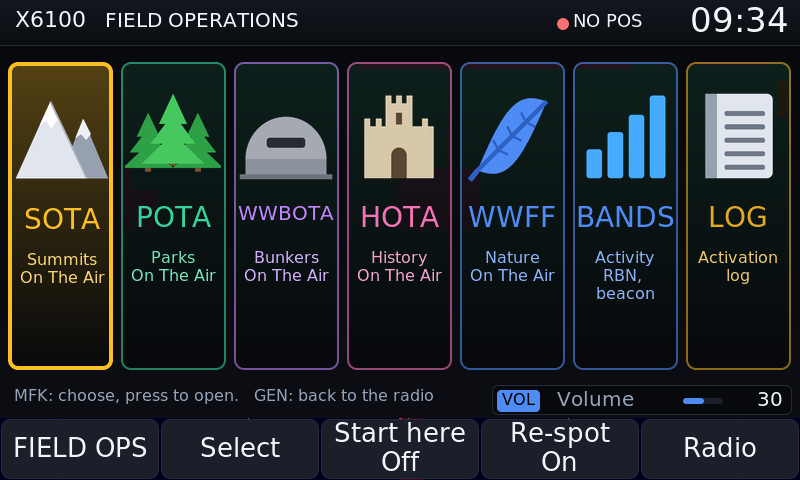
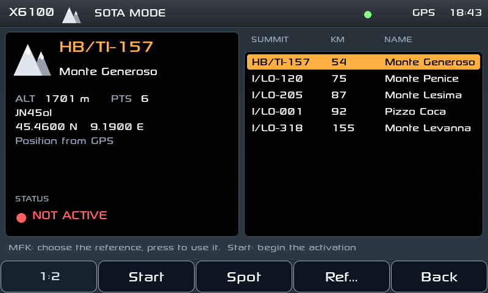
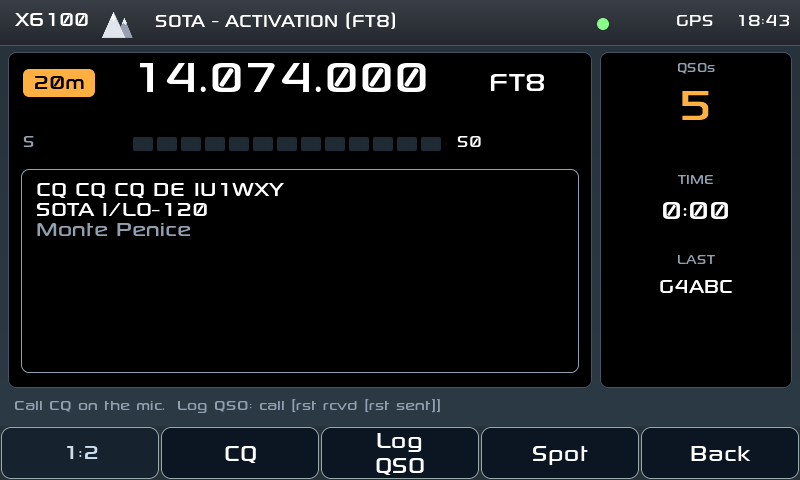
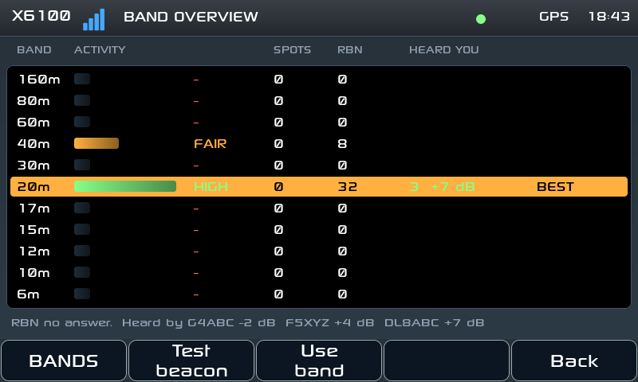
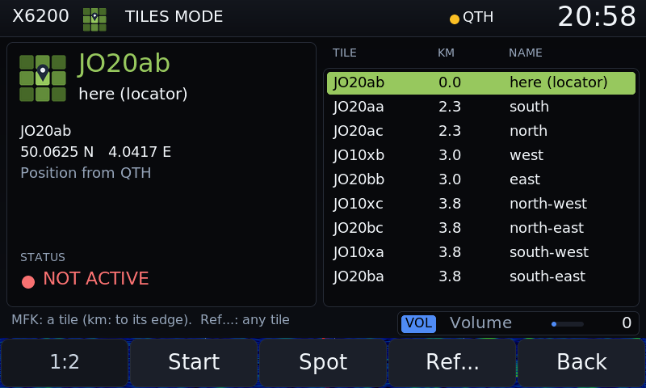
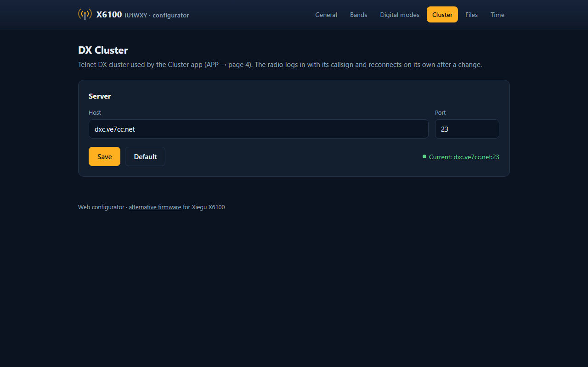
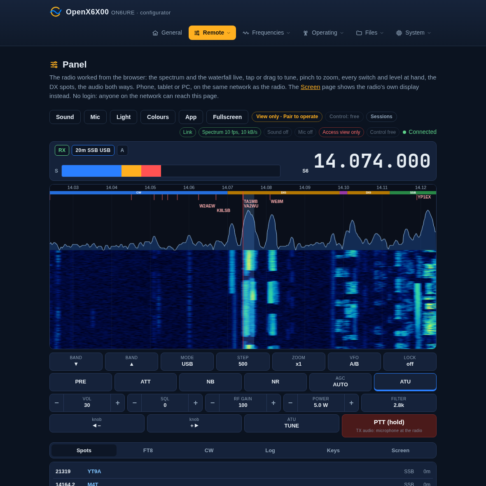

# OpenX6X00: manual

How to use every part of the firmware, and the reference tables. The short
overview is the [README](../README.md).

Each option has a "Where:" line with its place on the radio, for example
"Where: Settings > Display > MAIN SCREEN". Settings opens from APP (page 2) >
Settings. Button and option names are written as the radio shows them.

## Contents

- [Getting started](#getting-started): [first steps](#first-steps), [buttons and knobs](#buttons-and-knobs)
- [Updating the firmware](#updating-the-firmware)
- [Main screen](#main-screen): [band keys](#band-keys), [receiving outside the ham bands](#receiving-outside-the-ham-bands), [WR12 receiver](#wr12-receiver-x6200), [low battery](#low-battery), [battery time](#battery-time), [status bar](#status-bar), [S-meter](#s-meter), [waterfall](#waterfall), [screen recording](#screen-recording), [Walkie Talkie](#walkie-talkie-mode)
- [Settings](#settings): [General](#general-tab), [Display](#display-tab), [Audio](#audio-tab), [Wireless](#wireless-tab), [Bluetooth](#bluetooth-tab), [Keys](#keys-tab), [Cluster](#cluster-tab), [TX Cal](#tx-cal-tab), [Info](#info-tab), [Walkie](#walkie-tab)
- [Transmitting](#transmitting): [TX shift](#tx-shift), [SWR scan and the tuner](#swr-scan-and-the-tuner), [digital-mode TX level](#digital-mode-tx-level), [recording voice messages](#recording-voice-messages), [ALC in CW](#alc-in-cw)
- [Digital modes](#digital-modes): [opening a mode](#opening-a-mode), [FT8 and FT4](#ft8-and-ft4), [JS8](#js8), [WSPR](#wspr), [SSTV, WeFax and NavTex](#sstv-wefax-and-navtex), [PSK31, PSK63 and Olivia](#psk31-psk63-and-olivia), [JTTY](#jtty), [RTTY and WeFax TX](#rtty-and-wefax-tx)
- [CW](#cw): [CW decoder](#cw-decoder), [CW from the keyboard](#cw-from-the-keyboard), [CW Keyboard](#cw-keyboard), [USB paddle](#usb-paddle), [CW messages](#cw-messages), [CW Trainer](#cw-trainer)
- [Apps](#apps): [DX Cluster](#dx-cluster), [Field Ops (SOTA / POTA)](#field-ops-sota--pota), [Bands](#bands), [Channels](#channels)
- [Bluetooth](#bluetooth): [headphones](#bluetooth-headphones), [CAT](#bluetooth-cat)
- [Themes](#themes)
- [Web configurator](#web-configurator)
- [Wavelog](#wavelog)
- [Winlink](#winlink)
- [Browser panel](#browser-panel)
- [Browser remote](#browser-remote)
- [TCI server](#tci-server)
- [Network name](#network-name)
- [SSH](#ssh)
- [Tailscale](#tailscale)
- [Ethernet](#ethernet): [USB tethering](#usb-tethering)
- [Troubleshooting and FAQ](#troubleshooting-and-faq)
- [Reference](#reference): [Bluetooth CAT connection](#bluetooth-cat-connection), [CI-V commands](#supported-ci-v-commands), [btcat-ctl](#btcat-ctl), [btaudio-ctl](#btaudio-ctl), [files on /mnt](#files-on-mnt)
- [Build](#build)

## Getting started

### First steps

1. Set your callsign and QTH locator.
   Where: Settings > General > STATION.
   JS8, FT8, WSPR (TX and upload) and the DX Cluster need the callsign.
2. Connect to a WiFi network, for example your phone's hotspot.
   Where: Settings > Wireless > WIFI.
   WiFi sets the clock, and the DX Cluster, the uploads, the web configurator
   and the TCI server need it.
3. Check the clock. FT8, JS8 and WSPR need it right to a second or two.
   Where: Settings > General > DATE / TIME.
4. Open the web configurator from a browser on the same network:
   `http://x6100.local/`, or `http://<radio IP>/` where mDNS names do not
   resolve (see [Web configurator](#web-configurator)).

### Buttons and knobs

The APP button opens three pages of apps and tools:

| Page | Buttons |
|---|---|
| APP 1:3 | Modes, Cluster, SWR Scan, RX Recorder |
| APP 2:3 | Settings, CW Trainer, Field Ops, Channels |
| APP 3:3 | Bands, GPS, Screen rec, CW Keyboard |

With Icon menus on (Settings > Display > INTERFACE, on by default) APP also
opens the same apps as a grid of tiles over these pages, with Walkie and
Birdie Cal besides: the MFK chooses a tile, a press opens it, APP or ESC
closes the grid. "APP > CW Keyboard" in this manual is the tile, or the
button on APP 3:3.

- Each app has its own button pages, named like `(JS8 1:7)`. The first
  button goes to the next page.
- The MFK walks the items of an app or a list; a press chooses.
- ESC closes popups and apps.
- A press of VOL does not close menus or apps, and in a text field it types
  nothing; on the main screen it still works as ESC. Held, it is still one
  press.

Long press. Each button group (GEN, APP, KEY, MSG, DFN, DFL) has a
long-press action.
Where: Settings > Keys > FRONT KEYS, LONG PRESS.

| Kind | Actions |
|---|---|
| Quick | none, screenshot, RX recorder on/off, screen rec on/off, mute, WF mode, ATT on/off, PRE on/off, tuner on/off, tuner tune (transmits a carrier) |
| Digital modes | RTTY, FT8, WSPR, JS8, SSTV, WeFax, NavTex |
| Tools | Cluster, CW Trainer, CW Keyboard, Field Ops, Bands, Channels, RX recorder, SWR Scan, GPS, QTH grid, Settings |

The hand mic F1 and F2 keys (short and long press) are set in the same tab.
Where: Settings > Keys > HAND MIC KEYS.
The hand mic MODE key steps LSB, USB, CW, CW-R, AM, NFM; a long press turns
DIG on or off in SSB, like a long press of the front SSB key.
The hand mic FIL key works as the front DFL key: the filter pages, and the
DFL long press action.
The hand mic V/M key opens the [CHANNELS](#channels) window; UP and DOWN
step through the channels (a long press changes band).

## Updating the firmware

The radio updates itself: Settings > Info > Update, or the Update page of the
web configurator (System > Update).

- Check asks GitHub for the latest release. Install downloads its update
  bundle (the GUI, the web pages, the helpers and their data, about 10 MB),
  checks every file against the project's signature, puts the files in place
  with the previous ones kept, and restarts the radio software: the screen
  goes dark for a few seconds. Settings, logs and everything on the DATA
  partition stay as they are.
- The new version is "pending" until it has run a minute; then it is
  confirmed. If it does not stay up for a minute three times in a row, the
  start loop puts the previous version back by itself. A power cut during the
  install is undone the same way at the next start.
- The web page can also take a bundle file (`OpenX6X00-x6100-vX.Y.Z-update.tar.gz` or `OpenX6X00-x6200-vX.Y.Z-update.tar.gz`
  from the releases page) for a radio without internet, and has a button to go
  back to the previous version by hand.
- The bundle is signed; a bundle not made by the project is refused. (For
  building your own: `tools/update/mkbundle.py`, the key in
  `rootfs/usr/share/x6100/update.pub`; a radio with `/mnt/update/allow-unsigned`
  takes unsigned bundles.)
- What the updater cannot change comes with a card image: the kernel, its
  modules (the WiFi driver), U-Boot, the partition layout. The radio says when
  a release has a new card image for it:
  - Check: "vX is available, with a new card image", and a message saying what
    the image brings. Install still updates the radio software; the image is
    written when convenient.
  - After the update, Settings > Info > Update and the web Update page say
    "New card image for this version: ..." until the new image is on the card,
    and the radio says it once at the first start of each version.
  - Writing a new image keeps the settings and logs on the DATA partition (see
    [Install](#getting-started)); download the Backup first all the same.
  - How it knows: every card image carries its level for its radio in
    `/etc/openx6x00-image`, which no update touches, and each version lists the
    level it wants in `/usr/share/x6100/image-required`. Images up to v0.3.3
    have no stamp and count as level 1.

## Main screen

### Band keys

The BAND keys (and the hand mic's long UP/DOWN, the keyboard's PgUp/PgDn, the
Walkie Talkie's Band buttons, the browser panel) step through the active bands
of the band list, from the frequency up or down.

- They skip a band the radio cannot tune: 4 m (70 MHz), and on the X6200 2 m
  and 70 cm, unless a transverter (Settings > General > TRANSVERTERS) or, on
  the X6200, the WR12 covers it (see [WR12 receiver](#wr12-receiver-x6200)).
  The band plan strip, Birdie Cal and the browser panel's band list leave them
  out the same way.
- 2 m and 70 cm on the X6100 are transverter bands (Settings > General >
  TRANSVERTERS): they stay on the band keys while a transverter covers them.
- 60 m (5351.5-5366.5 kHz, WRC-15) is on the band keys, between 80 m and
  40 m. It opens at 5.360 MHz in USB, the sideband used there. A radio
  updated from an older version gets it too, unless a band of its own already
  covers part of it (a "60m CW" added on the web page). Whether the base lets
  you transmit there is the base's own band plan: both bases list a 60 m band
  around it. Not tried on the air yet.
- A band with no mode saved opens in LSB under 10 MHz and USB above, USB on
  60 m; on the X6200 wide FM on FM broadcast, AM on the airband and NFM in
  what only the WR12 receives.

### Receiving outside the ham bands

- The broadcast bands of the band list (Broadcast 75m to 11m) open in AM and
  keep their own mode and settings, as a ham band does; the band keys still
  skip them. (They opened in LSB under 10 MHz and USB above, which made AM
  stations sound garbled.)
- The X6200 also receives FM broadcast (87.5-108 MHz, wide FM) and the airband
  (118-137 MHz, AM), as its specification has it: two bands, FM broadcast and
  Airband, after 6 m on the band keys. They are receive only: PTT, the digital
  apps, CW from the keyboard, the tuner and the SWR scan are refused there,
  with "No TX on 100.000 MHz: receive only".
- The same refusal holds anywhere the radio does not transmit: above 55 MHz
  without a transverter, and what the WR12 receives unless a transverter with
  a shift covers it (the transverter wins, see
  [WR12 receiver](#wr12-receiver-x6200)). In split it is the other VFO's
  frequency, the one the radio would transmit on, that counts.
- PRE and ATT are on the VOL 2:2 button page (F1 from the main screen), per
  band. The X6200 has no PRE key, and its receiver is specified with the
  preamplifier on: turn PRE on when the band sounds quiet.

### WR12 receiver (X6200)

Xiegu's WR12 is a receiver for the X6200's HOST port: 54 MHz to 1 GHz,
receive only. The radio cannot tell yet that it is plugged in, so a switch
says so. Where: Settings > General > WR12 RECEIVER > WR12 on HOST (also on
the web Display page, Receiver card). Off by default.

- On: the bands of the band list between 54 MHz and 1 GHz come onto the band
  keys and the band plan (4 m, 2 m, 70 cm with the default list), and the
  knob and the keypad go up to 1 GHz. They open in NFM. Everything there is
  receive only (PTT, the apps, CW, the tuner and the SWR scan are refused with
  a message), unless a transverter with a shift covers it: the transverter
  wins and transmits on its IF. Set its shift to 0 to leave that range to the
  WR12.
- Off again while on one of those bands: the radio goes to the band below
  (the airband from 2 m).
- Not tested yet: whether the base tunes through the WR12 by itself when it is
  given a frequency above 137 MHz, as this switch assumes. Reports are
  welcome, with the log of the run (`/mnt/app_logs/`): at every start the
  radio writes there what is on the HOST port ("USB on HOST: ..."), what it
  would need to detect the WR12 by itself.
- The X6200's two transverters (2 m and 70 cm, 28 MHz IF) are off by default,
  so that 2 m and 70 cm are the WR12's. Older versions had them always on:
  "145.500" was tuned and transmitted on 29.500 MHz, on 10 m. A transverter
  set up in Settings before the update keeps its shift. The three that
  gdyuldin's X6200 firmware saves (4 m, 2 m and 70 cm through a 28 MHz IF)
  are not taken for yours when they are exactly its values and nothing else
  is set: they are removed, and the transverters are off. To use one, set
  its shift in Settings > General > TRANSVERTERS (0 is off).

### Low battery

On battery, at 10% or less the radio shows a message every minute: "Battery
8%: about 15 min left" (the minutes when it knows them), and from 5%
"Battery 5%: connect power". At 6.0 V it shows "Low battery! Turning off in
30s" and switches itself off to protect the battery. As a guide, on my radio
receiving with WiFi and Bluetooth on, 10% left about 22 minutes and 5% about
12.

Right after power-on the base may not have measured the battery yet: one
X6100 reported nothing for about 3 seconds, then a charge that climbed to the
real one over about 7 more. The radio does not take those first readings: the
box at the top right stays empty, and the battery's readings count from about
15 seconds after the base's first reading with a voltage, some 15 to 20 seconds
after the screen comes up. The warnings and the power-off at 6.0 V work from
then on. The GUI log (app_logs) lists what the base sent until then, as
"battery: start-up reading" lines.


### Battery time

> **Experimental.** The time left is an estimate, not a measurement. The radio
> learns it by itself from how you use it, and it gets more precise over time.
> A "~" in front of the time means it is still learning.

At the top right the radio shows the charge and the time left:
- On battery: "45%  2h07", that is 45% of charge and about 2 hours and 7
  minutes before the battery is empty, if you keep using the radio the way you
  are using it now. While the radio is still learning, the time has a "~" in
  front: "~4h28".
- Charging: the lightning sign with "66%  ~3h05", the time still needed to
  reach a full charge.
- Charged and still on the external supply: "99%" with the power sign.
- External supply only, no battery fitted: the external voltage, "12.1v".
- Just after power-on: nothing, for 15 to 20 seconds, while the base's first
  readings settle (see [low battery](#low-battery)).

The "~" stays until the radio has seen at least 2 hours of discharge or 2 full
charges. Until then take the time as a rough guess.

<!-- IMG battery_estimate_main.png: top right, "45%  2h07" -->

How the radio works it out: there is no fixed table, it learns from how you
really use it. It weighs what draws current:
- receiving;
- transmitting, by watts and by seconds on the air;
- WiFi and Bluetooth;
- headphones;
- screen brightness.

The time shown follows what you did in the last 20 minutes. It counts down
minute by minute and rises slowly, but it never shows more than the model gives
for the % now: near empty the % can fall 30 points in a few minutes, and the
time falls with it. At 0% on receive it shows 0h00. While you transmit the %
sags under the TX current, so a single 0% reading is not taken as empty: the
time reaches 0h00 after a few minutes at 0%. (Up to v0.3.5 it also followed
slowly on the way down, and could still show hours at 0%, issue #31.) Every 20
minutes the radio works its model out again and saves it on the microSD, so it
is not lost when you switch off. The more you use the radio, the closer the time
gets to the real one.

Limits:
- If you start transmitting much more than usual, the time drops fast. That is
  correct: the battery really is going down faster.
- While charging the time is less precise, because the base reports the charge
  in uneven steps while it charges.
- A battery that is getting old loses capacity. The radio follows the change
  after a few discharges, not at once.

The voltage is no longer at the top: read it in the POWER box of the
[Info tab](#info-tab). The battery log stays on the radio's microSD and is not
sent anywhere.

### Status bar

The box at the top left of the main screen: the radio state on the first row,
the connections on the second.

| Item | Meaning |
|---|---|
| VFO-A / VFO-B | the VFO in use; SPL-A / SPL-B when split is on; with a [TX shift](#tx-shift) the shift ("-600k") or REV; red in split when the radio cannot transmit on the other VFO |
| USB-D, LSB, CW... | the mode |
| AUTO, FAST, SLOW, OFF | the AGC |
| PRE, ATT, ATU | highlighted when the preamp, the attenuator or the tuner is on |

Each icon of the second row is dark when off, grey when on but not connected
yet, in colour when working:

| Icon | Colour means |
|---|---|
| WiFi | green connected; grey on, no network; dark off |
| Bluetooth | blue a device connected; grey on, nothing connected; dark off |
| Note | blue Bluetooth headphones connected (A2DP) |
| Keyboard | amber a Bluetooth CAT client connected; grey CAT bridge ready |
| Arrow | green GPS position (fix in the last 10 s); grey GPS on, no fix |
| DX | green DX cluster connected; grey connecting or retrying; dark stopped |

In the middle is the [S-meter](#s-meter). On the right: the local time and the
charge with the time left (see [battery time](#battery-time)).

### S-meter

The S-meter shows the signal and its level in dB. Three options set its look.

Where: Settings > Display > MAIN SCREEN (also on the web configurator's
Display page).

| Option | Values | What it does |
|---|---|---|
| S-meter type | Bars, Needle | Needle (the default): a wide, low dial with a needle, in the theme's colours; the dB value is under the dial. Bars: thin bars along the scale. |
| S-meter colours | Theme, Scale, Level | Theme: as the theme draws it. Scale: green, yellow and red along the scale. Level: the lit bars (on the needle, the arc up to the signal) in the colour of the signal level. |
| Needle lamp | on, off | An amber dial lit from behind, with dark marks and a red zone over S9 (the default). Needle only; it replaces the colours. |

The VISION theme always uses bars.

Per band S-meter calibration. Each band has its own correction, -40 to
+40 dB in 1 dB steps; the value shown is the one of the band the radio is on.
Where: Settings > General > CONTROLS > Per band S-meter cal.

- When you start editing it, a panel "S-METER CALIBRATION" says for 5 s:
  "For this band only. Feed -73 dBm and set the reading to S9 on each band you
  use. -22 dB matches an IC-7300."
- Change it only while reading a known signal: -73 dBm (S9) from a generator,
  or the same signal on a calibrated radio.
- A band never calibrated starts at -22 dB, or at the single S-meter cal value
  set before.

### Waterfall

Where: Settings > Display > WATERFALL.

| Option | What it does |
|---|---|
| Mode | Centered keeps the VFO in the middle; Fixed keeps the span (below) |
| Auto level, offset | the levels follow the noise floor; the offset makes it darker or brighter |
| Min / max | the manual levels, used when auto level is off |
| Line, zoom | a line on the VFO; zoom with the waterfall instead of the span |
| Smooth scroll | scrolls by pixels instead of lines |
| Speed | 3 = 15 lines/s (default), 4 = 20, 5 = 30; 2 = 7.5 and 1 = 5 average the frames into a line: less noise and less CPU |

In Fixed mode the span stays still and the VFO line moves across it. The
spectrum comes in only for the span around the VFO, so the side you tune
away from gets nothing new: there the waterfall goes on with the last
picture received at those frequencies, and the spectrum shows its last line
there, dimmed: the last one received after the dial had been still for half a
second. When what is received is a quarter of the spectrum's span from the
centre (25 kHz at zoom 1, 12.5 kHz at zoom 2), or the VFO 40% of it, the
view jumps back and centres on what is received: the VFO, less any IF shift
(with Smooth scroll on, the waterfall slides there).

Over the waterfall. Where: Settings > Display > MAIN SCREEN.

| Option | What it does |
|---|---|
| Band plan | the band segments in a strip at the top |
| Cluster spots | the DX cluster calls at their frequencies (see [DX Cluster](#dx-cluster)) |
| Cluster column | the spot list in a box on the right |

The band plan strip shows the IARU Region 1 segments (160 m to 6 m, 60 m as
WRC-15). A band of the band list the IARU plan does not cover (one added on
the web configurator's Bands page, the top of 6 m, 4 m, 2 m) gets a strip
too, typed from its name: CW in the name makes a CW segment, DIG, FT8, FT4 or
DATA a digital one, BCN a beacon one, anything else all modes. "60m CW" at
5.2585 MHz is a CW segment, so the main screen's
[CW line](#cw-from-the-keyboard) works there. Broadcast and CB
get none. A band changed on the web page shows at the next band change.

Zoom and step per mode. Where: Settings > Display > MAIN SCREEN (also on the
web configurator's Display page).

- On (the default): each mode keeps its own waterfall zoom and tuning step
  (FST), and a mode change brings that mode's back. SSB (LSB, USB), DIG
  (LSB-D, USB-D), CW (CW, CW-R), AM (AM, SAM), NFM and wide FM each have
  their own.
- Off: one zoom and one step for every mode. A change in any mode (FST, the
  span buttons, the MFK, the browser panel, CAT) changes them in all, and a
  mode change keeps them, whatever makes it: the mode keys, Mode from band
  plan, or the knob turned into the next band of the band list, which brings
  the mode last used in that band (14.069 in 20m CW to 14.0701 in 20m SSB).
- Turned off, the zoom and step of the mode the radio is in become every
  mode's. They stay over a restart.
- Turned on again, each mode has its own zoom and step back, as they were
  when the option went off.

Spectrum. Where: Settings > Display > SPECTRUM (off by default; the screen
restarts to lay it out). The band plan and the cluster spots stay at the top
of the waterfall. With Spectrum on, the card has:

| Option | What it does |
|---|---|
| Fill | the area under the trace filled |
| Peaks | the peaks held for a moment |
| Fill gradient | the fill fades from its colour at the trace to the background at the bottom |
| Filter colour | the filter passband on the spectrum and the waterfall: Theme (default), Blue, Cyan, Green, Yellow, Orange, Red, Violet, White |
| Height | the height of the spectrum, 60-160 px |


Colours, on the web configurator's Display page:

| Option | Values |
|---|---|
| Waterfall colours | Theme (default), Classic, Gauss, Grey, Fire, Ice, Rainbow |
| Trace colour | Theme, or your own |
| Fill colour | As trace, or your own (the trace is then drawn over it) |

### Screen recording

Records the screen and the audio to an AVI file (MJPEG video, 800x480,
8 frames/s, mono audio).

- Start and stop: APP 3:3 > Screen rec (the button reads Stop rec while
  recording), or a long-press action (screen rec on/off).
- Files: `/mnt/screenrec/screen-YYYYMMDD-HHMMSS.avi`. The web configurator's
  Gallery lists them and can convert them to MP4.
- While recording, the monitor level is raised (to at least 30) so your
  transmitted voice is recorded too. Your monitor setting comes back when the
  recording stops. Not on the X6200: there the recording takes your
  transmission at your own Moni level (0 by default, so it is not recorded).
  The X6200's speaker shares the case with the built-in microphone, and a
  monitor at 30 went round through the microphone into the transmission, a
  loud ringing on the air (issue #15). On the X6100 the raised monitor can do
  the same while you transmit in SSB with the built-in microphone (issue #72):
  use a headset or the hand mic away from the speaker while recording.
- File length: Settings > Audio > SCREEN REC > File length, 1 hour (default),
  45, 30, 15 or 5 minutes. When a file reaches that length it is closed and
  the recording goes on in a new file, named with the time it starts. Stop
  says how many files were saved. An hour takes about 2.5 GB.
- It needs the SD card and 50 MB free ("Screen rec: no SD card", "SD card
  full"). With less than 10 minutes of space left the radio shows "SD card:
  about N min left", again every minute; at 50 MB it stops by itself and closes the
  file properly ("SD card full, recording saved").


### Walkie Talkie mode

The radio held upright, the knobs on top, with a plain screen: VFO or memory,
RX/TX, frequency, mode, a bandscope, the S-meter, and the VOL, SQL and PWR
bars. It follows the theme.

- Bandscope: the band around the frequency, the same trace as the main
  spectrum (fill, peaks, colours, filter and VFO line), with the band edges
  in MHz and the span under it. The zoom is the main screen's. It runs also
  when the main spectrum is turned off.

Where: Settings > Walkie > WALKIE TALKIE > Walkie Talkie (or Settings >
General > CONTROLS > Walkie Talkie). The screen turns to portrait at once, no
restart.

> **How to leave Walkie Talkie mode**
> 1. Press **APP**: the walkie buttons appear on the left edge, the first one reads "(WLK 1:4)".
> 2. **Hold** that first button "(WLK 1:4)" (or press it three times): it goes to "(WLK 4:4)".
> 3. **Hold** the button **"Exit hold"** for a second. The radio goes back to the normal landscape screen.

- PTT: the PTT key on the side of the radio. It transmits with the built-in
  microphone (Settings > Walkie > Microphone); the border turns red and the
  S-meter shows the power and SWR. The microphone of Settings > Audio is back
  when you leave walkie mode.
- VOL knob: always the volume. The buttons that set a value use the MFK. When
  you leave walkie mode the VOL knob goes back to what it was on before.
- F1-F5 run down the left edge, with the buttons next to them. APP opens the
  walkie pages:

| Page | Buttons |
|---|---|
| WLK 1 | MEM/VFO, Band +, Band -, TX power |
| WLK 2 | AM/FM, SSB (held: DIG), ATU (held: tune, it transmits), PRE (held: ATT) |
| WLK 3 | AGC (held: split), A/B (held: copy), Step (held: back), Lock |
| WLK 4 | Store, Clear (held), Vol Sql RF Pwr (the levels page), Exit (held) |

- GEN, KEY, DFN, DFL and VM open their pages as on the main screen.
- Walkie channels: 32 channels of their own, apart from Channel Memory. Each
  keeps frequency, mode, AGC, PRE and ATT, like a memory.
  - MEM: the main knob steps through channels 1-32, the empty ones too. The
    panel shows "CH 05 - name", "CH 05" or "CH 05 - empty". A stored channel
    tunes the radio; an empty one leaves it where it is.
  - Store (WLK 4): the current frequency and mode go into the channel shown,
    and the knob switches to MEM.
  - Clear (WLK 4, held): empties the channel shown.
  - They are kept in /mnt/walkie_channels.json, the same format as
    channels.json with the channel number in "ch". A name can be written
    there; the radio shows it.
- Exit: APP, then WLK 4, hold "Exit hold" (steps in the box above). The screen
  goes back to landscape, no restart.
- Not in walkie mode: the apps, Settings and the hand mic keys. Leave walkie
  mode to use them.

## Settings

APP (page 2) > Settings. The tabs are on three button pages: General, Display,
Audio, Wireless (page 1); Bluetooth, Keys, Cluster, TX Cal (page 2); Info,
Walkie (page 3). The page button, or the APP key pressed again, turns the
page and opens its first tab.

The MFK walks the controls and stops at the first and last one. There the
page shows its top or its end, so status rows below the last control are
always in view. Some cards depend on the base firmware revision (TX AUDIO,
band output gain, TX filter, CESSB, FM emphasis): they are hidden when the
base is too old.

### General tab

| Card | Options |
|---|---|
| STATION | callsign, QTH locator, Mode from band plan (the knob turned into another band plan segment sets its mode: CW in a CW segment, the band's sideband in a phone segment; SSB and CW only), Independent VFOs (VFO A and VFO B each keep their own band, frequency and mode: the VFO key brings the other one's band back, A=B copies everything to the other VFO; off, both VFOs live in the current band) |
| DATE / TIME | date, time, time zone |
| CONTROLS | Freq acceleration, Accel. onset, Charger (Off, On, Shadow), Per band S-meter cal, TX shift of the band the radio is on (see [TX shift](#tx-shift)), Walkie Talkie (see [Walkie Talkie mode](#walkie-talkie-mode)) |
| TRANSVERTERS | two transverters: from, to, shift in MHz; a shift of 0 is off (the X6200's default, see [WR12 receiver](#wr12-receiver-x6200)) |
| WR12 RECEIVER | the X6200 only: WR12 on HOST (see [WR12 receiver](#wr12-receiver-x6200)) |
| TCI SERVER | on/off, port and status, connected client, Clients (Operate or Listen only, see [TCI server](#tci-server)) |

Main knob acceleration. Where: Settings > General > CONTROLS > Freq
acceleration.

- The radio times every detent of the main knob, and the step grows smoothly
  with the speed.
- Turning slowly the step is the tuning step. Turning faster it grows up to
  6 times (Lite) or 15 times (Strong, which also starts sooner). None keeps
  the step.
- Accel. onset (1-5, default 3) sets how soon it starts: 1 only when turned
  fast, 5 already when turned gently.

Charger. Where: Settings > General > CONTROLS > Charger (default On). What the
radio asks the base for with an external supply connected:

- Off: no charging, with the radio on or switched off.
- On: charging, with the radio on or switched off.
- Shadow: no charging while the radio is on; at Power off the base is asked to
  charge, so the battery charges while the radio is off.

The radio sends it at the start, with each change, and again with the rest of
the base's settings (every 3 s in receive on the X6100, every second on the
X6200). A power-off for a low battery asks for charging whatever the setting.
Whether the base charges: External on the [Info tab](#info-tab), for example
"12.1 V  charging".

The X6200 with base 1.0.8 goes on reporting "charging" while the radio is on
and a supply is connected, whatever the setting, so External says "charging"
then (#33). The setting works all the same: measured by a user with the stock
charger and the radio on, with Off the battery stayed at 7.8 V and 65 % for 42
minutes, with On it went from 57 to 64 % in 45 minutes.

Zone. Where: Settings > General > DATE / TIME > Zone. The change applies at
once; summer time follows by itself where the zone has it. 24 zones, UTC then
west to east: UTC, Pacific/Honolulu (HST), America/Anchorage (AKST/AKDT),
America/Los_Angeles (PST/PDT), America/Denver (MST/MDT), America/Chicago
(CST/CDT), America/New_York (EST/EDT), America/Sao_Paulo (BRT),
America/Buenos_Aires (ART), Europe/London (GMT/BST), Europe/Lisbon, Canary
(WET/WEST), Europe/Rome (CET/CEST), Europe/Athens (EET/EEST),
Africa/Johannesburg (SAST), Europe/Moscow (MSK), Asia/Kolkata (IST),
Asia/Singapore (SGT), Asia/Shanghai (CST), Australia/Perth (AWST), Asia/Seoul
(KST), Asia/Tokyo (JST), Australia/Brisbane (AEST), Australia/Sydney
(AEST/AEDT), Pacific/Auckland (NZST/NZDT).

Per band S-meter cal: see [S-meter](#s-meter). TCI SERVER: see
[TCI server](#tci-server).

### Display tab

| Card | Options |
|---|---|
| BACKLIGHT | timeout and brightness, buttons brightness (Always Off, Always On, Temporarily On), Screen off (min) (minutes without a key or knob, 0 never; the key that wakes it does nothing else), Screen always off (the screen stays dark for a radio run from the VFO-Knob or a browser; POWER shows it for the blank time, a minute at least) |
| SPECTRUM | Spectrum; with it on Fill, Peaks, Fill gradient, Filter colour, Height (see [Waterfall](#waterfall)) |
| WATERFALL | see [Waterfall](#waterfall) |
| MAIN SCREEN | Band plan, Cluster spots, Cluster column, Broadcast names, S-meter type, S-meter colours, Needle lamp, Birdies (see [Birdie Cal](#birdie-cal)), Zoom and step per mode (see [Waterfall](#waterfall)) |
| INTERFACE | Popups Freq/Info/ALC, Icon menus, Knob info, Theme, Font, Decoder text, FT8/FT4 info |

- Popups Freq/Info/ALC: a big frequency while tuning, a big value of the
  control being changed, a big ALC reading while transmitting.
- Icon menus (on by default): the APP grid (see
  [Buttons and knobs](#buttons-and-knobs)), APP > Modes as tiles and icons on
  the Settings tabs; off, APP shows its button pages only, Modes a list and
  the tabs their numbers. It shows the next time they open.
- Knob info: the value shown while a knob turns.
- Theme: see [Themes](#themes). A new theme applies at once, without a restart.
- Font: Sony Sketch, Roboto or DejaVu (default). A new font applies at once.
  Themes with their own font (Black Metal, Total Black, 1bit, a theme file that
  sets one) keep it.
- Broadcast names (from v0.127): tuned to a broadcast station on the air,
  the frequency strip shows "BC <station name>" in a light blue box instead
  of the band name. The names come from the broadcast list (see the
  [Info tab](#info-tab)).

All these options are also on the web configurator's Display page.

### Audio tab

| Card | Options |
|---|---|
| RX AUDIO | Speaker mode, Line-in / Line-out, Play / Rec gain, Boot sound (CQ CQ in CW with the boot logo, quiet; at volume 28 when your VOL is lower; off by default), Speaker always off |
| TX AUDIO | compressor (threshold, makeup), TX filter, FM pre/de-emphasis |
| MICROPHONE | Input (Built-in, Hand, Auto), Hand mic gain, Built-in gain |
| VOX | On, Gain, Anti-VOX, Delay |
| AGC | Hang, Knee, Slope |

Speaker always off, for a radio run from a browser or a TCI client: the
speaker and the TX monitor stay silent whatever the volume, and there is no
boot sound. The sound to the browser, TCI and Bluetooth headphones goes on as
before. Turning VOL says so on the screen. The CW sidetone keeps its own level
(Key volume). Also on the web configurator's Display page, Remote station card.

Line-in and Play / Rec gain are separate settings:

- Line-in / Line-out (0-36, default 10) are the base's own levels. Line-in is
  the input level for the audio the digital apps transmit.
- Play / Rec gain (dB) are the radio's own playback and recording volumes.
- Up to v0.3.5, moving Play or Rec gain also set Line-in to that dB value,
  as a whole number: 0 at 0 dB and below. With Line-in at 0 the digital apps
  on the X6200 could transmit at 0 W (issue #16). Play and Rec gain no longer
  change Line-in. After the update, a Line-in left that way goes back to 10.
  A Line-in you set on its own slider afterwards stays as it is.

Compressor on the X6200: its base has three levels, so the ratio chosen (Comp
on the MFK 2:3 page) goes to the nearest of them: 2:1 and 3:1 as 2:1, 4:1 to
7:1 as 4:1, 8:1 as 8:1; 1:1 (Off) is off. It is off by default on the X6200.

TX monitor: Moni level (VOL 2:2 page, F2) plays your own transmission on the
speaker. It is 0 by default on both radios. At 30, the default in earlier
releases, the microphone picked the monitor up and fed it back into the
transmission: on the X6200, whose speaker and built-in microphone share the
case, a loud ringing from the moment PTT was pressed in SSB (issue #15); on
the X6100 a feedback loop on PTT and while an app sent its tones (issue #72).
A radio whose Moni level was never changed gets the new default with the
update; a level you set stays. To hear yourself again, turn it up there. On
the X6200 a screen recording does not raise it (see
[Screen recording](#screen-recording)).

### Wireless tab

| Card | Options |
|---|---|
| WIFI | power, status, IP, networks |
| NETWORK NAME | the radio's name on the LAN, `x6100` by default: reachable as `<name>.local` (see [Network name](#network-name)) |
| TAILSCALE | on/off, status, the radio's name and address on your tailnet, the login as a code to scan, Log out (see [Tailscale](#tailscale)) |
| ETHERNET | a USB Ethernet adapter: DHCP or a static address (see [Ethernet](#ethernet)) |

WiFi/BT power switches the WiFi and Bluetooth chip (one chip for both): with
it off, Bluetooth is off too. Bluetooth has its own tab.

Joining a network:

- Press a network, then Connect. A network with a lock asks for its password
  (8 to 63 characters); an open one joins at once. The digits, the dot and CE
  of the hand mic type into the password box.
- The radio joins open and WPA2 networks, and WPA2/WPA3 ones in WPA2. It says
  so instead of asking for a password on a WEP, WPA Enterprise, Enhanced Open
  (OWE), WPA3-only or hidden network.
- A join that does not complete is tried four times. Then the screen says why:
  "handshake failed: password, signal or router security", "no answer: signal,
  channel or router security", "not in range", "joined, but no address from
  DHCP", and so on. A wrong password and a weak signal look the same to the
  radio, so the first message names both.
- After a failed join the radio writes what its WiFi module, NetworkManager and
  the supplicant said to `app_logs/wifi.txt` on the card's DATA partition (no
  password is in it). Attach that file to a report.
- The saved networks, the SSH host keys and root's SSH keys are copied to
  `backups/backup.tgz` on the DATA partition at every clean shutdown, and when
  a key is added or removed on the web configurator ([SSH](#ssh)). At the first
  start of a rewritten card they are taken back from it, so the card keeps its
  WiFi (a network named `Cafe [5G]` too); files already there are left alone.
  Only regular files of those three folders come back, each written by the
  radio itself: a link, a device, or a name the archive holds twice is left
  out.

An access point that does not answer the X6100 (#29, #32):

- Some access points never let the X6100 join, with the right password and a
  good signal: MediaTek ones (GL.iNet GL-MT3000, GL-MT3600BE) and the UniFi
  U6+ among them. The radio authenticates, then the access point never
  answers its association request. Connect makes its four tries and then
  says, on a network with a password, "handshake failed: password, signal or
  router security", as a wrong password does. In `app_logs/wifi.txt` the
  supplicant's `AssocStatusCode` is 1; `dmesg` shows
  `RTL871X: auth success, start assoc` with no association after it. (The
  "join refused, assoc status 1" quoted in #29 is another firmware's log.)
- The X6100's WiFi driver, 8723bu, sent its HT capabilities one octet short,
  and these access points do not answer that. The fixed driver comes with the
  card image of the release that carries it: write that image (see
  [Install](#getting-started)). An update alone does not change the driver;
  the radio says when a release has a new card image for it (see
  [Updating the firmware](#updating-the-firmware)).
- Until then the kernel's own driver for the chip, rtl8xxxu, joins them. The
  X6200 has another chip and driver, and none of this applies to it.

rtl8xxxu over [SSH](#ssh) (through a phone hotspot, which the radio joins, or
[Ethernet](#ethernet)), until the next start:

```
/etc/init.d/S45network-manager stop
rmmod 8723bu
modprobe rtl8xxxu
/etc/init.d/S45network-manager start
```

rtl8xxxu at every start (the radio restarts):

```
mv /etc/modprobe.d/x6100-wifi.conf /etc/modprobe.d/x6100-wifi.conf.disabled
echo 'blacklist 8723bu' > /etc/modprobe.d/disable-8723bu.conf
reboot
```

Back to 8723bu without a new card image:

```
rm /etc/modprobe.d/disable-8723bu.conf
mv /etc/modprobe.d/x6100-wifi.conf.disabled /etc/modprobe.d/x6100-wifi.conf
reboot
```

Writing a new card image, such as the one with the fix, goes back to 8723bu
by itself. The 20 MHz and channel 12 and 13 settings in `x6100-wifi.conf` are
8723bu's and do not apply to rtl8xxxu.

### Bluetooth tab

| Card | Options |
|---|---|
| ADAPTER | Bluetooth (power), Status, Address, Pairing (3 min) |
| DEVICES | Scan (headphones and keyboards, 16 s), Activity, the device list |
| HEADPHONES | RX to headphones, Volume, Mute speaker |
| BLUETOOTH CAT | Clients connected, Port |

- Status: *on* and hidden (paired devices connect, nobody else can pair),
  *pairing* while the pairing window is open, *off*. With the WiFi/BT chip
  switched off in Wireless it says so; if the Bluetooth service on the radio
  stops it says that too, and the page picks it up again when it is back.
- Pairing (3 min): the radio is visible and pairable for 3 minutes, the label
  counts down. Outside the window every pairing request is refused.
- The list: paired devices first, then what Scan found. Tags: *headphones*,
  *keyboard*, *phone*, *CAT* (a PC or other CAT client), *new* (not paired
  yet), *connected*. When a scan moves the devices around, the MFK stays on
  the device it was on.
- MFK press on a *new* device: pair and connect (headphones in pairing mode;
  for a keyboard press its pairing key). A keyboard that never sends its
  name shows as *Keyboard* and its address. Activity says what is going on:
  the code to type on a keyboard (then Enter), or "not found - is it in
  pairing mode?".
- MFK press on a paired device: a menu with Connect or Disconnect, Connect at
  startup (headphones) and Forget. Forget asks again (Cancel is first); after
  it the device has to be paired again.
- One pair of headphones at a time: connecting one disconnects the others. A
  keyboard and a CAT phone stay connected.
- Details: [Bluetooth headphones](#bluetooth-headphones), [Bluetooth CAT](#bluetooth-cat).

### Keys tab

| Card | Options |
|---|---|
| FRONT KEYS, LONG PRESS | the long-press action of GEN, APP, KEY, MSG, DFN, DFL (see [Buttons and knobs](#buttons-and-knobs)) |
| HAND MIC KEYS | F1, F2, F1 long, F2 long |
| PADDLE | USB paddles: Connected, the dit/dah of each kind, Learn dit and dah, Swap dit and dah, Serial port (see [USB paddle](#usb-paddle)) |

### Cluster tab

| Card | Options |
|---|---|
| CLUSTER FILTERS | Modes (CW, SSB, DIG, AM/FM), Bands (160-6 m), Activity (POTA, SOTA, WWBOTA, HOTA; none lit = all spots) |
| CLUSTER VIEW | Newest first, All bands, Spot snap hold, Spot snap speed |
| PSK REPORTER | Report decodes (on by default) |

What they do: see [DX Cluster](#dx-cluster).

### TX Cal tab

| Card | Options |
|---|---|
| TX CALIBRATION | IQ offsets, band output gain, codec gain |
| CESSB | on, level |
| TX PROTECTION | SWR protection |
| S-METER | Preamp, Attenuator, RF gain a step, Measure |

S-meter front end. Where: Settings > TX Cal > S-METER.

The S-meter reading stays put when PRE, ATT or the RF gain change: the
preamp's gain is taken off the reading, the attenuator's depth added, and
for every RF gain step under 100 a fraction of a dB added. The three values
are settings, with the figures measured on one radio as defaults.

| Setting | Range | Default |
|---|---|---|
| Preamp | 0 to 40 dB | 19 dB |
| Attenuator | 0 to 40 dB | 15 dB |
| RF gain, a step | 0.00 to 2.00 dB | 0.60 dB |

Measure sets them for your radio, since preamps differ a little. Feed a
steady carrier, from a signal generator (around -73 dBm, S9) or a strong
broadcast station, so the meter reads between S5 and S9+20, and press
Measure. For about 12 s the radio reads its meter with everything off, then
with PRE on, with ATT on, and with the RF gain at 40, a second and a half
each, and moves the three settings by what was left over. PRE, ATT and the
RF gain go back as they were, also when you press Stop, leave the tab or
transmit. A reading that wanders more than 3 dB during a step, or a carrier
outside S5 to S9+20, stops the measurement and changes nothing. A band
change stops it too ("Stopped: band changed"): PRE and ATT belong to the
band, so check them on the band you left.

The per band S-meter calibration (Settings > General > CONTROLS) is a
separate correction, for the band's level with everything off.

SWR protection. Where: Settings > TX Cal > TX PROTECTION > SWR protection.

- Off, or the highest SWR allowed, 1.5 to 5.0 in steps of 0.5. Default 2.0.
- When the SWR stays over it for 0.3 s, the transmission stops and the radio
  says "TX stopped: SWR 3.4". Short spikes at key-up don't count.
- Not while the ATU tunes: the tune carrier sees a high SWR on purpose.
- Nothing stays locked: the next PTT or transmission goes out again.
- It stops what the radio keys itself: CAT PTT, the PTT button, CW messages
  and the CW keyboard, voice messages, the digital apps and the keyboard
  paddle (it keys again after both paddles are let go). A PTT held on the
  hand mic, VOX and the radio's own CW keyer may key again at once: let go
  and check the antenna.

Stuck TX. Now and then a command from the radio to its base (the board that
transmits) does not get through, and a lost PTT off could leave the radio
keyed. The radio watches for it; there is nothing to set.

- If the base is still in TX 2 s after PTT off, and a command to it failed in
  the 10 s before, the radio sets the TX power to 0. Your power comes back as
  soon as the base is back in RX.
- A PTT held on the hand mic and VOX are never cut: the base keys them itself.
- Each case goes into the base log:
  - "write to register N failed: N resent OK, N lost; resending all
    registers"
  - "base still in TX 1000 ms after an un-key or write error, nothing keying it
    from the GUI: PTT off resent"
  - "base still in TX 2000 ms after PTT off and a write error: TX power set to
    0 (vext 13.8 V, vbat 8.2 V)"
  - "base back in RX: TX power 5.0 W restored (vext 13.8 V, vbat 8.2 V)"
  - "base silent for N ms, battery 8.2 V, external 13.8 V": the base sent
    nothing for more than 0.3 s. Not in the first 10 s after start, at most
    one line every 10 s.

### Info tab

The FIRMWARE card: the project, where its source is, the firmware version and
the baseband version, then the broadcast list and the factory reset (below).

Broadcast list, Update: the timetable of the broadcast stations (EiBi,
eibispace.de) for the current season: A from the end of March to the end of
October, B for the rest of the year; if the new season is not out yet the
previous one is used. The note below shows the list in use ("In use: season
A26, updated 2026-10-17, 9,593 stations."). Update downloads it over WiFi or
Ethernet ("Downloading 0.3 of 0.5 MB") and says "Broadcast list updated:
9,593 stations, season A26."; with no connection, "No internet connection.
Connect the radio to WiFi or Ethernet."; if the download fails, "The
download failed, the old list is still in use." The old list stays as a
spare copy. The SWL panel (GENE key of the hand mic) and the station name on
the frequency strip use the new list at once, without a restart.

Factory reset (from v0.127). Where: Settings > Info > FIRMWARE > Factory
reset, Reset.... A panel lists what goes and what stays; hold the MFK down for
3 seconds to confirm, ESC cancels ("Released: reset cancelled"). A press or a
turn of the knob does nothing. Then the radio software restarts (a few
seconds of dark screen); the radio does not reboot.

> **There is no undo.** Download the Backup from the web configurator first,
> so you can put your settings back.

- Reset: all the settings in params.db (band memory and CW messages
  included), app frequencies, DX cluster, FT8 UDP, PSK squelch, TCI server, time
  zone, headphone volume, Bluetooth CAT.
- Kept: logs (ADIF, QSO, field), memory channels, PSK/Olivia macros, JS8
  texts, voice messages, pictures, recordings, themes, CW trainer progress,
  Bluetooth pairings and autoconnect list.

POWER, below Factory reset, has three lines:
- Battery: voltage and charge, for example "7.9 V  66%", or "not fitted".
- External: the external supply and whether it is charging, for example
  "12.1 V  charging", or "none".
- Time left: what the [battery time](#battery-time) is based on, "learned from
  N h on battery, M charges", or "starting values, learning" while it has
  nothing of its own yet.

<!-- IMG settings_power.png: Settings > Info, POWER box -->

### Walkie tab

| Card | Options |
|---|---|
| WALKIE TALKIE | Walkie Talkie, Main knob steps channels, Microphone |

- Walkie Talkie: turns the portrait screen on. Settings closes and the walkie
  screen comes up (see [Walkie Talkie mode](#walkie-talkie-mode)).
- Main knob steps channels: the main knob goes through the walkie channels
  instead of tuning. The same as the MEM/VFO button on WLK 1.
- Microphone: the input used while the walkie screen is up (Built-in, Hand,
  Auto; default Built-in). The Audio tab's input is not changed.

## Transmitting

TX power (PWR) goes from 0.1 W to 10 W on the X6100, and to 8 W on the X6200:
its rating on an external supply. The Power knob control, TX power on WLK 1,
the browser panel's PWR, TCI's `drive` (100 % is the radio's top: 10 W, or 8 W on the X6200) and CAT stop there.
Up to v0.3.6 the X6200 also went up to 10 W and asked its base for that
(issue #53). A setting saved above 8 W comes back as 8 W. The TX meter keeps
its 0-10 W scale on both radios, so it shows what the radio measures.

### TX shift

A band can transmit at a fixed distance from where it listens: an FM
repeater's input, or a QO-100 station whose receive and transmit converters
put the satellite at two different frequencies. Where: Settings > General >
CONTROLS > TX shift <band>, kHz (the band the radio is on; not shown on a band
the radio cannot transmit on), or the web configurator's Bands page, TX shift
column. 0 is off; up to 10 MHz up or down (9999 kHz in Settings).

- With a shift, split comes on and VFO B stays at VFO A + the shift, in A's
  mode: tune A anywhere (the knob, a memory, the band keys, CAT, TCI, the
  apps) or change its mode, and B follows. The radio listens on A and
  transmits on B.
- The status bar shows the shift in place of SPL-A ("-600k", "+1.6M"); the
  Black Metal and Total Black themes show it after the other VFO.
- The VFO key gives the reverse: on VFO B the radio listens on the
  repeater's input (A = B - the shift) and transmits on its output; the
  status bar reads REV. The VFO key again goes back.
- Split off (AGC held) pauses the shift: simplex on A, the shift kept for when
  split comes on again. A shift of 0 turns split off too.
- The shift belongs to the band: another band has its own, or none. For
  repeaters in part of a band only, give them a band of their own on the web
  Bands page (for example 10m ending at 29.520 MHz and a "10m FM" from 29.520
  to 29.700 MHz) and the shift to that one: tuning into it brings the shift,
  tuning out of it takes it away.
- While the shift is on, VFO B is the shift's: a frequency or a mode written
  to B (CAT, A=B) goes back to A + the shift in A's mode (on REV the other
  way round).
- The radio transmits only where it can (HF, a transverter that is on). Where
  the shift takes B off it (below 0 Hz too, where B itself stops at 100 kHz),
  the VFO on the status bar turns red (in Black Metal and Total Black the
  other VFO's frequency), and PTT, the apps, CW, the tuner and the SWR scan
  are refused with "No TX on ... MHz". The web Bands page saves a shift only
  where the whole band, shifted, can transmit (6 m with +5000 kHz, 55-58.9
  MHz, is refused); the Settings row takes any shift, and B is then red and
  refused where it cannot.
- The digital apps (FT8, FT4, JS8, WSPR, RTTY, SSTV...), the SWR scan, the
  voice messages and TCI's audio go out on the TX frequency, so they work in
  split and with a shift: for each transmission the VFO you listen on moves
  there with the radio's split off, and both come back after. v0.3.5 moved
  the VFO you listen on and left split on: an X6100 sent FT8 1325 Hz above B
  whatever its offset, and the X6200's base sends these from VFO A in split
  (an FT8 CQ at 1200 Hz with a +700 Hz shift was heard at VFO A + 1325 Hz,
  575 Hz below where it belonged).
- Winlink is simplex: it keys only on the frequency the radio listens on.
  With a shift on it does not key and says "Winlink: no TX, a TX shift is set
  on this band"; in plain split with VFO B on another frequency it says
  "Winlink: no TX, split would send on 14.200.000, not 14.105.000". Up to
  v0.3.6 plain split was let through, and Winlink called the gateway from B.
  XIT and RIT are refused the same way ([Winlink](#winlink)).

Two examples:

- A 10 m FM repeater that sends on 29.620 MHz and listens on 29.520 MHz: a
  shift of -100 kHz on the band it is in. Tune to 29.620; the radio transmits
  on 29.520.
- QO-100 through converters to and from 28 MHz, the receive one putting the
  narrowband transponder's lower beacon (10489.500 MHz) at 28.500 MHz, the
  transmit one taking 2400.000 MHz (which comes down at 10489.500) from
  28.000 MHz: a shift of -500 kHz on 10 m. Tune the downlink and the uplink
  follows.

Not tried on the air yet. The hand mic's PTT and the paddle go to the base
directly, without the GUI's check: what the base does with a VFO B it cannot
transmit on is its own TX permit.

### SWR scan and the tuner

SWR scan: APP 1:3 > SWR Scan. It transmits a carrier (AM, 1 W, or less when
PWR is set lower) and sweeps it across the span around the frequency the
radio transmits on (the other VFO in split), drawing the SWR as it goes.

- Run starts the sweep and the button turns into Stop. Stop, or closing the
  window, ends it and puts the VFO and the mode back.
- Span: 50, 100, 200 or 500 kHz (not while scanning). Scale: Log or Linear.
- It starts only from receive. While the radio transmits or the tuner is
  tuning, Run says "SWR scan: not while transmitting or tuning" and nothing
  moves. On a frequency the radio cannot transmit on, it says "No TX on ...
  MHz".

The tuner (the ATU key held, or the "tuner tune" action) transmits a carrier
until it has found a match. The radio now gives up a tune that does not end
normally:

- The base has 3 s to start transmitting for the tuner. If it doesn't, the
  radio says "Tuner did not start".
- If the base goes back to receive without reporting a match, the radio
  waits 1 s and then says "Tuner: no match".
- In both cases the tune is switched off and the radio is back in receive.
  Before, it stayed in its tuning state: a new tune and the SWR scan did
  nothing, and CAT and TCI reported TX until a restart. That is the likely
  cause of issue #25, no SWR scan after a tune on 10 m and 15 m.
- Each case goes into the base log (`/mnt/base_i2c.log`) with what the base
  reported, for example "ATU: Tuner: no match (tx 0, atu_status 0,
  atu_params 00000000)".

Not tried on the radio yet: what the X6200's base reports at the end of a
tune with no match.

### Digital-mode TX level

The apps that transmit from the radio (FT8/FT4, JS8, WSPR, SSTV, RTTY,
WeFax) set their audio level by themselves.

- The level settles with the ALC working a little (about 1), with the power
  at the setting.
- In the first second or so of a transmission nothing changes. Then, while
  the ALC reads under 1, the level goes up slowly and stops there; when the
  ALC goes over 3 or the power is well over the setting, it comes down.
- The level found is kept for the next transmission. Not from a WSPR beacon,
  which has its own power (0.2 W by default): its level would pull the one
  FT8 starts from down.
- On the X6200 the ALC reading does not follow the audio level, so the level
  goes up until the power reaches the setting and stays there.
- A transmission that reads 0 W from its first second to its end says so:
  "TX 0 W: level -38 dB, Line-in 10". Not at a 0.1 W setting, where the
  power reading (in whole tenths of a watt) can show 0.0 all along. The log
  gets a line with the level, the Line-in, the ALC and the power set; send it
  with a report. On the X6200 the level then goes back to its default (0 dB)
  for the next transmission, instead of climbing back 8 dB a transmission. A
  Line-in of 0 is the other known cause: see [Audio tab](#audio-tab).
- At start the log has a line with the base's version, Line-in, Line-out,
  Play and Rec gain and the level kept.

While the AF volume is 0, or the speaker is muted (the mute action, Bluetooth
headphones with Mute speaker, a TCI client transmitting), the TX monitor is
quiet too: the speaker does not play the tones of a digital transmission. On
the X6100 a screen recording still takes them.

TX power while a digital app is open:

- The power is capped at 7 W. With a higher setting the app says so
  ("Power is limited to 7W"), and the setting comes back when you close it.
- The Power button in the apps sets the power: 0.1, 0.2, 0.5, 1, 2, 3, 5,
  7 W. WSPR's Power button is its own and leaves the radio's power alone (see
  [WSPR](#wspr)).
- Digital apps reopen on their last frequency and mode.

### ALC in CW

In CW and CW-R the ALC bar of the TX panel is grey. In CW the base makes the
carrier itself and its own ALC brings it down to the power set, so the bar
only shows how much it turned it down. Readings around 5 on a dummy load are
normal; there is nothing to adjust.


### Recording voice messages

**Voice messages can be recorded only from the hand mic.** The built-in
microphone cannot record them. This is a limit of the radio's baseband, not
of this firmware: the baseband keeps the built-in microphone off while
receiving and turns it on only when transmitting.

- It applies to MSG > Voice (Rec) and to the Field Ops voice CQ (Rec CQ).
- With no hand mic, after 3 seconds the radio says "No audio: recording uses
  the hand mic".
- Transmitting with the built-in microphone works as usual (Settings > Audio
  > MICROPHONE), also in Walkie Talkie mode.
- The recording keeps 250-3000 Hz, what SSB sends, without the radio's own
  hum and whistles.

## Digital modes

### Opening a mode

APP (page 1) > Modes opens a menu: RTTY, PSK31, PSK63, FT8, FT4, FT2, WSPR, Olivia,
JTTY, JS8, SSTV, WeFax, NavTex. Turn the MFK to choose, press to open; the last used mode is marked.
Pressing Modes again closes the menu.

- Callsign and QTH: Settings > General > STATION.
- The apps reopen on their last frequency and mode.
- Power is capped at 7 W while an app is open (see
  [Digital-mode TX level](#digital-mode-tx-level)).

### FT8 and FT4

APP > Modes > FT8 (or FT4, FT2). The radio tunes an FT8/FT4/FT2 frequency; the band
keys step through the others. 80 px of waterfall (about two slots) sit above
the list. The main knob moves your TX audio offset.

Buttons:

| Page | Buttons |
|---|---|
| 1 | Show: All / CQ, Mode: FT8 / FT4 / FT2, TX CQ, TX Call |
| 2 | Hold Freq, Auto, Force QSO save, Power |
| 3 | CQ Modifier, Time Sync, Log Map, Live Map |
| 4 | Freq: Preset / 14.091, Hound: Off / On, Retries, For you |

- Show: CQ shows the CQs and the messages to you; All shows all traffic.
- TX CQ calls CQ. A band key, Freq or Mode ends the CQ: TX CQ goes to
  Disabled (after a band key or Freq the radio also says "CQ off: press TX
  CQ to call on this frequency"), and one press calls again there. A reply,
  yours or Auto's, takes the CQ's place and turns it off too. TX Call allows
  or stops transmitting; stopping cuts a transmission in progress.
- Hold Freq: your TX offset does not move to the station you answer.
- Auto: the next message of the QSO is sent by itself, and a station that
  calls you gets an answer, also while you call CQ (what other programs call
  "Res"). It never calls a CQ on its own. If several stations call you in the
  same slot and one is a POTA activator, that one is answered first.
- Retries: how many times a message goes out with no answer before the QSO is
  dropped. Each press steps 3, 4, 5, 6, 8, 10, 12, 15 and back to 3; 6 by default.
- Time Sync: for a clock off by a few seconds with no WiFi or GPS to set
  it. Press it as a slot starts (the signals start, or a clock you trust
  shows :00, :15, :30, :45): the clock moves to the nearest slot start (15 s
  FT8, 7.5 s FT4, 3.75 s FT2) and is kept in the clock chip. A clock that
  NTP (WiFi) or the GPS keeps is left alone ("Clock in sync", "The GPS keeps
  the clock"): moved to a press it could only get worse.
- CQ Modifier: for example `CQ POTA` or `CQ DX`.

The list. Each row has the slot time, the message, and on the right the
country with its flag, the distance (when the sender sent a grid and your
QTH is set) and the SNR. The country comes from AD1C's cty.dat (SP2KMO's
upstream PR #282). Settings > Display > INTERFACE > FT8/FT4 info picks what
goes next to the SNR: km, mi, Country, Country + km (the default) or
Country + mi.

| Row | Colour |
|---|---|
| CQ, not worked | green |
| CQ, worked on another band or mode | dark green |
| CQ, worked on this band and mode | darker green, struck through |
| a message to you | red |
| your TX | blue |

A POTA tag after the message marks a station spotted on POTA right now, and
any `CQ POTA`. The spots are the ones the cluster already fetches from
pota.app; with no spots there is no tag.

Replying. Turn the MFK onto a row and press it. The radio
answers that station, moves your TX offset there (unless Hold Freq is on) and
turns TX Call on. A press while transmitting stops TX. Touching a row answers
it too; the MFK stays on its row, and on the last row the list keeps
following new messages. Dragging the list leaves the MFK on the row you let
go on.

The "For you" strip. Stations that call you stay pinned in a strip under the
list, so they do not scroll away.

- Up to 3 stations, one row each, newest at the bottom.
- A row stays 2 minutes after the station's last message. It leaves earlier
  when you send that station RR73 or 73. A band or mode change clears it.
- An MFK press on a row replies, as in the list.
- With the MFK: down past the last row of the list enters the strip; up from
  its first row goes back to the list.
- For you (page 4) turns the strip off: no pinned rows, the calls to you stay
  in the list only, in red as before. On by default.
- The strip has no title: a line in the "to you" colour sits on top of it.
  It is hidden when empty.

Log. A QSO is logged by itself when the other station sends R+report or
RR73 and both reports are known; "Force QSO save" logs by hand. The log is
`/mnt/ft_log.adi`; the radio says "Saved QSO de ...".

Log Map. Page 3 > Log Map shows the logged stations on a world map centred on you:
great-circle paths, a dot and the callsign for each station. Calls and dots
are larger since v0.119. ESC or Log Map closes it.

Live Map. Page 3 > Live Map puts on the same map every station decoded in
the last 15 minutes that sent a grid (a CQ or a reply with its 4-character
square). The dot's colour is the distance from your QTH square: green under
1000 km, blue under 3000, orange under 8000, pink beyond. Stations heard in the
last minute have a bigger, ringed dot and their call first; a call is left out
where it would cover another. A band change empties it. Your own position is
the centre of your 4-character square, the red dot. ESC or Live Map closes it;
the map is a snapshot, open it again to refresh.

PSK Reporter. Settings > Cluster > PSK REPORTER > Report decodes (on by default)
sends what you decode in FT8, FT4, FT2 and JS8 to pskreporter.info, the way
WSJT-X does: UDP to report.pskreporter.info:4739, batched about every 5 minutes
(up to 30 s earlier or later, at random), each call once per band in 5 minutes.
Your callsign goes with your QTH square cut to 4 characters (JN35, never the
6-character locator) and "OpenX6X00 v0.x.y" as the software; each spot
carries the call, its grid when the message had one, dial + audio frequency,
SNR and mode. Your own transmissions are never reported. With no network the
batch is dropped quietly; nothing waits on it, the decoding goes on. Search
your call on pskreporter.info to see the spots after a few minutes.
In PSK31, PSK63 and Olivia the text is free, so a station is reported when the
decoder reads "DE <call>" (as in "CQ CQ DE IK1ABC"), with no grid and 0 dB SNR,
because these modes give no S/N figure.

FT2. FT2 (IU8LMC, 2026) is FT4 at twice the speed: 41.67 Bd, 103 symbols in
2.47 s, 167 Hz wide, 3.75 s slots. Mode cycles FT8 > FT4 > FT2; the band keys
step through the FT2 frequencies (1.843, 3.568, 5.360, 7.062, 10.144, 14.084,
18.108, 21.144, 24.923, 28.184, 50.316 MHz). A transmission starts only in the
first 0.8 s of its slot, so that it ends inside it; the "RX" line comes every
4th slot (15 s). QSOs are logged as ADIF MFSK / FT2. From SP2KMO's upstream
port. The knob moves the TX offset 5 or 10 Hz a click when turned fast again
(4 or more clicks in 30 ms), from randal007's upstream fix.

WSJT-X UDP output. While the app is open the radio sends WSJT-X compatible
UDP messages (heartbeat, status, decodes, logged QSOs), so GridTracker or
JTAlert can follow it. From SP2KMO's upstream PR #275. It is set in
`/mnt/ft8_udp.conf` (`enabled=`, `host=`, `port=`, `id=`); the defaults are
port 2237 and the network gateway (your phone on a hotspot) plus the WSJT-X
multicast group.

Custom frequency. DXpeditions often work away from 14.074, e.g. H49A on
14.091. Page 4 > Freq lists the mode's preset frequencies, one per band: pick
one with the knob and press. Hold Freq for the keyboard: type the dial frequency in kHz
(14091) or MHz (14.091) and press Enter. The radio goes there in USB-D, the
rows say "RX FT8 Custom 14.091" and the button shows 14.091. It is kept for
the next time. An empty entry, a band key or a Mode change goes back to the
preset list. Range 1800 - 54000 kHz. The web remote's "base" reports it.

Hound mode. For an FT8 DXpedition in Fox and Hound mode (FT8 only). Page 4 >
Hound: On, then select the Fox's CQ and press. The rules are WSJT-X's (K1JT
and the WSJT-X team, GPL v3):

- You call "FOX YOURCALL GRID" in the second period (:15 and :45). Below
  1000 Hz is the Fox's: if your offset is lower it jumps to 1000-3000 Hz at
  random. Calling stops after 2 minutes; press the CQ again to go on.
- The Fox answers alone or inside a multi-stream message, e.g.
  "K1ABC RR73; YOURCALL <H49A> -12". You send "FOX YOURCALL R-xx" with the
  Fox's SNR, first on the Fox's own offset, then 300 Hz away from it.
  It stops after 11 periods (165 s) without RR73.
- The Fox's RR73 ("YOURCALL RR73; ..." or "YOURCALL FOX RR73") logs the QSO
  and TX stops. Decodes from the second period (other Hounds) are ignored.
- TX CQ and Hold Freq do nothing in Hound mode. The RX rows show the state,
  e.g. "Hound: calling H49A". Hound is off each time the app opens.

The multi-stream messages are now decoded in any FT8 session (ft8_lib left
them out); the Fox's call shows as `<...>` until its CQ has been heard.

SuperFox. Not supported. The SuperFox signal (WSJT-X 2.7) is a 1500 Hz wide
polar-coded waveform. Its code tables in WSJT-X are licensed for WSJT-X only
("NOT free software ... no derived work" without IV3NWV's written
permission), so they cannot go into this firmware, and the Fox check is a
one-time code verified on an internet server. Old-style Fox and Hound works.

### JS8

A JS8Call-compatible decoder and keyboard in the radio, with all four speeds
(Normal, Fast, Turbo, Slow) decoded at once.

First steps:

1. Set callsign and QTH in Settings > General > STATION. JS8 will not send
   without a callsign.
2. The radio clock must be within about 2 s: WiFi sets it, or use Time Sync
   (page 3) after some stations have decoded. It shifts only JS8's own
   timing (a drift shown on the top line); hold the button to reset it.
3. APP > Modes > JS8. The radio tunes the nearest JS8 frequency; the band
   keys step through JS8Call's (or GhostNet's) frequencies, or type your own
   (Freq, page 6). While JS8 is open the RX filter is 200-3000 Hz, noise
   reduction, noise blanker and notch are off, and power is capped at 7 W;
   all go back when you leave.
4. Turn the MFK onto a station's row, then HW CPY? (page 1), Reply (page 2)
   or Query > (page 1).
5. ESC or the top knob stops sending; the next ESC leaves the app.

Nothing sends by itself: AUTO (automatic replies), HB (heartbeats) and HB ACK
are off every time the app opens.

Buttons (the first one of each row turns the page, hold to go back):

| Page | Buttons |
|---|---|
| 1 | CQ (hold: auto CQ), Heartbeat, Query >, HW CPY? |
| 2 | Show: No HB / Directed / All, Reply, Send..., Clear |
| 3 | Time Sync, Hold: Off / On, Show Stations / Messages, Inbox |
| 4 | AUTO, HB, HB ACK, Settings... (INFO, STATUS, Relay, Groups) |
| 5 | APRS >, Log QSO, Activ.: Off / POTA / SOTA, Log prompt |
| 6 | Alerts >, Speed, Decode: All speeds / My speed, Freq: JS8 / GhostNet / kHz |
| 7 | Power, Map |

What it does:

- One-press messages (SNR?, GRID?, INFO?, STATUS?, HEARING?, AGN?, RR, 73),
  an Inbox for `MSG` messages, relays and store-and-forward like desktop
  JS8Call.
- Log: the Log popup (page 5, or when a QSO ends with 73/SK) saves to
  `js8call_log.adi` in desktop JS8Call's ADIF format, with POTA/SOTA
  activation fields. FT8 keeps its own `ft_log.adi`.
- Map (page 7): the stations of the JS8 log on the same map as FT8.
- Alerts: beeps for messages, CQs and new stations, and purple alert words.
- APRS through JS8 gateways: grid and GPS position beacons (optionally with a
  message), POTA and SOTA spots, SMS, email and Winlink.
- Rows in the list: blue sent by you, red to you, green a CQ, dark blue to a
  group, purple an alert word.

The @X6100 group, for stations running this firmware. It is in Groups by
default, and everyone is free to take it out:

- Messages to @X6100 show in red like those to you, also under Show: No HB
  and Directed. In Show Stations, a station heard sending to @X6100 gets a
  small X6100 tag at the end of its row. While you are in the group, a MSG
  to @X6100 goes in the Inbox.
- The radio never transmits to the group by itself: no automatic answers,
  heartbeat acks, ACKs or relays for @X6100 traffic, with AUTO on or off,
  in the group or not. Only what you send yourself goes out.
- To leave it: page 4, Settings..., Groups: @X6100. Delete @X6100 from the
  text and confirm; the radio shows "No groups" (or your other groups). It
  stays out after that, also after a restart or an update. To join again,
  type @X6100 there.

Known limits: relays, store and forward, and most APRS items are not yet
proven on the air (only the grid spot and SMS are). The main screen's
waterfall stands still while JS8 is open.


### WSPR

APP > Modes > WSPR. The radio tunes the nearest WSPR dial frequency (USB-D,
WSJT-X's list); the band keys step through the others. Cycles are two minutes
from the even UTC minute, so the clock must be right to about a second (GPS
or NTP).

- RX: every cycle not used for TX is decoded at 1:54. The spots go to the
  top of the table (UTC, SNR, DT, audio Hz, drift, call, grid, dBm, km from
  your QTH).
- TX % (0, 10, 20, 33, 50): the chance that a cycle is a beacon, chosen at
  random as in WSJT-X. TX next sends one beacon in the next cycle; press
  again before that cycle to cancel it. Turning TX % to 0 cancels a beacon
  it had already chosen for the next cycle.
- Stop TX: while a beacon is on the air, and in the second before it starts,
  the TX next button reads Stop TX. A press takes the beacon off the air at
  once and turns TX % to 0 and TX next off. The rest of that cycle is idle;
  the next cycles receive until you press TX % or TX next again. Closing WSPR
  (ESC) also stops a beacon.
- Power (page 2) is WSPR's own: 0.1, 0.2, 0.5, 1, 2 or 5 W, 0.2 W by
  default. The radio's power setting is not changed: the radio goes to
  WSPR's power for each beacon and back to its own after it. These steps
  are the WSPR levels (20, 23, 27, 30, 33, 37 dBm) that the radio's 0.1 W
  steps reach exactly, so the power the beacon reports is the power it
  sends. 0.25 W is not one of them: the X6200 would send 0.2 W.
- After the update WSPR beacons go out at 0.2 W until you choose another
  power. Before, WSPR used the radio's power, and its Power button changed
  it for SSB and the other apps too.
- The message is the callsign, the first 4 characters of the locator and
  that power. Compound calls with a `/` can't be sent. Without a callsign or
  a locator (Settings > General > STATION, or a GPS fix when WSPR opens) TX
  next and TX % say which one is missing and stay off.
- The main knob moves the TX audio offset (1410-1590 Hz).
- Upload: the spots of each cycle go to WSPRnet (plain HTTP over WiFi). The
  status line counts what was sent and what failed.
- Page 2: Power and TX %, the same 0, 10, 20, 33, 50 steps as on page 1.

### SSTV, WeFax and NavTex

These apps work on known frequencies, so they don't need the waterfall. They
fill the screen in the same look as WSPR, and Freq. opens the list to tune
from (the MFK chooses, a press tunes). The header shows the station or
frequency and the receiver state. Leaving the app gives the VFO back.

- NavTex: NAVTEX 518 and 490 kHz, NAVTEX HF 4209.5 kHz and the HF MSI
  frequencies. The MFK scrolls the text.
- DSC (in NavTex, Mode: NAVTEX / DSC): receive only, MF/HF distress and
  safety calls on 2187.5, 4207.5, 6312, 8414.5, 12577 and 16804.5 kHz (Freq.
  lists them). One row per call, the newest on top: UTC time, category
  (DISTRESS, URGENCY, SAFETY, ROUTINE, ACK), the caller's MMSI with its
  country, then the nature of distress, ALL SHIPS or the called MMSI and the
  proposed mode and frequency. Distress rows are red, with the position and
  the time it was valid. A `?` marks a call whose error check failed. Save
  (page 2) writes the calls to the Files page.
- WeFax: DWD, Northwood and Athens stations. View (page 2) chooses Big
  (default), Full (the whole fax) or Small, the old low panel that keeps the
  main waterfall visible above it.
- SSTV: calling frequencies, LSB on 80 and 40 m (3.735, 3.845, 7.165,
  7.171 MHz) and USB above (14.230, 14.233, 18.160, 21.340, 24.975, 28.680,
  50.510 MHz). The picture is on the left, the decoder state on the right,
  the decoding progress in the thin bar under the header. The decoder is
  TheMurusTeam's 1KO125 beta8 one, with a tolerant VIS detection.

WeFax buttons. WeFax opens in RX Auto: it waits for the start tone of a fax.

| Page | Buttons |
|---|---|
| 1 | Freq., RX Auto / Cont, Clear, Close |
| 2 | Align, Tilt, View, Save |
| 3 | Fax Browser, Fix Align, Fix Tilt, Done |
| 4 | Power |

SSTV buttons:

| Page | Buttons |
|---|---|
| 1 | Start Auto RX, Start Manual RX, RX Mode (Manual RX), TX |
| 2 | Freq., RX Pics Browser, Delete picture, Auto RX Restart (on: a new VIS during a picture starts a new one) |
| 3 | Power, Denoise (ON/OFF), Close (ESC also closes) |

Denoise. SSTV 3:3 > Denoise, on by default. When a picture is complete the
radio saves it as it came off the air (`sstv-20261016-143205.png`), cleans
it and saves the clean copy next to it (`sstv-20261016-143205_dn.png`); the
screen shows the clean one. The clean-up removes the coloured dashes that
QRM and fading leave along a line and the single wrong dots, then evens out
the grain a little without softening edges. A picture without noise comes out
the same. Two limits: a line drawn only 1 pixel high goes with the noise, and
in Robot 36/72 a colour dash covers two lines, so it stays. It takes about
0.1 s per picture after the decoding; the live picture while receiving is
the raw one. With Denoise OFF only the original is saved. In the RX Pics
Browser and the web Gallery both files are listed, the
`_dn` one first with the original right below it; delete either one on its own.

SSTV TX. TX opens the TX menu (turn the MFK, press to choose):

- CALL CQ: a picture with CQ CQ SSTV and your callsign on it.
- REPLY TO / REPLAY TO the target callsign: the reply text on a picture;
  Replay adds a miniature of the last received picture.
- TX IMAGE ONLY: the picture without text. REPEAT LAST TX sends the last
  transmission again.
- SET TARGET CALLSIGN: type the other station's call (Reply and Replay need
  it).

Then choose the picture, the text (templates like `R575QSB`, `PSEQSL`, `73`)
and its colours; the next press transmits.

- TX Mode chooses Martin, Scottie or Robot. Cancel TX goes back. Halt TX
  stops on the air.
- TX goes through the same player as FT8 and WSPR: power at most 7 W, level
  set from the ALC and the power.
- Pictures are in `/mnt/sstv/tx_pics`, text templates in
  `/mnt/sstv/tx_text`; the default ones are copied there at the first start.
  Received pictures are saved in `/mnt/sstv`.
- Pictures can be uploaded from the web configurator's Gallery.

### PSK31, PSK63 and Olivia

Keyboard-to-keyboard modes, ported from SP2KMO's OpenX6100 PSK31 and Olivia
work (randal007's merge). APP > Modes > PSK31, PSK63 or Olivia. The radio
goes to the nearest standard dial frequency in USB-D (PSK 14.070, 7.040,
3.580...; Olivia 14.071, 7.071, 3.5815...); the BAND keys step through the
others. Frequency and mode come back when the app closes.

- The waterfall covers the receive filter; the coloured band is where the
  decoder listens. The main knob moves it (5 Hz a click in PSK, 10 Hz in
  Olivia); in PSK it snaps
  onto the signal underneath when the knob stops. The MFK gives 1 Hz (PSK)
  or 5 Hz (Olivia) steps.
- Received text in the panel under the waterfall, sent text in the TX
  colour; the size follows Settings > Display > Decoder text, as RTTY and CW.
- Mode (page 1): PSK31 (31.25 Bd) or PSK63 (62.5 Bd), same Varicode; Olivia
  8/250 (default), 16/500 or 32/1000. The status button shows the audio
  frequency and the lock quality; press resyncs, hold clears the text.
- PSK squelch (page 2, SQL): text is shown only while the decoder's quality
  (how tightly the symbols sit on 0 and 180 degrees, the Q on the button)
  is at the threshold or above, and for 1.5 s after it drops. Noise alone
  reads about 50 (never above 64 in the tests), a readable PSK31 signal 70 and
  more. On at 68 by default, so noise prints nothing. Press, then the MFK sets
  it (0 = off); hold toggles off/on.
  Olivia needs no squelch: it prints only once it has locked (a few blocks,
  about 8 s at 8/250).
- Dial (page 2): the MFK moves the VFO in 1 kHz steps, up to 50 kHz either
  side; hold goes back to the standard frequency.
- DX call and RST (page 2): the DX call is taken from "DE <call>" in the
  received text, or typed in; hold clears it.
- TX: Free Text, or the macros (pages 3-5: press sends, hold edits; an empty
  text deletes). Tokens `<MYCALL>`, `<CALL>`, `<RST>`, `<RSTR>`. Stop TX ends
  with a short carrier tail (PSK) or after the current block (Olivia). Nothing is sent on
  opening. TX goes through the same path as FT8: power capped at 7 W, ALC
  levelling, SWR protection, the TX strip.
- Files: `/mnt/psk_macros.txt`, `/mnt/olivia_macros.txt`, `/mnt/psk.conf`
  (squelch).
- The macros can also be edited on the web configurator's Macros page.

### JTTY

The keyboard mode added in WSJT-X 3.2 by K1JT and the WSJT-X team (ported
from WSJT-X, GPLv3). APP > Modes > JTTY. The radio goes to the JTTY dial
frequency of the band in USB-D (14.090 on 20 m). The layout is the same as
RTTY and PSK: received text in the panel under the waterfall, sent text in
the TX colour. F1-F8 (pages 2 and 3) are macros: press sends, hold edits
the name and then the text (an empty text deletes, the ones after move up).
By default they are the WSJT-X contest keys. In the text, `%M` is your call,
`%H` the DX call, `%E` "599" and the serial number, sent as one frame. Up to
80 characters, kept in `/mnt/jtty_macros.txt`, also on the web configurator's
Macros page. Decoded stations go to PSK Reporter when it is on. TX goes through the same path as FT8 (7 W cap, ALC, SWR
protection). I haven't made a QSO with it yet, so reports are welcome.

### RTTY and WeFax TX

The RTTY and WeFax transmitters are in the firmware (the TX player), but no
screen on the radio starts them yet: a control for them is still to come.

- RTTY TX: ITA2 AFSK with the RTTY app's rate, shift, centre and reverse,
  through the same TX player.
- WeFax TX: a picture in grey, 1809 px wide (IOC 576), 120 LPM, with APT
  start and stop tones and phasing, at most 800 lines. Pictures go to
  `/mnt/wefax/tx_pics` (uploaded from the Gallery).
- NavTex is receive only.

## CW

### CW decoder

In CW mode the decoder buttons are on the CW pages (CW 1:2, 2:2): Decoder
on/off, Tuner (tuning indicator), Dec SNR, CW peak and CW peak Q. Text and
speed (WPM) appear in the panel over the waterfall.

- The receiver comes from gdyuldin x6100_gui 1.0.1: a coherent tone tracker
  that follows the station inside the CW filter, a detector with a noise
  floor, and a time classifier that learns the speed.
- On test signals it copies 98-100% from 20 dB down to 0 dB SNR (in 2.5 kHz)
  and still 97-100% at -3 dB; the old decoder stopped at about +5 dB. The WPM
  reading is within about 0.5 WPM.
- Dec SNR (5-30 dB, default 8) is how far over the noise floor a mark must
  be. Lower copies weaker signals but can print noise.
- No characters from noise: lone blips, clicks and steady carriers (birdies)
  on the tone are not decoded and do not change the speed estimate.
- A letter shows when the next one starts; the last one after a short pause.
  For 1 s after the decoder is reset (first use, CW peak or key tone change)
  nothing is decoded. A key-down longer than 8 dots (tune-up) is ignored.
- Upstream bugs fixed here: a strong station slightly off tune was never
  decoded, and a dash cut by a retune came out as a dot.

Parse. Where: CW 2:2 > Parse (on by default). The decoder often runs words
together when the spacing is tight: "CQCQDEON6UREK". With Parse on, each
finished word is split on the usual CW words and on callsigns: "CQ CQ DE
ON6URE K", "UR 5NN 5NN", "TU 73 <SK>", "NAME JOE". It only adds spaces,
never changes a letter, and leaves a word alone when it does not read
cleanly (ANTENNA stays ANTENNA). Callsigns show in the theme's accent colour
once confirmed: after or before DE, or sent twice. A call-shaped word heard
once (often noise) stays plain. Abbreviations
and prosigns are dimmer, RST (599, 5NN) in the heading colour. A call
already on the panel decides a doubtful split: with W1AW sent before,
"DEW1AWK" reads DE W1AW K. Parse Off gives the text exactly as decoded.

### CW from the keyboard

With a USB or Bluetooth keyboard you key CW straight from the main screen.
Pair a Bluetooth keyboard in Settings > Bluetooth > DEVICES; it is found
again when it reconnects.

- It works in CW or CW-R, with the VFO inside a CW segment of the band plan
  (the CW part of the strip over the waterfall) and no app open.
- A letter or digit opens a thin line over the bottom of the waterfall with
  what you type. Backspace corrects, Esc clears it (and stops sending).
- Enter keys the line. Lines typed while sending wait in a queue. The line
  on the air is bright up to the key and highlighted after it, the queue is
  grey.
- On the left of the line, the yellow MFK tag with the key speed and an
  arrow to the corner: while the line is open the MFK turns the speed (the
  same as KEY > Speed), and goes back to its control when the line closes.
- When everything is sent the line goes away. Out of CW mode or out of the
  CW segment nothing new is sent and the line is cleared.
- F1 to F5 key the MSG > CW messages 1 to 5 (in list order) as if typed
  and sent with Enter; Esc stops them. An F key with no message does nothing.
- In a CW message `{CALL}` is your callsign (Settings > General > STATION),
  also with TX in MSG > CW; with no callsign set it stays as written.
- Until the line is open, the other keys (- = and so on) work as usual; in
  CW [ and ] are the paddle (below).
- With Live on ([CW Keyboard](#cw-keyboard), last page) each letter is keyed
  as you type it.

### CW Keyboard

The CW Keyboard app is CW as you type, with a keyboard or without one, the
same on the X6100 and the X6200. Where: APP > CW Keyboard; a long press can
open it too (Settings > Keys > FRONT KEYS, LONG PRESS: APP CW Keyboard).

- It keys in CW or CW-R. In another mode the box on the right reads NOT CW
  and nothing is taken ("Set CW mode to transmit"). Unlike the main screen's
  line it does not need the CW segment; where the radio may not transmit it
  says "No TX on ...: receive only" and keys nothing.
- With a USB or Bluetooth keyboard: type the line under the log, Enter keys
  it, lines typed while sending wait in a queue. Backspace corrects; Esc
  stops what is on the air and queued, and with nothing to stop closes the
  app.
- Without a keyboard: a press of the MFK, or Send, with the line empty opens
  the on-screen keyboard. Turn the MFK to a key and press to type it; OK (the
  tick) keys the line, the keyboard key at the bottom left closes it without
  sending. With a line typed on a keyboard, the MFK press or Send keys it.
- Turning the MFK (or the arrow keys) sets the speed, 5 to 60 WPM, the same
  as KEY > Speed; the head of the window shows it.
- The log: what was sent dim, the line on the air bright up to the key and
  highlighted after it, the queue grey. On the right READY, ON AIR or NOT CW.
- Buttons: Send, Stop, Clear (the log and the line), Close. The next pages
  key the MSG > CW messages (up to eight, four to a page), each as a typed
  line; the last page has Live.

Live. Where: CW Keyboard, last page, "Live: On" / "Live: Off", off by
default. The same setting drives the CW line of the main screen (above).

- Live on: each letter is keyed as you type it, no Enter needed; a space is
  the word gap. The empty field reads "Live: keyed as typed".
- On the on-screen keyboard too: it reads "Live:" in front of the line and
  each letter goes out as you press it. The line only shows what you typed;
  full (64 letters) it starts again empty. OK or the keyboard key closes it
  and keys nothing more. Live switched while it is open counts from the next
  time it opens. Letters and Backspace go to the end of the line, wherever
  the arrow keys put the cursor. An MFK press held on a letter keys it once;
  held on Backspace it goes on rubbing out.
- Backspace removes the last letter not keyed yet; a letter already on the
  air stays.
- Limits: there can be up to about 0.1 s of extra space between letters, and
  with a short QSK time the relay may click between them. Not yet tried on
  the air.


### TinyMIDI / Bluetooth paddle

The N6ARA TinyMIDI paddle works as a Bluetooth keyboard.

- Put its mode switch on the left (Keyboard Mode) and pair it in Settings >
  Bluetooth > DEVICES like any keyboard: it is a Low Energy one, the scan
  finds it as *keyboard*.
- In CW or CW-R the dit contact (the `[` key) and the dah contact (`]`) key
  the radio. Out of CW they are the volume keys again.
- It follows the KEY settings: Speed, Iambic A or B, the dit:dah ratio and
  the key mode: Manual makes the dit contact a straight key, Auto-R swaps
  the contacts. Train keys only the sidetone, as with a wired paddle.
- A touch of the paddle stops a CW message or line on the air, as a break.
- The touch paddle goes up to 30 WPM, a paddle on its 3.5 mm jack up to 40.
  Any USB keyboard's [ and ] keys do the same.

### USB paddle

USB paddle interfaces plug into the radio's USB port. The radio reads four
kinds:

- Keyboard type: the adapter sends keys. Default Left Ctrl = dit, Right
  Ctrl = dah (the Vail adapter); [ and ] always work too.
- Mouse type: the paddle shows up as a mouse, default left button = dit,
  right button = dah. An ordinary mouse is not taken for a paddle.
- USB MIDI (highly experimental): notes, default 1 = dit, 2 = dah.
- USB serial (CH340, FTDI, CP210x, PL2303, CDC ACM): the paddle on the
  modem lines, default CTS = dit, DSR = dah. Off by default: turn on Serial
  port. The first ttyUSB or ttyACM port is read; the radio's own ports are
  never touched.

In CW or CW-R the contacts key the radio; out of CW they do nothing. The
keyer follows the KEY buttons in CW (mode, iambic A/B, speed, ratio).

- Iambic A: letting go of a squeeze (both contacts) ends with the element
  being sent. Iambic B sends one more of the other contact.
- A contact pressed during an element and still held when the other one is
  let go is a press of its own, sent in both modes. K keyed dah, dit, dah
  with the dit down just before the dah is let go stays a K (Iambic A sent M).

SET > KEYS > PADDLE shows what is connected and the dit/dah of each kind.
Learn dit and dah > Start, then press the dit contact and the dah contact:
whatever comes in (a key, a mouse button, a MIDI note, a serial line) is
saved for that kind. Each press has 10 seconds. Swap dit and dah exchanges
them for all the USB paddles.


A keyboard-type paddle press stops a CW message on the air; the other kinds
do not.

### CW messages

The MSG > CW messages are sent with TX or as a beacon.

- Edit them on the radio (MSG > CW) or on the web configurator's CW messages
  page (Operating menu): add, edit, delete, 1-64 characters each. The radio
  shows the changes the next time MSG > CW opens.
- While a message or beacon is sent, the break-in delay is raised (one word
  space plus 150 ms, at most 1 s), so the transmitter stays keyed through
  the gaps instead of clicking the relay. It goes back to your setting between
  beacons and when the message ends.
- `{CALL}` is your callsign and `{HIS}` the other station's: the last call
  the decoder confirmed (the one Log QSO offers), e.g. `{HIS} UR 599 599 BK`.
### CW Trainer

APP (page 2) > CW Trainer keys with the radio's own keyer, so it follows the
KEY settings. While it is open the radio is in train mode: sidetone only, no TX.

- KEY button, page KEY 2:2:
  - Mode: Manual is a straight key, only one paddle contact works. Auto-L and
    Auto-R are the iambic keyer for a paddle; L and R swap which side gives
    dits and dahs.
  - Iambic: A or B.
  - QSK time and Ratio are on the same page.
- With a paddle, set Mode to Auto-L or Auto-R before opening the trainer. On
  Manual only one side of the paddle keys.
- Learn (Koch) plays groups of the characters of your level. The level's
  newest character comes up in about one place of three while it is new,
  less and less over its first 20 tries; after that it comes up as often as
  the others. Weak and little tried characters come up more often (Stats
  shows the last 20 tries of each).


## Apps

### DX Cluster

Needs WiFi (Settings > Wireless) and your callsign (Settings > General >
STATION), used to log in.

- The client connects in the background as soon as both are there. It
  reconnects by itself (with a backoff) after an error or when WiFi comes
  back.
- It logs in to one server, the one chosen. A cluster network takes a call on
  a few nodes at most (DXSpider: three), and a second login with the same call
  on a node ends the first. When the node refuses the call, or another login
  with it takes over (a logger on your PC), the radio waits 30 minutes before
  it tries again. To run the radio and a logger at the same time, give the
  radio its own login, your call with `-2`, on the web configurator's Cluster
  page (Link card).
- Link Off (Cluster page 2, or the web page) ends the login and keeps it off,
  also after a restart. Powering off closes the link at once.
- Spots older than 60 minutes are dropped. After login it asks for the latest
  50 spots (`sh/dx`).

Cluster app (APP > Cluster; pages `(CLUSTER 1:2)` and `(CLUSTER 2:2)`):

- The spots of the current band, sorted by frequency, with a VFO marker row
  among them. The list stays centred on the VFO: tuning scrolls it and
  selects the nearest spot. Spots within 3 kHz of the VFO are highlighted; a
  green `*` marks spots less than 2 minutes old.
- Turning the MFK browses the list (this stops the VFO following). An MFK
  press or the Tune button tunes to the spot. The mode comes
  from the comment (CW, FT8, SSB, ...) or else from the band plan: CW, USB-D
  on the FT8/FT4 frequencies, LSB below 10 MHz, USB above.
- Page 1: Band / All switches between the current band and all bands (always
  all when the VFO is outside the amateur bands); the button shows the view
  (`Band / 20m`, `Band / All`). Tune, Mode (All > CW > SSB > DIG, a quick
  view filter), Close.
- Page 2: Server opens the list of saved servers: MFK to choose, press to use
  it, Server again or ESC to close. The choice is saved in
  `/mnt/cluster.conf`. Order: by frequency around the VFO (`Freq`) or newest
  first (`Time`). Link: the cluster login on or off.
- Order and band view are saved and shared with the cluster column.
- The status line shows the WiFi and cluster state ("Set your callsign",
  "No network: WiFi or Ethernet", "Connecting...", "WiFi - logging in...",
  "Logged in as ON6URE-2", "Cluster link off", or the error and "retrying" or
  "retry in 30 min"). "Logged in" means the call was sent: a node that refuses
  it says so next, and the line shows that. The web configurator's Cluster page
  shows the same line (Link card, On the radio).

Filters and alerts. They are saved in `/mnt/cluster.conf`, shared by the
radio and the web configurator, and apply to the app, the column and the
waterfall.

- On the radio: modes (CW, SSB, DIG, AM/FM), bands (160-6 m, all on = no
  filter) and activity (POTA, SOTA, WWBOTA, HOTA, any mix; none lit = all
  spots). One mode and one band always stay on. A change applies at once.
  Where: Settings > Cluster > CLUSTER FILTERS.
- POTA / SOTA come from the spot comment: the word POTA or SOTA, a park
  reference (`US-1234`, `IT-0123`) or a summit reference (`I/LO-123`,
  `W7W/KG-001`). WWFF references (`IFF-0123`), TOTA towers (`OKR-0150`) and
  WCA castles (`DL-01156`) and lighthouses (`USA-1286`) are not taken as POTA.
  WWBOTA: the word WWBOTA (or BOTA) or a bunker (`B/G-0070`); HOTA: the word
  HOTA or a HOTA reference (`RO-H0390`).
- Besides the cluster, the radio reads the activator spots of pota.app,
  wwbota.org and cqhota.app once a minute (WiFi needed) and puts them in the
  same list.
- On the web configurator (Cluster page): the same modes, bands and activity,
  plus maximum age and spotters to skip (`*` wildcard).
- Heard in (web configurator, Filters card): only the spots whose spotter is
  in one of these countries, typed as prefixes: `PA, ON` for the Netherlands
  and Belgium. Each prefix stands for its whole country by the country list
  (`cty.dat`): PD and PH are the Netherlands too, OT is Belgium, K is the USA,
  R is European Russia (UA9 or R0 for Asiatic Russia); Sicily (IT9) counts as
  Italy. Up to 16; empty = all spots. The spotter's `-2` or `-#` (a skimmer)
  does not count. Spots from other countries are dropped as they come in, so
  they cannot push the wanted ones out of the list or replace them (the list
  keeps one spot per call and frequency, the newest). Spots from spotters the
  country list does not know are dropped too. A changed list takes the latest
  spots from the cluster again. Alerts still come through. The POTA, WWBOTA and
  HOTA spots are filtered the same way. The cluster itself still sends every
  spot: nothing is set on the node, so a logger that uses the same call there
  is not affected.
- Alerts (web configurator): callsigns or prefixes (`3B8M`, `VP8*`, `*/MM`),
  optionally only on some bands or one mode. Matching spots are magenta with
  an `ALERT` tag and are never filtered out. A new one pops up on the main
  screen for 10 s (an MFK press tunes it).

On the main screen. Where: Settings > Display > MAIN SCREEN.

- Cluster spots: a short cyan line at each spot frequency at the top of the
  waterfall (across the band plan strip), with the callsign under it, in two
  staggered rows on a dark see-through background. Alert calls are pink. The
  waterfall does not move.
- Cluster column: a box at the right of the waterfall (80 % opaque) with the
  spots (kHz, callsign, mode, age) around the VFO marker row, coloured by
  age: green under 2 minutes, yellow under 10, amber under 30, grey older.
  The title shows the view (`Cluster 40m - Freq`). In time order the newest
  spot is on top and there is no VFO marker row.
- While the column is shown, the MFK has two more items, Cluster order
  (Freq / Time) and Cluster bands (Band / All), the same settings as in the
  app.

Cluster view. Where: Settings > Cluster > CLUSTER VIEW.

| Option | What it does |
|---|---|
| Newest first | the same as Cluster order |
| All bands | the same as Cluster bands |
| Spot snap hold (0-5, 0 = off) | with the cluster spots shown, turning the main knob slowly stops the VFO on a spot it passes for this many more detents |
| Spot snap speed (1-5) | how slow counts as slow: at most this many detents every 33 ms. Turning faster goes past. |

Without the cluster spots on the waterfall there is no snap.

Servers. If `/mnt/cluster.conf` has no `server=` lines the app lists fifteen
public clusters (DXFUN, VE7CC, W3LPL, K1TTT, NC7J, W1NR, WA9PIE, K4ZR,
DB0SUE, GB7DJK, AE5E, HamQTH, IZ7AUH, ON0DXK, N2WQ). The default is DXFUN, `dxfun.com` port 8000. Add and
remove servers from the [web configurator](#web-configurator) or in the file
([format](#files-on-mnt)).

### Field Ops (SOTA / POTA)

A full-screen interface for portable activations: APP (page 2) > Field Ops,
or a long-press action. GEN or Radio goes back to the normal screen.

- Everything (the reference, the activation running, its log, the screen you
  were on) is kept on the SD card in `/mnt/field`. Coming back, or a restart
  in the middle of an activation, finds it as it was.
- Start here (home screen) opens Field Ops at power on.
- Re-spot (home screen, on by default): the automatic spot after a QSY. Off,
  the radio spots only when the activation starts, when you press Spot and
  the QRT at End.
- The main knob still tunes; the MFK chooses.


| Home | SOTA, before the activation |
|---|---|
|  |  |
| **Activation** | **Bands** |
|  |  |

Home: a row of twelve tiles, LOG first, then SOTA, POTA, WWBOTA, HOTA, WWFF,
TOTA, WCA, MOTA, LH, Tiles and Bands. Six and a half fit on the screen (five and a half
with VISION): the row scrolls along as the MFK moves, and Bands is one MFK
step left of LOG. A press opens. On the PC a drag scrolls the row and a click
opens a tile.

SOTA / POTA, before the activation:

- On the left the reference: summit or park, name, altitude and points
  (SOTA), locator, coordinates and where the position comes from. On the
  right the nearest references with their distance. The nearest one is
  taken; the MFK and a press choose another; Ref... (page 2) types one.
- The position comes from the radio's GPS, else from the QTH locator. The
  dot in the header is green for a real position (GPS), yellow for the
  locator.
- Update list (page 2) downloads the reference lists of all the programmes; then it
  works offline. Also from the web configurator's Field Ops page. The radio
  says "Downloading the reference lists: up to half an hour on a slow WiFi",
  then each list with its progress, "Updating POTA (1/9): x.x / y.y MB" up
  to LH (9/9),
  and "reading it..." once it is downloaded. A download that stops goes on
  from where it stopped, up to 5 tries ("retry 2 of 5"). At the end:
  "Lists: N POTA, N SOTA, N WWBOTA, N HOTA, N WWFF, N TOTA, N WCA, N MOTA,
  N LH". A list
  that could not be fetched keeps its previous entries and is named after:
  "Not updated, kept as it was: <list>: <reason>". A run that hangs (a
  connection that never answers) ends after 45 minutes with "timed out".

  
- Start begins the activation and its ADIF log.

SOTA / POTA, during the activation: the band, the frequency and the mode,
the S-meter, the CQ text with the reference, the QSO count, the time since
the start and the last call.

- CQ sends `CQ CQ SOTA DE <call> <call> K` in CW (POTA in a park). In SSB it
  sends your voice CQ: record it once with Rec CQ (page 2, before or during
  the activation): press, speak, Stop rec (60 s at most). It records from the
  hand mic only (see [recording voice messages](#recording-voice-messages)). It is `CQ SOTA` /
  `CQ POTA` in `/mnt/msg`, so MSG > Voice lists it too. CQ again while it is
  on air stops it.
- Log QSO: type `CALL`, or `CALL rst_rcvd rst_sent` (default 599 in CW, 59
  otherwise). Each QSO goes to the SD card at once, in
  `/mnt/field/logs/<date>-<time>_<ref>.adi` with `MY_SOTA_REF` or
  `MY_SIG POTA` / `MY_POTA_REF`. The logs can be downloaded from the web
  configurator's Field Ops page.
- If a QSO can't be written to the microSD the radio says "QSO not saved: "
  and why: "the microSD has an error and is read-only. Restart the radio; if
  it happens again, back up and rewrite the microSD", "the microSD is full",
  "the microSD gave a write error. Restart the radio; if it happens again,
  back up and rewrite the microSD" or "the microSD could not be written.
  Restart the radio; if it happens again, back up and rewrite the
  microSD". The same goes for the day's log outside Field Ops.
- The mode logged is FT8 or FT4 when the radio is on an FT8/FT4 frequency,
  also in USB.
- Spot: a POTA self-spot on pota.app with the frequency and mode of the radio
  (WiFi needed). The first press shows what will be posted and the button
  reads Spot?; press again within 4 s to post.
- In POTA the radio also spots by itself: when the activation starts, and
  after a QSY (1 kHz or more away, or another mode) once you have transmitted
  there and stayed a minute. Tuning around and listening doesn't spot. At most one automatic spot in 5 minutes; pota.app keeps
  only your latest spot, so the old frequency goes away. These QSY spots go
  to pota.app only: a DX cluster spot can't be withdrawn.
- SOTAwatch spots are not available yet (they need an API client approved by
  SOTA): post an alert on SOTAwatch and call CQ in CW, RBNHole spots you from
  the Reverse Beacon Network.
- End (page 2), pressed twice, ends the activation. In POTA, if the
  activation was spotted from the radio, End also posts a QRT spot on
  pota.app (WiFi needed).

Bands screen: for each band the cluster spots of the last 30 minutes, the
Reverse Beacon Network skimmer spots of the last 15 and the skimmers that
heard you in the last 10 (with the best SNR); the activity as a bar and
HIGH / GOOD / FAIR / POOR, the best band marked.

- Test beacon sends `TEST DE <call>` in CW (the radio must be in CW), so you
  can see who hears you.
- Use band (or a press) tunes a typical activation frequency of the band.
- RBN is connected while the screen is open (the first minute fills the
  counts); it needs WiFi and the callsign.
- The skimmer data comes from the Reverse Beacon Network
  (reversebeacon.net), thanks to its skimmer operators.

LOG tile. The page title is "<program> LOGBOOK <reference>" with a red TEST:
the page and its QRZ upload are experimental. It lists the QSOs of the
activation log (N, TIME, CALL, BAND, MODE, RST S / R). Buttons: Log QSO,
Upload QRZ, QRZ: <call>, Back.

- Upload QRZ (experimental) sends the whole activation log to your QRZ.com
  logbook. QSOs already there are counted, not sent again: "QRZ: 5 sent, 2
  already there". A QSO QRZ refuses (a call it does not take) does not stop
  the others: "QRZ: 5 sent, 2 already there, some refused", then "QRZ
  refused 1: <the reason QRZ gave>".
- QRZ: <call> (page LOGBOOK) shows the QRZ profile the upload goes to, and a
  press turns to the next one: "QRZ profile: <call>". The profiles, up to
  three callsigns each with a Logbook API key, are set on the Field Ops page
  of the web configurator, where the active one is chosen too. With one
  profile the key says "Only one QRZ profile"; with none, "No QRZ profile:
  add it on the web page, Field Ops".
- It needs your QRZ Logbook API key, pasted on the Field Ops page of the web
  configurator.
- Uploading to QRZ needs a QRZ.com Logbook API key, which QRZ.com only gives
  with a paid QRZ.com subscription (XML level or higher).
- Other messages: "Uploading the log to QRZ...", "No log to upload", "No QRZ profile:
  add it on the web page, Field Ops", or "QRZ: HTTP <code> after N sent" when the service itself failed.


Spot also posts the spot on the DX cluster (`POTA IT-0123 SSB`, `SOTA
I/LO-123 CW`), and so does Start in POTA, WWBOTA, HOTA and WWFF; the QSY
spots don't.

WWBOTA (World Wide Bunkers On The Air) and HOTA (History On The Air) work
like POTA, with their own tile.

- Update list downloads the bunkers (wwbota.org) and the HOTA references
  (cqhota.app) with the parks and summits. Lists that did not change since
  the last update are not downloaded again.
- The activation screen shows what a valid activation needs: `QSOs / 25` in
  WWBOTA (`/ 10` for the S5 and Z3 bunkers), `CALLS / 5` in HOTA (different
  calls, the same UTC day, within 500 m), `QSOs / 10` in POTA, `QSOs / 4` in
  SOTA.
- The log has `MY_SIG WWBOTA` or `MY_SIG HOTA` and `MY_SIG_INFO` with the
  reference.
- Spots: the same rules as POTA (Start, Spot, after a QSY, QRT at End).
  WWBOTA spots go to wwbota.org, no account needed. HOTA spots go to
  cqhota.app with your own key: on cqhota.app, My account > Integration API
  key, then paste it in the web configurator's Field Ops page. Without the
  key HOTA spots go to the DX cluster only, and the message says so.

WWFF (World Wide Flora and Fauna) has its own tile too, the blue leaf.

- Update list downloads the WWFF directory (wwff.co) with the other lists;
  the list heading says AREA. A reference is `DLFF-0123`, `ONFF-0456` and
  the like.
- A valid activation needs 44 QSOs: the activation screen counts `QSOs / 44`.
- The log has `MY_SIG WWFF` and `MY_SIG_INFO` with the reference; a park
  to park QSO logs the other reference as `SIG WWFF`, `SIG_INFO`.
- Spots go to the WWFF Spotline (spots.wwff.co) with your own API key,
  asked to the Spotline team, pasted in the web configurator's Field Ops
  page. Without the key WWFF spots go to the DX cluster only, and the
  message says so.

TOTA (Towers On The Air), WCA (World Castles Award) and MOTA (Mills On The
Air) have their own tiles: the orange lookout tower, the grey castle and the
teal windmill.

- Update list downloads their lists with the others: the towers from the
  TOTA site (wwtota.com, its tower list), the castles from the WCA list as
  ON4VT keeps it with positions, the mills from GMA (gma.rocks). The list
  headings say TOWER, CASTLE and MILL.
- A tower is `OKR-0150`, `DLR-0163` or `ONR-0323`, a castle `ON-00001`,
  `DL-01156` or `I-14619`, a mill `X42018`.
- Most castles have no position in the list: those of Belgium, Germany,
  England, the Czech Republic and Sweden have one, those of Italy, France
  and Spain don't. A castle with no position is not among the nearest:
  Ref... (page 2) takes any castle by its number, `DL-1156` as `DL-01156`. A
  number the list doesn't have yet (new castles are activated before the
  list has them) is taken as it is: "not in the castle list, taken as it
  is".
- The activation screen counts what a valid activation needs: `QSOs / 13`
  in TOTA (13 on HF; on VHF 3 are enough, which the count doesn't tell
  apart), `QSOs / 50` in WCA, `CALLS / 4` in MOTA (four different stations;
  33 QSOs when the radio runs on mains or car power). Operate within 200 m
  of the tower, within 1 km of the castle, within 1 km of the mill and in
  sight of it.
- The log has `MY_SIG TOTA`, `MY_SIG WCA` or `MY_SIG MOTA` and `MY_SIG_INFO`
  with the reference. A QSO with another tower, castle or mill (its
  reference typed after the call) logs theirs as `SIG` and `SIG_INFO`, and
  the log shows T2T, C2C or M2M. During a WCA activation a castle sent
  without its zeros (`DL-1156`) is logged as `DL-01156` when the list has
  that castle and no such park.
- Spots go to the DX cluster only, as in SOTA: none of the three has a spot
  service open to the radio. Spot posts `TOTA OKR-0150 SSB`, `WCA DL-01156
  CW` or `MOTA X42018 SSB`. Nothing is spotted by itself: not at the start,
  not after a QSY, no QRT at End. The TOTA Cluster on wwtota.com takes spots
  from its own app and site only, and passes them on to the DX cluster in
  the same form.
- The logs go to wwtota.com (Upload, once registered), to the WCA by email
  (wcalog@qth.cz) and to GMA (ADIF upload) for MOTA. Download them from the
  web configurator's Field Ops page.

LH, the lighthouses, has its own tile too, the red and white lighthouse.
"LH" is what lighthouse activators write on the DX cluster ("LH BEL 002").
The references are the lighthouses' ARLHS numbers, the World List of Lights
of the Amateur Radio Lighthouse Society.

- Update list downloads GMA's lighthouse list (gma.rocks) with the others;
  the list heading says LIGHT. A lighthouse is `BEL 002`, with a space, as
  the list writes it (`USA 1286` and `AUS 079H` have four digits or a
  letter). Ref... also takes `BEL-002`, `BEL002`, `bel 2` or `ARLHS BEL 002`.
  Belgium's lighthouses and lightships (the BLHA's 18 among them) are all
  in the list.
- A valid activation for GMA's Lighthouse Award: 4 different stations,
  operating portable (50 QSOs when you work from the lighthouse on its
  power), within 1000 m of the light and in sight of it. The activation
  screen counts `CALLS / 4`.
- The log has `MY_SIG ARLHS` and `MY_SIG_INFO BEL 002`. A QSO with another
  lighthouse logs theirs as `SIG ARLHS` (the log shows L2L): type it after
  the call as `LH BEL 002` or `BEL-002`, which always work, or as `BEL 002`
  when the list has it (during a lighthouse activation also `BEL002`, and
  `BEL 007` for a number that can be no report).
- Spot posts `LH ARLHS BEL 002 SSB` on the DX cluster: LH for the people
  who look for lighthouses, ARLHS just before the number so Spothole picks
  up the reference. There is no lighthouse spot service open to the radio.
- The log goes to GMA (ADIF upload, the reference typed in the upload
  form), where it counts for the Lighthouse Award and, for the Belgian
  lights, the BLHA.

Tiles (Tiles on the Air, tilesontheair.com, worldwide) has its own tile too,
a lime map with a pin. A tile is a 6-character locator square, 2.5' of
latitude by 5' of longitude (about 5 x 7 km): `JO20ab`. Tiles counts one
activation per tile and UTC day.



- There is no list to update: the reference is the tile you are in, from
  the GPS or from a 6-character QTH locator ("here (GPS)", "here
  (locator)"), with the eight around it and how far it is to their nearest
  edge. The tile follows you as you move, until you choose another one or
  start. A 4-character QTH locator tells no tile: Ref... (page 2) types
  yours, and takes any tile (`JO20ab`, `jo20AB`).
- One QSO is a valid activation: the screen counts `QSOs / 1`. Every mode
  counts; Tiles' rules want each QSO made by you, no automated ones. An
  activation that runs past 00:00 UTC is two for Tiles: its upload splits
  the log by day.
- The log has the tile in `MY_GRIDSQUARE`, where Tiles reads it, and in
  `MY_SIG TILES` / `MY_SIG_INFO`. A QSO with another Tiles activator: type
  their tile after the call. It is logged as their `GRIDSQUARE` and `SIG
  TILES`, and the log shows T3, Tiles' tile to tile. In the other
  programmes a locator typed after the call is only their `GRIDSQUARE`.
- Spot posts `TILES JO20ab SSB` on the DX cluster. Tiles' own spots (its
  site and apps) need an account key and are not sent from the radio.
- The log goes to tilesontheair.com (the activation form; the ADIF is
  required from 30 QSOs). Download it from the web configurator's Field Ops
  page.

### Bands

The band overview of Field Ops as an app of its own, in the look of the other
apps: APP (page 3) > Bands, or a long-press action.


- Each band shows its activity bar and word, the cluster / RBN spot counts
  and who heard you (skimmers, best SNR); the best band is framed.
- MFK to choose, a press (or Use band) tunes a typical frequency of the band
  (CW or phone, as the radio's mode).
- Test beacon sends `TEST DE <call>` in CW. ESC closes.
- The numbers are the same as in Field Ops.

### Birdie Cal

Birdies are steady carriers the radio makes inside itself (clock harmonics, the
receiver's own spurs): thin lines on the waterfall that never move with the band.
APP > Birdie Cal finds them. Disconnect the antenna, press **Start**: the scan
steps the receiver across every active band, a spectrum width at a time, and
keeps every narrow carrier that stays put between two looks: a few minutes,
every band the radio transmits on (a transverter's too; not the receive-only
bands). **Stop** ends it early; what
was found so far is kept. **Clear**
forgets them. The list is `/mnt/birdies.txt`, one frequency a line. It holds
2048; a scan that finds more says so at the end ("List full at 2048: ... more not
kept"), which with the antenna still connected means stations: take it off,
**Clear** and scan again.

What is done with them is Settings > Display > MAIN SCREEN > **Birdies** (also
the **Marks** button here and the web Display page): *Marks* draws a short red
tick at each one at the top of the waterfall; *Marks + notch* also puts the DNF
notch on a birdie that falls inside the passband in USB, LSB and the digital
modes, and takes it off again when you tune away (a notch you set yourself is
left alone). The receiver's own centre spike, which moves with the VFO, is not a
birdie and is not kept.

### Channels

A list of named frequencies: APP (page 2) > Channels, the long-press action
APP Channels, or the V/M key of the hand mic.


- The CHANNELS window has a row for each channel: the name on the left, the
  frequency and the mode on the right. A channel with no name shows as
  "CHANNEL n".
- The MFK moves along the list; a press tunes the channel (frequency, mode,
  AGC, PRE, ATT) and closes the window.
- Close closes it. Add stores the current VFO (frequency, mode, AGC, PRE, ATT)
  as a new channel at the end of the list. Delete removes the channel under
  the cursor. Edit renames it (the keyboard opens, "Channel name").
- Drag picks the channel up and the button becomes Drop: the MFK carries the
  channel up and down, Drop saves the new order.
- Hand mic: V/M opens the window (not over WeFax, NavTex, SSTV, JS8, PSK,
  Olivia or JTTY); UP and DOWN tune the channel before or after the last one
  tuned and show its name for a moment, without opening the window.
- Up to 100 channels. They are the same as on the web configurator's Memories
  page; a change made there shows on the radio within a few seconds, unless
  the window is open.
- The first list has NAVTEX MF and HF, SHANNON VOLMET, the DWD RTTY stations
  and the DWD and GYA WeFax stations.

## Bluetooth

### Bluetooth headphones

Radio RX audio to A2DP headphones. Everything is in Settings > Bluetooth:
pairing and connection in DEVICES, the audio switches in HEADPHONES.

1. Switch Bluetooth on, put the headphones in pairing mode and press Scan
   (16 s).
2. An MFK press on a device marked *new* pairs, trusts and connects it; it
   also opens the pairing window (the Pairing switch counts down). What it is
   doing, or why it failed, shows on the Activity row. On a paired device
   the menu offers Connect / Disconnect, Connect at startup and Forget.
3. HEADPHONES, with the headphones connected:

| Option | What it does |
|---|---|
| RX to headphones | a PulseAudio loopback from the radio RX audio (`alsa_input.platform-sound.stereo-fallback`) to the headphones |
| Volume | the headphones sink volume |
| Mute speaker | AF volume and TX monitor 0 while the headphones are connected, back to the previous values when they disconnect. The AF volume does not change the audio sent to the headphones. |

- Only A2DP is used: HFP/HSP (SCO) gives no audio on this radio and drops the
  WiFi, so PulseAudio has no headset backend
  (`rootfs/etc/pulse/system.pa.d/btaudio.pa`). The same file stops PulseAudio
  from looping a phone or tablet that connects for CAT (it also appears as an
  A2DP source) into the radio TX audio.
- The headphones get mono audio, like the radio's, with about 0.4 s of delay;
  it can grow to 0.7 s when the link is busy.
- WiFi runs at 20 MHz only, so it leaves more of the band to the headphones.
- Bluetooth keyboards (for [CW from the keyboard](#cw-from-the-keyboard)) are paired the
  same way: Scan also finds keyboards, marked *keyboard* in the list (one
  that never sends its name shows as *Keyboard* and its address). After the
  MFK press, press the keyboard's pairing key when asked; if it asks for a
  code, the code to type (then Enter) shows on the Activity row. A keyboard
  that takes a new address at each pairing is found again by its name.
- Pairings are kept in a backup on `/mnt` (`backups/bluetooth.tgz`) and
  restored at the first start of a new image (`S39btpairings`), so it does not
  forget them. A radio that has pairings of its own keeps them as they are.

> **WiFi and Bluetooth share one chip.** With both on, the headphone audio can
> skip, WiFi slows down and the chip sometimes resets. The built-in WiFi is
> weak anyway: for the web configurator and the TCI server a cable works better, a
> USB Ethernet adapter ([Ethernet](#ethernet)) or a phone on
> [USB tethering](#usb-tethering).

### Bluetooth CAT

`btcat` (`btcat/btcat.c`) opens the real CAT UART (`/dev/ttyS2`) and
bind-mounts a pty over it, so the GUI talks to btcat. USB CAT and up to 3
Bluetooth clients share the CAT port: one request at a time, replies go back
to whoever asked, transceive frames (dst `0x00`) go to everyone.

Where: Settings > Bluetooth (ADAPTER and BLUETOOTH CAT cards).

| Option | What it does |
|---|---|
| Bluetooth | adapter power |
| Pairing (3 min) | visible and pairable for 3 minutes, then off by itself; the label counts down |
| Clients | Bluetooth CAT clients connected now, or "bridge not running" |

CAT accepts paired devices only (RFCOMM security level medium): a device in
range that has not paired cannot open the port. Outside the pairing window
the radio is hidden, not pairable and its pairing agent refuses every
request; paired devices still connect. To pair a phone or PC once: switch Pairing on, then pair from
the phone or PC within 3 minutes (Just Works, no PIN). When the window closes
the new devices are marked trusted and the pairings are saved on `/mnt`.
Pairing a keyboard or headphones from the device list opens the window too.
On Linux: `rfcomm connect /dev/rfcomm0
<BT-MAC> 1`, then use `/dev/rfcomm0`. On Windows and Android the paired
device exposes an outgoing COM/SPP port. Log files: `/tmp/btcat.log`,
`/tmp/btcat-setup.log`. Connection details: [reference](#bluetooth-cat-connection).

## Themes

Every colour of the GUI comes from a role (background, button, selected row,
header text, OK, TX, ...). A theme gives each role a colour, plus corners,
borders, gradients, the font and the waterfall palette.

Where: Settings > Display > INTERFACE > Theme (also on the web
configurator's Display page). The new theme applies at once, with no
restart.

| Theme | Look |
|---|---|
| RF.Guru | default: near-black surfaces, gold for what is on, electric blue as the second accent |
| Classic | black, grey keys, IC-7300 style |
| Outdoor | for the sun: light, black text, grey waterfall, S-meter in one grey gradient |
| Outdoor-Negative | Outdoor with the lightness inverted: dark, white text, the hues kept |
| VISION | for weak eyes: big type, white digits on dark grey, orange for what is on, aqua frames; the S-meter on a row of its own, always bars |
| Black Metal | designed by 2E0JFS: two rows of state on top (ATT PRE, NR NB DNF, AGC, SPL ATU, RIT XIT; mode, filter, BW, IF, STEP, scope span), S/SWR/ALC scales beside a big frequency with the 10 Hz digits smaller, the other VFO and an A/B badge, the span edges in the spectrum, one-line buttons; brushed grey panels, cyan for the tuned digit and the encoder's control, Roboto |
| Total Black | designed by 2E0JFS: Black Metal on pure black, the buttons marked by a thin grey line on top |
| 1bit | black on one white, like a monochrome LCD: every pixel ink or paper, a pixel font, inverted boxes for what is on or selected, the frequency in big pixel digits, the S-meter as segments, the spectrum as black bars, the waterfall as dots (the stronger, the denser); its own font and icons |
| your files | `/mnt/themes/<name>.json`, or a folder `/mnt/themes/<name>/theme.json` with PNG images |

- A theme file sets only what it changes; the rest comes from its `base`
  theme.
- A folder theme can draw the background, the buttons (normal, active,
  disabled, page), the top bar, the frequency strip, the app windows and the
  encoder LED with PNG images, 9-sliced to the size of each surface.
- The RS theme (an RS-BA1 look) no longer comes with the image: it is cut
  from a screenshot of Icom's RS-BA1. `themes/make_rs.py` in the source still
  makes that folder from such a screenshot, for personal use. A card that has
  `/mnt/themes/RS` from an earlier version keeps it.
- Legacy is kept in the code but not offered in the menu.
- File format, images and the list of roles:
  [docs/THEMES.md](THEMES.md).

Encoder LED. The bottom buttons show which encoder their control is on. The
control the encoder adjusts now has a red LED, which follows button presses
and encoder changes. A theme can draw the LED with an image.

Fonts. Sony Sketch, Roboto and DejaVu (default) are in Settings > Display >
INTERFACE > Font. Arial is set by a theme's `font`; its LVGL sizes are
generated with `tools/font_gen.py`.

## Web configurator

A small web server (vendored in [webserver/](../webserver/), Python/bottle) runs
on the radio on port 80. Open `http://x6100.local/` (or `http://<radio IP>/`)
from any browser on the same network. The radio picks up changes within a few seconds.

A change is taken only from a page opened by the radio's address, its own name
(`x6100.local`, `x6200.local`, or the [network name](#network-name) you gave
it) or its Tailscale name (the full `*.ts.net` one, or the short one on your
tailnet), and the same goes for the Files page and the Backup download, which
hold the keys and passwords kept on the radio, and for the connections of the
Panel and the Remote page (the Panel's sound too). Opened by another name (one
your router gives it, `x6100.fritz.box`), the pages show the settings but do
not save them, the Panel and the Remote page do not connect, and they say by
which names they do: a web site can point a name of its own at the radio (DNS
rebinding), and through your browser it could otherwise change settings,
download the keys or key the transmitter. Logs > Export and the Gallery's ZIP
download hold no secret and work by any name; TCI programs, which are not
browsers, connect by any name as before.

The menu has General and four groups:

| Group | Page | Does |
|---|---|---|
| | General | index of the pages |
| Frequencies | Bands | band edges, default modes and TX shifts ([TX shift](#tx-shift)) |
| | Digital modes | add, edit and delete the FT8/FT4, JS8, WSPR and FT2 frequencies |
| | Memories | MEM 1-9 slots and the named channel list ([Channels](#channels)) |
| Operating | Cluster | DX cluster servers, filters and alerts (writes `/mnt/cluster.conf`) |
| | Field Ops | QRZ Logbook profiles (three callsigns with their API keys, the active one), HOTA key, WWFF key, update the reference lists, download the activation logs |
| | Wavelog | every logged QSO to your Wavelog: URL, API key, station profile (one, or Automatic by the radio's callsign), connection test, Send now (writes `/mnt/field/wavelog.conf`, see [Wavelog](#wavelog)) |
| | Winlink | Winlink email over HF with Pat and ARDOP: Enabled, callsign, locator, the Winlink password (write only), ARDOP bandwidth, the status and Open the mailbox (Pat's page on port 8080; writes `/mnt/winlink.conf`, see [Winlink](#winlink)) |
| | CW messages | the MSG > CW messages: add, edit, delete (1-64 characters) |
| | Macros | the PSK31, Olivia and JTTY macros (add, edit, move up, delete) and the JS8 INFO and STATUS answers (see below) |
| | Logs | every QSO on the radio, day by day: edit, delete, export as ADIF or CSV |
| Files | Files | browse and download `/mnt` |
| | Gallery | screen recordings, voice recordings, screenshots, SSTV and WeFax pictures (see below) |
| | Backup | download settings, memories, cluster, TCI server, QSO log, voice messages (optionally CW trainer and WiFi) as one file, and restore the parts you choose |
| System | Display | every display option of the radio (see below) |
| | Time | local and server time; Sync sets the radio clock from the browser's, in the radio's timezone; NTP sync; timezone |
| | Ethernet | the USB Ethernet adapter: state, DHCP or static address (see [Ethernet](#ethernet)) |
| | TCI | enable the [TCI server](#tci-server), set its port |
| | SSH | the keys that may log in over SSH: list, add, remove (passwords are not taken, see [SSH](#ssh)) |

### Editing, saving, deleting

Every page says what a change is in and when the radio takes it. A card's
title carries "Takes effect: ..." (at once; within a few seconds; at the next
spot, upload, band key or MEM tap; the next time the window opens on the
radio; the screen restarts). Each row of a list (CW messages, memories and
channels, macros, bands, digital modes) says Unsaved as soon as it is edited,
Saving..., Saved, or Failed with the radio's reason, the typed values kept so
they can be corrected or saved again with Save. A row keeps its draft while
another row is saved and while the list is read again from the radio; a bar
in the card counts the unsaved and failed rows and offers Save all and
Discard. A row says Saved only when it holds what the radio confirmed:
while a row is being saved its Save is unavailable, and an edit typed
meanwhile stays, Unsaved, for the next Save. The changes to one list go to
the radio one at a time, each after the answer to the one before, so with
Save all the rows waiting their turn say Saving... On the Bands and Digital
modes pages the row's fields and Close are locked until the answer comes,
and Add is refused, with a message, until the row being edited is saved or
closed. A row the radio changed meanwhile (another browser, the radio
itself) says "Changed on the radio meanwhile": Save keeps yours, Reload
takes the radio's. The browser warns before a page is left with a row
unsaved, failed or still saving.

On the Bands, Digital modes, Memories, Cluster, CW messages, Macros, Display
and TCI pages a save that fails says why: the radio's own reason (an invalid
port, a list that is full), "No reply from the radio in 15 s: reload the page
to see what was saved" (the radio may have saved it), "The radio's web server
could not be reached (WiFi?)" (the browser got no answer at all: the WiFi, a
phone that went to sleep) or "The radio's web server failed (HTTP N)". The
Tailscale, Winlink and Wavelog pages say the same, but wait longer than 15 s:
they run a helper. The other pages (Field Ops, Logs, Network, Time, Update,
Backup) give the radio's reason when it sent one, else only that the save
failed, and wait as long as the browser does.

Display applies each option as it is changed and the row says Applied on the
radio, or Failed with the control back to what the radio has. Forms (TCI,
Network, the cluster filters, the JS8 answers) say Unsaved and enable their
Save once a field differs from the radio's.

Deleting is the same everywhere: the question names what goes (the message,
the channel with its frequency, the band), and for twenty seconds the status
line offers Undo, which puts the entry back where it was. QSO logs and
activation logs cannot be undone and say so, with the advice to export first.

Stored secrets (QRZ Logbook keys, the HOTA and WWFF keys) are only ever
replaced by a key typed in, or taken away by their Remove button; a field
left empty keeps the key.

Gallery: a folder per kind (screen recordings, voice recordings, screenshots,
SSTV and WeFax received and to send) with count and size.

Macros page (Operating > Macros): the macro buttons of the PSK31 and Olivia
windows (up to 12 each, name up to 23 characters, text up to 199, tokens
`<MYCALL>`, `<CALL>`, `<RST>`, `<RSTR>`), the JTTY F1-F8 keys (text up to 80,
tokens `%M`, `%H`, `%E`) and the JS8 answers to INFO? and STATUS? (up to 64
characters each). Plain ASCII only. It writes `/mnt/psk_macros.txt`,
`/mnt/olivia_macros.txt`, `/mnt/jtty_macros.txt` and the INFO and STATUS lines
of `/mnt/js8_texts.txt`. The radio reads them when the window opens, so close
and reopen the window to see the changes.


- Multi-select (tap, checkbox, shift for a range, all/none); delete the
  selection with one confirmation or download it as a ZIP.
- Upload several pictures into the SSTV and WeFax TX folders (other formats
  are converted to PNG in the browser).
- Convert AVI to MP4 in the browser (HTTPS page only) or on the radio.

Display page (System > Display): the same options as Settings > Display,
applied on the radio as you change them.

| Card | Options |
|---|---|
| Theme | Theme (the radio's screen restarts with the new one) |
| S-meter | S-meter type (Bars, Needle), Colours (Theme, Scale, Level), Needle lamp; with a preview |
| Waterfall | Mode (Centered, Fixed), Speed (1-5), Auto level, Auto level offset (-15 to +15 dB), Center line, Zoom, Smooth scroll |
| On the waterfall | Band plan, Cluster spots, Cluster column |
| Backlight | Brightness, Brightness when idle, Idle after (5-120 s), Button lights (Always off, Always on, Temporarily on), Screen off after (0-120 min), Screen always off |
| Receiver | the X6200 only: WR12 on HOST (see [WR12 receiver](#wr12-receiver-x6200)) |
| Text and info | Independent VFOs, Birdies (Off, Marks, Marks + notch), Mode from band plan, Zoom and step per mode (see [Waterfall](#waterfall)), Icon menus, Knob info, Decoder text (Large, Compact), Magnify frequency, Magnify info, Magnify ALC |

HTTPS. The server also listens on port 443, with a self-signed certificate
made on first start (valid 10 years, stored in `/mnt/https/`). The browser
shows a certificate warning once; accept it. A certificate that is expired or
not valid yet by the radio's clock (one made while the clock was wrong) is
made anew at the next start, and the browser asks once more. While the clock
is not set (a date before 2026: no network or GPS yet, a clock chip that lost
its time) the certificate is left as it is, and checked again once the clock
is set. In-browser MP4 conversion in the
Gallery only works on the HTTPS page (WebCodecs needs a secure context);
"Convert on radio" works on both.

Server options: `--host`, `--port`, `--https-port` (0 = off), `--cert-dir`,
`--db`, `--cluster-conf`, `--tci-conf`, `--channels-file`,
`--filebrowser-path`, `--debug`; see
[webserver/README.md](../webserver/README.md).

| Cluster | Digital modes |
|---|---|
|  |  |

## Wavelog

Every QSO the radio logs goes to your [Wavelog](https://github.com/wavelog/wavelog) as well, a few seconds after it is logged: FT8, FT4, FT2, JS8, voice and CW (the phone's logger, the CW keyboard) and the Field Ops activations, all that the web Logs page lists. The radio's own logs stay as they are. Where: web configurator, Operating > Wavelog.

- Set up: the Wavelog URL (the address you open Wavelog with), an API key with read and write rights (Wavelog: your account menu, API Keys), then Load, choose the station profile and switch Upload to Wavelog on. Test connection asks Wavelog for its version, with what is typed, before Save. The saved key goes only to the server it was saved with: with the URL of another server (your Wavelog moved), type the key again for Test connection, Load and Save.
- Station profile Automatic: each QSO goes to the Wavelog profile with the callsign the radio logged it with (Settings > General > STATION). With a profile DF8MH and one DF8MH/P in Wavelog, changing the callsign on the radio is all it takes; when several profiles have the callsign, the one Wavelog marks active. A QSO whose callsign has no profile waits, "Wavelog: no station profile for DF8MH/M, 1 QSO waiting", and the others still go; make the profile in Wavelog, then Send now.
- From the moment it is switched on: the QSOs logged before are not sent. To send an older log, import its ADIF in Wavelog (Files, Logs page, Export).
- The display says what happened: "Wavelog: DL1ABC uploaded", "Wavelog: DL1ABC was already there" (Wavelog found it as a duplicate), "Wavelog: no connection, 2 QSOs waiting". A failure is shown once, on the QSO that met it.
- Each QSO goes once. The radio tells QSOs apart by the other station, the date and time to the second, the band, the mode and your station callsign: two QSOs with DL1ABC in the same minute, or one as ON6URE and one as ON6URE/P, are two, and both go. Wavelog itself takes a second QSO with the same station, band and mode within 15 minutes, under the same callsign of yours, for a duplicate.
- Without a network, or behind a WiFi login page, the QSOs wait on the SD card (`/mnt/field/wavelog.queue`) and go at the next QSO, a minute after the next start, every 5 minutes while some wait, or with Send now on the web page.
- A QSO Wavelog refuses (a record it can't take) goes to `/mnt/field/wavelog.failed.adi` and is not sent again unless it is edited on the Logs page. A refused key stops the upload until a new key is saved; the QSOs wait.
- A QSO edited on the Logs page after it was sent goes again with the next upload. Wavelog adds QSOs and changes none it has. When the QSO's call, date, time, band, mode and own callsign are as they were (a report or a name corrected), Wavelog keeps its own copy, and the display says "Wavelog: DL1ABC was already there, edit it in Wavelog too". An edit of any of those reaches Wavelog as another QSO: it is added ("uploaded"), or, within 15 minutes of the old one with the same call, band and mode, found as a duplicate ("was already there"); either way the old one is to be corrected or deleted in Wavelog by hand. A QSO edited while it waits (no network) goes as it stands then, once; deleted while it waits, it does not go. A QSO deleted on the Logs page after it was sent stays in Wavelog.
- HTTPS is checked against the radio's root certificates. Check the certificate off only for a Wavelog at home with a self-signed certificate.
- The key is kept in `/mnt/field/wavelog.conf`. The Wavelog page never shows it again and it is not in the Backup, but like the QRZ, HOTA and WWFF keys it can be downloaded from the Files page by anyone who reaches the web configurator (your LAN, and your tailnet with Tailscale on). The upload uses Wavelog's API (`api/qso`, `api/station_info`, `api/version`); QSOs sent through it are not uploaded on to other services by Wavelog at once and get no callbook lookup there.
- By hand: `x6100-wavelog sync`, `x6100-wavelog stations`, `x6100-wavelog test` (one line each, as the other helpers).

## Winlink

Since v0.3.6. [Winlink](https://winlink.org) email over HF from the
radio alone, with no computer and no internet: [Pat](https://getpat.io) is the
mail program, and its mailbox is a web page you open on a phone, a tablet or a
laptop on the radio's network; ARDOP is the HF modem
([ardopcf](https://github.com/pflarue/ardop)), working through the radio's own
audio. Pat calls a Winlink RMS gateway, the radio tunes there and transmits,
and your mail goes out while the new mail comes in. Where: web configurator,
Operating > Winlink. Off by default; when it is off, Pat and ARDOP do not run.

Setting it up:

1. You need a Winlink account: your callsign and its password.
   [winlink.org](https://winlink.org) explains how to get one.
2. On Operating > Winlink, fill in the Station card and Save:
   - Callsign: your Winlink account. Empty takes the radio's callsign
     (Settings > General) without its portable part: ON6URE for ON6URE/P.
   - Locator: sent to the gateway, and Pat's gateway list is sorted by the
     distance from it. Empty takes the radio's QTH.
   - Winlink password: kept on the radio and never shown again (the page says
     "set (hidden)"); a field left empty keeps it.
   - ARDOP bandwidth: the widest ARDOP may use. 500 Hz suits most gateways and
     a crowded band; 2000 Hz is faster on a good path, with a gateway that
     runs ARDOP 2000.
3. Switch Enabled on. Status says "Running as ON6URE" once Pat and ARDOP run.
   From then on they start with the radio, also after a new card image.
4. Press Open the mailbox, or open `http://x6100.local:8080/` (`x6200.local`
   on an X6200, or the radio's address): Pat's own page, where you write and
   read your mail. Its Settings page has the rest of Pat's options. The
   callsign, the password, the locator and the ARDOP and radio settings are
   set again by the radio each time Pat starts: change those on the radio's
   Winlink page, not in Pat.

Connecting to a gateway:

- In the mailbox: Connect, ARDOP as the transport, then the gateway list (the
  RMS list): the gateways that run ARDOP, with their callsign, frequency and
  distance. Pick one on a band that suits the time of day and your antenna,
  and Connect.
- Pat gives the radio the gateway's dial frequency: the radio tunes there,
  switches to USB-D (unless it is in USB or USB-D already), and tunes back
  after the session. The power is the radio's setting, at most 7 W, as for
  the radio's other digital modes.
- ARDOP keys the radio the way the radio's own digital modes do, and
  identifies with your callsign in CW. The radio does not key for Winlink
  while it is already transmitting, nor for 5 minutes after a high SWR
  stopped a Winlink transmission; the screen says so.
- The TX level is the one the radio's digital apps share (see
  [Digital-mode TX level](#digital-mode-tx-level)). It is judged from about
  1.3 s into a frame, so a shorter frame leaves it as it is. Up to v0.3.6
  ARDOP frames took the base's overshoot at keying for overdrive and pulled
  the level down, frame after frame, until the power fell to a few tenths of
  a watt within each frame. One or two FT8 transmissions bring it back.
- Winlink transmits only on the frequency the radio listens on, which is the
  gateway's once Pat has tuned there. This is checked as each transmission
  begins, on the band Pat's QSY brought (split and the [TX shift](#tx-shift)
  belong to a band):
  - Split on with VFO B on another frequency, or a TX shift on: no key,
    "Winlink: no TX, split would send on 14.200.000, not 14.105.000" or
    "Winlink: no TX, a TX shift is set on this band". Turn split off (AGC
    held), or put B on the same frequency.
  - XIT or RIT set (the XIT and RIT buttons): no key, "Winlink: no TX, XIT is
    set (+500 Hz)" or "Winlink: no TX, RIT is set (+500 Hz)". XIT moves the
    transmission off the gateway's frequency, RIT moves what ARDOP hears. Set
    them to 0.
  - Split turned on, the other VFO chosen, XIT set or the dial turned while
    Winlink transmits: that transmission stops, "Winlink: TX stopped, it left
    14.105.000 MHz".
  - A QSY Pat asks while the radio transmits is made when the transmission
    ends. A frame ARDOP sends right after that transmission goes out after the
    QSY, as a transmission of its own, on Pat's new frequency. If the radio
    cannot go there (an app holds the frequency): no key, "Winlink: no TX, the
    radio could not go to Pat's 7.100.000 MHz", until the radio is on that
    frequency or Pat tunes again.
  - A connection keeps its frequency: the one Pat tuned last, or where ARDOP
    last transmitted. Turn the dial or choose the other VFO between two
    transmissions, and Winlink does not key: "Winlink: no TX, the radio left
    14.105.000 MHz". Go back there, or connect again with the gateway's
    frequency. A minute after Pat's last QSY and ARDOP's last try the dial
    counts again: a connect without a frequency then transmits where you
    listen (ARDOP hears that frequency too). Pat's tune-back after a session
    is a QSY too, so retuning right after a session and connecting at once
    without a frequency waits that minute.
- Pat listens before it calls: on a busy frequency it asks in the mailbox
  whether to go ahead.
- The gateway list: the first time, Pat fetches it from winlink.org when the
  radio has internet, and keeps it on the SD card. Without internet it uses
  the list built into Pat (April 2026). Updating it needs the internet.
- With the radio on the internet (WiFi, Ethernet), Pat's Telnet transport
  (Connect, Telnet) sends and fetches the mail with no radio at all: a first
  test of the account and the mailbox.

Good to know:

- The mailbox has no login of its own. Anyone who reaches the radio's
  network, and your tailnet with Tailscale on, can read and send your mail and
  make the radio transmit under your callsign. Turn Winlink off on a network
  you do not trust (a campsite's WiFi, a shared hotspot).
- The mailbox answers only to the radio's address and its own names
  (`x6100.local`, the Tailscale name, the short name on your tailnet), and refuses requests from the pages of
  other sites, so a web page you happen to visit cannot use it through your
  browser. The configurator changes Winlink only when opened by those names
  too. ARDOP and the radio's frequency control for Pat listen on 127.0.0.1,
  which Tailscale (userspace mode) also opens to your tailnet.
- The password is kept on the radio's system partition (`/var/lib/winlink`),
  out of reach of the web pages: never shown again, not in the Backup, not on
  the Files page. A new card image keeps the settings (`/mnt/winlink.conf`)
  but asks for the password again.
- The mail is on the DATA partition (`/mnt/winlink/pat/mailbox`, one file per
  message), so it survives a new card image. Like everything on `/mnt`, anyone
  who reaches the web configurator can download it from the Files page.
- Pat's own calls home are off: the version report, the release check and the
  password-recovery check. When the radio is online, Pat still fetches the
  gateway list from winlink.org, checks the account at a connection (once
  every 100 days) and fetches the forms when you update them.
- Pat runs behind the GUI and the audio (lower priority).
- Over SSH, `x6100-winlink status` prints the state, and
  `/run/winlink/pat.log` and `/run/winlink/ardopcf.log` have the programs'
  output (in memory).

Tested on an X6200: the receive path, Pat's page and its guard, and ARDOP's
ID frame on the air (1 W). Not tested yet: a real session with a gateway, and
the X6100 on the air. Reports are welcome ([#18](https://github.com/Guru-RF/OpenX6X00/issues/18)).

Pat (MIT, Martin Hebnes Pedersen LA5NTA) and ardopcf (MIT, Rick Muething, John
Wiseman, Peter LaRue) come with the firmware: Pat with small changes (its page
answers only to the radio's names, no calls home), ardopcf with its audio and
PTT through the radio's GUI.

## Browser panel

The radio worked natively from a browser: `http://x6100.local/panel` (the
web configurator's Remote > Panel page). Not a picture of the radio's screen
but the radio's own controls, laid out for a touch screen, on a phone, a
tablet or a PC, portrait or landscape: what the closed phone app does, as a
web page, nothing to install, any device with a browser.



- The spectrum and the waterfall, live from the radio's own FFT (a kilobyte a
  frame, fifteen a second: a tenth of the Screen page's bandwidth), with the
  frequency scale, the IARU band plan strip, the VFO line and the passband.
  Tap or drag to tune, pinch (or Ctrl + the mouse wheel) to zoom, the wheel
  to tune by the step. Colours: Blue, Fire, Ice, Grey.
- The frequency: tap it for a keypad (kHz). BAND up and down, MODE, STEP,
  ZOOM, VFO A/B, LOCK; the knob buttons tune by the step.
- PRE, ATT, NB, NR, AGC, ATU on and off; VOL, SQL, RF GAIN and POWER with
  - and +, or a slider on a tap; FILTER presets for the mode and the edges by
  hand; ATU TUNE (a long press of the key).
- The S-meter, the power and SWR while transmitting, the battery.
- Spots: the DX cluster's spots as the radio filters them (see
  [DX Cluster](#dx-cluster)), newest first, tap one to tune to it; the calls
  stand on the waterfall too, an alert in orange.
- FT8: the FT8 / FT4 / FT2 app from the browser. Open starts it on the radio
  (Close ends it), its decodes come as they arrive, CQs and calls to you
  coloured, the sender's country and distance, "worked" when the log knows
  the call; tap a CQ or a call to answer it as a press on the radio's list
  does, CQ calls, STOP ends the transmission, AUTO and HOLD are the app's
  switches, TX is the app's TX Call (armed or off), MODE steps FT8, FT4,
  FT2, TX Hz sets the audio frequency. The QSO logs itself as always. The
  last rows are kept, so a page that opens later sees them. What the app
  does now and next is a timeline above the list, see below.
- CW: the radio's CW decoder's text as it comes (in CW mode, Settings > CW);
  LOG takes the last call sign in it to the Log tab.
- Log: a voice or CW QSO by hand: call, RST sent and received, a name, LOG.
  It goes to the day's ADIF log on the radio on the radio's frequency and
  mode (the web Logs page lists it), as a QSO from the CW keyboard does; during
  a Field Ops activation it counts for the activation.
- Keys: the front keys and knobs, for the radio's menus and apps; the Screen
  tab shows the radio's display, so an app opened with APP is worked from
  here. The [Browser remote](#browser-remote) is the same thing full size.
- Sound (the RX audio in the browser) and Mic (the browser's microphone while
  PTT is held) as on the Screen page, over the TCI server; PTT without Mic
  keys the radio's own microphone.
- Light: a light theme for the sun. App: the panel alone, without the
  configurator's header, for a phone. Fullscreen.
- Keyboard: left and right arrows tune (Shift: ten steps), `[` and `]` the
  volume, Space is PTT while held. The keys are the radio's only when they
  are meant for nothing else: not while a pop-up or the pairing and control
  dialogs are open, not in a field or a list, and Space on a button reached
  with Tab presses that button (Sound, Light, a tab), as anywhere on the web,
  never PTT. Space on the PTT button itself is PTT. A click or a tap on a
  button gives the keyboard back to the page, so Space after a click on
  Sound is PTT, even when a field, the menu at the top or a button reached
  with Tab had the keyboard before.
- Phone in portrait: the radio on top, the Spots, Keys and Screen tabs below.
  Tablet or PC in landscape: side by side. The page follows the screen.

What the page shows is the radio's state, never what it hopes. A tune or a
level (the frequency, VOL, SQL, RF GAIN, POWER) shows at once, in faint
italics, until the radio confirms it; the VFO line on the panorama stays
where the radio is meanwhile. When the radio refuses it (another place has
control, LOCK or an app holds the frequency, a frequency the radio does not
tune, the radio busy) the status line says why and the radio's own value
shows again; a change neither confirmed nor refused within two seconds goes
back to the radio's value too. A browser that only watches, or does not
have control, does not send the change at all: it says why and opens the
pairing or Take control dialog. With LOCK on, the frequency stays and the
status line says so.

The page talks to the GUI's remote WebSocket (port 50002, the Screen page's):
`panel 1` subscribes to the state (`state {...}` as JSON: frequency, mode,
filter, the switches and the levels, whenever something changes), the
S-meter (`m <dB>`, ten a second), the TX meters (`t <W> <SWR> <ALC>`), the
bands and the band plan (`bands`, `plan`), the spots (`spots [...]`) and the
spectrum as binary frames (16 bytes header `{u16 0xFFFF, u16 bins, u32
centre Hz, u32 width Hz, u32 sequence}`, then one int8 dB per bin). `set NAME
VALUE` changes the radio: `freq`, `mode` (0-7, the order of the mode list),
`agc` (0-3), `pre`, `att`, `nb`, `nr`, `atu`, `lock` (0/1), `sql`, `rfg`
(0-100), `vol` (0-55 on the X6100, 0-100 on the X6200), `pwr` (tenths of a watt: 1-100,
1-80 on the X6200), `step`, `zoom` (1-8), `band`
(+1/-1), `vfo` (toggle), `filter LO HI`. A `set` the radio refuses is
answered `err ...` (`err freq: locked (LOCK, or an app holds the
frequency)`, `err freq: not a frequency this radio tunes`, `err NAME: the
radio is busy, try again`, `err unknown setting NAME`, the role and
control refusals) and followed by the whole `state`, changed or not, so a
client that showed what it asked for can show the radio's again. One the
radio drops because an app locked the frequency, mode or band in between
gets no `err`, but the whole `state` goes to every panel client. The keys
and knobs go as on the Screen page. The apps: the FT8 list's rows come as `ft8r {...}` (id, type,
text, call, grid, audio Hz, SNR, to me, worked, distance, country), the app's
state as `ft8 {...}` (open, proto, cq, tx, auto, hold, sending, txf, next),
the CW decoder's text as `cw "..."`; `ft8 open|close|cq|stop|auto|hold|mode`,
`ft8 txcall`, `ft8 txfreq HZ` and `ft8 reply ID` work the app; the state
carries the timeline too (`in` ms to our next slot, `slot` its length, `rep`
the sends left, `qso`, `hound`, `nocall`, `logged` and `logged_s`), once a
second while a countdown runs; `log CALL|RSTS|RSTR|NAME`
writes the day's log and is answered with `logged ok|no`. `logq ID CALL|...`
is the same QSO with a number the client chose (the Panel takes 53 random
bits, so no two tabs or reloads of a browser pick the same), answered
`logged ID ok|no` to the clients of the session that sent it; the radio
keeps the last 64 answers, each bound to its QSO: a number a session sent
before with the same QSO is written only once (the answer goes out again),
with another QSO it is answered `logged ID conflict` and not written.
`logq? ID CALL|...` asks for one again: `ok`, `no`, `pending` (still being
written), `conflict` (the number holds another QSO) or `unknown` (never
seen, the radio restarted since, or no longer kept). After `size` the radio lists its keys (`keys GEN APP
...`: the X6200 has no PRE, V/M, AGC or LOCK key) and, to a panel, `modes 8|10`
(the X6200 adds SAM and WFM; `set mode` with one the radio has not is answered
`err mode: not on this radio`), `volmax 55|100`, the AF volume's range, and `pwrmax 100|80`, the top of
`pwr` in tenths of a watt. The greeting `hello <version> <boot>` ends with a
number chosen when the GUI started: a client that sees it change knows the
radio restarted. Sessions and control: `pair?` puts a code on the radio's
screen, `pair CODE NAME` answers `paired TOKEN ROLE TX`, `auth TOKEN` at each
connection answers `role view|operate|admin TX NAME`; `control take|release`
and the radio's `ctl none|local|tci|browser NAME MINE` say who controls the
radio (while the code shows, the screen mirror of unpaired viewers pauses:
the code is for the eyes at the radio); an admin's `sessions` lists the paired browsers as JSON and `revoke N`
ends one; `unpair` forgets the caller's own; `tx 0|1` goes to every client
when the radio keys or unkeys. `key PTT 1 N` keys the radio's own microphone,
N the page's number for this press, and is repeated every second as the
lease; `key PTT 0` lets go (see Transmitting from the browser). Settings > General > BROWSER REMOTE turns the
server on and off for both pages. A page opens on a tab with `/panel#ft8`,
`#cw`, `#log`, `#keys` or `#screen`.

### When the link drops

Both pages, Panel and Screen, say how each of their links to the radio is
doing, in the bar at the top: Link (the commands and the state), Spectrum
or Picture, Sound and Mic, each green when flowing, amber when connected but
silent (the radio does not answer: what is shown is old), red when down, grey
when not in use; then Access (what this browser may do) and Control (who
operates the radio), see Pairing and control below. The controls grey out and the panorama says how old the
shown state is ("What is shown is from 12 s ago") the moment the connection
is lost or stalls, so a stale page never looks live.

The page comes back by itself: one second after the loss, then two, four,
eight, at most fifteen seconds between tries, with a Try now button. It also
says why it waits when it can tell: the radio not reachable (off, restarting,
or on another address after a network change), the browser remote turned off
(with the button to turn it on), an update being installed (the page returns
when the radio has restarted). A changed boot number says "The radio
restarted".

Nothing crosses a gap on its own. A key held when the link went is released
and stays released (the radio drops it as well), a transmission from the
browser microphone ends, a tune on its way is dropped: when the page is back
it shows the radio's real state and the operator presses again, on purpose.
Nothing is replayed: not a frequency, not a PTT, not a CQ, not a QSO. What
the operator typed is kept: the log fields, the chosen tab, through a lost
link and a reload.

A link that stalls (connected, but the radio does not answer) counts as lost
for everything that touches the air, because what the page sends meanwhile
waits in the connection and would arrive late, all at once: the transmission
ends on the page (the PTT button shows "TX ended", the status line "The radio
does not answer: keys released, press again when it answers"), held keys are
let go (the releases follow whatever is stuck, so they arrive too), a tune on
its way is dropped, and a key, a knob, a setting, an FT8 command or PTT
pressed meanwhile is not sent ("The radio does not answer: nothing is sent
until it does"). The link counts as back when the radio answers a ping sent
after the silence: by then everything that was on its way from the radio has
been read, so the page shows its real state before the next press. The page
asks again every few seconds until it is answered, so an answer the radio
dropped on the way (its queue for the page full) does not keep it stalled.

A QSO from the Log tab is the one thing that must not be lost or doubled, so
each goes with a number of its own and shows "sending..." until the radio
answers "logged" or "refused". One sent into a gap ("waiting for the
connection"), or left without an answer by a reload, is asked about when the
link is back, and the radio's answer settles it. When the radio has no
record of it (it never saw it, restarted since, or no longer keeps the
answer: it cannot tell which), the row says so and leaves it to the
operator, who checks the Logs page and taps Send again or Forget. The page
never retries by itself when a duplicate is possible.

The number is one no other tab and no reload of the browser picks, and the
radio's answer is bound to the QSO it was given for, so two Panel tabs open
side by side never take each other's "logged". The QSOs waiting for an
answer are kept in the browser one by one, so neither tab's list overwrites
the other's and a reloaded tab still has its own (without the browser's
storage, as in some private windows, they live as long as the page). A
number the radio already holds for another QSO (a tab still showing a page
from before this update, which counted from 1) is answered "not logged: the
radio holds another QSO under this number"; Send again sends it under a new
number.

### Pairing and control

Anyone on the network can open the Panel and the Screen page and watch: the
spectrum, the picture, the state, the sound. To operate the radio a browser
is paired once, with a code the radio shows:

1. The page's bar says "View only · Pair to operate". Tap it, or any key or
   knob on the page, which opens the same dialog: the radio puts a six-digit
   code on its screen for two minutes (Settings > General > BROWSER REMOTE >
   Pair code shows it again, and the card shows it too).
2. Type the code and a name for the browser ("Kitchen phone", "Shack PC").
   Three wrong tries burn the code; Pair asks for a new one.
3. The browser is paired: the bar shows its name, and it stays paired through
   reloads and restarts of either side (a token in the browser's storage,
   shared by the Panel and the Screen page). The radio keeps up to sixteen
   paired browsers in `/mnt/remote_sessions.conf`.

The first browser ever paired is the admin: it operates the radio and manages
the others (Sessions in the bar lists them, with their name, their address,
whether they are connected now and when they were last seen; Revoke ends one
at once, its open connections included). Every later browser is an operator:
it operates the radio but manages nothing. A browser unpairs itself from its
name in the bar. Settings > General > BROWSER REMOTE > Forget all revokes
every browser at the radio, for a radio that changes hands or a code that
was seen by the wrong eyes; the next pairing is the new admin.

What a browser may do:

| Role | Watch and listen | Log a QSO | Tune, mode, keys, knobs, PTT, FT8 | Manage browsers |
|------|------------------|-----------|-----------------------------------|-----------------|
| View only (not paired) | yes | no | no | no |
| Operator | yes | yes | yes, with control | no |
| Admin | yes | yes | yes, with control | yes |

Control: one holder at a time for what touches the RF side (frequency, mode,
filter, keys and knobs, PTT, the FT8 app), so two browsers, a TCI client and
the operator at the radio never fight over the VFO without knowing. The bar
says who has it: "Control: free" (the first to tune or key takes it), "In
control · Release" (this browser), "Kitchen phone · Take control", "At the
radio · Take control" (someone used the radio's own keys or knobs), "TCI
client · Take control". A key, a knob or a setting pressed in a browser
without control is not sent to the radio: a Take control dialog opens, says
who has control, and its button brings control here (as the button in the
bar does at any time). One exception: while the radio transmits, control
stays where it is until the transmission ends.
Release gives it up without anyone taking it. The radio's own keys and knobs
always take control back (the operator standing at the radio has the last
word); a browser takes it again on purpose. A TCI client takes it as the
knob always did, the moment it tunes or keys, unless someone is on the air;
the TCI page's "Clients may" (or Settings > General > TCI SERVER > Clients)
set to Listen only makes TCI clients hear and follow the radio without
tuning or keying it, for a shared network. A browser that loses its link
loses control with it. Web Logs and the configurator pages are not gated:
they change settings, not the air.

### Transmitting from the browser

A PTT press from a page is a request; the radio answers, and the button
shows what the radio did, never what the page hoped:

- PTT (hold), with "TX audio: microphone at the radio" or "browser
  microphone" under it, so what will go on the air is known before the
  press. Mic on means the browser's microphone; Mic off, the radio's own.
  When the browser's microphone is wanted but not ready (not granted yet,
  refused, gone) the press is refused with "No TX" and the reason: the
  radio's microphone is never used in its place.
- Keying... until the radio confirms it is on the air (within 1.5 s, else
  "No TX: the radio did not key"); ON AIR with the seconds counting; on
  release Unkeying... until the radio confirms RX.
- TX ended, when the radio ended it: the link dropped or stalled, the
  microphone went away, the page lost sight of the key (a tab switch, a call
  on the phone), the lease ran out. The operator presses again, on purpose.
- TX (not this browser), while the radio is keyed from elsewhere.

A held PTT is a lease. With the radio's microphone the page renews the key
every second: three seconds without a renewal (the link gone, the page
frozen) and the radio unkeys by itself, as it does after three minutes on
the air whatever happens; the page is told why ("ptt released: no renewal
from the page"). With the browser microphone the TCI rules apply: the radio
unkeys half a second after the audio stops and after three minutes. Nothing
keys the radio across a gap: a reconnect never re-presses PTT, and every
press has a number of its own that its renewals carry. A hold the radio let
go (the lease ran out, three minutes, a release) stays over: renewals of it
that a stalled link delivers late are ignored, only a new press keys again.
A Panel or Screen page left open since before the update that brought the
numbers cannot key the radio's own microphone until it is reloaded: its PTT
button shows "No TX" and the status line "this session may not transmit
from a page older than the radio: reload the page". With Mic on (the
browser's microphone, through the TCI) such a page still transmits.

### What the FT8 app will do next

The FT8 tab shows the app's automation as a timeline, Listening > Queued >
Next slot > Sending > Logged, the current step lit, with the facts under
each: who AUTO answers, the queued message and its station, the seconds to
the slot it goes out in and the tries left, what is on the air, the last
QSO logged and how long ago. The line under it says the same in a sentence,
with the condition: "Next: ON6URE JO21 in 7 s (every 30 s, our 15 s slot),
until a station answers or CQ off", "Listening, nothing queued. AUTO: a
station calling you is answered by itself. CQ calls, a tap on a CQ answers
it", "No callsign set on the radio: the app decodes but never transmits".

Three things are kept apart: a message queued but not armed (TX off: it
stays a draft, the dry run), one armed (TX on: it goes out in the next slot
of ours, counted down) and one on the air. TX is the app's TX Call: off, the
app listens, decodes and queues and nothing keys the transmitter, so a new
setup, a doubtful antenna or a first look at a band costs no transmission;
CQ, a tap on a call or TX itself arms it, and the radio says so on its
screen as well ("TX off: receive only until TX Call, CQ or a call is
pressed").

STOP is one button with one stated outcome: the transmission under way and
the queued message are dropped, CQ goes off, TX goes off; the line then
says what stays armed ("AUTO stays on and answers callers once armed") until
the state moves on. CQ off alone stops the calling and keeps the rest; AUTO
off stops the answering; Close ends the app.

All of it runs on the radio: CQ and AUTO go on calling and answering when
the page closes or loses its link, and a page that opens later finds the
timeline where the radio is. The same holds for the radio's other automation
the browser does not drive: JS8's AUTO, heartbeats and acks and WSPR's TX %
beacons (set on the radio, off whenever their app opens, see JS8 and WSPR)
continue on the radio until stopped there.

## Browser remote

The radio in a browser: its screen live, every front key, the three knobs,
the audio both ways. A phone, a tablet or a PC on the same network opens
`http://x6100.local/remote` (the web configurator's Remote > Screen page) and works the
radio as if standing in front of it, apps and settings included, since it is
the radio's own screen that is shown. This is what the closed phone apps did;
here it is a web page, nothing to install.

<!-- IMG web_remote.png: the Remote page in a browser -->

- The screen: streamed as JPEG frames, up to ten a second, by the GUI itself
  (`remote_server.c`, WebSocket on port 50002). An unchanged screen is sent
  once a second. The Walkie Talkie portrait screen is shown upright.
- Picture (next to Fullscreen): Sharp sends the whole screen as it is (about
  40 kB a frame with a moving waterfall), Balanced the same at a lower JPEG
  quality (about 33 kB), Fast half the size, drawn over the whole picture
  (about 12 kB). The frames a second follow the link: on a WiFi link that
  carries 150 kB/s, Sharp gives about 4 and Fast about 9. The choice is kept
  in the browser. A frame goes out only when the last one has reached the
  browser, so a slow link shows fewer, current frames rather than late ones.
- F1-F5 under the screen, the key block to its right (GEN, KEY, DFN / APP,
  MSG, DFL / AM, CW, SSB / A/B, PRE, ATU / V/M, AGC, FST), BAND up and down,
  LOCK, POWER and PTT. A key is held as long as it is pressed, so long presses
  work; the page releases every key it holds when it loses the connection.
- VOL, MFK and the MAIN knob: drag around the ring, the mouse wheel over it,
  or the - and + buttons; "push" presses the VOL or MFK knob.
- Keyboard: F1-F5, left and right arrows turn the main knob (Shift: ten
  detents at a time), `[` and `]` the volume, PageUp and PageDown the MFK,
  Enter pushes the MFK, Space is PTT. As on the Panel, the keys are the
  radio's only when they are meant for nothing else: not with a dialog open
  or in the picture list, and Enter or Space on a button reached with Tab
  presses that button, never the MFK or PTT (Space on the PTT button itself
  is PTT). A click or a tap on a button gives the keyboard back to the page,
  and so does a picture chosen with the mouse or a finger: Enter is then the
  MFK push again. The picture list reached with Tab keeps its keys until Tab
  moves on.
- Sound: the RX audio to the browser, over the TCI server (so TCI must be on,
  the default). Browsers need a tap before they play: press Sound once.
- Mic: the browser's microphone goes to the radio while PTT is held, over the
  TCI server as any TCI client does it. Browsers only give the microphone to
  an https page: open `https://x6100.local/remote` and accept the radio's
  certificate once. Without Mic, PTT keys the radio's own microphone or hand
  mic, as the PTT key on the radio does.
- Fullscreen fills the display with the remote; the status line shows the
  frame rate and the bandwidth (about 300-500 kB/s with a moving waterfall).

Where: the Remote link in the web configurator's menu. Settings > General >
BROWSER REMOTE turns the server on and off (on by default) and shows who is
watching; the web page offers to turn it on when it is off. The port is in
`/mnt/remote.conf`. Up to three viewers at a time.

The screen is streamed even while the radio's panel is dark (Screen off after,
Screen always off): a radio with its screen off, worked from the browser, is
the intended setup for a remote shack corner. The link's health, the greyed
last picture with its age when the link drops, the reconnection and what is
never replayed across a gap are as on the Panel page (When the link drops,
above); so are the pairing, the roles, control of the radio and the PTT as
the radio confirms it (Pairing and control, Transmitting from the browser,
above): anyone on the network watches, a paired browser operates. The web
configurator itself has no login: use it on a network you trust. Pages from
other sites cannot connect (the browser's Origin is checked).

## TCI server

While a TCI client transmits (the knob's PTT, AetherSDR, the browser remote's
microphone) the radio's speaker and TX monitor are quiet, and come back as they
were when the client unkeys. A frequency change from a TCI client wakes a blanked
screen like a key does (not with Screen always off).

TCI (Transceiver Control Interface, version 2.0) is the protocol of Expert
Electronics' SDRs, the one AetherSDR serves to WSJT-X and to the
[VFO-Knob](https://github.com/Guru-RF/VFO-Knob). The radio serves it too:
one WebSocket carries the frequency, mode, filter, AGC, RIT, drive and PTT
both ways, the S-meter and the TX meters, and the audio, so a knob or a
program on the network tunes the radio, hears it and keys it.

- On by default, on whatever network the radio is on. Turn it off in Settings > General > TCI SERVER or on the
  web configurator's TCI page (System > TCI). The port is 50001, the one TCI
  clients expect; both places can change it. Stored in `/mnt/tci.conf`
  (`enabled=0|1`, `port=`, `trust=operate|view`).
- What clients may do: Operate (the default: tune, change the mode, key, as
  always) or Listen only (the TCI page's "Clients may", the card's Clients):
  a listening client hears and follows the radio, and its tuning and keying
  are answered with the state as it is, unchanged. An operating client takes
  control of the radio the moment it tunes or keys, as the knob always did,
  unless someone is on the air; a browser that was operating sees "TCI
  client active" and takes control back on purpose (Pairing and control,
  under Browser panel).
- One transmission at a time: the client that keyed holds it, and its unkey
  or its leaving unkeys the radio, whoever has control by then. Another
  operating client's key meanwhile, also one sent while the first key is
  still on its way to the radio, is answered `trx:0,false;` and changes
  nothing, not even who has control: the client that keyed still tunes
  during its over. A key the radio refuses (someone on the air, TCI audio in
  CW or CW-R) is answered `trx:0,false;` too, to the client that sent it
  alone, and so is a PTT key that, once at the radio, does not put it on the
  air within a second (a frequency it does not transmit on). A key still on
  its way when its client unkeys or leaves keys nothing, and a client whose
  key was refused or cancelled unkeys nothing: a transmission keyed
  meanwhile with the PTT key on the radio or the browser's PTT stays on the
  air.
- There is no login or pairing for TCI clients: enable it only on a network
  you trust, or set Listen only, and turn it off when it is not needed.
  Anyone who reaches the port can key the transmitter when clients may
  operate. A web page is the exception: a browser names the page's site
  (Origin) when it opens the socket, and the radio refuses a page from any
  site but its own, so a page you happen to visit cannot key the radio
  through your browser. TCI programs send no Origin and are not affected.
- The TCI SERVER card shows the connected client (address), "no client"
  otherwise.
- What it carries: `vfo`, `modulation` (lsb, usb, cw, cwr, am, nfm, digl,
  digu), `rx_filter_band`, `agc_mode`, `rit_enable` / `rit_offset`,
  `drive` (TX power, 0-100 %: 0.1 W up to 10 W, 8 W on the X6200),
  `trx` (PTT; `trx:0,true,tci;` keys with the client's
  audio as the microphone), `rx_smeter` and `rx_channel_sensors` (the
  S-meter in dBm, after `rx_sensors_enable:true;`), `tx_sensors` (mic level,
  forward power, SWR, ALC, after `tx_sensors_enable:true;`), the RX audio
  stream (`audio_start`, in the client's format, below) and the TX audio
  frames the client answers to each `TX_CHRONO`. The greeting ends with
  `start;` then `ready;`: the radio is running, as ExpertSDR3 says of an SDR
  that is on. A client cannot switch the radio on or off: `start;` and
  `stop;` are both answered with `start;`.
- Audio formats: each client gets the RX audio as it asks with
  `audio_samplerate` (24000 or 48000), `audio_stream_sample_type` (int16,
  int24, int32, float32), `audio_stream_channels` (1, or 2 with the same
  audio in both) and `audio_stream_samples` (100 to 2048 a frame); a value
  the radio does not have is answered with the one it keeps. A client that
  asks for nothing gets TCI's defaults, which WSJT-X and JTDX expect without
  asking: 48 kHz, float32, stereo, 2048 a frame (about 3 Mbit/s from the
  radio). A client that asks for 24 kHz and not for a channel count gets one
  channel in frames of 512, as the radio always sent it (the VFO-Knob does
  this). The receiver is heard at 24 kHz: for 48 kHz the radio doubles the
  rate with a filter, flat to 9 kHz. The greeting gives the client's format,
  a change is answered with what moved, and every frame's header says its
  rate, type, length and channels.
- TCI audio on the air (`trx:0,true,tci;`): in every mode but CW and CW-R,
  where the key is refused. DIGU and DIGL take it as the radio's own FT8,
  PSK and Winlink take theirs in USB-D. Every 21.3 ms a `TX_CHRONO`
  asks for 21.3 ms of audio in the client's format (1024 samples of each
  channel at 48 kHz, 512 at 24 kHz); the radio takes 8 to 48 kHz in any of
  the four types and transmits the first channel. A frame whose size is not
  what its header says ends the transmission at once (the radio unkeys);
  WSJT-X's and JTDX's frame, twice the size with the audio in its first half,
  is taken as theirs.
- VFO-Knob: build or flash its AetherSDR firmware, set the radio's address
  on the knob's configuration page as the AetherSDR computer, port 50001.
  The knob tunes, changes mode, filter and AGC, keys the radio, shows the
  S-meter and the TX meters, plays the RX audio on its jack and sends its
  microphone when keyed.
- Other clients: anything that talks to AetherSDR or ExpertSDR3 over TCI
  (loggers, CW keyers) should work for what the radio has; what it does not
  have is answered with the radio's own value.
- WSJT-X, WSJT-X Improved and JTDX: CAT and audio over the one connection,
  no sound card or cable. The audio takes about 3 Mbit/s from the radio, and
  about 6 Mbit/s more from the PC while it transmits (they send each TX frame
  at twice its size).
  - Settings > Radio: Rig "TCI Client RX1", Network Server the radio's
    address and port (`x6100.local:50001`), PTT Method CAT (the only one TCI
    has), Mode Data/Pkt (the radio in DIGU, as for its own FT8) or USB; or
    None, with the radio's mode set yourself. Split Operation None or Fake
    It. Up to v0.3.6 TCI audio did not go out in DIGU, so Mode had to be
    USB.
  - Settings > Audio: "Use TCI Audio" on, then restart the program. The Rx
    dB box beside it sets the receive level. Keep it on: their keying always
    sends TCI audio (`trx:0,true,tci;`), so with it off the radio is keyed
    with silence.
  - The transmit level is their Pwr slider; set it so the radio's ALC shows
    little or none, as with a sound card.
  - On the radio, Clients on Operate (Settings > General > TCI SERVER, or
    the TCI page's "Clients may"). With Listen only, their band and mode
    changes are answered with the radio's state, unchanged, and they stop
    with a Rig Failure.

## Network name

The radio announces itself on the LAN by mDNS (Avahi), so `http://x6100.local/`
opens the web configurator and `x6100.local:50001` is the TCI server, on WiFi
and on Ethernet alike, without knowing the address. Phones, tablets, Macs,
Linux and current Windows resolve `.local` names out of the box.

The name is `x6100` by default. Change it in Settings > Wireless > NETWORK NAME
(the keyboard opens; letters, digits and `-`, up to 32) or on the web
configurator's Network page. It is saved in `/mnt/hostname.conf` on the DATA
partition, so it survives a new card image, and takes effect at once: the
radio's hostname changes and Avahi announces the new name within a few
seconds. Two radios on one LAN need two names.

Where mDNS is blocked (some corporate or guest networks) or the browser does
not resolve `.local`, the IP address shown in Settings > Wireless still works.

## SSH

SSH on the radio takes keys only: logging in with a password is off, because
every radio came with the same root password. Each computer you log in from
needs its public key on the radio:

1. On the computer, once: `ssh-keygen -t ed25519` (it keeps the key in
   `~/.ssh/id_ed25519`, the public half in `~/.ssh/id_ed25519.pub`).
2. On the web configurator, System > SSH: paste the one line of
   `id_ed25519.pub` and press Add.
3. `ssh root@x6100.local` (your radio's name, or its address) logs in.

- The page lists the keys (type, comment, fingerprint) and removes one; a
  removed key can be put back with Undo for twenty seconds. It takes
  ssh-ed25519, ecdsa-sha2-nistp256/384/521 and ssh-rsa of 3072 bits or more,
  one key at a time, as `ssh-keygen` writes it (no options in front).
- The keys are root's, in `/root/.ssh/authorized_keys`. A copy goes to
  `backups/backup.tgz` on the DATA partition after each change on the page and
  at every clean power-off, so a new card image takes them back.
- The page opens only by the radio's address or its own name (as the
  Tailscale page): a page from another site cannot add a key through your
  browser.
- `/mnt/ssh/authorized_keys` on the DATA partition, which the X6100's card
  images of v0.3.1 to v0.3.5 also read, is no longer read: at the first start
  after the update its keys move into root's file (they show on the page) and
  it is renamed `authorized_keys.imported`.

## Tailscale

[Tailscale](https://tailscale.com) puts the radio on your own private network,
your tailnet. With Tailscale on a laptop or a phone you reach the radio from
anywhere as if you were on its LAN: the web configurator, the
[Browser panel](#browser-panel), the [Browser remote](#browser-remote) and the
[TCI server](#tci-server). Nothing is opened on the router: Tailscale finds its
own way out, and relays the traffic when it must.

Turning it on (the radio needs the internet for it):

1. Settings > Wireless > TAILSCALE > Tailscale on, or Remote > Tailscale >
   Enabled on the web configurator.
2. The first time, the radio downloads Tailscale from Tailscale's own site
   (version 1.104.2 for 32-bit ARM, 37 MB, to the DATA partition) and checks
   it against the checksum that comes with OpenX6X00. Status shows the
   download.
3. Status says "Waiting for your login". Scan the code on the radio's screen
   with a phone, or press Log in to Tailscale on the web page, and log in with
   your Tailscale account (a free Personal account will do). If your tailnet
   approves new devices by hand, Status says so: approve the radio in
   Tailscale's admin console.
4. Status says Connected. Address shows the radio's name on the tailnet, its
   network name with your tailnet's suffix (`x6200.tail1234.ts.net`), and its
   address (`100.x.y.z`).

From the laptop or the phone, with Tailscale on: `http://<name>/` (the full
name, `http://x6200/` with MagicDNS on, or the `100.x.y.z` address), with
`/panel` and `/remote` after it; a TCI client connects to the same name, port
50001. The browser's microphone needs the https page (`https://<name>/remote`),
with the radio's certificate accepted as on the LAN.

Good to know:

- Everyone on your tailnet reaches the radio as if they were on its LAN: the
  web configurator has no login, TCI clients need none, and SSH takes the keys
  added on System > SSH ([SSH](#ssh)). Share the radio's machine in Tailscale
  only with people you would let in at home. The Panel and Screen pages still
  ask for pairing before they operate.
- Tailscale runs in userspace mode (the radio's kernel has no TUN device): it
  hands each incoming connection to the radio's own port. The radio itself
  cannot reach the other machines of the tailnet, and needs not.
- Its log upload to Tailscale is off (`--no-logs-no-support`), and so is its
  DNS on the radio.
- The login (the radio's key) is kept on the radio's root filesystem, out of
  reach of the web pages. A new card image keeps Tailscale on but asks for a
  new login; the radio then shows up as a new machine (remove the old one in
  the admin console).
- Log out forgets the login; while Tailscale is on, a new login is asked for at
  once. Off stops Tailscale and keeps the login. On the radio Log out takes two
  presses; the web page asks first, and warns when it was itself opened over
  the tailnet, since Off or Log out then cut that very connection.
- Files sent to the radio with Taildrop are refused: they would land on the
  radio's small system partition, so it gives them 1 MB of memory only.
- The [network name](#network-name) is the radio's name on the tailnet: a new
  name goes to Tailscale too.
- tailscaled takes about 30 MB of the radio's memory, and runs behind the GUI
  and the audio (lower priority).
- Over SSH, `x6100-tailscale status` prints the state, and
  `/run/tailscale/tailscaled.log` has tailscaled's own log.

The tailscaled program is Tailscale's own build (BSD-3-Clause), fetched from
pkgs.tailscale.com; OpenX6X00 does not include it.

## Ethernet

A USB Ethernet adapter in the radio's USB port gives it a wired connection
instead of WiFi. Adapters with the common chips work (ASIX, Realtek
RTL8152/8153, CDC Ethernet/NCM). It can be plugged in at any time.

While the adapter is connected (cable in, address got) the WiFi radio is
held off: the info bar shows a USB plug in the WiFi cell, lit, and the
WiFi status says "Ethernet in use". The WiFi/BT chip
stays on, so Bluetooth keeps working. Pull the cable or the adapter and
WiFi comes back on its own. An adapter plugged in without a cable shows the
plug unlit, and WiFi stays as it was.

Where: Settings > Wireless > ETHERNET, or the Network page of the web
configurator (System > Network). Both show the same settings. The ETHERNET
card is there only while an adapter is plugged in: it appears and goes away
with the adapter, also with the page open. Without one the web page says
"No Ethernet adapter connected".

- Status: connected, no cable, connecting or not connected, and the
  adapter's name (eth0).
- Address in use / Gateway in use: what the adapter has now.
- Mode: DHCP (the default, the network gives the address) or Static.
- IP address, Netmask, Gateway, DNS: used in Static mode. The netmask can be
  written as 255.255.255.0 or /24. Gateway and DNS can stay empty.
- Apply: checks all the fields and saves them. Nothing changes until Apply.

On the radio, move to a field with the MFK and press it: the keyboard opens
for that field (the 1# key gives the digits). OK keeps the value only if it is
a valid address.

Apply refuses an address that is not a dotted quad, a netmask that is not
valid, the subnet's network or broadcast address, and a gateway outside the
subnet. The setting is kept across restarts and belongs to the port, not to
one adapter: another adapter gets the same address.

WiFi and Ethernet together: with a gateway set, internet traffic goes over
the cable and WiFi stays connected for its own network. Leave the gateway
empty and the cable reaches only its subnet, while internet stays on WiFi.
Changing Ethernet never touches the WiFi settings.

### USB tethering

> **Experimental.**

An Android phone or tablet with USB tethering can sit on a cable in the
radio's USB-A port. Turn on USB tethering on the phone: the phone gives the
radio an address, and the two reach each other over the cable. The radio's
internet stays on WiFi or Ethernet.

- There is no screen for it on the radio, and it does not show on the
  ETHERNET card.
- iPhone is not supported.
- Not tried with many phones yet.

## Troubleshooting and FAQ

#### The screen stood still, the audio stopped, then the radio came back by itself

The GUI restarts when its audio server (PulseAudio) goes away: `x6100_daemon`
starts the audio server again and then the GUI, within a few seconds. The log of
the run that ended is in `/mnt/app_logs/`; the last lines say why. A power-off
with the POWER key saves the run's log there too (`..._off.txt`); the newest 50
logs are kept.

#### The radio stops at the boot logo, or the screen stays dark after it

The radio writes each step of its start to `app_logs/start_trace.txt` on the
DATA partition as it goes (the run's own log is kept in memory until the GUI
ends, so a start that stops leaves nothing else). Each line has the time in
UTC and the seconds since power-on:

1. "boot: OpenX6X00 ..., card image ..." at the beginning of each start
2. a line before and after each start script ("S00adata start", "S00adata
   end", ...), with ", exit N" after one that failed, and "init scripts done"
   after the last. S00adata checks the DATA partition at every start and makes
   it at the first start of a new card; its own lines ("S00adata: fsck.fat of
   ...", "fsck.fat exit N", "formatting ...") show a check that takes long.
3. "x6100_daemon: GUI start N" before each start of the GUI, then the GUI's
   own lines:
   1. "GUI start", with the version
   2. "settings: ..." only when the settings file could not be used (see
      ["Settings file unusable"](#settings-file-unusable-put-aside-defaults-loaded))
   3. "settings read"
   4. "base: no answer (try N)" for each try while the base gives no answer,
      and "base: reset" after about 6 seconds of that; then "base answered".
      "base: its pins or its line could not be opened" instead when the GUI
      cannot reach the base at all
   5. "screen built"
   6. "base: version ..."
   7. "services: WiFi set up", "services: Bluetooth set up", "services: CAT,
      TCI and the browser's servers up", "services: QSO log read", "services
      started"
   8. "first frame": the screen is the GUI's from here on
   9. "battery: readings count", 15 to 20 seconds later
4. "x6100_daemon: GUI ended, exit code N" when the GUI stops (139: it crashed),
   then the next start of the GUI

The scripts after S95gui (the web server, Tailscale, Winlink) run while the GUI
starts, so their lines come between the GUI's. The last line of the failed
start says how far it got. If the radio still starts on the external supply,
open the web configurator's Files page, `app_logs`, and send `start_trace.txt`
(and `start_trace.1.txt` if it is there) with your report, saying when the
failed start was and on what power. If it does not start far enough for the
web configurator, read the file on a PC.

#### Reading the start trace on a PC

1. Switch the radio off and take out its SD card. Put the card in a PC.
2. Open the card's large FAT32 partition, labelled DATA: Windows and macOS show
   it as a drive. Windows may offer to format the card's other partitions:
   cancel that, never format.
3. In `app_logs`, open `start_trace.txt` (and `start_trace.1.txt`). The last
   "boot:" line begins the newest start. Send the file with your report,
   saying when the failed start was and on what power; the `x6100_log_*.txt`
   files from that time help too.
4. When the newest start is not in it (the last "boot:" block is from an
   earlier start), that start stopped before the DATA partition was ready,
   in its check or its first making (S00adata). Those lines are on the card's
   system partition, the second one (ext4: Linux reads it, Windows and macOS
   need an ext4 reader), in `/var/lib/x6100/start_trace.txt`. When that file
   has no "boot:" line for it either, the start stopped before Linux ran its
   start scripts (in U-Boot or the kernel): say so in the report. A start
   whose DATA partition did not mount, or went read-only after card errors,
   has all its lines in that file too, the GUI's included.

#### "Settings file unusable: put aside, defaults loaded"

The settings file, `params.db` on the DATA partition, could not be used at the
start: empty, damaged (the radio switched off or the card pulled while it was
being written), or not this firmware's. Up to v0.3.5 the radio then stopped at
the boot logo at every start. Now the file is renamed
`params-unusable-<date>Z.db` (its `-wal` and `-shm` files with it), the
default settings take its place and the radio starts. Set it up again, or
restore a Backup on the web configurator. Attach the put-aside files to a
report: they show what happened to the file.

"Settings not readable: defaults, not saved" means the card would not let the
radio use or replace the file (it went read-only after card errors, or it was
busy). That start runs on the default settings and saves nothing; the file on
the card stays as it is. Switch off and on again; if it says so at every start,
check the card on a PC.

"Settings not usable by this version: defaults, not saved" means the file is
sound but this version could not bring it up to date or use it: a fault of the
version, not of the file, which is kept. That start runs on the default
settings and saves nothing. A version installed by an update is then not
confirmed: after three such starts, the next start goes back to the version
before. Please report it, with the run's log from `app_logs`.

#### FT8, JS8 or WSPR decode nothing, or nobody answers

Check the clock: FT8 and JS8 need it within about 2 s, WSPR within about a
second. WiFi (NTP) or GPS sets it. FT8 and JS8 also have Time Sync (FT8's
for a clock that neither keeps).

#### The clock is back at the same time after every power-off

The radio keeps the time in a clock chip while it is off. Some of these chips
come stopped (their STOP or TEST1 bit set) and never count. The radio starts
such a chip at boot and says so in the system log ("Clock chip ... was
stopped ... started"). The chip takes the right time at the next NTP sync
(when WiFi or Ethernet comes up), from FT8's Time Sync, or from the date and
time set in Settings > General > DATE / TIME, and keeps it from then on.

#### The ALC reads about 1 in FT8 or JS8. Is it too high?

No. The TX level settles with the ALC working a little, with the power at the
setting. It comes down by itself over 3. See [Digital-mode TX level](#digital-mode-tx-level).

#### The ALC reads about 5 in CW. Is it too high?

No. In CW the base sets the power with its own ALC, and the bar is grey for
that reason. See [ALC in CW](#alc-in-cw).

#### I can't record a voice message with the built-in microphone

The radio's baseband records only from the hand mic: plug it in to record. See
[recording voice messages](#recording-voice-messages).

#### The power drops to 7 W when I open a digital app

That is the cap for the digital apps. Your setting comes back when you close
the app.

#### FT8 or another digital app transmits at 0 W

The radio says "TX 0 W: level ... dB, Line-in ..." after such a
transmission. Check Settings > Audio > Line-in: it should be 10 unless you
changed it yourself (see [Audio tab](#audio-tab)). On the X6200 the next
transmission starts again from the default level. If it happens again, send
the newest log in `/mnt/app_logs/` (a power-off with the POWER key saves the
run's log there) and the base log `/mnt/base_i2c.log` with your report.

#### The DX Cluster shows no spots

Read the status line in the Cluster app. It needs WiFi and your callsign.
Check also the filters (Settings > Cluster): one mode and one band always
stay on, so a narrow choice can hide everything. On the web configurator's
Cluster page, Heard in keeps only the spots from the countries listed: on a
quiet band that can be none.

The web page's Link card shows the same status line (On the radio). "Not
taken up by the radio yet", more than a few seconds after a change made
there, means the radio still uses the server or the link it had: save the
change again; a restart of the radio reads the file anew.

#### The MP4 conversion does not work in the Gallery

Open the web configurator on HTTPS (`https://<radio IP>/`) and accept the
certificate once, or use "Convert on radio".

#### A Bluetooth headset gives no audio for the microphone

Only A2DP (listening) is used: HFP/HSP gives no audio on this radio and drops
the WiFi.

#### The new font did not change anything

Black Metal, Total Black, 1bit and theme files that set a font have their own
and keep it: pick another theme to see the font you chose.

#### The main screen's waterfall stands still

That is normal while JS8 is open.

#### Where are my logs?

FT8/FT4 in `/mnt/ft_log.adi`, JS8 in `/mnt/js8call_log.adi`, Field Ops in
`/mnt/field/logs/`, the QSOs logged outside an activation in the day's log. The web configurator's
Logs page shows them all.

## Reference

### Bluetooth CAT connection

| | |
|---|---|
| Transport | Bluetooth SPP, RFCOMM channel 1 (or USB CAT) |
| SPP UUID | `00001101-0000-1000-8000-00805F9B34FB` |
| Pairing | required once, in the 3-minute pairing window; Just Works, no PIN; device name `X6100` (`BTCAT_ALIAS` in `/etc/default/btcat`) |
| Protocol | Icom CI-V, radio address `0xA4` |
| Frame | `FE FE A4 <ctrl> <cmd> [sub] [data] FD`; reply `FB` = OK, `FA` = NG |
| Baud (USB) | 19200 8N1 (ignored over BT) |
| Hamlib / flrig | rig model Xiegu X6100 |

### Supported CI-V commands

| Cmd | Sub | Function | Read | Write |
|---|---|---|:-:|:-:|
| `00` | - | Frequency (transceive, sent automatically on every change) | - | yes |
| `01` | - | Mode (transceive, sent automatically on every change; mode byte only, no filter) | - | - |
| `03` | - | Read frequency | yes | - |
| `04` | - | Read mode | yes | - |
| `05` | - | Set frequency (5 BCD bytes) | - | yes |
| `06` | - | Set mode (`00` LSB, `01` USB, `02` AM, `03` CW, `05` NFM, `07` CW-R) | - | yes |
| `07` | - / `00` / `01` / `A0` / `B0` | VFO: read current, VFO A, VFO B, A=B, swap A/B; `07 00` / `07 01` also sent automatically when the VFO changes (transceive) | yes | yes |
| `0F` | - | Split off/on | yes | yes |
| `10` | - | Tuning step (`00` 10 Hz, `01` 100 Hz, `02` 500 Hz, `03` 1 kHz, `04` 5 kHz) | yes | yes |
| `11` | - | Attenuator | yes | yes |
| `14` | `01` | AF volume (0-255) | yes | yes |
| `14` | `02` | RF gain (0-255) | yes | yes |
| `14` | `03` | Squelch (0-255) | yes | yes |
| `14` | `09` | CW pitch (0-255 = 300-900 Hz) | yes | yes |
| `14` | `0A` | TX power (0-255 = 0-10 W; the X6200 stops at 8 W) | yes | yes |
| `14` | `15` | Monitor level | yes | - |
| `15` | `02` | S-meter (Icom scale, 120 = S9, for network clients) | yes | - |
| `15` | `11` | TX power meter | yes | - |
| `15` | `12` | SWR meter | yes | - |
| `15` | `13` | ALC meter | yes | - |
| `16` | `02` | Preamp | yes | yes |
| `16` | `22` | Noise blanker | yes | yes |
| `16` | `40` | Noise reduction | yes | yes |
| `16` | `44` / `46` | Compressor / VOX (always off, write ignored) | yes | - |
| `19` | `00` | Transceiver ID (returns `A4`) | yes | - |
| `1A` | `01` | Band (Icom codes `01` 160 m ... `09` 10 m, `10` 6 m, `15` none); write tunes the band's centre | yes | yes |
| `1A` | `03` | IF filter width (BCD index) | yes | - |
| `1A` | `06` | Data mode + filter; write only adds or drops the data mode (USB ↔ USB-D, LSB ↔ LSB-D) | yes | yes |
| `1C` | `00` | PTT (`00` RX, `01` TX) | yes | yes |
| `25` | `00` / `01` | Frequency of selected / unselected VFO | yes | yes |
| `26` | `00` / `01` | Mode + data mode of selected / unselected VFO | yes | yes |
| `27` | `10` / `11` | Scope on (always) / wave data output: accepted, a stub | yes | yes |
| `27` | `14` / `15` | Scope centre mode (always centre) / span (follows the waterfall zoom, write sets the zoom) | yes | yes |
| `27` | `19` | Scope reference level (stub) | yes | - |

Anything else returns `FA` (NG).

Example, read frequency: `FE FE A4 E0 03 FD` →
`FE FE E0 A4 03 00 50 07 14 00 FD` (14.075.000 Hz).

### btcat-ctl

| Command | Effect |
|---|---|
| `btcat-ctl bt on\|off` | Bluetooth adapter power (= Settings > Bluetooth > Bluetooth) |
| `btcat-ctl discoverable on\|off` | Open / close the 3-minute pairing window: visible and pairable, the GUI's agent accepts pairing (= Pairing (3 min)) |
| `btcat-ctl status` | Print power and the time left in the pairing window |
| `btcat-ctl apply` | Re-apply power from `/mnt/btcat.conf`, close the pairing window |
| `/etc/init.d/S94btcat start\|stop\|restart` | Start/stop the bridge (set `BTCAT_ENABLE=no` in `/etc/default/btcat` to disable) |

### btaudio-ctl

Used by Settings > Bluetooth for the headphone audio. Scan, pair,
connect and remove are in the GUI itself, straight to BlueZ over D-Bus, with
its own pairing agent (log in `/tmp/bt_pair.log`).

| Command | Effect |
|---|---|
| `btaudio-ctl status` | Headphone audio state (tab separated) |
| `btaudio-ctl save` | Copy the pairings to `/mnt/backups/bluetooth.tgz` |
| `btaudio-ctl autoconnect MAC on\|off` | Connect at startup |
| `btaudio-ctl rx on\|off` | RX audio to the headphones (loopback) |
| `btaudio-ctl volume N` | Headphone volume, 0-100 % |
| `btaudio-ctl mute on\|off` | AF volume and TX monitor 0 while headphones are connected |
| `btaudio-ctl boot` / `monitor` | Started by `btcat-setup`: keeps the headphones on A2DP with the loopback up, connects the "Connect at startup" devices |

### Files on /mnt

The DATA partition, readable on a PC.

| File | What |
|---|---|
| `params.db`, `qso_log.db` | the radio's settings and QSO database |
| `params-unusable-<date>Z.db` | a settings file the radio could not use, put aside at a start (["Settings file unusable"](#settings-file-unusable-put-aside-defaults-loaded)) |
| `cluster.conf` | DX cluster server in use, saved servers, filters and alerts |
| `cw_trainer.json` | CW trainer statistics and Calls best score |
| `tci.conf` | TCI server on/off and port |
| `btcat.conf` | Bluetooth power, written by `btcat-ctl` |
| `btaudio.conf` | headphones settings (RX loopback, speaker mute, Connect at startup devices) |
| `ft_log.adi`, `js8call_log.adi` | FT8/FT4 and JS8 logs (ADIF) |
| `ft8_udp.conf` | FT8/FT4 WSJT-X UDP output: `enabled=`, `host=`, `port=`, `id=` |
| `app_freqs` | the last frequency and mode of each digital app |
| `psk_macros.txt`, `olivia_macros.txt`, `psk.conf` | PSK and Olivia macros, PSK squelch |
| `js8_inbox.txt`, `js8_held.txt`, `js8_texts.txt` | JS8 inbox, messages held for others, INFO/STATUS/alert words/groups |
| `incoming_log.adi` | put an ADIF log here to import it at the next start; a record with neither OPERATOR nor STATION_CALLSIGN is logged under your callsign |
| `field/` | Field Ops state and activation logs (`field/logs/`) |
| `screenrec/` | screen recordings (AVI) |
| `themes/` | theme files and folders ([docs/THEMES.md](THEMES.md)) |
| `sstv/` | received SSTV pictures; `tx_pics/` pictures and `tx_text/` text templates to send |
| `wefax/` | received faxes; `tx_pics/` pictures to send |
| `https/` | the web configurator's HTTPS certificate |
| `tailscale.conf` | Tailscale on or off: `enabled=0|1` |
| `tailscale/` | the tailscaled program, downloaded when Tailscale is turned on and checked before every start |
| `winlink.conf` | Winlink: `enabled=0|1`, `mycall=`, `locator=` (empty: the radio's), `bandwidth=500|2000` |
| `winlink/` | Pat's mailbox (`winlink/pat/mailbox/<call>/`), forms and gateway list |
| `app_logs/` | the log of each run of the GUI (`x6100_log_*.txt`), `wifi.txt` after a failed join, `start_trace.txt`: each step of each start ([a start that stops](#the-radio-stops-at-the-boot-logo-or-the-screen-stays-dark-after-it)) |

`cluster.conf` example (the `host=`/`port=` lines are the server in use, each
`server=` line is a saved server, `name|host|port`):

```
host=dxfun.com
port=8000
server=DXFUN|dxfun.com|8000
server=NC7J|dxc.nc7j.com|7373
filter_modes=CW,DIG
skip_spotters=K1TTT-#
filter_spotter_dxcc=PA,ON
alert=VP8*|20,17|CW
login=ON6URE-2
```

The other lines are the filters and alerts (see [DX Cluster](#dx-cluster)):
`filter_modes=`, `filter_bands=`, `filter_activity=`, `max_age=` (minutes),
`skip_spotters=`, `filter_spotter_dxcc=` (Heard in), `alert=` (pattern, bands,
mode) and `alert_off=`, `alert_popup=`, `alert_beep=`, `enabled=0` (link off)
and `login=`. The radio and the web page replace the file whole on each
change.

Defaults for the Bluetooth bridge are in `/etc/default/btcat`
(`BTCAT_ENABLE`, `BTCAT_BT`, `BTCAT_ALIAS`); the
runtime state in `/mnt/btcat.conf` overrides them.

## Build

GitHub Actions (`.github/workflows/main.yml`, *Build image*, about an hour)
builds the SD image with
[AetherX6100Buildroot](https://github.com/Guru-RF/AetherX6100Buildroot) (our fork of Aether Radio's),
using this repository's GUI, the vendored `webserver/`, the boot logo
`boot/logo.png` (800x480) and the Bluetooth files in `rootfs/`.

- Run it manually (`workflow_dispatch`) on `main` for a test image, uploaded
  as the artifact `OpenX6X00-<ref>-sdcard.img.zip`.
- Push a tag: the same image is attached to a GitHub Release.

Locally: follow [docs/UPSTREAM_README.md](UPSTREAM_README.md): clone
AetherX6100Buildroot next to this repository, configure it with
`./br_config.sh` and `make` in its `build` directory, then run
`buildroot/build.sh` from this repository. The workflow's patch steps show
what to change in the buildroot tree to use this repository (GUI and
webserver from local sources, `boost` and `fftw-single` for JS8, RHVoice
dropped, boot logo).

After a full build, the GUI alone is rebuilt in WSL with `make
x6100-gui-rebuild` (then `make`) in `~/AetherX6100Buildroot/build`. Buildroot
copies the local GUI sources with `rsync -u`, so a newer file edited inside
`build/build/x6100-gui-*/` survives a rebuild: always edit this repository,
never the copy in the build tree.

The private tests and UI harnesses of the original author are not part of
this repository.
